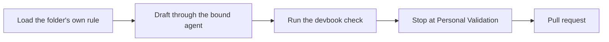

# Plan

```meta
rating: adopted
type: stage
```

> How work is agreed, written down, and sized before anyone changes code.

## Devbook chapters through flow-spec

```meta
rating: adopted
type: workflow
stage: [specify]
layer: [thread]
substage: [specify/specify]
feeds: [".devbook/ai/01-plan.md#import-plans: agreed spec", ".devbook/ai/02-code.md#code-gate-through-flow-code: apply-change"]
evidence: recorded
depends-on: [".devbook/tech/ai-development.md#delivery-engine", ".devbook/tech/ai-development.md#devbook-plugin"]
related: [".devbook/ai/concepts.md#task-scoped-context", ".devbook/ai/03-test.md#personal-validation-gate"]
date: 2026-09-26
```

A change to any of these runs through the delivery engine's `flow-spec`:

- an arc42 chapter
- a decision record
- a bounded context
- the technology graph
- a design guideline
- this record



The bound agent is the one the flow's `phase-drafting` entry binds for the folder.

- **Used for** — decision records, domain model changes, technology ratings, and the
  adoption record itself.
- **Adopted by** — every session that edits a devbook folder, routed there by the delivery
  engine's session context.
- **Evidence** — the devbook-adoption plan's documentation items, this chapter included,
  each ran as a `flow-spec` run with its stages on the delivery surfaces.
- **Limits** — never used to implement a chapter: that is `flow-code`, fed by
  `apply-change`.

## Import plans

```meta
rating: adopted
type: skill
stage: [specify]
substage: [specify/break-down]
feeds: [".devbook/ai/02-code.md#plan-items-pasted-into-a-session: prompt entries"]
evidence: recorded
depends-on: [".devbook/tech/ai-development.md#backlog-tools-plugin"]
related: [".devbook/arc42/adr/0013-imported-plan-is-a-roadmap-item-laid-out-by-import.md", ".devbook/arc42/adr/0053-a-plan-or-a-task-may-reference-a-brain-note.md"]
date: 2026-09-25
```

`import-plan` turns an agreed specification into a Backlog import plan: one `plan` entry,
which Import turns into a Roadmap Item, and the step entries under it. An agent session runs
a `prompt` step; only a person does a `task` or `test` step. Each step's `after:` field
orders it behind the steps it waits for. The specification may be a project note in the
person's Brain, `#brain:projects/<note>.md`: the skill reads it through the knowledge read
tool under `#brain`, and the `plan` entry and its steps name it by that address (local
ADR 0053).

- **Used for** — breaking a multi-session feature into roadmap items and the prompts that
  deliver them, with a review page beside the raw plan.
- **Adopted by** — the repository owner, for every multi-session feature.
- **Evidence** — the roadmap import decision (local ADR 0013) and the plans run through it,
  `devbook-adoption` among them.
- **Limits** — user-invoked only (`disable-model-invocation`); an agent never writes a plan
  on its own initiative, and the skill never writes to the app or talks to GitHub; its one
  call to the app reads a Brain note source.

## Estimate against landed work

```meta
rating: trial
type: skill
stage: [specify]
substage: [specify/break-down]
feeds: [".devbook/ai/01-plan.md#import-plans: effort:"]
evidence: none
depends-on: [".devbook/tech/ai-development.md#agent-skills"]
date: 2026-09-26
```

A unit of work gets story points on the 1/2/3/5/8/13/21 scale through the repository's own
`estimate` procedure. The procedure sizes it against a table of Backlog's own finished work
and names the reference each estimate was compared with.

- **Used for** — the `effort:` on plan entries and issues.
- **Adopted by** — the procedure was adopted on 2026-09-26; plan entries written before it
  carry efforts sized without the reference table.
- **Evidence** — none yet: no estimate has been checked against how long the work took.
- **Moves up when** — an estimate is checked against the time the work took.
- **Limits** — points size work, never time; turning them into a date is a measured pace's
  job, not the estimate's.

## Answer remarks

```meta
rating: trial
type: skill
stage: [specify]
substage: [specify/specify]
feeds: [".devbook/ai/01-plan.md#devbook-chapters-through-flow-spec: answers in the chapter"]
evidence: partial
depends-on: [".devbook/tech/ai-development.md#backlog-tools-plugin", ".devbook/tech/ai-development.md#model-context-protocol-servers"]
related: [".devbook/arc42/adr/0012-backlog-is-an-mcp-server-inside-the-desktop-app.md"]
date: 2026-09-26
```

A [remark](../domain/devbook/domain.md#remark) is the note a person leaves on a devbook
chapter while reading it in the app. `handle-remarks` reads the open remarks over the Backlog
MCP server, answers each in the chapter as an `annotation` fence, and only then resolves the
remark in the app.

- **Used for** — turning a reader's questions into written answers next to the passage they
  were asked about.
- **Adopted by** — the repository owner, on demand; `run-plan-item` runs the short
  form of it after an item rewrites a chapter.
- **Evidence** — the answer loop shipped in PRs #580 and #581; no sweep of a full inbox is
  on record yet.
- **Moves up when** — a full remark inbox is swept and the sweep is on record.
- **Limits** — the app never writes the fence, and a remark is resolved only after its answer
  is written.
