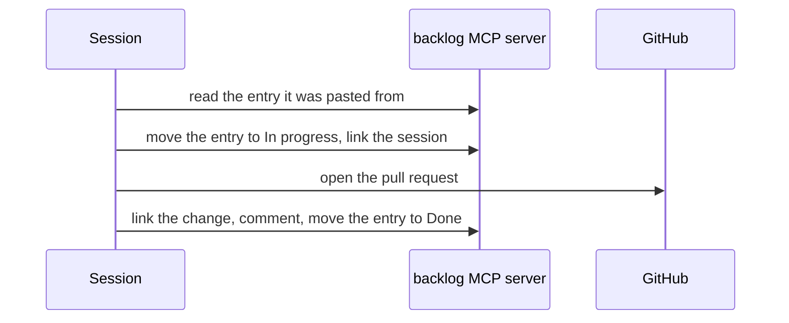

# Code

```meta
status: adopted
type: stage
```

> How a change is made once it is agreed: which session makes it, which agent writes it,
> and what fires around it without anyone asking.

## Code gate through flow-code

```meta
status: adopted
type: guardrail
stage: [code, verify]
substage: [code/start, code/implement, verify/build-test, verify/review]
feeds: [".devbook/ai/03-test.md#qa-agent-on-the-running-application: verify", ".devbook/ai/03-test.md#devbook-checks-around-a-flow: spec check"]
evidence: recorded
depends-on: [".devbook/tech/ai-development.md#delivery-engine", ".devbook/tech/ai-development.md#repository-instruction-files"]
related: [".devbook/ai/concepts.md#gate-before-the-first-write", ".devbook/ai/03-test.md#personal-validation-gate"]
date: 2026-09-26
```

Before the first write under `src/` or `tests/`, a session routes the work through the
delivery engine's `flow-code`. This is the
[gate before the first write](concepts.md#gate-before-the-first-write), applied to code. The
flow derives the kind of change in its first stage: a feature, a fix, a refactor, or config.
It then implements the change, runs build, tests and validation, and stops at Personal
Validation.

- **Used for** — every feature, fix, refactor, tooling change, and dependency move.
- **Adopted by** — every agent session in this repository.
- **Evidence** — the merged pull requests each carry a flow run on the delivery surfaces.
- **Limits** — work confined to the devbook folders goes through `flow-spec`.

## Plan items pasted into a session

```meta
status: adopted
type: skill
stage: [code]
substage: [code/start]
feeds: [".devbook/ai/02-code.md#code-gate-through-flow-code: through the gate"]
evidence: recorded
depends-on: [".devbook/tech/ai-development.md#backlog-tools-plugin", ".devbook/tech/ai-development.md#model-context-protocol-servers"]
related: [".devbook/ai/02-code.md#backlog-as-the-delivery-tracker"]
date: 2026-09-25
```

A session starts from a Backlog entry the person copies out of the app and pastes in.
`run-plan-item` first establishes whether the item is still outstanding. It reads the entry's
status over MCP, and falls back to git when it cannot. It then checks that the item's
`after:` items have landed and runs the instructions through the gate like any other
request. A `UserPromptSubmit` hook in the
same plugin notices the entry marker and nudges the session to invoke the skill.

- **Used for** — every `prompt` step of an imported plan.
- **Adopted by** — the repository owner, for every multi-session feature.
- **Evidence** — the `devbook-adoption` plan's items, each linked from its entry to the
  session and pull request that ran it.
- **Limits** — it refuses a `plan`, `task`, or `test` entry, and never redoes an item the
  evidence says has landed; pasting twice is expected.

## Roles bound to specialist agents

```meta
status: adopted
type: agent
layer: [harness]
evidence: recorded
depends-on: [".devbook/tech/ai-development.md#subagents", ".devbook/tech/ai-development.md#delivery-engine"]
related: [".devbook/ai/02-code.md#code-gate-through-flow-code"]
date: 2026-09-25
```

Each flow has a `phases` map in `.devbook/config.json`. A phase entry that names an agent
hands that phase to it, and a phase with no entry runs inline in the session.

| Flow | Phase | Agent |
| --- | --- | --- |
| `flow-code`, `flow-spec` | `phase-scope` | `architecture:architect` |
| `flow-code` | `phase-plan` | `architecture:architect` |
| `flow-code` | `phase-implement` | `csharp-coding:coding` |
| `flow-code` | `phase-verify` | `qa:qa` |
| `flow-spec` | `phase-drafting` for `arc42` and `tech` | `architecture:architect` |
| `flow-spec` | `phase-drafting` for `domain` | `domain-design:domain-architect` |
| `flow-spec` | `phase-drafting` for `design` | `ux-design:ux-designer` |
| `flow-spec` | `phase-drafting` for `ai` | `documentation:documentation` |

- **Used for** — scoping and planning, drafting in the folder's own discipline,
  implementation, and validation.
- **Adopted by** — every flow run.
- **Evidence** — the agents named on each run's stages on the delivery surfaces.
- **Limits** — review, build and test, and the pull-request phases bind no agent, so they run
  inline in the session.

## Worktree session per change

```meta
status: adopted
type: practice
layer: [harness]
evidence: recorded
depends-on: [".devbook/tech/tooling.md#git", ".devbook/tech/ai-development.md#claude-code"]
related: [".devbook/ai/concepts.md#isolation-per-session", ".devbook/ai/02-code.md#plan-items-pasted-into-a-session"]
date: 2026-09-25
```

Each change runs in its own git worktree and agent session under `.claude/worktrees/`, so
several sessions build, test, and run the app in parallel. Aspire starts `--isolated`, so
ports and user secrets stay per session.

- **Used for** — every change.
- **Adopted by** — the repository owner, routinely with several sessions at once.
- **Evidence** — the parallel worktrees under `.claude/worktrees/` and one branch per
  merged pull request.
- **Limits** — the machine state that [isolation per session](concepts.md#isolation-per-session)
  names as shared stays shared. A WIP commit is preferred over a bare `git stash`, and a
  change to another repository gets its own session.

## Rules wrapped per host

```meta
status: adopted
type: practice
layer: [harness]
evidence: recorded
depends-on: [".devbook/tech/ai-development.md#repository-instruction-files"]
related: [".devbook/ai/concepts.md#one-rule-one-place", ".devbook/ai/02-code.md#code-gate-through-flow-code"]
date: 2026-09-25
```

A rule is written once under `.agents/rules/` and reached through a one-sentence wrapper
in `.claude/rules/` whose `paths` say which files it governs, and `AGENTS.md` is the
standing brief `CLAUDE.md` imports. The devbook plugin also installs a wrapper per rule in
`.github/instructions/`, because it writes one for every host it supports.

- **Used for** — shared component adoption, storybook authoring, naming, context loading,
  MCP usage, and the devbook folder rules.
- **Adopted by** — every session, on every matching file read.
- **Evidence** — the wrappers under `.claude/rules/`.
- **Limits** — a rule fires on a read, so a file authored from scratch may not trigger it.

## Backlog as the delivery tracker

```meta
status: adopted
type: mcp-server
stage: [decide]
feeds: [".devbook/ai/01-plan.md#devbook-chapters-through-flow-spec: what you pick"]
evidence: recorded
depends-on: [".devbook/tech/ai-development.md#model-context-protocol-servers"]
related: [".devbook/arc42/adr/0012-backlog-is-an-mcp-server-inside-the-desktop-app.md"]
date: 2026-09-25
```

The product manages its own construction. The running desktop app serves the `backlog` MCP
server, and `.devbook/config.json` binds it as the delivery tracker. Both flows also list it
under `mcp` on `phase-scope` and `phase-create-pr`.



- **Used for** — the status of every plan item and the trail from entry to session to pull
  request.
- **Adopted by** — every run started from a Backlog entry.
- **Evidence** — the entries of the `devbook-adoption` plan, each with its session and pull
  request linked.
- **Limits** — with the app closed nothing answers; the run continues with the tracker
  reported unbound and the status is set by hand.

## Run tracking on delivery surfaces

```meta
status: adopted
type: mcp-server
layer: [harness]
evidence: recorded
depends-on: [".devbook/tech/ai-development.md#delivery-surfaces"]
date: 2026-09-25
```

Every flow run opens on each bound delivery surface: the Backlog app's Sessions pane and a
local run dashboard. As it goes, the run records its stages and their output there, with the
QA scenarios and their evidence and the Personal Validation decision.

- **Used for** — watching a run, and reattaching a resumed session to the run it left.
- **Adopted by** — every flow run.
- **Evidence** — the runs in the Sessions pane, one per flow.
- **Limits** — a surface is never the source of truth; the files and the pull request are.

## Session telemetry to the app

```meta
status: adopted
type: hook
layer: [harness]
evidence: recorded
depends-on: [".devbook/tech/ai-development.md#claude-code-hooks", ".devbook/tech/ai-development.md#backlog-tools-plugin"]
related: [".devbook/ai/02-code.md#run-tracking-on-delivery-surfaces"]
date: 2026-09-26
```

`telemetry-forwarder.mjs` posts each tool call, delegated agent, compaction, and session end
to the desktop app's `/telemetry` endpoint. The app attributes them to the delivery run the
session is driving, and shows the tool calls, agents, token use, and context gauge under the
run's row.

- **Used for** — seeing where a run's time and tokens went.
- **Adopted by** — every Claude Code session with `backlog-tools` installed.
- **Evidence** — the per-run tool-call and MCP-server ranking the Sessions pane shows
  (PR #653).
- **Limits** — Claude Code only; the output of a tool is dropped before posting, and a
  closed app costs a session one refused connection.

## Out-of-scope findings become issues

```meta
status: retired
type: hook
stage: [decide]
evidence: recorded
depends-on: [".devbook/tech/ai-development.md#claude-code-hooks"]
related: [".devbook/ai/05-unattended-runs.md#scheduled-issue-sweep"]
date: 2026-10-03
```

A `PostToolUse` hook once filed every suggested task a session flagged as a GitHub issue in
this repository, skipping a title already open.

- **Used for** — nothing since 2026-10-03.
- **Adopted by** — nobody.
- **Evidence** — 95 issues carry its footer, "Filed automatically from a Claude Code
  suggested task".
- **Limits** — retired for two reasons. A suggested task is its own handoff and needs no
  issue. And the hook filed tasks meant for other repositories here, as task prompts
  addressed to an agent, which the issue sweep then had to flag and a person had to close.

## Guidance from MCP servers

```meta
status: retired
type: mcp-server
layer: [harness]
evidence: recorded
depends-on: [".devbook/tech/ai-development.md#model-context-protocol-servers"]
related: [".devbook/ai/02-code.md#rules-wrapped-per-host"]
date: 2026-08-27
```

Agents once read the organization's architecture and design guidance from the
`jsdotnet-project-guidelines` and `jsdotnet-project-design` MCP servers.

- **Used for** — nothing since 2026-08-27.
- **Adopted by** — nobody.
- **Evidence** — the imported guidance under `.devbook/arc42/adr/guidelines/` and
  `.devbook/design/`, each guideline ending with where Backlog deviates.
- **Limits** — retired because guidance a server serves cannot be diffed, reviewed, or
  corrected where this repository departs from it; checked-in guidance can.
