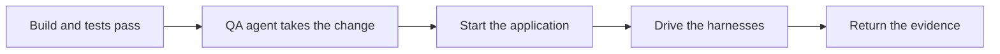

# Test

```meta
rating: adopted
type: stage
```

> How a change is proven before a person approves it.

## QA agent on the running application

```meta
rating: adopted
type: agent
stage: [verify]
substage: [verify/functional-qa]
feeds: [".devbook/ai/03-test.md#personal-validation-gate: evidence"]
evidence: recorded
depends-on: [".devbook/tech/ai-development.md#subagents", ".devbook/tech/ai-development.md#model-context-protocol-servers", ".devbook/tech/testing.md#playwright"]
related: [".devbook/ai/concepts.md#evidence-over-assertion"]
date: 2026-09-25
```

`flow-code`'s `phase-verify` hands the change to the `qa:qa` agent.



The agent starts the application on Aspire through the `run` procedure, and drives the Blazor
harnesses with Playwright. It keeps a monitor on Aspire's logs and traces for the whole run.
It returns an evidence path for every scenario it reports.

- **Used for** — full Playwright QA for new functionality, targeted checks for fixes and
  changes to an existing flow, startup-only for dependency moves.
- **Adopted by** — every code-modifying flow run.
- **Evidence** — screenshots and logs under `.qa-workspace/`, attached to the run's
  Validation stage.
- **Limits** — the MAUI heads cannot be driven, so validation targets the harnesses; the
  Playwright profile is shared per machine, so parallel sessions stagger QA.

## Repository procedures

```meta
rating: trial
type: skill
stage: [verify]
substage: [verify/functional-qa]
evidence: partial
depends-on: [".devbook/tech/ai-development.md#agent-skills", ".devbook/tech/ai-development.md#devbook-plugin"]
related: [".devbook/ai/03-test.md#qa-agent-on-the-running-application"]
date: 2026-09-25
```

This repository keeps four procedures as its own skills:

- `run` runs the application.
- `capture` takes evidence.
- `diagnose` looks into an observed issue.
- `estimate` sizes work.

A wrapper per host reaches each one and fixes its goal. `run` is a Claude Code recipe at
`.claude/skills/run-backlog/SKILL.md` with a Copilot twin at `.github/skills/run/SKILL.md`.
The other bodies live under `.agents/skills/`. The devbook stamp lists the four under
`components.devbook.procedures.adopted`. `flow-code`'s `phase-verify` starts the application
through `run` instead of guessing a command.

The procedure is called `diagnose` because a `debug` project skill would shadow Claude Code's
own `/debug`. There is no `show` procedure: a flow walks a change through `run` and
`capture`, and a person on Claude Code who wants to see it working uses the built-in `/run`.

- **Used for** — starting the AppHost the way `run` says, taking evidence of a change, and
  finding a cause from logs and traces without handing the person a debugger.
- **Adopted by** — the flows, since the procedures were seeded on 2026-09-25.
- **Evidence** — none yet beyond the flows that started the application this way.
- **Moves up when** — `capture` and `diagnose` show up in a run's evidence, not only `run`.
- **Limits** — the body is the repository's to edit; the goal in the wrapper is not. Devbook
  also ships a `prototype` procedure, which this repository deliberately has not adopted.

## Devbook checks around a flow

```meta
rating: trial
type: practice
stage: [verify]
layer: [thread]
substage: [verify/spec-conformance]
feeds: [".devbook/ai/03-test.md#personal-validation-gate: drift found"]
evidence: none
depends-on: [".devbook/tech/ai-development.md#devbook-plugin", ".devbook/tech/ai-development.md#delivery-engine"]
related: [".devbook/ai/05-unattended-runs.md#scheduled-devbook-upkeep"]
date: 2026-09-25
```

The flows' `phases` maps in `.devbook/config.json` hang the devbook skills on three phases.

| Skill | Runs | Does |
| --- | --- | --- |
| `devbook:validate` | Before `phase-update-base` | Runs as a chore. |
| `devbook:verify-change` | As `flow-code`'s `phase-spec-check` | Asks whether the chapter still says what the code does. |
| `devbook:update` | After `phase-summary` | Runs as a chore. |

- **Used for** — catching a chapter the change left behind before the person reviews it.
- **Adopted by** — every flow run since 2026-09-25.
- **Evidence** — none yet recorded against a pull request.
- **Moves up when** — a drift catch is recorded against a pull request.
- **Limits** — `verify-change` reports drift and writes nothing; the chapter is updated
  through `flow-spec`.

## Personal Validation gate

```meta
rating: adopted
type: guardrail
stage: [verify, integrate]
substage: [verify/acceptance]
evidence: recorded
depends-on: [".devbook/tech/ai-development.md#delivery-engine"]
related: [".devbook/ai/concepts.md#human-in-the-loop"]
date: 2026-09-25
```

The repository owner looks at the change and approves it in the session before any pull
request opens or any flow is marked complete. For code, the owner gets the running
application and the review links. For documentation, the owner gets a summary of the changed
chapters.

- **Used for** — every flow, documentation and code alike.
- **Adopted by** — every flow run; configuration may add gates, but the engine refuses to
  let it remove this one.
- **Evidence** — the approval and the owner's own words recorded on each run.
- **Limits** — an unattended run parks at this gate rather than approving itself.
