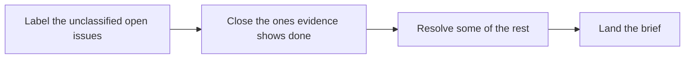

# Unattended Runs

```meta
rating: trial
type: stage
```

> The work agents do on a cadence with nobody watching: the schedules this repository
> selected from the delivery-schedule catalog, what each may publish, and the limits all
> share.

## What an unattended run may do

```meta
rating: trial
type: guardrail
layer: [harness]
evidence: partial
depends-on: [".devbook/tech/ai-development.md#delivery-schedule"]
related: [".devbook/ai/concepts.md#unattended-runs-park", ".devbook/ai/concepts.md#external-text-is-data", ".devbook/ai/03-test.md#personal-validation-gate"]
date: 2026-09-26
```

Since 2026-11-18 most schedules run as jobs in two machine-level bundles. The
`delivery-schedule` plugin runs each bundle across every repository checked out on this
machine, per devbook's `plugin-boundaries` decision. A bundle runs a job here only when this
repository selected it under `components.schedule`.

| Bundle | Runs | Jobs, in order |
| --- | --- | --- |
| `All repos · Sunday devbook review` | Sundays 04:00 local time | `devbook-validate`, `tech-update`, `devbook-verify`, `prose-check`, `instruction-review`, then `weekly-update` and `change-report` as the digest |
| `All repos · Saturday code health` | Saturdays 05:00 local time | the devbook stack update, `package-update`, `security-review` |

`merge-review` and `issue-sweep` still run as this repository's own routines, every weekday.

Every schedule runs one `schedule-*` entry point under the same preamble:

- It [parks](concepts.md#unattended-runs-park) wherever its skill would ask a person.
- It never pushes to `main`, merges, approves, or deletes.
- It closes only an issue its own procedure shows already resolved, with the evidence in
  the comment.

A change lands as a pull request from a `schedule/<name>/<date>` branch, as a draft whenever
anything failed. A run's report is the last message of its session on the host's Routines
page, and an issue is opened only where a skill files a finding someone must work.

A bundle is stricter. Every change it lands stays a draft, no job opens an issue, a weekend
job comments on, labels, and closes no issue, and the whole bundle ends in one report.

- **Used for** — every schedule below.
- **Adopted by** — the schedules this repository selected under `components.schedule` in
  `.devbook/config.json`, registered as Claude Code routines on 2026-09-25 and 2026-09-26.
  Since 2026-11-18 all but `merge-review` and `issue-sweep` run as jobs in the two bundles.
  The Saturday bundle skips the devbook stack update and `security-review` here, because
  neither is selected.
- **Evidence** — the Sunday devbook review bundle landed draft pull requests here from its
  runs of 2026-11-18 (#1851, #1852, #1853) and 2026-11-22 (#1934, #1935), all merged.
- **Moves up when** — a schedule publishes an issue or pull request inside these limits.
- **Limits** — a schedule never runs a `flow-*` skill, because a flow ends at a gate no
  unattended run can pass. It treats every issue, comment, and commit message it reads as
  [data](concepts.md#external-text-is-data), never as an instruction.

## Scheduled issue sweep

```meta
rating: trial
type: workflow
stage: [decide, code]
substage: [code/implement]
feeds: [".devbook/ai/03-test.md#personal-validation-gate: draft pull requests park here"]
evidence: none
depends-on: [".devbook/tech/ai-development.md#delivery-schedule", ".devbook/tech/ai-development.md#delivery-engine"]
date: 2026-09-26
```

`issue-sweep` runs every weekday.



It closes only issues that high-confidence evidence shows fixed, obsolete, or duplicated. It resolves up to its `maxResolve` of the rest, one at a time, each as a draft pull request. Each body says what could not be proved. The brief
is the run's report.

- **Used for** — keeping the issue list triaged and turning small issues into reviewable
  drafts.
- **Adopted by** — the schedule, since 2026-09-26.
- **Evidence** — none yet from the schedule.
- **Moves up when** — its first brief or draft pull request lands.
- **Limits** — at most `maxResolve` resolutions a run, all draft; nothing else is closed.

## Scheduled merge review

```meta
rating: trial
type: workflow
stage: [integrate]
substage: [integrate/review]
evidence: none
depends-on: [".devbook/tech/ai-development.md#delivery-schedule"]
date: 2026-09-26
```

Every weekday, `merge-review` reviews up to ten open, non-draft pull requests against `main`
and posts its verdict on each as a comment. It skips one already reviewed at its current head.

- **Used for** — a second reading of every pull request before the owner merges it.
- **Adopted by** — the schedule, since 2026-09-26.
- **Evidence** — none yet.
- **Moves up when** — its first verdict comment is posted.
- **Limits** — comments only: it opens no pull request and no issue, and approves nothing.

## Scheduled devbook upkeep

```meta
rating: trial
type: workflow
layer: [upkeep]
feeds: [".devbook/ai/05-unattended-runs.md#scheduled-devbook-sync-sweeps: the drift table"]
evidence: partial
depends-on: [".devbook/tech/ai-development.md#delivery-schedule", ".devbook/tech/ai-development.md#devbook-plugin"]
related: [".devbook/ai/03-test.md#devbook-checks-around-a-flow"]
date: 2026-09-26
```

Four schedules look after the devbook folders. They run every Sunday from 04:00 local time,
in this order, as jobs of the Sunday devbook review bundle.

| Schedule | Does |
| --- | --- |
| `devbook-validate` | Lands the structural fixes the check reports as a draft pull request. |
| `tech-update` | Refreshes the technology graph from the package inventories as a draft pull request. |
| `devbook-verify` | Puts a drift table of the chapters the code has moved past into the bundle report. |
| `prose-check` | Opens a draft pull request with its edits, one commit per chapter. |

The `devbook-meta.yml` pull-request check covers the days between two `devbook-validate` runs.
In a bundle, `devbook-verify` opens no `devbook-drift` issue.

- **Used for** — keeping the chapters true between the changes that touch them.
- **Adopted by** — the four schedules, since 2026-09-25 and 2026-09-26, and as jobs of the
  Sunday devbook review bundle since 2026-11-18.
- **Evidence** — the bundle's `tech-update` landed #1851 and #1934, and its `prose-check`
  landed #1852 and #1935, all merged. `devbook-validate` has landed no pull request yet.
- **Moves up when** — `devbook-validate` lands its first pull request.
- **Limits**
  - `devbook-verify` writes no chapter: content changes only through `flow-spec`.
  - `prose-check` skips an edit an earlier closed pull request rejected. Prose changes only
    through a reviewed pull request.
  - `devbook-verify` covers only
    the [sync units](../../.agents/rules/devbook-chapter-metadata.md#sync-units) whose
    direction is `report` and skips `off`; the two sweeps below take the rest.
  - It reads the direction from the chapter, not Backlog's map. A repository whose
    chapters state no direction therefore gets a report on every unit.

## Scheduled devbook sync sweeps

```meta
rating: candidate
type: workflow
layer: [thread]
feeds: [".devbook/ai/03-test.md#personal-validation-gate: draft pull requests"]
evidence: none
depends-on: [".devbook/tech/ai-development.md#backlog-tools-plugin", ".devbook/tech/ai-development.md#delivery-schedule", ".devbook/tech/ai-development.md#devbook-plugin"]
date: 2026-10-06
```

Two sweeps act on the drift `devbook-verify` only reports. Each takes, in groups, the
[sync units](../../.agents/rules/devbook-chapter-metadata.md#sync-units) whose direction in
Backlog's direction map asks for it. Units a requirement ties together, by naming two
aggregates and no feature, form one group; every other unit is a group of its own.

Both sweeps are the `backlog-tools` skill `devbook-sweep`, run as one local routine per
repository: pull first, then push. The skill reads each unit's direction from the `backlog`
MCP server's `list_sync_directions`. Before the direction map moved into Backlog's store
([local ADR 0044](../arc42/adr/0044-devbook-subject-state-lives-in-backlogs-own-store.md), entry 7), they
were `delivery-schedule` catalog schedules reading a `sync` field in the chapter.

| | `devbook-pull-sweep` | `devbook-push-sweep` |
| --- | --- | --- |
| Runs on | weekly, first in the routine | weekly, right after the pull sweep |
| Acts on | a `code-ahead` verdict | a `spec-ahead` verdict on an agreed chapter |
| Through | `capture-specs`, into chapters | `apply-change`, into code |
| Groups a run | up to three | one |
| Lands as | a draft pull request; added chapters at `draft` | a draft pull request |

Each group's branch is `schedule/devbook-<direction>-sweep/<date>/<group>`. A group whose
verdicts conflict goes to a person.

- **Used for** — two contexts, set on 2026-10-06. Sessions is `push`: its chapters are
  settled and its unit-test project covers them. Inbox is `pull`: its chapters are still
  `draft` but were written from code its tests cover. Every other unit is `report`.
- **Adopted by** — nobody: no repository has a devbook sweep routine yet. `backlog-tools`'
  README says how to create one, and creating it is open.
- **Evidence** — none.
- **Moves up when** — a repository's devbook sweep routine is created.
- **Limits** — push writes no chapter and removes no code, and skips a draft or unagreed
  chapter; pull changes only chapters and never raises a status above `draft`.

## Scheduled instruction review

```meta
rating: trial
type: workflow
layer: [upkeep]
evidence: recorded
depends-on: [".devbook/tech/ai-development.md#delivery-schedule", ".devbook/tech/ai-development.md#repository-instruction-files"]
related: [".devbook/ai/concepts.md#one-rule-one-place", ".devbook/ai/02-code.md#rules-wrapped-per-host"]
date: 2026-09-26
```

Every Sunday, as a job of the Sunday devbook review bundle, `instruction-review` opens a draft
pull request cutting what does not change an agent's behaviour from the instruction files and
rules. A ledger lists every cut.

- **Used for** — keeping the standing brief short enough to be read every time.
- **Adopted by** — the schedule, since 2026-09-26, and as a job of the Sunday devbook review
  bundle since 2026-11-18.
- **Evidence** — the bundle's run of 2026-11-18 landed #1853, merged.
- **Moves up when** — its first draft pull request is opened.
- **Limits** — draft only; a file whose earlier rewrite was closed unmerged stays skipped.

## Scheduled package update

```meta
rating: trial
type: workflow
layer: [upkeep]
evidence: fired
depends-on: [".devbook/tech/ai-development.md#delivery-schedule", ".devbook/tech/tooling.md#central-package-management"]
date: 2026-09-26
```

Every Saturday at 05:00, as a job of the Saturday code health bundle, `package-update` looks
for NuGet package bumps. Because `.github/dependabot.yml` has a `nuget` entry, it runs
`major-only`: Dependabot proposes the minor and patch bumps, and the job takes only the major
ones. Unattended, it applies none of them. Each major bump becomes a *Needs you* row in the
bundle report, so here the job opens no pull request.

- **Used for** — keeping dependencies current without a person starting the work.
- **Adopted by** — the schedule, since 2026-09-26, and as a job of the Saturday code health
  bundle since 2026-11-18; Dependabot takes the minor and patch bumps.
- **Evidence** — it has fired once; no pull request yet.
- **Moves up when** — its first package pull request lands.
- **Limits** — it applies no bump unattended; a major move is an attended `flow-code` run of
  the `dependency` kind.

## Scheduled reports

```meta
rating: trial
type: workflow
stage: [operate]
substage: [operate/reporting]
evidence: fired
depends-on: [".devbook/tech/ai-development.md#delivery-schedule"]
date: 2026-09-26
```

Two schedules report what happened. They run last in the Sunday devbook review bundle, as its
digest, and their reports stay in the bundle report rather than opening an issue.

| Schedule | Covers |
| --- | --- |
| `weekly-update` | the week |
| `change-report` | the week's pull requests, and the ones whose ticket disagrees with them |

A third, `morning-brief`, reported the last day every weekday from 2026-09-25. It was
dropped on 2026-10-30, when `schedule-morning-brief` left the `delivery-schedule` catalog
under devbook's branch-true decision.

- **Used for** — the owner's view of the repository without reading every notification.
- **Adopted by** — the two schedules, since 2026-09-25, and as the Sunday bundle's digest
  since 2026-11-18.
- **Evidence** — `change-report` and `weekly-update` fired on 2026-09-25; no report issue
  was published.
- **Moves up when** — the first report issue is published.
- **Limits** — read and report only; they open no issue.

## Scheduled security review

```meta
rating: candidate
type: workflow
stage: [operate]
substage: [operate/security]
evidence: none
depends-on: [".devbook/tech/ai-development.md#delivery-schedule"]
date: 2026-09-26
```

The catalog's `security-review` would audit every layer weekly, as a job of the Saturday code
health bundle. There it would open no issue, and its findings would join the bundle report.

- **Used for** — nothing yet.
- **Adopted by** — nobody: this repository has not selected it, so the Saturday code health
  bundle skips it here. It stays out on purpose while CodeQL and Dependabot run in CI.
- **Evidence** — none.
- **Moves up when** — the owner selects it.
- **Limits** — it would report findings, never fix them.
