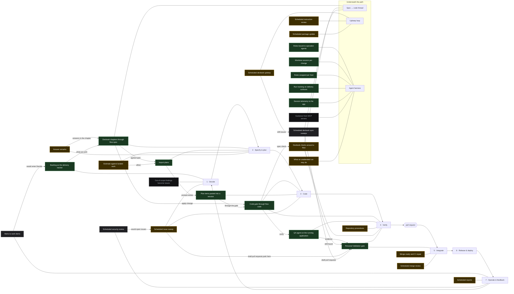

# AI Adoption Map

```meta
status: adopted
type: adoption-map
related: [".devbook/tech/ai-development.md"]
```

> How this repository is developed with AI, read along the seven-stage delivery path and
> the three layers beneath it. The tools themselves are registered in
> `.devbook/tech/ai-development.md`; this folder records how they are used, at which stage
> or layer, and how far that use has actually got.

## Usage files

| File | Covers |
| --- | --- |
| `01-plan.md` | Agreeing and sizing work: devbook chapters through `flow-spec`, import plans, estimates, answered remarks. |
| `02-code.md` | Making a change: the code gate, plan items pasted into a session, the roles and their agents, worktree sessions, per-host rules, the Backlog tracker, run surfaces, the session telemetry hook, and the retired findings-to-issues hook and guidance servers. |
| `03-test.md` | Proving a change: the QA agent, the repository procedures, the devbook checks around a flow, and Personal Validation. |
| `04-release-operate.md` | Getting a change to `main` and a production failure back into the loop. |
| `05-unattended-runs.md` | The schedules selected from the catalog, and what an unattended run may and may not do. |
| `concepts.md` | The ideas the practices above rest on. |

## The loop

The seven stages run left to right, with the pull request between `verify` and `integrate`
and `operate` feeding `decide`. The three layers run underneath every stage. Each usage
joins every stage or layer it lists, shaded by its rating, and a labelled arrow is a
hand-off its `feeds` records.



## What the loop shows

- **Adopted ends at the pull request.** Every stage before it has an adopted usage: the
  tracker at `decide`, chapters and import plans at `specify`, pasted plan items and the
  code gate at `code`, the QA agent and Personal Validation at `verify`. Five more adopted
  usages are the `harness` they all stand on. All twelve have recorded evidence. No usage
  whose home is `integrate`, `release` or `operate`, nor any in the `upkeep` loop, is
  adopted.
- **Trial is wired, not proven.** None of the twelve `trial` usages has recorded evidence:
  two are `partial`, three have `fired` without publishing anything, and seven have none.
  Seven of them wait on one event. The six trial schedules and the unattended-run limits
  they run under all move up when a schedule publishes its first issue or pull request, and
  come down if none does.
- **`verify` splits five ways, `integrate` shows its gaps.** Build and tests, review,
  functional QA, spec conformance and acceptance each run on a different tool. At
  `integrate`, review and readiness have a usage each; CI checks and the merge itself have
  none, and the merge stays the owner's by intent.
- **`release` is empty.** Deployment runs as `azd` and the release workflows and has no AI
  usage of its own. The emptiness is the finding, not a gap to fill.
- **Production does not reach `decide` yet.** Alerts to work items is the one hand-off that
  would close the loop from `operate`, and it is a `candidate` whose workflow fails its
  preflight. The security review would open issues for the issue sweep, and is kept out on
  purpose.
- **The layers carry the rest.** The spec ↔ code thread is written at `specify` and checked
  at `verify`; the sync sweeps that would level it between runs are a `candidate`. The
  upkeep loop's three schedules land their work as pull requests at `integrate`. The
  harness holds the roles, worktrees, rules, run tracking and telemetry every session
  stands on, the limits every schedule runs under, and the retired guidance servers.

## What the adoption left out

The `devbook-adoption` plan took the stack almost whole. Local ADR 0016's status table
records what landed. Three parts were left out on purpose, and none of them has a chapter,
because nobody works that way here:

| Left out | Why |
| --- | --- |
| `devbook-collaboration` | Dropped at the owner's decision on 2026-09-28, although `decide-adoption-scope` had asked for it. It is not installed or stamped. |
| The `security-review` schedule | The owner kept it unselected: CodeQL and Dependabot run in CI instead. `05-unattended-runs.md` keeps it as a `candidate`. |
| The `devbook-update` schedule | Added to the catalog in 1.10.0 and not taken. Stack updates run by hand through `devbook-config:update`. |

## Reading and extending the folder

Every chapter carries `status` and `date`, and says where it works with `stage`, `layer`,
or both; the file it sits in places nothing. `substage` names the part of a stage it works
in, `feeds` the chapters it hands work to, and `evidence` how much its rating rests on.
`status` rates the **usage** on the ladder `.devbook/tech` uses: `candidate`, `trial`,
`adopted`, `hold`, `retired`. It moves only when the **Adopted by** line says the way of
working changed, and below `adopted` the **Moves up when** bullet names the event that
would move it. A new chapter goes in the file for the part of the flow it belongs to. Its
tool is registered in `.devbook/tech` first and named in `depends-on`, and the table and
diagram above change in the same edit.
