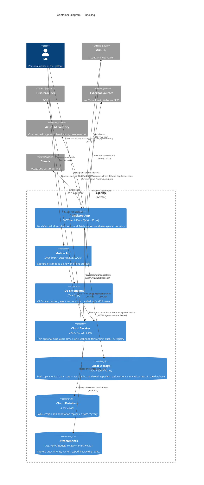
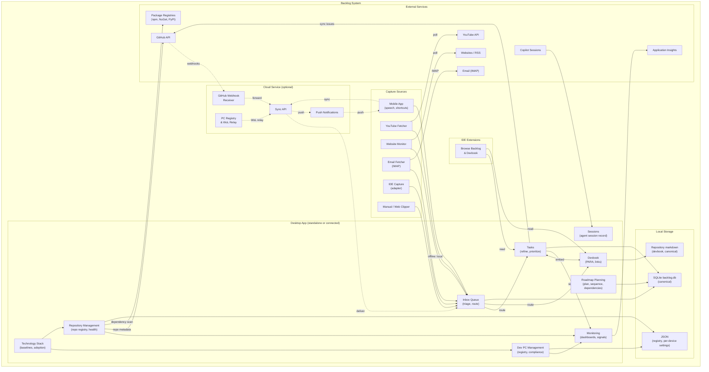
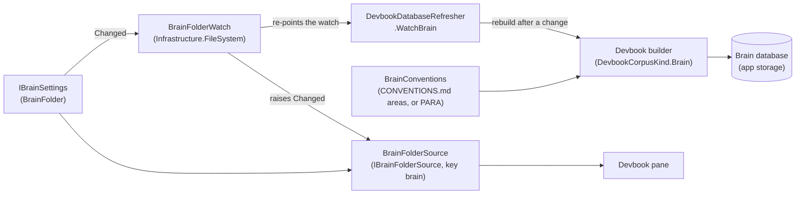
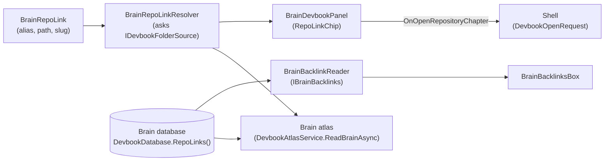
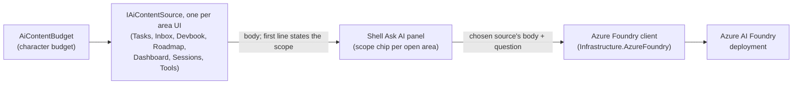
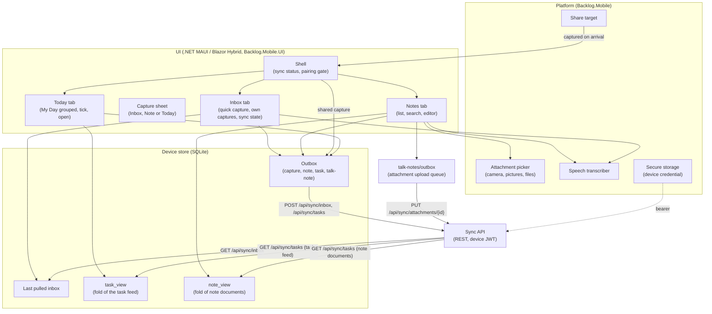
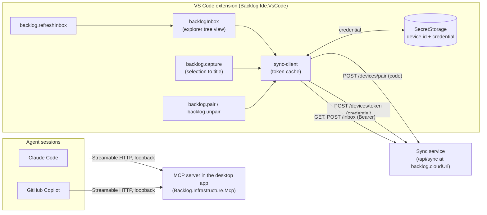
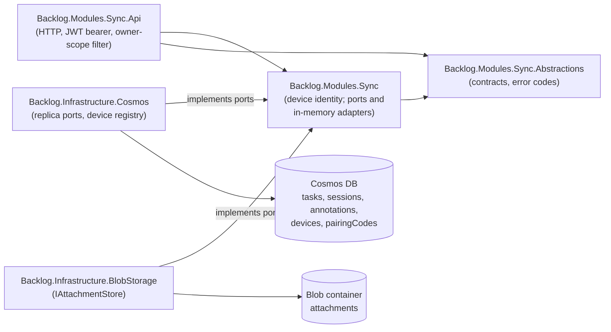
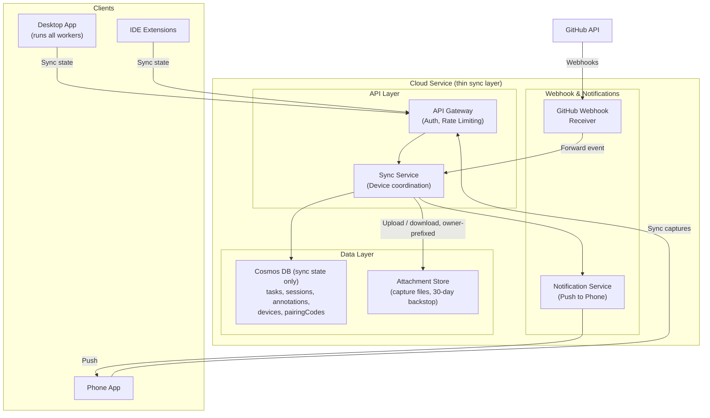

# 05. Building Block View

```meta
```

## Container View

```meta
related: [".devbook/arc42/03-context-and-scope.md#access-channels-scope", ".devbook/domain/context-map.md", ".devbook/arc42/adr/0003-sqlite-is-the-canonical-local-task-store.md", ".devbook/arc42/adr/0005-azure-hosted-task-replica-for-multi-device-sync.md", ".devbook/arc42/adr/0014-attachments-travel-through-a-blob-store-beside-the-replica.md"]
```

Container boundaries below are the deployable and runtime split. The domains they
serve are listed in `.devbook/domain/context-map.md#subdomain-landscape` and defined
in each context's own `.devbook/domain/<context>/domain.md`. This view does not
restate their responsibilities.

The desktop's canonical store is one SQLite database, `backlog.db` (local ADR 0003);
a task's content is markdown text held in it. The cloud keeps the replica in Cosmos DB
(local ADR 0005) and attachments in a Blob container beside it (local ADR 0014).



### System-level flow

```meta
```



## Desktop App

```meta
related: [".devbook/arc42/06-runtime-view.md#task-to-github-issue", ".devbook/arc42/adr/0001-desktop-stack-maui-blazor-hybrid.md", ".devbook/arc42/adr/0003-sqlite-is-the-canonical-local-task-store.md", ".devbook/arc42/adr/0009-captures-are-a-document-kind-on-the-replica.md", ".devbook/arc42/adr/0012-backlog-is-an-mcp-server-inside-the-desktop-app.md", ".devbook/arc42/adr/0015-devbook-database-lives-in-app-storage-and-the-app-builds-it.md", ".devbook/arc42/adr/0017-inbox-import-is-a-capture-source-with-a-markdown-manifest.md", ".devbook/domain/tasks/features.md#pairing-a-device"]
```

The desktop app is the local-first Windows client, and the one channel that serves
every domain. It runs in the two modes the glossary defines, **Standalone** and
**Connected** (`.devbook/arc42/12-glossary.md#terms`).

```mermaid
graph TB
  McpCallers["MCP clients\n(agents, IDE extensions)"]

  subgraph "Desktop App (Backlog.Desktop)"
    Shell["Shell UI — Backlog.Desktop.UI\n(.NET MAUI Blazor Hybrid, Ask AI panel)"]

    subgraph "Module UIs"
      TasksUI["Backlog.Modules.Tasks.UI"]
      InboxUI["Backlog.Modules.Inbox.UI"]
      RoadmapUI["Backlog.Modules.Roadmap.UI"]
      DevbookUI["Backlog.Modules.Devbook.UI"]
      DashboardUI["Backlog.Modules.Dashboard.UI"]
      CaptureUI["Backlog.Modules.Capture.UI"]
      ToolsUI["Backlog.Modules.DevPc.UI\n(Tools)"]
      SessionsUI["Backlog.Modules.Sessions.UI"]
      SyncUI["Backlog.Modules.Sync.UI\n(Devices settings)"]
    end

    subgraph "Modules"
      Tasks["Backlog.Modules.Tasks"]
      Inbox["Backlog.Modules.Inbox"]
      Roadmap["Backlog.Modules.Roadmap"]
      Dashboard["Backlog.Modules.Dashboard"]
      Capture["Backlog.Modules.Capture"]
    end

    subgraph "Background workers"
      SyncWorkers["TaskSyncWorker, SessionSyncWorker,\nAnnotationSyncWorker"]
      BackupWorker["BackupWorker"]
      McpWorker["McpServerWorker"]
    end

    subgraph "Adapters (Backlog.Infrastructure.*)"
      Sqlite["Infrastructure.Sqlite\n(backlog.db: tasks, roadmap,\ninbox_items, inbox_lists, inbox_groups)"]
      FileSystem["Infrastructure.FileSystem\n(InboxBacklogTarget, backups)"]
      DevbookInfra["Infrastructure.Devbook\n(devbook database in app storage)"]
      SyncClient["Infrastructure.Sync\n(Sync Client, optional)"]
      Mcp["Infrastructure.Mcp\n(MCP server, loopback only)"]
      CaptureInfra["Infrastructure.Capture\n(YouTube, Website / Feeds, Import\n→ InboxCaptureDelivery)"]
      Foundry["Infrastructure.AzureFoundry\n(IInboxPlanDrafter, IInboxTriageAdvisor,\nAsk AI)"]
      Claude["Infrastructure.Claude"]
      Copilot["Infrastructure.Copilot"]
      GitHubInfra["Infrastructure.GitHub"]
      DevPcInfra["Infrastructure.DevPc"]
      SessionsInfra["Infrastructure.Sessions"]
    end
  end

  SyncAPI["Cloud Sync API\n(optional)"]
  GitHub["GitHub API"]
  Sources["YouTube, websites / feeds,\nimport manifests"]
  FoundryApi["Azure AI Foundry"]

  Shell --> TasksUI & InboxUI & RoadmapUI & DevbookUI & DashboardUI & CaptureUI & ToolsUI & SessionsUI & SyncUI
  Shell --> Foundry & Claude & GitHubInfra & FileSystem & SyncClient & Mcp

  TasksUI -->|Abstractions| Tasks
  InboxUI -->|Abstractions| Inbox
  RoadmapUI -->|Abstractions| Roadmap
  DashboardUI -->|Abstractions| Dashboard
  CaptureUI -->|Abstractions| Capture
  ToolsUI -->|DevPc.Abstractions| DevPcInfra
  SessionsUI -->|Sessions.Abstractions| SessionsInfra
  SyncUI -->|pairing, sync loops| SyncClient

  TasksUI --> Copilot & GitHubInfra
  RoadmapUI --> GitHubInfra
  DevbookUI --> DevbookInfra & Copilot & GitHubInfra

  Tasks --> Sqlite
  Roadmap --> Sqlite
  Inbox --> Sqlite
  Inbox -->|IInboxBacklogTarget| FileSystem
  FileSystem -->|ITaskItems| Tasks
  Inbox -->|IInboxPlanDrafter, IInboxTriageAdvisor| Foundry
  Claude -->|Dashboard.Abstractions| Dashboard

  Capture -->|ICaptureDelivery| CaptureInfra
  CaptureInfra --> Sources
  CaptureInfra -->|IInboxIntake| Inbox

  SyncWorkers --> SyncClient
  SyncClient -->|captures via IInboxIntake| Inbox
  SyncClient -.->|push / pull| SyncAPI
  BackupWorker --> FileSystem

  McpCallers -->|HTTP on 127.0.0.1 / ::1| Mcp
  McpWorker --> Mcp
  Mcp --> Tasks & Roadmap & DevbookInfra & SessionsInfra

  GitHubInfra --> GitHub
  Foundry --> FoundryApi
```



Capture sources and background workers run inside the desktop process, so external
credentials stay on the machine. `MauiProgram` starts the sync, backup and MCP
workers at launch.

**MCP server** is `Backlog.Infrastructure.Mcp`, hosted by `McpServerWorker` on its
own Kestrel listener bound to `127.0.0.1` and `::1` and never to a wildcard address
(local ADR 0012). Agents and IDE extensions on the same machine reach Tasks, Roadmap,
Devbook and Sessions through it; `McpServerRegistrationTests` holds the binding.

Module UI projects reference adapters directly where a pane needs one: Tasks.UI and
Devbook.UI reference Copilot and GitHub, Roadmap.UI references GitHub, and Devbook.UI
references `Backlog.Infrastructure.Devbook`, whose database lives in app storage
(local ADR 0015). `ModuleBoundaryTests` permits a module UI to take an adapter and
forbids it another module's implementation.

**Devbook database** is `Backlog.Infrastructure.Devbook`: the builder that indexes
a repository's devbook folders in C#, and the read-only reader over the result.
It indexes the chapters, the reference graph, the outline, the Archify artifacts
and the click demos. The `demo` and `demo_link` tables (schema 5) pair each
`*.demo.html` with its page by name and with every chapter whose `demo` field
names it. The pairing rule itself lives in `DevbookReadingConvention`, in the
Devbook module's Abstractions, so the builder, the MCP chapter read and the
Domain devbook pane apply one rule. `tools/devbook/build-database.mjs` writes the
same tables, and `DevbookBuilderParityTests` compares the two writers.

The same builder reads the Brain (local ADR 0026) under `DevbookCorpusKind.Brain`.
This is how the Brain is built and kept current:



- **Areas, not devbook folders.** The builder indexes the areas `BrainConventions`
  (Devbook Abstractions) reads from the Brain's `CONVENTIONS.md`, or the PARA set.
  No devbook folder convention applies to them. `para`, `repos` and `tasks` become
  node attributes, and a `repo:` link in `related` or in prose is stored as an
  edge whose target is no node.
- **A port of its own.** `BrainFolderSource` resolves the Brain as one local,
  always editable folder keyed `brain`, beside `DevbookFolderSource`. The pane
  reads it through `IBrainFolderSource`, a port beside `IDevbookFolderSource` in
  the Devbook Abstractions. The repository source therefore stays the one
  registration that every search, reference, annotation and Archify reader
  resolves. The desktop composition (`AddDevbookAdapters`) builds the source over
  `IBrainSettings.BrainFolder`.
- **The watch.** Both heads resolve `BrainFolderWatch` after `Build()` and call
  `Start()`. It raises the source's `Changed` after a setting change or a Brain
  rebuild.
- **Its own root.** `DevbookDatabaseLocation` records the folder as a Brain, so
  the folder is its own root with its own database in app storage.
  `BrainConflictCopies` (Abstractions) finds OneDrive conflict pairs from the note
  names alone.
- **Parity.** `tools/devbook/brain.mjs` is the Node side of the same convention,
  and the parity test compares the two on a Brain fixture.

The `repo:` edges are read back by three readers (local ADR 0027 §6):



- **Forward links.** `BrainRepoLinkResolver`, in the Devbook UI, asks whether this
  machine has the link's alias and section. The shell opens the chapter through
  the same `DevbookOpenRequest` a task's reference takes.
- **Backlinks.** `BrainBacklinkReader`, in `Backlog.Infrastructure.Devbook`,
  answers the `IBrainBacklinks` port from the Brain's own database. The desktop
  composition registers it over `IBrainFolderSource`, and `BrainBacklinksBox`
  asks it for the chapter on screen.
- **The atlas.** `DevbookAtlasReader.ReadBrain` gives every `repo:` target a node
  of its own. Each link becomes a `repo-link` edge labelled with the alias, and
  dashed where the link does not resolve. `GraphAtlas` in the component library
  draws an edge's optional `label` and `dashed`.

The same project reads scenario pages, outside the database. `Scenarios/` ports
devbook's page parser and page signature, and `ScenarioSignatureVectorTests` holds
the port to devbook's shared vector. It also reads a committed `run.json` in both
of its versions and devbook's `_meta/scenarios.json` register, and it does the
disk reads behind them. The Devbook UI's `DevbookScenarioStore` keeps one catalog
per repository from those reads. The menu, the Domain panel, and every chapter's
`scenario:` images draw from that catalog. So does a task entry's text, which the
Tasks pane is not allowed to reach on its own. The shell answers the pane's
`DevbookImagesFor` parameter from `DevbookScenarioImageSources`, one
`IDevbookImageSource` per repository over the same store. `IDevbookImageSource`
lives in the component library, so Tasks.UI still references no Devbook project.
Outside a knowledge document, `MarkdownView` asks that source about images and
nothing else. A followed reference's `#anchor` reaches a scenario page as a
`DevbookFocus`, passed from `DevbookPane` through `DomainDevbookPanel` to
`DevbookScenarioPage`. The page marks that part and reveals it with
`backlogRevealRow`.

**Inbox Service** is `Backlog.Modules.Inbox`, a module with its own `Abstractions`
project and its own tables in `backlog.db` (`inbox_items`, `inbox_lists`,
`inbox_groups`). It holds the Inbox Item, List and Group aggregates and one feature
slice per action: intake, manual capture, tags, repositories, filing, archive,
route to backlog, create plan, and the list and group organiser.

The Inbox reaches Tasks only through the `IInboxBacklogTarget` port.
`InboxBacklogTarget` in `Backlog.Infrastructure.FileSystem` answers it over Tasks'
published `ITaskItems`, and it is the one place an inbox item becomes entry text.
A batch of items goes through the port's `CreateBatchTasksAsync` as one
multi-entry document into Tasks' `ImportPlanAsync`. The adapter maps the created
entries back to items by `import_item_id` and names each entry's own item as its
source. The `Backlog.Modules.Inbox.UI` pane references its own module's
Abstractions and nothing of Tasks. See local ADR 0009.

Two AI ports reach `Backlog.Infrastructure.AzureFoundry`, over the one configured
deployment. `IInboxPlanDrafter` serves the plan drafter. `IInboxTriageAdvisor`
serves the AI triage of local ADR 0023: the cards over an item in triage, and the
triage pass. Either port may be left unregistered, and the Inbox then reads the
feature as unavailable. The desktop web harness swaps in a deterministic advisor,
so the triage surfaces can be driven without Azure.

**Ask AI content** flows from one source per area to the shell's Ask AI panel:



The port is `IAiContentSource` under `Backlog.SharedKernel.Ai`. Each area's UI
project answers it: `TasksAiContentSource`, `InboxAiContentSource`,
`DevbookAiContentSource`, `RoadmapAiContentSource`, `DashboardAiContentSource`,
`SessionsAiContentSource` and `ToolsAiContentSource`. Each source declares what
its content is. It composes a body for a question within the character budget,
choosing among its records the one way `AiContentBudget` defines. The shell
learns nothing about what a task, an item or a chapter looks like.

A source never describes the screen: no filter text, sort, layout or selection
beyond pinning the open record. Screen state is left out because the visible task
rows exceeded the deployment's quota on every press. The scope that defines an
area's records is content, though, and the body's first line states it. Examples
are a dashboard's repositories and period, or a task list's repository scope.

**Sync Client** is `Backlog.Infrastructure.Sync`, shared by the desktop head and
both web harnesses. The harnesses register it separately, so the two pair as two
distinct devices. Its parts:

- `IDeviceCredentialStore` holds the device's registration credential. On Windows
  that is `DpapiDeviceCredentialStore`. On Android it is
  `SecureValueDeviceCredentialStore`, the platform-neutral half of that adapter,
  over MAUI `SecureStorage` (Keystore-wrapped `EncryptedSharedPreferences`), so a
  force-stop does not un-pair the phone. The in-memory store is for tests.
- `SyncTokenProvider` exchanges the credential for a device token and caches it.
  It refreshes within two minutes of expiry and never retries a 401.
- `SyncAuthenticationHandler` attaches the token to outbound requests.
- `DevicePairingClient` drives the pairing calls.

On the desktop the Sync Client also carries the capture path. `TaskReplicaMerge`
hands every `capture`-kind replica document to the Inbox's `IInboxIntake` port
before the task merge. `TaskSyncSession` drains the Inbox's `IInboxCaptureOutbox`
into the ordinary tasks push as tombstones. Both ports are optional constructor
parameters. A head without an inbox store, such as the phone, composes unchanged
and leaves captures on the replica.

A second caller reaches `IInboxIntake` without touching the replica.
`InboxCaptureDelivery` in `Backlog.Infrastructure.Capture` answers the Capture
module's `ICaptureDelivery` port by calling `IInboxIntake` in-process. It does so
when a source monitor (YouTube channel, website feed) finds a new entry on the
desktop. `IInboxIntake` is idempotent by id: a known id is a replay, not a
duplicate. A second press of Capture is therefore free, and the delivery keeps no
record of the ids it has already seen. See
`.devbook/domain/context-map.md#strategic-rules`.

**The Settings screen** is the shell's, `Settings.razor` in
`Backlog.Desktop.UI/Settings`, drawn in the component library's `SettingsFrame`:
a back link, a `Settings · <group>` eyebrow, a one-sentence headline a page
writes through `SettingsHeadline` (its title when it writes none), and a menu
of three groups — Workspace, AI and Product areas — beside the page. Every page
has its own address, `settings/<page>`; the menu items are links to them, so
choosing one navigates and Back returns. Its five app-wide pages — Features,
AI providers, Storage & backup, GitHub accounts and Repositories — are one
component each beside it, so a change to one page is a change to one file, and
`SettingsPages` describes them as `SettingsSection` records like the modules'
pages. What more than one page reads is a `SettingsScreenContext` the screen
owns and hands to every page: how this machine reaches GitHub, which logins the
GitHub CLI holds, and that a feature was switched. A `SettingsSection` names
its menu group and the titles of the cards it draws, which the settings search
reads without rendering a page, and optionally an `ISettingsBadgeSource` the
shell resolves from the container for the page's menu badge. The menu draws a
short value on the right of a page's name, built by `SettingsBadges`: Features
`<on>/<total>` over `AppFeatures.All`, Repositories and GitHub accounts their
counts, AI providers how many of Claude usage, GitHub usage and Azure Foundry
are set up out of three, and a module page its source's value. The screen
redraws the menu when the feature store, the GitHub, Claude or Azure Foundry
settings, or a badge source raise `Changed`. A module page whose feature is off
stays in the menu with an `Off` badge, and opening it shows a note pointing at
the Features page in place of the module's component, which is disposed until
the feature is back on. Storage & backup is drawn as two
`SettingsCard`s in a wrapping row — *Where the backlog is stored*, with the
branch snapshot folder inside it, and *Backup*, with **Back up now** in its
header — under a headline read from `BackupWorker.Last`, whose
`BackupState.DailyCopies` counts the days a copy was committed on. Within a group the app-wide pages come first,
then the registered sections by their order, and every page opened is kept
alive, hidden, while another is on screen. The Features page reads its counts
from the feature store on every render: a headline of how many features are on
and how many of those are unfinished (Dev or Beta), three `MetricTile` figures,
an unpersisted `RadioGroup` filter (All, On, Off, Unfinished), and one
`SettingsCard` per `AppFeatures.Sections` entry whose titles are the page's
search list. Below the width that holds the menu
and the page side by side — a container query on the frame's own width, not the
window's — the screen shows one of them: `settings` is the menu alone as a
grouped list, each group's pages in one rounded card of 52px rows with a
chevron and the page's badge value when it has one; `settings/<page>` is the
page alone at full width, and its back link goes to that list instead of to
the tasks. The screen tells the frame which address it is on (`PageChosen`);
the stylesheet decides the width.
The header's search slot holds the library's `SettingsSearch`, *Find a
setting*, and `SettingsPages.Find` decides what it keeps: a page whose title or
one of whose declared card titles holds the text, ignoring case — never a
field's label or what a page draws, so no page is rendered to search it. While
it has text the menu lists only those pages, drops a group left empty, and
lists each matched card under its page as a link to `settings/<page>#card-<title>`;
following one opens the page and `backlogRevealSettingsCard` scrolls the card into
view and lights its border in `--color-border-focus` for a moment, without the
fade under reduced motion. A search that keeps nothing says
`No setting matches "<text>".` in the menu's place, and Escape clears it. At
phone width the field takes a row of its own above the grouped list it filters,
and is not drawn on a page's address.
The Repositories page draws the
working set as the library's `DataTable`, a row per repository, and opens that
repository's card in place in a detail row under it; `HasRowDetail` keeps the
detail row to the one repository being edited. GitHub accounts is one
`SettingsCard` of rows, one per configured account, each naming its login, whether
the GitHub CLI is using it now and how many repositories are worked as it;
choosing a row opens that account's card under it, across the whole list, one
at a time.

**Devices settings** belong to `Backlog.Modules.Sync.UI`, the Sync module's
only UI. Its Devices page registers a device and pairs it, counts down the
pairing code, and forgets a device. It also holds the sync service address and
drives the task and session sync loops through the Sync Client.
`SyncSettingsRegistration.AddSyncSettings` registers the page as a
`SettingsSection` from `Backlog.SharedKernel`, and the desktop composition
calls it. Each of the page's groups is a card, and its headline says whether
this device is paired with the sync service; the section declares all seven
card titles, both states' among them, for the settings search. The shell
lists the page under Product areas, marked `Off` with only the Features-page
note while the Sync feature is off, and keeps it alive across moves to other
pages.

## Mobile App

```meta
related: [".devbook/arc42/06-runtime-view.md#mobile-capture-and-sync", ".devbook/arc42/06-runtime-view.md#talk-note-upload", ".devbook/arc42/06-runtime-view.md#mobile-my-day-and-task-push", ".devbook/arc42/06-runtime-view.md#sync-item-lifecycle", ".devbook/arc42/06-runtime-view.md#mobile-note-sync", ".devbook/arc42/adr/0025-notes-ride-the-task-feed.md", ".devbook/domain/capture/features.md#mobile-capture"]
```

Android-first, offline-first capture app. Serves Capture, Inbox,
and lightweight Tasks. It owns mobile UI, push plumbing, and sync
transport, but not domain lifecycle rules.

The shell (`MainLayout`) is a title bar carrying the sync status, the page, and
three tabs along the bottom, withheld until the device is paired:

- **Inbox** — a quick-capture field and the phone's own captures that the desktop
  has not taken in yet. Each says whether it waits in the outbox or was sent. No
  row triages: triage stays on the desktop.
- **Capture sheet** (`/capture`, opened from Today's capture button) is a sheet
  over the screen it was opened from, not a tab. It sends one thought to the
  Inbox as a capture, creates it as a note through the note view, or adds it to
  today through `task_view`. It offers dictation and a photo.
- **Notes** — every note in `note_view`, newest first and searched on the phone,
  and an editor for one. A note has a title, a dictated Markdown body, and
  attached pictures and files. It saves on its own a second after typing stops,
  and is sent as outbox kind `note`.
- **Tasks** — My Day, read from `task_view`, and the phone's writes to tasks. It
  adds a task picked for today. For a task in today's My Day it marks it done or
  undone, ticks one of its steps, or moves it to tomorrow.

Its local SQLite file holds no canonical task data. It holds:

- the outbox;
- `inbox_cache`, the last inbox it pulled;
- `task_view`, a fold of the owner's task feed;
- `note_view`, a fold of the `note` documents on the same feed, with its own cursor.

Everything the phone sends leaves through the outbox, oldest first, with backoff
and a park after five attempts. An entry's kind decides how it is sent: `capture`,
`note` or `task`. Kind `talk-note` only drains an entry an earlier build left
queued. A note's files, and a leftover talk note's, wait beside the database in
`talk-notes/outbox/`, the attachment upload queue. Each file is uploaded before
the document that names it and checkpointed into the entry, so a retry never
sends one twice. A note document then goes to `POST /api/sync/tasks`, and a
leftover talk note's capture to `POST /api/sync/inbox`. See `.devbook/arc42/06-runtime-view.md#mobile-note-sync`,
`.devbook/arc42/06-runtime-view.md#talk-note-upload`,
`.devbook/arc42/06-runtime-view.md#mobile-my-day-and-task-push` and
`.devbook/arc42/adr/0025-notes-ride-the-task-feed.md`.



The phone reaches the cloud only through the sync API. No device store goes
through a file-sync product (`.devbook/arc42/02-constraints.md#technical-constraints`).

## IDE Extensions

```meta
related: [".devbook/arc42/06-runtime-view.md#ide-context-aware-capture", ".devbook/arc42/06-runtime-view.md#copilot-app-session-capture", ".devbook/arc42/adr/0005-azure-hosted-task-replica-for-multi-device-sync.md", ".devbook/arc42/adr/0009-captures-are-a-document-kind-on-the-replica.md", ".devbook/arc42/adr/0012-backlog-is-an-mcp-server-inside-the-desktop-app.md", ".devbook/tech/ide.md#vs-code-extension-api"]
```



Two kinds of editor-side client reach Backlog, and they take different paths. The VS Code
extension talks to the sync service. Claude Code and GitHub Copilot sessions talk to the
desktop app through its MCP server. Domain lifecycle rules stay with the owning domains.

The VS Code extension, `Backlog.Ide.VsCode`, serves the Inbox (capture intake). It adds one
explorer tree view, `backlogInbox`, and four commands:

- `backlog.refreshInbox` reloads the tree, which lists the captures from `GET /api/sync/inbox`.
- `backlog.capture` turns the editor selection into a title and sends it to
  `POST /api/sync/inbox` with the source `vscode`.
- `backlog.pair` redeems a pairing code from the desktop's Devices settings at
  `POST /api/sync/devices/pair`, and `backlog.unpair` forgets the pairing.

The extension reads the service's base URL from the `backlog.cloudUrl` setting. Local ADR
0009 fixes the shape of both inbox calls. Local ADR 0005 is why the extension goes to the
sync service rather than to the desktop's files: only the service can serve an editor on a
second machine.

The inbox routes require a paired device, so the extension joins the desktop's owner as a
second device, per local ADR 0005 §Identity. It redeems a code rather than registering,
because a registration mints a new owner with an empty inbox. The device id and credential
go into VS Code's `SecretStorage`. `src/sync-client.ts` trades the credential for a
short-lived token at `POST /api/sync/devices/token`, reuses it until two minutes before it
expires, and sends it as `Authorization: Bearer` on both inbox calls. An inbox 401 gets one
retry with a fresh token. A 401 from the token endpoint means the credential is rejected:
the extension clears it and offers to pair again. With no pairing it sends no inbox request.
The extension has no webview and caches nothing but the token.

The extension is a TypeScript project outside `Backlog.sln`. In development the AppHost
hosts it through two explicit-start resources. `ide-vscode-build` runs `npm run watch`, and
`ide-vscode-host` opens a VS Code Extension Development Host with the extension side-loaded.
`.devbook/tech/ide.md#vs-code-extension-api` has the detail.

Agent sessions reach Backlog the way an IDE does, and are not a container of their own.
Local ADR 0012 has them call the MCP server that runs inside the desktop app,
`Backlog.Infrastructure.Mcp`. Its tools read and change the desktop's own store: tasks,
the roadmap, devbook chapters and their [remarks](../domain/devbook/domain.md#remark),
sessions, and delivery runs. The chapters include the Brain's notes, and a new note is
written into the Brain's inbox area.

Visual Studio has no extension yet, and no project exists for it. `.devbook/tech/ide.md`
lists Visual Studio extensibility and a VS Code webview UI as candidates.

This capture channel is distinct from the session record Sessions keeps
(`.devbook/domain/sessions/domain.md#session-log`). That record tracks session lifecycle
for monitoring. Capture uses session context to create backlog and knowledge items.

## Cloud Service

```meta
related: [".devbook/arc42/06-runtime-view.md#state-sync-and-webhook-forwarding", ".devbook/arc42/07-deployment-view.md#cloud-deployment-azure", ".devbook/arc42/adr/0005-azure-hosted-task-replica-for-multi-device-sync.md", ".devbook/arc42/adr/0009-captures-are-a-document-kind-on-the-replica.md", ".devbook/arc42/adr/0011-devbook-annotations-are-a-third-replica-container.md", ".devbook/arc42/adr/0014-attachments-travel-through-a-blob-store-beside-the-replica.md"]
```

The cloud service is the glossary's *Thin cloud* (`.devbook/arc42/12-glossary.md#terms`),
deliberately not the backbone. It persists only sync-oriented state, much of it
TTL-based, and never canonical domain data or external credentials (local ADR 0005).

"Cloud Service" names where this container runs; the code is named after what it
does. It is implemented by `src/Modules/Sync/Backlog.Modules.Sync.Api` and appears
in the Aspire app model as the `sync` resource. Only the Sync Service component
below is built. The webhook receiver, notification service, and PC registry are
not.

The sync service is five projects:



- `Backlog.Modules.Sync.Abstractions` carries the contracts and error codes both
  sides reference.
- `Backlog.Modules.Sync` holds the domain logic behind ports: device registration,
  pairing-code issuance and redemption, and device-token issuance. Its `Ports`
  declare `ITaskReplica`, `ISessionReplica`, `IAnnotationReplica` and
  `IAttachmentStore`. Its `Adapters` hold an in-memory stand-in for each, for the
  endpoint tests and for a run with no Cosmos configured.
- `Backlog.Modules.Sync.Api` wires the module to HTTP, JWT-bearer authentication,
  and the owner-scoping filter.
- `Backlog.Infrastructure.Cosmos` implements the replica ports against the
  `tasks`, `sessions` and `annotations` containers (local ADRs 0005 and 0011). It
  serves the device registry and pairing-code store from `devices` and
  `pairingCodes`, so a registration survives a restart of the service. It is the
  only project that references the Cosmos SDK, so the API head depends on a port
  implementation rather than on a database driver.
- `Backlog.Infrastructure.BlobStorage` implements `IAttachmentStore` against the
  `attachments` blob container (local ADR 0014). It is the only project that
  references the Storage SDK.

The API head serves sessions and annotations as one route each,
`/api/sync/sessions` and `/api/sync/annotations`. A device pushes a batch with
`POST` and pulls the owner's feed from a cursor with `GET`, as it does on
`/api/sync/tasks`.

Captures have no container of their own. A capture is a document kind in the
`tasks` container, and the module writes it through `ITaskReplica` (local ADR
0009). A device posts a capture to `/api/sync/inbox`, the desktop lists the
owner's waiting captures from the same route, and it acknowledges one with
`POST /api/sync/inbox/{id}/ack`. The session, annotation and inbox routes sit
behind the same paired-device authorization, owner-scope and replica-fault
filters as every other sync route.

The Cosmos database therefore holds five containers. `tasks`, `sessions` and
`annotations` are partitioned on the owner, and `devices` and `pairingCodes`
on their own id.

The blob store stages an upload as uncommitted blocks. It commits them only once
the handler has checked the size and digest, so a refused upload never becomes a
blob. The API head exposes it as `PUT`/`GET /api/sync/attachments/{id}`, behind the
same authorization, owner-scope and replica-fault filters as every other sync
route. The per-file cap and the type allowlist are `Modules:Sync:Attachments`
settings. A capture names its files as metadata. The acknowledgement tombstone,
the phone's own or the desktop's pushed one, releases them, best effort.



Cloud components:

| Component | Responsibility |
|---|---|
| **API Gateway & Auth** | Minimal REST surface; GitHub OAuth for webhook registration; JWT device sessions; rate limiting. |
| **Sync Service** | The only domain-aware service; stores sync *state*, never the canonical domain data; delta push/pull of the task, session and annotation replicas, the capture inbox, and attachments; conflict listing/resolution. |
| **GitHub Webhook Receiver** | Validates HMAC-SHA256, stores events (TTL 24h), forwards to desktop; never processes domain data. |
| **Notification Service** | Push to phone (FCM); SSE/WebSocket to desktop for real-time forwarding. |
| **Remote PC Registry & WoL Relay** | Register machines, heartbeat, Wake-on-LAN relay, connection details. |


