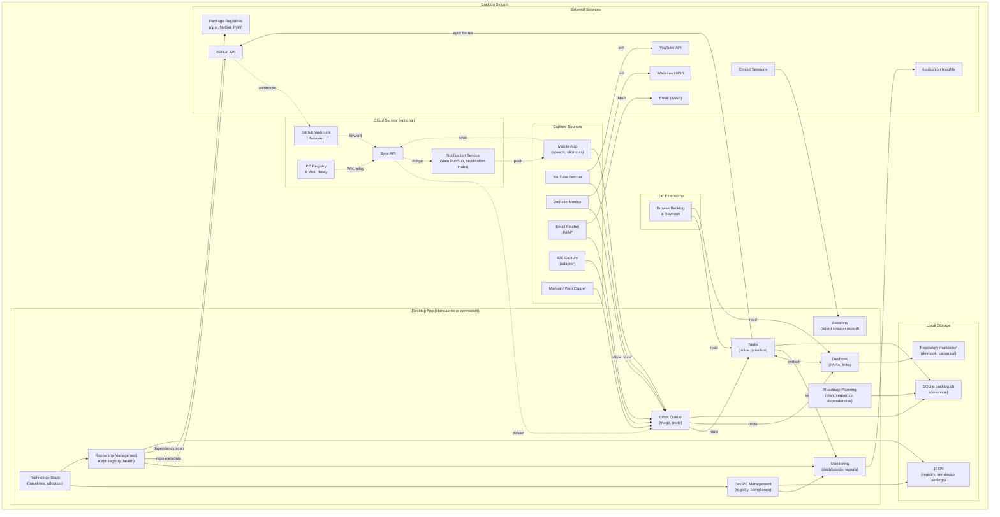
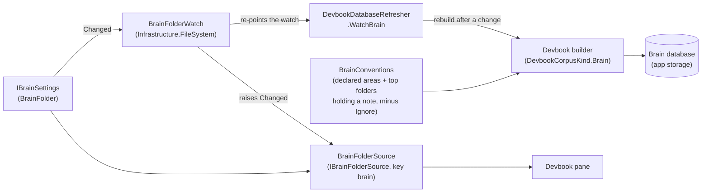
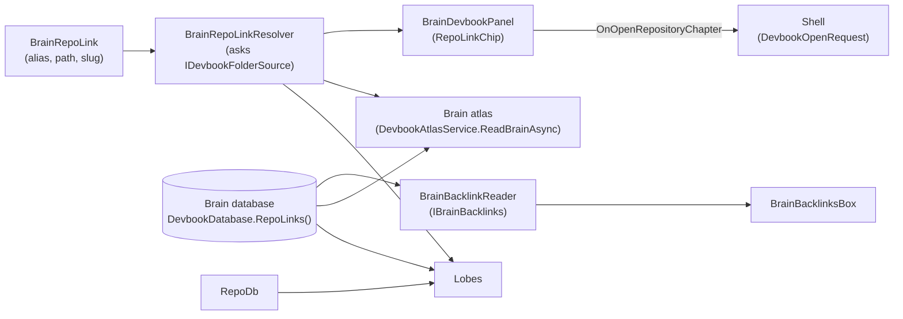
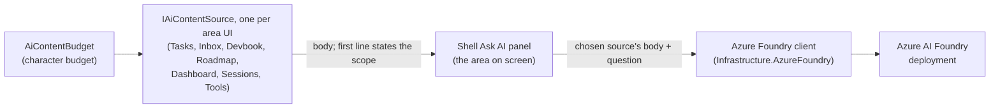
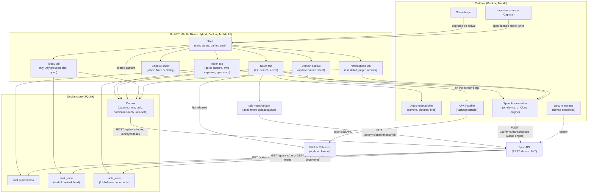
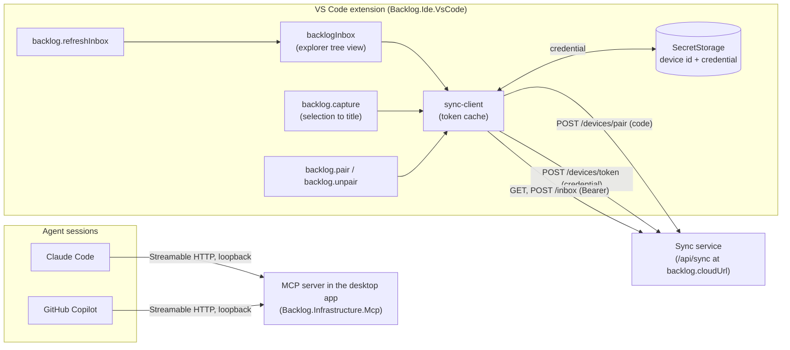
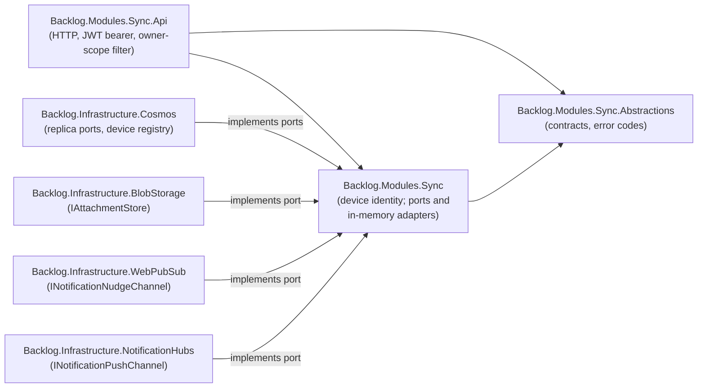

# 05. Building Block View

```meta
```

## Container View

```meta
related: [".devbook/arc42/03-context-and-scope.md#access-channels-scope", ".devbook/domain/context-map.md", ".devbook/arc42/adr/0003-sqlite-is-the-canonical-local-task-store.md", ".devbook/arc42/adr/0005-azure-hosted-task-replica-for-multi-device-sync.md", ".devbook/arc42/adr/0014-attachments-travel-through-a-blob-store-beside-the-replica.md"]
```

Container boundaries below are the deployable and runtime split. The domains they serve are in `.devbook/domain/context-map.md#subdomain-landscape` and each context's `.devbook/domain/<context>/domain.md`.

The desktop's canonical store is one SQLite database, `backlog.db` (local ADR 0003);
a task's content is markdown text held in it. The cloud keeps the replica in Cosmos DB
(local ADR 0005) and attachments in a Blob container beside it (local ADR 0014).


### System-level flow

```meta
```



## Desktop App

```meta
related: [".devbook/arc42/06-runtime-view.md#task-to-github-issue", ".devbook/arc42/adr/0001-desktop-stack-maui-blazor-hybrid.md", ".devbook/arc42/adr/0003-sqlite-is-the-canonical-local-task-store.md", ".devbook/arc42/adr/0009-captures-are-a-document-kind-on-the-replica.md", ".devbook/arc42/adr/0012-backlog-is-an-mcp-server-inside-the-desktop-app.md", ".devbook/arc42/adr/0015-devbook-database-lives-in-app-storage-and-the-app-builds-it.md", ".devbook/arc42/adr/0017-inbox-import-is-a-capture-source-with-a-markdown-manifest.md", ".devbook/arc42/adr/0030-stored-credentials-go-through-the-os-protected-envelope.md", ".devbook/arc42/adr/0033-the-dashboard-sends-its-figures-to-foundry-whichever-part-was-pressed.md", ".devbook/arc42/adr/0042-repository-management-owns-pull-request-state.md", ".devbook/arc42/adr/0044-devbook-subject-state-lives-in-backlogs-own-store.md", ".devbook/arc42/adr/0047-the-domain-view-reads-by-unit.md", ".devbook/domain/sync/features.md#pairing-a-device"]
```

The desktop app is the local-first Windows client and the one channel that serves every domain. It runs **Standalone** or **Connected** (`.devbook/arc42/12-glossary.md#terms`).

```mermaid
graph TB
  McpCallers["MCP clients\n(agents, IDE extensions)"]

  subgraph "Desktop App (Backlog.Desktop)"
    Shell["Shell UI — Backlog.Desktop.UI\n(.NET MAUI Blazor Hybrid, Ask AI panel)"]

    subgraph "Module UIs"
      TasksUI["Backlog.Modules.Tasks.UI"]
      InboxUI["Backlog.Modules.Inbox.UI"]
      RoadmapUI["Backlog.Modules.Roadmap.UI"]
      DevbookUI["Backlog.Modules.Devbook.UI"]
      DashboardUI["Backlog.Modules.Dashboard.UI"]
      CaptureUI["Backlog.Modules.Capture.UI"]
      ToolsUI["Backlog.Modules.DevPc.UI\n(Tools)"]
      SessionsUI["Backlog.Modules.Sessions.UI"]
      SyncUI["Backlog.Modules.Sync.UI\n(Devices settings)"]
    end

    subgraph "Modules"
      Tasks["Backlog.Modules.Tasks"]
      Inbox["Backlog.Modules.Inbox"]
      Roadmap["Backlog.Modules.Roadmap"]
      Dashboard["Backlog.Modules.Dashboard"]
      Capture["Backlog.Modules.Capture"]
      RepoMgmt["Backlog.Modules.RepositoryManagement\n(pull-request contract, one cache)"]
    end

    subgraph "Background workers"
      SyncWorkers["TaskSyncWorker, SessionSyncWorker,\nAnnotationSyncWorker, NotificationSyncWorker,\nDevbookSubjectSyncWorker"]
      BackupWorker["BackupWorker"]
      McpWorker["McpServerWorker"]
    end

    subgraph "Adapters (Backlog.Infrastructure.*)"
      Sqlite["Infrastructure.Sqlite\n(backlog.db: tasks, roadmap,\ninbox_items, inbox_lists, inbox_groups)"]
      FileSystem["Infrastructure.FileSystem\n(InboxBacklogTarget, backups)"]
      DevbookInfra["Infrastructure.Devbook\n(devbook database in app storage)"]
      SyncClient["Infrastructure.Sync\n(Sync Client, optional)"]
      Mcp["Infrastructure.Mcp\n(MCP server, loopback only)"]
      CaptureInfra["Infrastructure.Capture\n(YouTube, Website / Feeds, Import\n→ InboxCaptureDelivery)"]
      Foundry["Infrastructure.AzureFoundry\n(IInboxPlanDrafter, IInboxTriageAdvisor,\nAsk AI)"]
      Claude["Infrastructure.Claude"]
      Copilot["Infrastructure.Copilot"]
      GitHubInfra["Infrastructure.GitHub"]
      DevPcInfra["Infrastructure.DevPc"]
      SessionsInfra["Infrastructure.Sessions"]
    end
  end

  SyncAPI["Cloud Sync API\n(optional)"]
  GitHub["GitHub API"]
  Sources["YouTube, websites / feeds,\nimport manifests"]
  FoundryApi["Azure AI Foundry"]

  Shell --> TasksUI & InboxUI & RoadmapUI & DevbookUI & DashboardUI & CaptureUI & ToolsUI & SessionsUI & SyncUI
  Shell --> Foundry & Claude & GitHubInfra & FileSystem & SyncClient & Mcp

  TasksUI -->|Abstractions| Tasks
  InboxUI -->|Abstractions| Inbox
  RoadmapUI -->|Abstractions| Roadmap
  DashboardUI -->|Abstractions| Dashboard
  CaptureUI -->|Abstractions| Capture
  ToolsUI -->|DevPc.Abstractions| DevPcInfra
  SessionsUI -->|Sessions.Abstractions| SessionsInfra
  SyncUI -->|pairing, sync loops| SyncClient
  Shell -->|IPullRequests| RepoMgmt

  TasksUI --> Copilot & GitHubInfra
  RoadmapUI --> GitHubInfra
  DevbookUI --> DevbookInfra & Copilot & GitHubInfra

  Tasks --> Sqlite
  Roadmap --> Sqlite
  Inbox --> Sqlite
  Inbox -->|IInboxBacklogTarget| FileSystem
  FileSystem -->|ITaskItems| Tasks
  Inbox -->|IInboxPlanDrafter, IInboxTriageAdvisor| Foundry
  Claude -->|Dashboard.Abstractions| Dashboard
  GitHubInfra -->|IPullRequestSource, IRegisteredRepositories| RepoMgmt
  FileSystem -->|"IPullRequests for Tasks and Progress, ISettledPullRequestStore"| RepoMgmt

  Capture -->|ICaptureDelivery| CaptureInfra
  CaptureInfra --> Sources
  CaptureInfra -->|IInboxIntake| Inbox

  SyncWorkers --> SyncClient
  SyncClient -->|captures via IInboxIntake| Inbox
  SyncClient -.->|push / pull| SyncAPI
  BackupWorker --> FileSystem

  McpCallers -->|HTTP on 127.0.0.1 / ::1| Mcp
  McpWorker --> Mcp
  Mcp --> Tasks & Roadmap & DevbookInfra & SessionsInfra

  GitHubInfra --> GitHub
  Foundry --> FoundryApi
```




Capture sources and background workers run inside the desktop process, so external credentials stay on the machine. `MauiProgram` starts the sync, backup and MCP workers at launch.

**MCP server** is `Backlog.Infrastructure.Mcp`, hosted by `McpServerWorker` on its own Kestrel listener bound to `127.0.0.1` and `::1`, never a wildcard address (local ADR 0012). Agents and IDE extensions on the machine reach Tasks, Roadmap, Devbook and Sessions through it; `McpServerRegistrationTests` holds the binding.

Module UI projects reference adapters directly where a pane needs one: Tasks.UI and Devbook.UI reference Copilot and GitHub, Roadmap.UI references GitHub, and Devbook.UI references `Backlog.Infrastructure.Devbook` (local ADR 0015). `ModuleBoundaryTests` permits a module UI to take an adapter and forbids another module's implementation. `PullRequestStateBoundaryTests` forbids a module UI calling a pull-request member of the GitHub adapter (local ADR 0042 §8).

**Repository Management** is `Backlog.Modules.RepositoryManagement` and its `.Abstractions`: the pull-request state of the registered repositories, with one status, one readiness verdict and one cache (local ADR 0042). It has no `.UI` project; the pull requests pane and session card stay in the shell and read `IPullRequests`. `Backlog.Infrastructure.GitHub` answers its source ports. `Backlog.Infrastructure.FileSystem` keeps its settled pull requests and translates its contract for Tasks (`ILinkedPullRequestStates`) and Progress (`IGoalPullRequestReader`). Tasks.UI keeps its GitHub reference for issues and settings only.

**Devbook database** is `Backlog.Infrastructure.Devbook`: the C# builder that indexes a repository's devbook folders and the read-only reader over the result. It indexes:

- the chapters;
- the reference graph;
- the outline;
- the Archify artifacts;
- the click demos;
- the C4 model.

`DevbookC4Workspace` reads the arc42 folder's `workspace.dsl`, and `DevbookC4Graph` adds an `element` node per element and a `view` node per view. The edges are `contains` and `relationship`. A section that embeds a view adds an `embeds` edge, and an element an arc42 or domain chapter's metadata names adds a `c4` or `c4-touches` edge.

The `demo` and `demo_link` tables (schema 5) pair each `*.demo.html` with its page by name and with every chapter whose `demo` field names it. `DevbookReadingConvention`, in the Devbook module's Abstractions, holds the pairing rule that the builder, the MCP chapter read and the Domain devbook pane share. Each identifier a chapter's `tests` field names is a `tests` row of `node_attribute` (schema 6), read through `DevbookDatabase.Attributes("tests")`, so the Domain view can tell a proved requirement from one no test is linked to (local ADR 0047). `tools/devbook/build-database.mjs` writes the same tables, and `DevbookBuilderParityTests` compares the two writers.

`Backlog.Infrastructure.Devbook` also reads the C4 zoom tab's Code level (local ADR 0046 §3). `Code/CSharpCodeReader` parses every `*.cs` under a component's folder, `bin/` and `obj/` left out, with Roslyn syntax trees and never a compilation. It returns the types with their public members and the members of every accessibility, and the uses between types it can see by name. It merges a partial type by name. It reads on demand, keeps each folder's model while every file keeps its path, size and modification time, and writes nothing to the devbook database.

Devbook.UI's `C4DevbookCode` hands it the folders a building block names in `code`, spelled from the repository root. It maps the model for `C4CodeView` in the component library: class boxes laid out by `C4LayoutEngine`, and a type panel with the component's decision records. A component no building block names code for stops at level 3, and a branch snapshot carries no source to read.

The same builder reads the Brain (local ADR 0026) under `DevbookCorpusKind.Brain`:



- **Areas, not devbook folders.** The builder indexes the areas `BrainConventions` (Devbook Abstractions) resolves (local ADR 0026 §2): those the Brain's `CONVENTIONS.md` declares, or the PARA set. Every other top folder holding a note follows. The `Ignore` section of `CONVENTIONS.md` comes off the whole list. No devbook folder convention applies. `para`, `repos` and `tasks` become node attributes, and a `repo:` link in `related` or prose is stored as an edge whose target is no node.
- **A port of its own.** `BrainFolderSource` resolves the Brain as one local, editable folder keyed `brain`, beside `DevbookFolderSource`. The pane reads it through `IBrainFolderSource`, beside `IDevbookFolderSource` in the Devbook Abstractions. The repository source stays the one registration every search, reference, annotation and Archify reader resolves. `AddDevbookAdapters` builds the source over `IBrainSettings.BrainFolder`.
- **The watch.** Both heads resolve `BrainFolderWatch` after `Build()` and call `Start()`. It raises the source's `Changed` after a setting change or a Brain rebuild.
- **Its own root.** `DevbookDatabaseLocation` records the folder as a Brain, with its own database in app storage. `BrainConflictCopies` (Abstractions) finds OneDrive conflict pairs from note names alone.
- **Parity.** `tools/devbook/brain.mjs` is the Node side of the same convention, compared on a Brain fixture.

The `repo:` edges are read back by four readers (local ADR 0027 §6):



- **Forward links.** `BrainRepoLinkResolver`, in the Devbook UI, asks whether this machine has the link's alias and section. The shell opens the chapter through the `DevbookOpenRequest` a task's reference takes.
- **Backlinks.** `BrainBacklinkReader`, in `Backlog.Infrastructure.Devbook`, answers `IBrainBacklinks` from the Brain's database; `BrainBacklinksBox` asks it for the chapter on screen.
- **The atlas.** `DevbookAtlasReader.ReadBrain` gives every `repo:` target a node and each link a `repo-link` edge labelled with the alias, dashed where it does not resolve. `GraphAtlas` draws an edge's optional `label` and `dashed`.
- **The Lobes atlas.** `DevbookAtlasService.ReadLobesAsync` reads the Brain's database and the devbook database of every repository alias it is handed, nothing else. `DevbookLobesReader` gives each node a scope, a region and a kind by the mappings of [Lobes atlas](../domain/brain/features.md#lobes-atlas). A `repo:` link resolves through `BrainRepoLinkResolver` to that devbook's chapter node, both spellings folded. An unfollowable link is a ghost chapter; an alias not handed in is a ghost scope. Each scope counts its nodes per region and the Brain notes linking into it.

The same project reads scenarios files outside the database. `Scenarios/` ports devbook's scenarios-file parser and journey signature (each `##` journey of a `scenarios.md` or `scenarios.<name>.md` with its `###` parts), held to devbook's shared vector by `ScenarioSignatureVectorTests`. It also reads each journey's committed `run.json` in all three versions and devbook's `_meta/scenarios.json` register at schema 2, with the disk reads behind them.

The Devbook UI's `DevbookScenarioStore` keeps one catalog per repository from those reads. The menu, the Domain panel, every chapter's `scenario:` images and a task entry's text draw from it; the Tasks pane may not reach it directly. The shell answers the pane's `DevbookImagesFor` parameter from `DevbookScenarioImageSources`, one `IDevbookImageSource` per repository over the same store. `IDevbookImageSource` lives in the component library, so Tasks.UI references no Devbook project. Outside a devbook document, `MarkdownView` asks that source about images only.

A followed reference's `#anchor` reaches a scenarios file as a `DevbookFocus`, passed from `DevbookPane` through `DomainDevbookPanel` to each journey's `DevbookScenarioPage`. The journey holding that part marks it and reveals it with `backlogRevealRow`.

**Inbox Service** is `Backlog.Modules.Inbox`, a module with its own `Abstractions` project and tables in `backlog.db` (`inbox_items`, `inbox_lists`, `inbox_groups`). It holds the Inbox Item, List and Group aggregates and one feature slice per action:

- intake;
- manual capture;
- tags;
- repositories;
- filing;
- archive;
- route to backlog;
- create plan;
- the list and group organiser.

The Inbox reaches Tasks only through the `IInboxBacklogTarget` port. `InboxBacklogTarget` in `Backlog.Infrastructure.FileSystem` answers it over Tasks' `ITaskItems` and is the one place an inbox item becomes entry text. A batch goes through `CreateBatchTasksAsync` as one multi-entry document into Tasks' `ImportPlanAsync`. The adapter maps created entries back to items by `import_item_id` and names each entry's item as its source. `Backlog.Modules.Inbox.UI` references its own Abstractions and nothing of Tasks (local ADR 0009).

Two AI ports reach `Backlog.Infrastructure.AzureFoundry` over the one configured deployment. `IInboxPlanDrafter` serves the plan drafter. `IInboxTriageAdvisor` serves the AI triage of local ADR 0023: the cards over an item in triage, and the triage pass. If either is unregistered, the Inbox reads the feature as unavailable. The desktop web harness swaps in a deterministic advisor, so triage surfaces can be driven without Azure.

**Ask AI content** flows from one source per area to the shell's Ask AI panel:



The port is `IAiContentSource` under `Backlog.SharedKernel.Ai`. Each area's UI project answers it:

- `TasksAiContentSource`
- `InboxAiContentSource`
- `DevbookAiContentSource`
- `RoadmapAiContentSource`
- `DashboardAiContentSource`
- `SessionsAiContentSource`
- `ToolsAiContentSource`

Each source composes a body for a question within the character budget, choosing among its records the one way `AiContentBudget` defines. The shell therefore learns nothing about what a task, item or chapter looks like. The panel asks the one area on screen, since the shell never shows two areas at once, and is offered only while that area has a composed source.

A source never describes the screen. Filter text, sort, layout and selection stay out, apart from pinning the open record, because the visible task rows exceeded the deployment's quota on every press. The scope that defines an area's records is content. The body's first line states it, such as a dashboard's repositories and period or a task list's repository scope.

A source may pin the records every question needs. `AiContentBudget` charges a pinned record first, so no question's words can rank it out. Tasks pins the open entry.

The Dashboard pins one line per insight across every tab, worded as its part words it, whichever tab is on show. The figures lead the body, under a line saying they are not entries. The first line counts only merged pull requests and closed issues, so the assistant never reports a figure line as a pull request. An insight that cannot answer keeps its line with the reason. Local ADR 0033 records what this sends to Foundry and why.

An area may also open the panel itself. Each dashboard part's frame draws an Ask AI control. `DashboardPane.OnAskAi` hands the part's title to the shell, which opens the panel on the Dashboard with the question begun `About the "<part>" chart: `. The part travels in the question and never in the body, because which part was pressed is screen state. The shell passes the callback only while the assistant is on and a Dashboard source is composed, so no part offers a control that leads nowhere.

**Sync Client** is `Backlog.Infrastructure.Sync`, shared by the desktop head and both web harnesses. The harnesses register it separately, so they pair as two distinct devices. Its parts:

- `IDeviceCredentialStore` holds the registration credential: `DpapiDeviceCredentialStore` on Windows, `SecureValueDeviceCredentialStore` on Android over MAUI `SecureStorage` (Keystore-wrapped `EncryptedSharedPreferences`) so a force-stop does not un-pair the phone, and an in-memory store for tests.
- `SyncTokenProvider` exchanges the credential for a device token and caches it, refreshing within two minutes of expiry and never retrying a 401.
- `SyncAuthenticationHandler` attaches the token to outbound requests.
- `DevicePairingClient` drives the pairing calls and awaits the store's `SaveAsync`, so the Android store never blocks the pairing screen.

The GitHub, Claude and Azure Foundry settings stores seal their keys with the same DPAPI scope, one value at a time (local ADR 0030).

On the desktop the Sync Client also carries the capture path. `TaskReplicaMerge` hands every `capture`-kind replica document to the Inbox's `IInboxIntake` before the task merge, and `TaskSyncSession` drains the Inbox's `IInboxCaptureOutbox` into the tasks push as tombstones. Both ports are optional constructor parameters, so a head without an inbox store, such as the phone, composes unchanged and leaves captures on the replica.

`InboxCaptureDelivery` in `Backlog.Infrastructure.Capture` is a second caller of `IInboxIntake`: it answers the Capture module's `ICaptureDelivery` in-process when a source monitor (YouTube channel, website feed) finds a new entry. `IInboxIntake` is idempotent by id, so a second press of Capture is free and the delivery keeps no record of seen ids (`.devbook/domain/context-map.md#strategic-rules`).

**The Settings screen** is the shell's: `Settings.razor` in `Backlog.Desktop.UI/Settings`, drawn in the component library's `SettingsFrame`. The frame holds:

- a back link;
- a `Settings · <group>` eyebrow;
- a one-sentence headline a page writes through `SettingsHeadline` (or its title);
- a menu of three groups (Workspace, AI and Product areas) beside the page.

Every page has its own address, `settings/<page>`; menu items are links, so Back returns. Within a group the app-wide pages come first, then registered sections by order. Every page opened is kept alive, hidden, while another is on screen.

Five app-wide pages (Features, AI providers, Storage & backup, GitHub accounts, Repositories) are one component each, described by `SettingsPages` as `SettingsSection` records like the modules' pages. The screen owns a `SettingsScreenContext` and hands it to every page. It holds what more than one page reads: how this machine reaches GitHub, which logins the GitHub CLI holds, and that a feature was switched. A `SettingsSection` names its menu group and the titles of its cards, which the settings search reads without rendering a page. It may also name an `ISettingsBadgeSource` the shell resolves for the page's menu badge.

`SettingsBadges` builds the short value right of a page's name:

- **Features:** `<on>/<total>` over `AppFeatures.All`.
- **Repositories and GitHub accounts:** their counts.
- **AI providers:** how many of Claude usage, GitHub usage and Azure Foundry are set up, out of three.
- **A module page:** its source's value.

The feature store, badge sources and the GitHub, Claude and Azure Foundry settings raise `Changed`, and the screen redraws the menu. A module page whose feature is off stays in the menu with an `Off` badge. Opening it shows a note pointing at the Features page while the module's component is disposed.

- **Storage & backup** is two `SettingsCard`s in a wrapping row: *Where the backlog is stored*, with the branch snapshot folder inside it, and *Backup*, with **Back up now** in its header. The headline reads `BackupWorker.Last`, whose `BackupState.DailyCopies` counts the days a copy was committed on.
- **Features** reads its counts from the feature store on every render. It draws a headline of how many features are on and how many of those are unfinished (Dev or Beta). Below it sit three `MetricTile` figures, an unpersisted `RadioGroup` filter (All, On, Off, Unfinished), and one `SettingsCard` per `AppFeatures.Sections` entry, whose titles are the page's search list.
- **Repositories** draws the working set as the library's `DataTable`, a row per repository, and opens that repository's card in a detail row under it. `HasRowDetail` keeps the detail row to the one repository being edited.
- **GitHub accounts** is one `SettingsCard` of rows, one per account, each naming its login, whether the GitHub CLI uses it, and its repository count. Choosing a row opens that account's card under it, one at a time across the list.

Below the width that holds menu and page side by side, the screen shows one of them, by a container query on the frame's own width. `settings` is the menu alone as a grouped list, each group one rounded card of 52px rows with a chevron and the page's badge. `settings/<page>` is the page alone at full width, and its back link goes to that list. The screen tells the frame which address it is on (`PageChosen`), and the stylesheet decides the width.

The header's search slot holds the library's `SettingsSearch`, *Find a setting*. `SettingsPages.Find` keeps a page whose title, or one of whose declared card titles, holds the text, ignoring case. It never reads a field's label or what a page draws, so no page is rendered to search it.

While the search has text, the menu lists only matching pages, drops an empty group, and lists each matched card under its page as a link to `settings/<page>#card-<title>`. Following one opens the page. `backlogRevealSettingsCard` scrolls the card into view and lights its border in `--color-border-focus` for a moment, without the fade under reduced motion. A search that keeps nothing says `No setting matches "<text>".` in the menu's place, and Escape clears it. At phone width the field takes its own row above the list it filters and is not drawn on a page's address.

**Devices settings** belong to `Backlog.Modules.Sync.UI`, the Sync module's only UI. Its Devices page registers and pairs a device, counts down the pairing code, and forgets a device. It also holds the sync service address and drives the task and session sync loops through the Sync Client. `SyncSettingsRegistration.AddSyncSettings` registers it as a `SettingsSection` from `Backlog.SharedKernel`, and the desktop composition calls it.

Each group of the page is a card, and its headline says whether this device is paired. The section declares all seven card titles, both states' among them, for the settings search. The shell lists the page under Product areas and keeps it alive across moves to other pages. While the Sync feature is off, it is marked `Off`, with only the Features-page note.

## Mobile App

```meta
related: [".devbook/arc42/06-runtime-view.md#mobile-capture-and-sync", ".devbook/arc42/06-runtime-view.md#talk-note-upload", ".devbook/arc42/06-runtime-view.md#mobile-my-day-and-task-push", ".devbook/arc42/06-runtime-view.md#sync-item-lifecycle", ".devbook/arc42/06-runtime-view.md#mobile-note-sync", ".devbook/arc42/adr/0025-notes-ride-the-task-feed.md", ".devbook/domain/capture/features.md#mobile-capture", ".devbook/arc42/07-deployment-view.md#installation-and-updates-mobile", ".devbook/arc42/adr/0039-notifications-are-an-owned-document-kind-and-push-only-nudges.md", ".devbook/domain/notifications/features.md#answering-from-another-device", ".devbook/arc42/adr/0045-the-sync-service-relays-dictation-audio-to-foundry-and-keeps-none-of-it.md"]
```

The mobile app is an Android-first, offline-first capture app serving Capture, Inbox and lightweight Tasks. It owns mobile UI, push plumbing and sync transport, not domain lifecycle rules.



The shell (`MainLayout`) is a title bar with the version control and sync status, the page, and bottom tabs, withheld until the device is paired.

The **version control** (`AppUpdateControl`) is the app bar's title. It names the app and running version and opens the update bottom sheet, the phone's counterpart of the desktop footer's version control. The sheet offers Check, then Install update once a newer APK is found; a quiet check after launch only puts a dot on the control.

The sheet talks to `IAppUpdateService`, shared with the desktop in `Backlog.UI.Components/AppUpdate`. The Android head registers `ApkAppUpdateService` (`Backlog.Mobile.UI/AppUpdate`), which checks GitHub Releases and installs through `AndroidApkInstaller` (`Backlog.Mobile/Services`); `.devbook/arc42/07-deployment-view.md#installation-and-updates-mobile` describes the path.

The tabs are:

- **Inbox:** a quick-capture field and the phone's own captures the desktop has not taken in, each marked waiting in the outbox or sent. No row triages; triage stays on the desktop.
- **Notes:** every note in `note_view`, newest first and searched on the phone, with an editor. A note has a title, a dictated Markdown body, and attached pictures and files. It saves a second after typing stops and is sent as outbox kind `note`.
- **Tasks:** My Day from `task_view`, and the phone's task writes: add a task for today, mark one in today's My Day done or undone, tick a step, or move it to tomorrow.
- **Notifications:** the notifications the paired desktops published, as a list, a detail and a swipe pager. A question is answered there, each answer box dictatable through the speech transcriber. The reply leaves through the outbox as `notification-reply`.

The **Capture sheet** (`/capture`, opened from Today's capture button) is a sheet over the screen it was opened from, not a tab. It sends one thought to the Inbox as a capture, creates it as a note through the note view, or adds it to today through `task_view`. It offers dictation and a photo.

The Android launcher shortcut **Capture** opens the sheet too, at `capture?from=inbox`. The head publishes a dynamic shortcut, and `MainActivity` raises the buffered, consume-once `CaptureOpenRequests`, which the shell follows as it follows a notification tap (local ADR 0039). A restored activity raises nothing.

The local SQLite file holds no canonical task data. It holds:

- the outbox;
- `inbox_cache`, the last inbox pulled;
- `task_view`, a fold of the owner's task feed;
- `note_view`, a fold of the `note` documents on the same feed, with its own cursor.

Everything the phone sends leaves through the outbox, oldest first, with backoff and a park after five attempts. The entry's kind (`capture`, `note` or `task`) decides how it is sent; `talk-note` only drains an entry an earlier build left queued.

A note's files, and a leftover talk note's, wait in `talk-notes/outbox/`, the attachment upload queue. Each file is uploaded before the document that names it and checkpointed into the entry, so a retry never sends one twice. A note document then goes to `POST /api/sync/tasks`, a leftover talk note's capture to `POST /api/sync/inbox`. See `.devbook/arc42/06-runtime-view.md#mobile-note-sync`, `.devbook/arc42/06-runtime-view.md#talk-note-upload`, `.devbook/arc42/06-runtime-view.md#mobile-my-day-and-task-push` and `.devbook/arc42/adr/0025-notes-ride-the-task-feed.md`.

The speech transcriber listens on-device by default. With the Cloud engine picked
in Settings, it records the turn and sends it to the sync API for transcription.
It falls back to on-device when the cloud cannot answer (local ADR 0045).

The phone reaches the cloud only through the sync API. No device store goes
through a file-sync product (`.devbook/arc42/02-constraints.md#technical-constraints`).

## IDE Extensions

```meta
related: [".devbook/arc42/06-runtime-view.md#ide-context-aware-capture", ".devbook/arc42/06-runtime-view.md#copilot-app-session-capture", ".devbook/arc42/adr/0005-azure-hosted-task-replica-for-multi-device-sync.md", ".devbook/arc42/adr/0009-captures-are-a-document-kind-on-the-replica.md", ".devbook/arc42/adr/0012-backlog-is-an-mcp-server-inside-the-desktop-app.md", ".devbook/tech/ide.md#vs-code-extension-api"]
```



The VS Code extension talks to the sync service; Claude Code and GitHub Copilot sessions talk to the desktop app through its MCP server. Domain lifecycle rules stay with the owning domains.

The VS Code extension, `Backlog.Ide.VsCode`, serves the Inbox (capture intake). It adds one explorer tree view, `backlogInbox`, and four commands:

- `backlog.refreshInbox` reloads the tree from `GET /api/sync/inbox`.
- `backlog.capture` sends the editor selection as a title to `POST /api/sync/inbox` with the source `vscode`.
- `backlog.pair` redeems a pairing code from the desktop's Devices settings at `POST /api/sync/devices/pair`.
- `backlog.unpair` forgets the pairing.

The extension reads the service's base URL from `backlog.cloudUrl`. Local ADR 0009 fixes the shape of both inbox calls. Local ADR 0005 is why it goes to the sync service rather than the desktop's files: only the service can serve an editor on a second machine.

The inbox routes require a paired device, so the extension joins the desktop's owner as a second device (local ADR 0005 §Identity). It redeems a code rather than registering, because a registration mints a new owner with an empty inbox. The device id and credential go into `SecretStorage`. `src/sync-client.ts` trades the credential for a short-lived token at `POST /api/sync/devices/token`, reuses it until two minutes before expiry, and sends it as `Authorization: Bearer` on both inbox calls. It handles its 401 cases as [IDE Context-aware Capture](06-runtime-view.md#ide-context-aware-capture) describes. The extension has no webview and caches nothing but the token.

The extension is a TypeScript project outside `Backlog.sln`. In development the AppHost hosts it through two explicit-start resources: `ide-vscode-build` runs `npm run watch`, and `ide-vscode-host` opens a VS Code Extension Development Host with it side-loaded. `.devbook/tech/ide.md#vs-code-extension-api` has the detail.

Agent sessions reach Backlog the way an IDE does and are not a container of their own. Local ADR 0012 has them call the MCP server inside the desktop app, `Backlog.Infrastructure.Mcp`. Its tools read and change the desktop's store: tasks, the roadmap, devbook chapters and their [remarks](../domain/devbook/domain.md#remark), sessions and delivery runs. The chapters include the Brain's notes, and a new note is written into the Brain's inbox area.

Visual Studio has no extension yet; `.devbook/tech/ide.md` lists Visual Studio extensibility and a VS Code webview UI as candidates.

This capture channel is distinct from the session record Sessions keeps for monitoring (`.devbook/domain/sessions/domain.md#session-log`); capture uses session context to create backlog and knowledge items.

## Cloud Service

```meta
related: [".devbook/arc42/06-runtime-view.md#state-sync-and-webhook-forwarding", ".devbook/arc42/06-runtime-view.md#notification-reply", ".devbook/arc42/07-deployment-view.md#cloud-deployment-azure", ".devbook/arc42/adr/0005-azure-hosted-task-replica-for-multi-device-sync.md", ".devbook/arc42/adr/0009-captures-are-a-document-kind-on-the-replica.md", ".devbook/arc42/adr/0011-devbook-annotations-are-a-third-replica-container.md", ".devbook/arc42/adr/0014-attachments-travel-through-a-blob-store-beside-the-replica.md", ".devbook/arc42/adr/0039-notifications-are-an-owned-document-kind-and-push-only-nudges.md", ".devbook/arc42/adr/0044-devbook-subject-state-lives-in-backlogs-own-store.md", ".devbook/arc42/adr/0045-the-sync-service-relays-dictation-audio-to-foundry-and-keeps-none-of-it.md"]
```

The cloud service is the glossary's *Thin cloud* (`.devbook/arc42/12-glossary.md#terms`), deliberately not the backbone. It persists only sync-oriented state, much of it TTL-based, and never canonical domain data or external credentials (local ADR 0005).

"Cloud Service" names where this container runs; the code is `src/Modules/Sync/Backlog.Modules.Sync.Api`, the `sync` resource in the Aspire app model. The Sync Service and Notification Service components below are built, their Azure resources first provisioned on 2026-11-04. No push reaches a phone until the hub has its FCM credential (local ADR 0039). The webhook receiver and PC registry are not built.

The sync service is seven projects:



Each adapter project is the only one that references its Azure SDK; the Azure resources behind them are in [Cloud Deployment (Azure)](07-deployment-view.md#cloud-deployment-azure).

- `Backlog.Modules.Sync.Abstractions` carries the contracts and error codes both sides reference.
- `Backlog.Modules.Sync` holds the domain logic behind ports: device registration, pairing-code issuance and redemption, and device-token issuance. Its `Ports` declare these:
  - `ITaskReplica`
  - `ISessionReplica`
  - `IAnnotationReplica`
  - `IDevbookSubjectReplica`
  - `INotificationReplica`
  - `IAttachmentStore`
  - `INotificationNudgeChannel`
  - `INotificationPushChannel`

  Its `Adapters` hold an in-memory stand-in for each store, for endpoint tests and runs with no Cosmos. They also hold no-op channels (`NoNotificationNudgeChannel`, `NoNotificationPushChannel`) for runs with no hub, Aspire included.
- `Backlog.Modules.Sync.Api` wires the module to HTTP, JWT-bearer authentication,
  and the owner-scoping filter.
- `Backlog.Infrastructure.Cosmos` implements the replica ports against the
  `tasks`, `sessions`, `annotations`, `devbookSubjects`, `notifications` and
  `notificationReplies` containers (local ADRs 0005, 0011, 0039 and 0044). It
  serves the device registry and pairing-code store from `devices` and `pairingCodes`, so a registration survives a restart. It is the only project referencing the Cosmos SDK.
- `Backlog.Infrastructure.BlobStorage` implements `IAttachmentStore` against the
  `attachments` blob container (local ADR 0014). It is the only project that
  references the Storage SDK.
- `Backlog.Infrastructure.WebPubSub` implements `INotificationNudgeChannel`: it
  hands a desktop its socket URL and publishes "pull now" to an owner's group.
- `Backlog.Infrastructure.NotificationHubs` implements `INotificationPushChannel`
  through `Microsoft.Azure.NotificationHubs`. It keeps one FCM v1 installation per
  phone and sends a data-only push to the owner's tag. It sends with the hub's
  `sync-send` rule and keeps installations with `sync-manage`.

The API head serves sessions, annotations and devbook subject state as one route
each: `/api/sync/sessions`, `/api/sync/annotations` and `/api/sync/devbook-subjects`.
A device pushes a batch with `POST` and pulls the owner's feed from a cursor with
`GET`, as it does on `/api/sync/tasks`. A desktop that meets a bare 404 on
`/api/sync/devbook-subjects` takes it for a service not yet deployed with the route.
It asks again on its next cycle (local ADR 0044 §7).

Captures have no container of their own. A capture is a document kind in the
`tasks` container, and the module writes it through `ITaskReplica` (local ADR
0009). A device posts a capture to `/api/sync/inbox`, the desktop lists the
owner's waiting captures from the same route, and it acknowledges one with
`POST /api/sync/inbox/{id}/ack`. The session, annotation and inbox routes sit
behind the same paired-device authorization, owner-scope and replica-fault
filters as every other sync route.

Notifications have two containers (local ADR 0039). The owner desktop pushes to
`POST /api/sync/notifications`, every device reads the feed from
`GET /api/sync/notifications`, and a viewer posts a reply to
`POST /api/sync/notifications/replies`. The owner instance lists the replies
addressed to it and deletes each once processed. A desktop asks
`GET /api/sync/notifications/negotiate` for its Web PubSub socket URL. A phone
hands its FCM token to `PUT /api/sync/notifications/push`, which answers whether
the service registered it.

The Cosmos database holds eight containers: `tasks`, `sessions`, `annotations`, `devbookSubjects`, `notifications` and `notificationReplies` partitioned on the owner, and `devices` and `pairingCodes` on their own id.

The blob store stages an upload as uncommitted blocks. It commits them only once
the handler has checked the size and digest, so a refused upload never becomes a
blob. The API head exposes it as `PUT`/`GET /api/sync/attachments/{id}`, behind the
same authorization, owner-scope and replica-fault filters as every other sync
route. The per-file cap and the type allowlist are `Modules:Sync:Attachments`
settings. A capture names its files as metadata. The acknowledgement tombstone,
the phone's own or the desktop's pushed one, releases them, best effort; the container's 30-day lifecycle rule is the backstop.


Local ADR 0045: `POST /api/sync/transcriptions` takes
one phone dictation's audio and answers its text. It sits behind the same
authorization and owner-scope filters as every other sync route. The service hands
the audio to the Azure Foundry `gpt-4o-transcribe` deployment through
`Backlog.Infrastructure.AzureFoundry`, with its managed identity, through a bridge in the host. It keeps neither
the audio nor the text.

The cap, the audio allowlist, the endpoint, the deployment
and the api-version are `Modules:Sync:Transcription` settings. With no endpoint set,
the route answers `503 sync.transcription_unavailable`, and the phone dictates
on-device.

| Component | Responsibility |
|---|---|
| **API Gateway & Auth** | Minimal REST surface; GitHub OAuth for webhook registration; JWT device sessions; rate limiting. |
| **Sync Service** | The only domain-aware service; stores sync *state*, never the canonical domain data. |
| **GitHub Webhook Receiver** | Validates HMAC-SHA256, stores events (TTL 24h), forwards to desktop; never processes domain data. |
| **Notification Service** | Tells a device to pull the `notifications` container, and carries no document itself. |
| **Remote PC Registry & WoL Relay** | Register machines, heartbeat, Wake-on-LAN relay, connection details. |

- **Sync Service:** delta push and pull of every replica kind, the capture inbox and attachments, and conflict listing and resolution. The Desktop App runs all the workers.
- **Notification Service:** the sync service publishes to an Azure Web PubSub hub (Free tier) that desktops hold a WebSocket to. It sends Android pushes through Azure Notification Hubs (Free tier), which relays to FCM, only when a notification is published or changes state. A push is a data-only FCM v1 message holding the id, kind, severity, state, title and summary from the owner's push preview, never the body. Bicep passes two SAS keys, Send and Manage, into container app secrets. Built and deployed on 2026-11-04; pushes wait on the hub's FCM credential (local ADR 0039).
