# 06. Runtime View

```meta
related: [".devbook/arc42/05-building-block-view.md"]
```

## Task to GitHub Issue

```meta
related: [".devbook/arc42/05-building-block-view.md#desktop-app"]
```

Creating a task writes its SQLite row locally first (local ADR 0003), then asynchronously creates
one GitHub issue per targeted repo.


The UI calls the Backlog service with `createTask(title, body, repo_ids, tags)`. The service upserts the row, returns the task id, then sends `POST /repos/{repo}/issues` per `repo_id`. GitHub answers `201 Created` with `issue_number` and `html_url`, which the service stores as `github_issue_ids`. The UI shows the links once they exist.

## State Sync and Webhook Forwarding

```meta
related: [".devbook/arc42/05-building-block-view.md#cloud-service"]
```

In connected mode the desktop pushes its task changes to the sync service, and the
phone pulls them from the task feed. `.devbook/arc42/08-crosscutting-concepts.md#task-sync`
has the reconciliation.

> Webhook forwarding is not built: no route receives GitHub webhooks.


The desktop sends `POST /api/sync/tasks` with what changed since its watermark; the service upserts into the `tasks` container and answers 200. The phone sends `GET /api/sync/tasks?since=cursor` and gets 200 with the documents and the next cursor.

On the unbuilt webhook path, the service validates the HMAC signature and stores a `WebhookEvent` with a TTL of 24 hours. It answers 202 and forwards `github.event` to the desktop over SSE.

## Mobile Capture and Sync

```meta
related: [".devbook/arc42/05-building-block-view.md#mobile-app", ".devbook/arc42/adr/0005-azure-hosted-task-replica-for-multi-device-sync.md"]
```

A capture is written to the phone's SQLite outbox before the network is touched, then sent in order. The phone shows the item at once, marked waiting, and delivers it when the service answers.

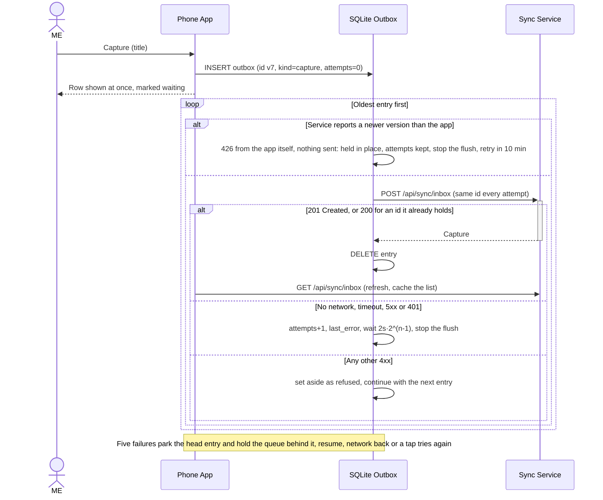

- **One outbox, many kinds.** Each row is `id, kind, payload, attempts, last_error, created_at`. Every kind shares one queue and order:

  | Kind | What it carries |
  | --- | --- |
  | `capture` | A capture. |
  | `task` | A task, sent to its own endpoint. |
  | `note` | A note the phone creates or edits (**Mobile Note Sync**). |
  | `talk-note` | An entry an earlier build left queued, which it drains (**Talk Note Upload**). |
- **Oldest first, head of line.** A transient failure stops the flush. No network, a timeout and a 5xx count, as does a 401 from a service that restarted with a new signing key. Retries come after 2s, 4s, 8s, 16s; the fifth failure parks the entry as *waiting — tap to retry*, still first in line. A refusal (any other 4xx but 426) is set aside at once and holds nothing up.
- **Held while the service is newer.** A 426 is the phone's own answer when the service reports a version above the app's (local ADR 0005 §Version compatibility). Nothing was sent. The head entry keeps its place and attempts, and the flush stops. It is tried again ten minutes on, so a rolled-back service takes the queue without a tap.
- **Same id on every attempt.** The id is minted (`Guid.CreateVersion7()`) when queued. The service answers a repeat with 200 and the capture it holds, so a lost 201 delivers once.
- **Flush triggers.** A flush starts on:
  - queuing an entry;
  - the backoff timer;
  - the app returning to the foreground;
  - the network coming back;
  - a tap on a parked entry.

  The last three skip the pending wait and give a parked entry its attempts back.
- **The list outlives the service.** Every successful pull is kept in the same file with its time. A failed pull, including 503 `sync.replica_unavailable` while the Cosmos emulator warms up, shows that list with one line saying why it is not newer.
- **Only the phone's own captures.** The Inbox tab lists captures from the phone channel (`mobile`) until the desktop takes each in. The phone sends no acknowledgement or other decision: triage stays on the desktop (`.devbook/domain/inbox/features.md#triage-stays-on-the-desktop`).
- **Notes come back.** Notes are the one Inbox kind the phone also pulls, on the task feed (**Mobile Note Sync**).

## Capture Attachments

```meta
related: [".devbook/arc42/adr/0014-attachments-travel-through-a-blob-store-beside-the-replica.md", ".devbook/arc42/05-building-block-view.md#cloud-service", ".devbook/domain/capture/domain.md#capture"]
```

A capture's files travel beside it (local ADR 0014). The phone uploads each file first, under an id it mints, then posts the capture naming them; the capture document carries only metadata. A note's files take this path too (**Mobile Note Sync**).

- **Upload, then capture.** `PUT /api/sync/attachments/{id}` carries the bytes, their `Content-Type` and their SHA-256 in `X-Attachment-Sha256`. The service stages files at `{ownerId}/{id}`. Before storing anything it refuses a type off the allowlist (415), a body over the cap (413) or a malformed digest (400). It commits only on a digest match; a mismatch is 400. The same bytes under the same id are a 200 that writes nothing; different bytes are a 409. Success is 201 `StoredAttachment`.
- **A capture names only what is there.** `POST /api/sync/inbox` with `attachments` is refused (400 `inbox.capture_attachment_missing`, naming the ids) unless every file is stored under this owner with the claimed size and digest. Otherwise it upserts the metadata and answers 201 `InboxItem`.
- **The desktop fetches** each file with `GET /api/sync/attachments/{id}`, served as a download with `nosniff`; another owner's id is a 404. The Inbox intake:
  1. records the files in `inbox_item_attachments` and saves the item first;
  2. downloads each file, checks its SHA-256 and writes it into the item's folder.

  A failed file keeps its reason and waits for Retry; the item is received either way (`.devbook/domain/inbox/requirements.md#capture-attachments`).
- **Acknowledgement releases.** The tombstone arrives as the phone's `POST /api/sync/inbox/{id}/ack` or the desktop's `POST /api/sync/tasks` tombstone, answered 200. Once stored, the service deletes the held capture's files. A failed delete is logged and left to the container's 30-day lifecycle rule; the acknowledgement never fails on it.


## Talk Note Upload

```meta
related: [".devbook/domain/capture/features.md#talk-note", ".devbook/arc42/06-runtime-view.md#capture-attachments", ".devbook/arc42/06-runtime-view.md#mobile-capture-and-sync"]
```

The note replaced the talk note (`.devbook/arc42/12-glossary.md#terms`). Outbox kind `talk-note` now only drains entries an earlier build left queued, and its staged uploads are the path a note's files take (**Mobile Note Sync**). The payload is the capture with attachment metadata and the ids of files already uploaded; the bytes wait in `talk-notes/outbox/`, since an outbox row holds JSON.

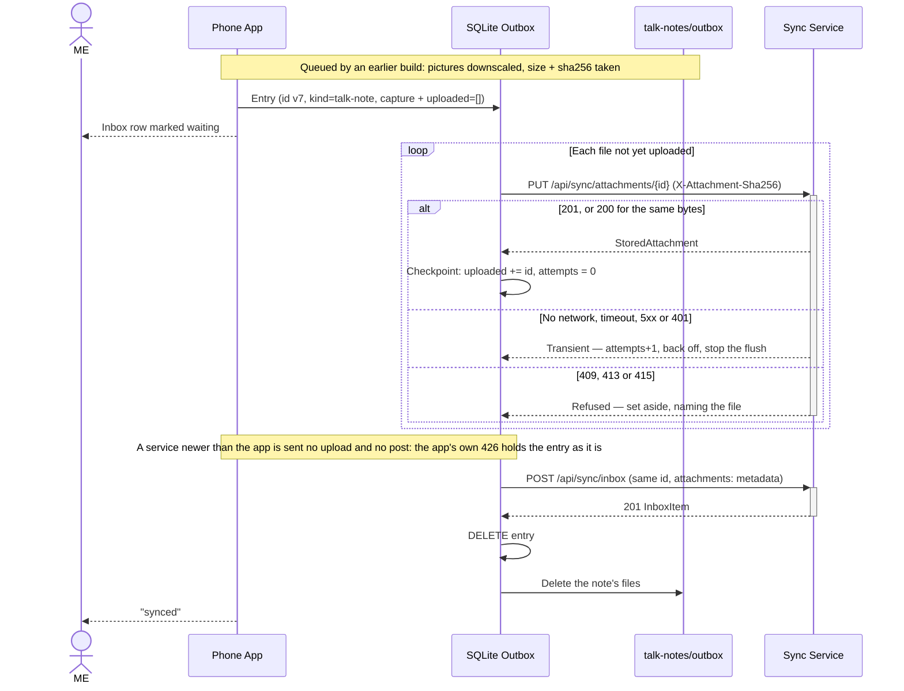

- **Prepared once, when queued.** Pictures were downscaled (1600 px longest edge, JPEG, EXIF reduced to orientation) unless the note kept originals. Size and SHA-256 come from the bytes that will go.
- **Uploads, checkpointed.** An attempt uploads each file not yet listed, then posts the capture. Each landed upload is written back into the entry (`IStagedOutboxKind`) and restores its attempts. A retry therefore resumes at the first file still to go with a fresh backoff budget.
- **One refusal refuses the note.** A 409, 413 or 415 on a file sets the entry aside naming the file; the capture is never posted without it.
- **Held while the service is newer.** A 426 on any request is the phone's own answer (**Mobile Capture and Sync**). The entry keeps its place, attempts and uploaded files until the verdict is next due.
- **Released on delivery.** The phone deletes the files once the capture is taken (201, or 200 for a known id).
- **Status from the outbox.** *synced* once the entry is gone, *uploading i of n* during an attempt, *waiting* otherwise, *waiting — tap to retry* once parked.

## Mobile My Day and Task Push

```meta
related: [".devbook/arc42/05-building-block-view.md#mobile-app", ".devbook/arc42/06-runtime-view.md#mobile-capture-and-sync", ".devbook/domain/tasks/features.md#my-day", ".devbook/domain/tasks/domain.md#agenda-time", ".devbook/domain/tasks/domain.md#completed", ".devbook/arc42/adr/0032-my-day-preferences-ride-the-task-feed.md"]
```

The phone's Today tab is My Day and nothing else. It reads the owner's task feed, not a My Day endpoint, and keeps only a projection of it. All four writes go through the device outbox:

- a task added for today;
- a task in today's My Day marked done or undone;
- one of its steps ticked or unticked;
- that task moved to tomorrow.

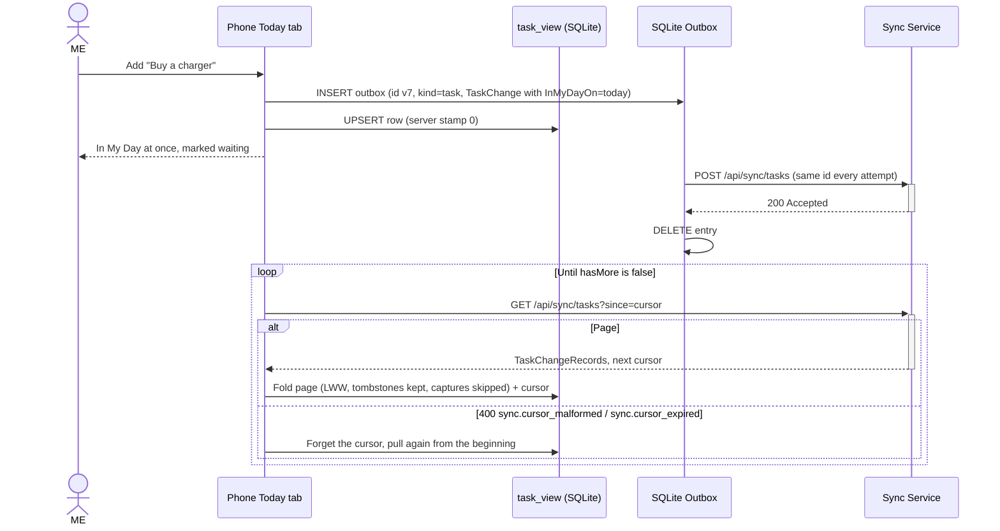

An edit to a task already in My Day takes the same path from the outbox onward:

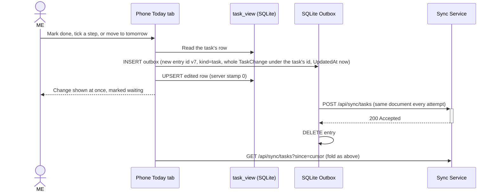

- **Fold the feed.** The phone pulls `GET /api/sync/tasks?since=` from its cursor until `hasMore` is false, keeping each page with its cursor in one transaction. Records fold into one `task_view` row per task:
  - the later `UpdatedAt` wins;
  - an equal stamp goes to the higher server stamp, then to the tombstone;
  - a `DeletedAt` hides the row, which is kept so page order never changes the result;
  - a non-task document never becomes a row: a `capture` is the Inbox's (ADR 0009), a `note` folds into its own view (ADR 0025).
- **Preferences are kept, not folded.** A `my-day-preferences` document is taken out of the page, the later `UpdatedAt` wins, and it is saved in the same transaction. The phone never writes it and reads `clearsOvernight: true` until one arrives (ADR 0032).
- **My Day is arithmetic**, as `.devbook/domain/tasks/domain.md#my-day` defines it. With Clear My Day overnight on, the list is the rows whose `in_my_day_on` is the phone's local date and whose status is not `archived`. With it off, an unfinished row with an earlier date stays. A row with `completed_on` today is in Done today. The phone applies the desktop's rule (ADR 0032 §5).
- **Other rows group by agenda time** against the phone's clock into Now, Agenda and Anytime today (`.devbook/domain/tasks/features.md#my-day`); a carried row has none and sits in Anytime today.
- **A rejected cursor starts over.** `sync.cursor_malformed` or `sync.cursor_expired` drops the cursor and pulls from the beginning; kept rows fold to the same result. Any other failure keeps the list with one line saying why.
- **Adding is a push.** The phone builds a `TaskChange` with a `Guid.CreateVersion7()` id and the typed title. It sets type `task`, status `draft` and priority `medium`, with `CreatedAt` now and `InMyDayOn` today. It is queued as outbox kind `task` and posted to `POST /api/sync/tasks` with a capture's order, backoff and waiting marker. A retry sends the same id, and the whole-document upsert makes it idempotent (ADR 0005).
- **At once, then replaced.** The `task_view` row is written at queue time with server stamp 0, marked waiting. The pull after delivery brings back the replica's copy, which replaces it.
- **An edit is a whole document.** The later `UpdatedAt` wins whole (ADR 0005), so the phone cannot send one field. It takes the row from `task_view`, applies the edit, stamps `UpdatedAt` now and queues the whole `TaskChange` as kind `task`. If the phone's clock is behind the row's stamp, the edit is stamped one millisecond past it. An edit that changes nothing queues nothing. The edits are:
  - Done, which ticks as the desktop's checkbox does;
  - Undone, which clears `completed_on`;
  - a step edit, which changes one sub-item's status;
  - Move to tomorrow, which sets `InMyDayOn` to the local date plus one day and drops the agenda time.
- **An edit rewrites the entry text.** The desktop's next save reads fields back off the text. The phone therefore builds the title, metadata line and body from `ContentMd` and applies the desktop control's `EntryTextParser` rewrite. `EntryTextParser` reads status, `completed_on` and `in_my_day_on` back. When the body changed, it also reads the steps' statuses back by position.

  Done writes `!done` onto every step chapter; a step tick flips a `[ ]` marker or writes the step's `!done` or `!ready`. A step with no place in the text is still set in the sub-item list. `TaskEdits` is the one service the screens call.
- **Every edit gets its own entry**, with its own entry id and the task's id in the `TaskChange`. Two quick taps therefore arrive in order and a retry is idempotent. The edit shows at once, marked waiting; the marker looks for the task's id inside the queued document, since the entry id differs. A pull bringing an older copy does not undo it, because the edit's stamp is later.
- **A refused edit stays on the phone.** If the service refuses and answers the same on every retry, the outbox sets the entry aside. The row keeps the edit until another device's later write replaces it.
- **A concurrent desktop edit wins or loses whole.** The phone's narrow edits make this rare; it is the cost of sending documents rather than field changes.

A repeating task the phone ticks gets its next occurrence from the desktop:

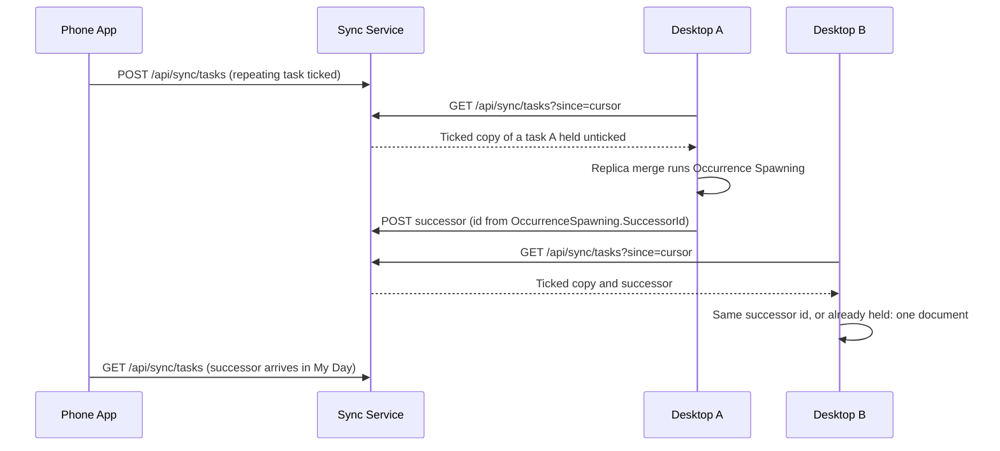

- **The phone never spawns an occurrence.** The desktop's merge runs Occurrence Spawning, as the desktop's own tick does. The successor is a desktop write that the next sync pushes and the phone pulls.
- **Nothing spawns twice.** A re-pull changes nothing, because the merge refuses a version it holds. A task that arrives already ticked, never seen before, spawns nothing. Two desktops derive the same successor id, so the replica keeps one document. A desktop holding the successor, live or deleted, spawns nothing.
- **An untick leaves the successor**, as the desktop's own untick does (`.devbook/domain/tasks/domain.md#occurrence-spawning`).

## Sync Item Lifecycle

```meta
related: [".devbook/arc42/05-building-block-view.md#mobile-app"]
```

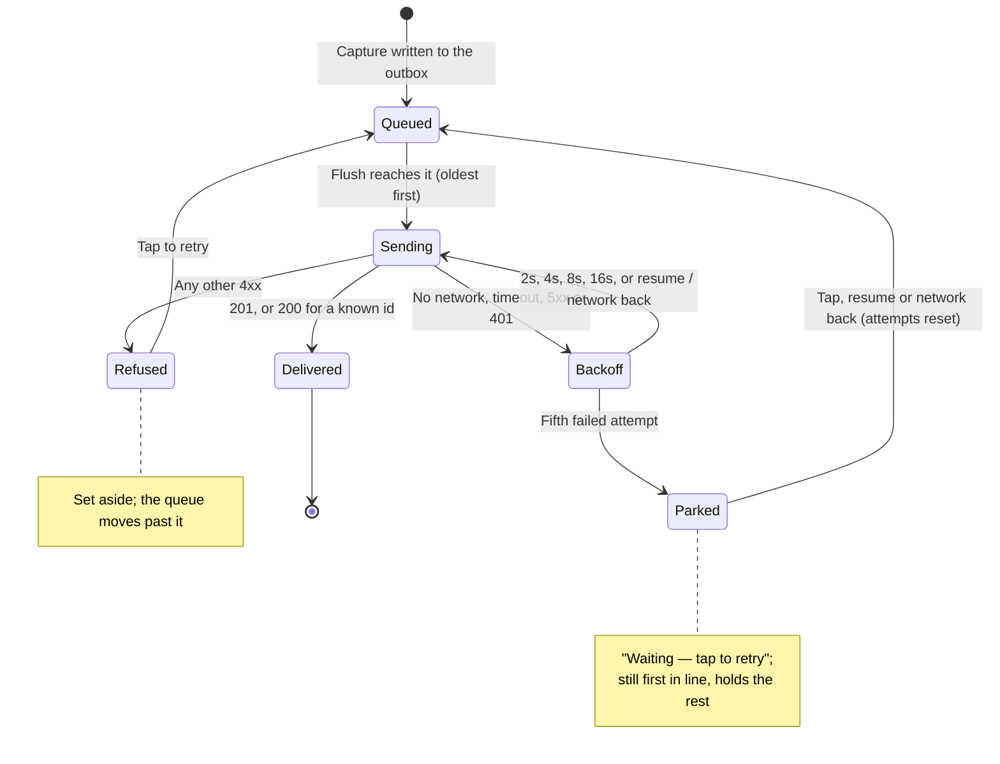

## IDE Context-aware Capture

```meta
related: [".devbook/arc42/05-building-block-view.md#ide-extensions", ".devbook/arc42/adr/0005-azure-hosted-task-replica-for-multi-device-sync.md"]
```


Pairing, when the extension has no credential or it was rejected:

1. ME generates a code in Settings > Devices.
2. The desktop sends `POST /api/sync/devices/codes` with its Bearer token and gets a code and `expiresAt`.
3. ME runs `backlog.pair` and types the code.
4. The extension sends `POST /api/sync/devices/pair` with the code and `deviceName`.
5. It gets 201 with `deviceId` and a credential shown once, and stores both in `SecretStorage`.

Without a stored credential the extension asks to pair before the title box and sends no inbox request.

Every capture:

1. ME runs `backlog.capture` on a selection and confirms a title box pre-filled with the selection's first line.
2. With no token cached, or one expiring within two minutes, the extension sends `POST /api/sync/devices/token` with the credential and gets `accessToken` and `expiresAt`.
3. It sends `POST /api/sync/inbox` with the title, `source=vscode` and its Bearer token.
4. On 201 it shows "Backlog: captured …".

- **A 401 from the inbox** says only that the token was refused, so the extension gets a new token and sends the same POST once more.
- **A 401 from the token endpoint** is a verdict on the credential; the extension deletes it and offers Pair with Desktop.

The extension sends the title only, with no repository context (file, line, branch). It caches nothing but the token and reaches the sync service at `backlog.cloudUrl`, not the desktop (`.devbook/arc42/05-building-block-view.md#ide-extensions`).

## Copilot App Session Capture

```meta
related: [".devbook/arc42/05-building-block-view.md#ide-extensions", ".devbook/domain/capture/domain.md#source-adapter", ".devbook/domain/capture/features.md#copilot-app-session-capture"]
```

> Not built. No `/inbox/items` route exists; agent sessions reach the desktop through
> its MCP server (local ADR 0012). The diagram is the intended flow.

A GitHub Copilot App session can capture a backlog follow-up or knowledge note from
local session metadata (`session_id`, `worktree_path`, `branch`). It goes through the
source adapter (`.devbook/domain/capture/domain.md#source-adapter`) and reuses the
local capture pipeline of the IDE extensions and desktop workers.

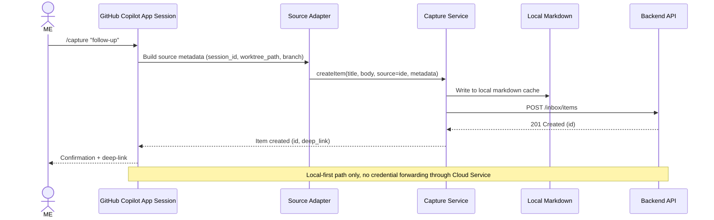

## Repository Baseline Scan and Health Signal

```meta
related: [".devbook/arc42/05-building-block-view.md#desktop-app", ".devbook/arc42/08-crosscutting-concepts.md#shared-data-types"]
```

> Not built. No scheduler, package-registry scan or `ProgressSignal` exists in the
> code; the diagram is the intended flow.

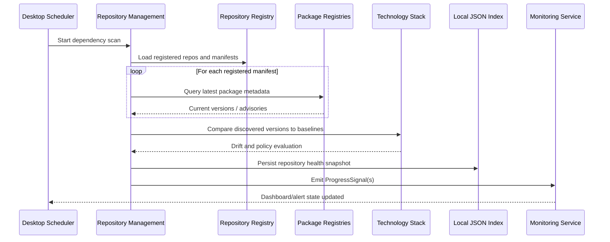

## Remote PC Wake and Status Update

```meta
related: [".devbook/arc42/05-building-block-view.md#desktop-app", ".devbook/arc42/05-building-block-view.md#cloud-service"]
```

> Not built. The cloud service has no PC registry and no `/pc/wake` or
> `/pc/heartbeat` route; the diagram is the intended flow.

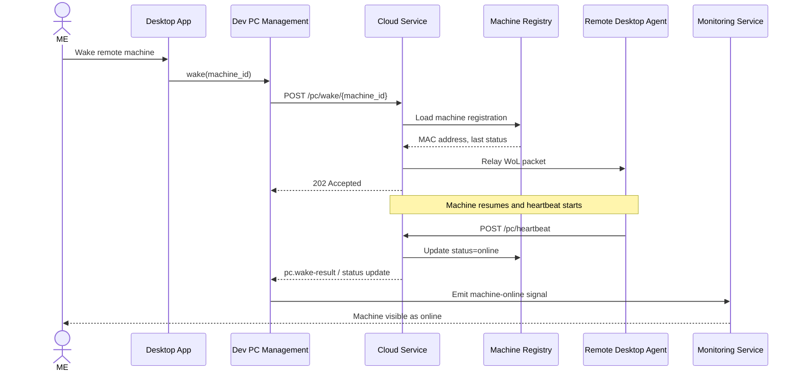

## Mobile Note Sync

```meta
related: [".devbook/domain/inbox/domain.md#note", ".devbook/domain/inbox/features.md#notes", ".devbook/arc42/06-runtime-view.md#mobile-capture-and-sync", ".devbook/arc42/06-runtime-view.md#mobile-my-day-and-task-push", ".devbook/arc42/06-runtime-view.md#capture-attachments", ".devbook/arc42/adr/0009-captures-are-a-document-kind-on-the-replica.md", ".devbook/arc42/adr/0005-azure-hosted-task-replica-for-multi-device-sync.md", ".devbook/arc42/adr/0025-notes-ride-the-task-feed.md"]
```

A note (`.devbook/domain/inbox/domain.md#note`) is the one Inbox item that syncs both ways. The phone pulls every note and pushes those it creates or edits; the desktop pushes its own edits and a tombstone on archive or delete. Both sides are built. `.devbook/arc42/adr/0025-notes-ride-the-task-feed.md` records why notes ride the task feed.


The phone's tab upserts the `note_view` row with `UpdatedAt` now and server stamp 0. It queues an outbox entry of kind `note` holding the whole document and posts it to `POST /api/sync/tasks` with type `note` and the same id each attempt, answered 200. The desktop pulls it with `GET /api/sync/tasks?since=cursor`, and the Inbox intake creates or updates the item, the later `UpdatedAt` winning. Desktop edits, archives and deletes go back as a note document or tombstone, which the phone folds into `note_view` on its next pull.

- **A third document kind.** A note travels as a task-shaped document in the `tasks` container with `type: "note"` under the Inbox item's id, following `.devbook/arc42/adr/0009-captures-are-a-document-kind-on-the-replica.md`. Unlike a capture, nobody acknowledges a note away: the desktop takes it in and keeps pushing it.
- **Pulled with the task feed.** The phone folds every `note`-type document from `GET /api/sync/tasks?since=` into `note_view` as it folds tasks. The later `UpdatedAt` wins, an equal stamp goes to the higher server timestamp, and a `DeletedAt` hides the row. The note pull keeps its own cursor beside `task_view`'s. The task fold skips notes; the Notes tab reads and searches `note_view` on the phone.
- **Pushed through the outbox.** The row is written at once, and the entry takes every outbox entry's order, backoff and waiting marker. A retry is idempotent. Each edit is its own entry, so offline edits go out in order. An edit is never stamped earlier than the copy it replaces, so a slow phone clock cannot undo it.
- **The desktop owns triage.** Its merge hands each `note` document to the Inbox's note port, which creates the item or applies the later edit by the note's `edited_at`. On each push the desktop sends every live note it changed itself and has not pushed yet. A flag tracks these rather than a watermark, because a note's stamp may come from the phone's clock. A note it only pulled is never sent back. A local change is stamped after the copy it replaces, whatever the clocks say.
- **Archive and delete.** The acknowledgement outbox pushes the tombstone as a `note` document, and the phone drops the row on its next pull. A phone edit arriving after the archive or deletion leaves it standing and owes the tombstone again under a later stamp. The deleted id is kept, so no later copy remakes it. The phone never pushes a tombstone.
- **Files keep their own path.** Photos and files travel as **Capture Attachments** describes, uploaded before the note document that names them; an edit uploads only added files. The service releases them when it takes the note's tombstone, as for a capture.

## Notification Reply

```meta
related: [".devbook/domain/notifications/domain.md#reply", ".devbook/domain/notifications/requirements.md#answering-from-another-device", ".devbook/arc42/08-crosscutting-concepts.md#notifications", ".devbook/arc42/adr/0039-notifications-are-an-owned-document-kind-and-push-only-nudges.md", ".devbook/arc42/06-runtime-view.md#mobile-note-sync"]
```

A question raised on a desktop is answered from the phone. Desktop A owns the
notification, so the phone's reply only proposes an answer, and Desktop A decides.
Local ADR 0039 records the decision. The scenario is built; the Android push was
deployed on 2026-11-04, and no push reaches a phone until the hub has its FCM credential.

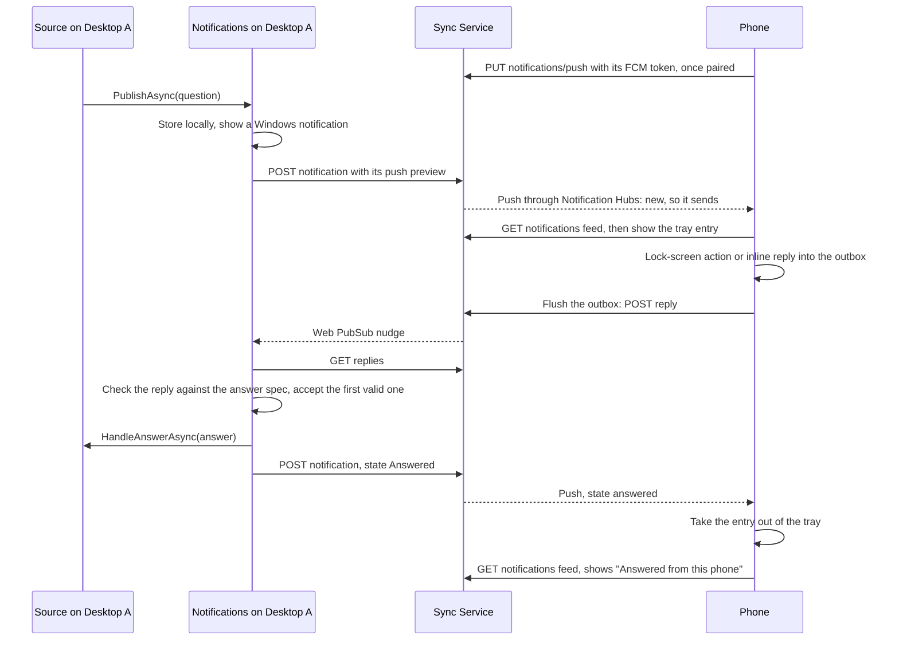

- **The push carries no body.** It is data-only; the OS notification shows the title and summary. The phone pulls the feed before showing the entry, since the actions come from the pulled answer spec, and pulls the body when the person opens it.
- **Only a transition pushes.** The service pushes when a notification is new or changes state; the owner's 10-minute presence re-push sends nothing.
- **The tray answers only what fits.** A single-choice question with up to three choices gets one action per choice. An open answer gets an inline reply, beside up to two choices. Any other question, an owner-only one included, gets no actions; a tap opens the notification in the app.
- **An offline owner delays the answer, not the reply.** The reply waits in the `notificationReplies` container. The phone shows "delivers on wake" until Desktop A wakes, pulls and accepts it.
- **A missed nudge costs only time.** Desktop A runs a full exchange on every nudge and one to catch up when its socket opens. While a question is open and the socket is down, it polls for replies every two minutes.
- **The answer survives a restart.** Desktop A stores the accepted answer in SQLite before calling the source's handler and replays it to a handler that was not running. The handler must therefore accept the same answer twice.
- **A late reply is rejected with its reason.** A reply to a question already answered or closed is rejected, and the phone shows which answer won.

## Talk Note Attach

```meta
related: [".devbook/domain/events/features.md#attach-a-talk-note", ".devbook/domain/events/domain.md#attachment-request", ".devbook/arc42/adr/0050-events-is-its-own-bounded-context.md", ".devbook/arc42/adr/0035-goals-and-impediments-replace-sprints.md", ".devbook/arc42/06-runtime-view.md#mobile-note-sync", ".devbook/arc42/05-building-block-view.md#mobile-app"]
```

The phone writes no knowledge event, so it attaches a Talk note by asking a
desktop. The request rides the task feed, as the phone's impediment edit does
(ADR 0035 §8), and the answer comes back on the `knowledgeEvents` feed. Local
ADR 0050 records the decision. The scenario is built.

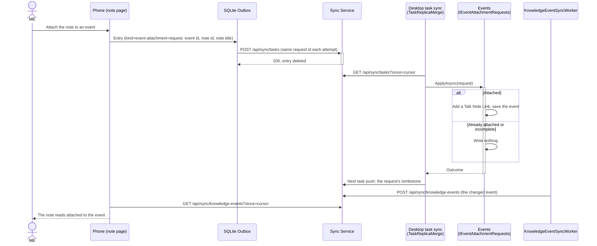

- **No document answers the request.** The note reads attached once the pulled
  event carries its Talk Note Link. Until then the note's Event section shows the
  outbox state of the request.
- **Every answer but one retires the request.** Attached, already attached and
  incomplete each queue a tombstone, so a second desktop or a second tap links
  nothing twice.
- **An unknown event defers the request.** A desktop that holds no event by that
  id yet keeps the request and offers it again after each pull. The deferral
  lives in memory, so a restart forgets it on that desktop.
- **A desktop without Events holds the request.** A head without the port leaves
  it on the replica for another desktop. With the `events` area off, a desktop
  defers it and applies it once the area is on again.
