# 06. Runtime View

```meta
related: [".devbook/arc42/05-building-block-view.md"]
```

## Task to GitHub Issue

```meta
related: [".devbook/arc42/05-building-block-view.md#desktop-app"]
```

Creating a task writes its SQLite row locally first (local ADR 0003), then asynchronously creates
one GitHub issue per targeted repo.


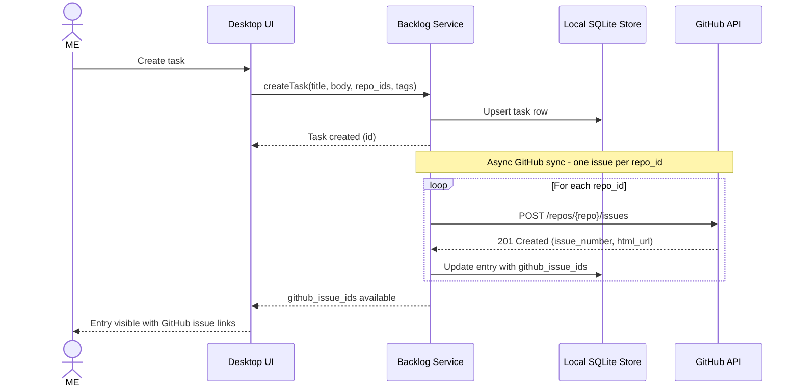

## State Sync and Webhook Forwarding

```meta
related: [".devbook/arc42/05-building-block-view.md#cloud-service"]
```

In connected mode the desktop pushes its task changes to the sync service, and the
phone pulls them from the task feed. `.devbook/arc42/08-crosscutting-concepts.md#task-sync`
has the reconciliation.

> Webhook forwarding is not built: no route receives GitHub webhooks. The last part of
> the diagram is the intended flow.

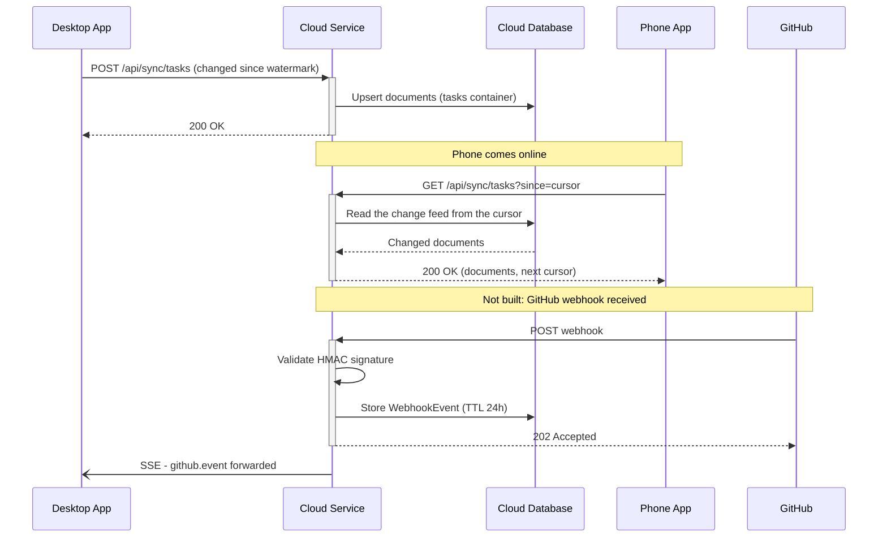

## Mobile Capture and Sync

```meta
related: [".devbook/arc42/05-building-block-view.md#mobile-app", ".devbook/arc42/adr/0005-azure-hosted-task-replica-for-multi-device-sync.md"]
```

A capture is written to the phone's own SQLite outbox before anything touches
the network, then sent in the order it was made. The phone never loses a capture
to a missing signal: it shows the item at once, marked waiting, and delivers it
when the service answers.

- **One outbox, many kinds.** Each row is `id, kind, payload, attempts,
  last_error, created_at`. The `kind` picks the sender, and every kind shares the
  same queue and order. `capture` is a capture; `task` is pushed to its own
  endpoint; `note` carries a note the phone creates or edits (**Mobile Note
  Sync**). `talk-note` drains an entry an earlier build left queued, one entry
  that is several requests (**Talk Note Upload**).
- **Oldest first, head of line.** A transient failure (no network, a timeout, a
  5xx, or a 401 from a service that restarted with a new signing key) stops the
  flush, so nothing overtakes it. It is retried after 2s, 4s, 8s, 16s. The fifth
  failure parks the entry as *waiting — tap to retry*, and it stays first in
  line. A refusal (any other 4xx but 426) is set aside at once and holds nothing
  up.
- **Held while the service is newer.** A 426 is the phone's own answer when the
  service reports a version above the app's (local ADR 0005 §Version
  compatibility); nothing was sent. The head entry keeps its place and its
  attempts, the flush stops, and it is tried again when the verdict is next due,
  ten minutes on, so a rolled-back service takes the queue without a tap.
- **Same id on every attempt.** The id is minted (`Guid.CreateVersion7()`) when
  the capture is queued. The service answers a repeat of it with 200 and the
  capture it already holds, so a retry after a lost 201 delivers it once.
- **Flush triggers.** Queuing an entry, the backoff timer, the app returning to
  the foreground, the network coming back, and a tap on a parked entry. The
  last three skip the pending wait and give a parked entry its attempts back,
  since each is a sign that the reason for the wait has gone.
- **The list outlives the service.** Every successful pull is kept in the same
  file with its time. A failed pull, including 503 `sync.replica_unavailable`
  while the Cosmos emulator warms up, shows that cached list with one status line
  saying why it is not newer.
- **Only the phone's own captures.** The Inbox tab lists the captures this phone
  made, until the desktop takes each in. The phone sends no acknowledgement and
  no other decision about an item: triage stays on the desktop
  (`.devbook/domain/inbox/features.md#triage-stays-on-the-desktop`). The service
  answers with every capture the desktop has not taken in, so the tab keeps the
  ones whose source is the phone channel, `mobile`.
- **Notes come back.** Notes are the one kind of Inbox item the phone pulls as
  well as sends. They travel on the task feed, not on the inbox listing, and
  **Mobile Note Sync** below describes them.

```mermaid
sequenceDiagram
    actor ME
    participant App as Phone App
    participant Outbox as SQLite Outbox
    participant Sync as Sync Service

    ME->>App: Capture (title)
    App->>Outbox: INSERT outbox (id v7, kind=capture, attempts=0)
    App-->>ME: Row shown at once, marked waiting

    loop Oldest entry first
        alt Service reports a newer version than the app
            Outbox->>Outbox: 426 from the app itself, nothing sent: held in place, attempts kept; stop the flush; retry in 10 min
        else
            Outbox->>+Sync: POST /api/sync/inbox (same id every attempt)
            alt 201 Created, or 200 for an id it already holds
                Sync-->>-Outbox: Capture
                Outbox->>Outbox: DELETE entry
                App->>Sync: GET /api/sync/inbox (refresh, cache the list)
            else No network, timeout, 5xx or 401
                Outbox->>Outbox: attempts+1, last_error; wait 2s·2^(n-1); stop the flush
            else Any other 4xx
                Outbox->>Outbox: set aside as refused; continue with the next entry
            end
        end
    end

    Note over App,Outbox: Five failures park the head entry and hold the queue behind it; resume, network back or a tap tries again
```

## Capture Attachments

```meta
related: [".devbook/arc42/adr/0014-attachments-travel-through-a-blob-store-beside-the-replica.md", ".devbook/arc42/05-building-block-view.md#cloud-service", ".devbook/domain/capture/domain.md#capture"]
```

A capture's files travel beside it rather than inside it (local ADR 0014). The
phone uploads each file first, under an id it mints itself, and posts the
capture that names them after; the capture document carries only their
metadata. All three sides are built. On the phone, a note's files take this path
(**Mobile Note Sync**).

- **Upload, then capture.** `PUT /api/sync/attachments/{id}` carries the bytes,
  their declared `Content-Type` and their SHA-256 in `X-Attachment-Sha256`. The
  service refuses a type off the allowlist (415) or a body over the cap (413)
  before storing anything, stages the bytes while hashing them, and commits them
  only when they match the declared digest. The same bytes again under the same
  id are a 200 that writes nothing; different bytes are a 409.
- **A capture names only what is there.** `POST /api/sync/inbox` with
  `attachments` is refused (400 `inbox.capture_attachment_missing`, naming the
  ids) unless every file is stored under this owner with the size and digest
  the capture claims.
- **The desktop fetches** each file with `GET /api/sync/attachments/{id}`,
  served as a download with `nosniff`. Another owner's id is a 404. The Inbox
  intake records the files the capture names in `inbox_item_attachments` and
  saves the item first, then downloads each one, checks its SHA-256, and writes
  it into the item's folder under the workspace. A file that fails keeps its
  reason and waits for Retry; the item is received either way. See
  `.devbook/domain/inbox/requirements.md#capture-attachments`.
- **Acknowledgement releases.** The capture's tombstone arrives as the phone's
  `POST /api/sync/inbox/{id}/ack` or as the desktop's pushed tombstone. When it is
  stored, the service deletes the files the held capture named. A failed delete is
  logged and left to the container's 30-day lifecycle rule; the acknowledgement
  never fails on it.

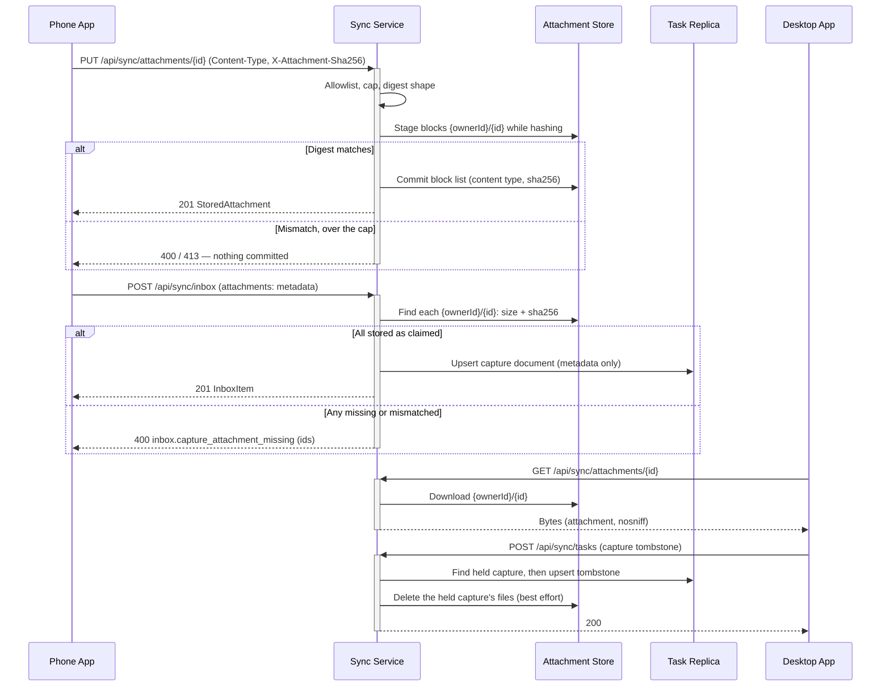

## Talk Note Upload

```meta
related: [".devbook/domain/capture/features.md#talk-note", ".devbook/arc42/06-runtime-view.md#capture-attachments", ".devbook/arc42/06-runtime-view.md#mobile-capture-and-sync"]
```

The note replaced the talk note (`.devbook/arc42/12-glossary.md#terms`). Outbox kind
`talk-note` now only drains entries an earlier build left queued, and its staged
uploads are the path a note's files take too (**Mobile Note Sync**). A `talk-note`
entry's payload is the capture, attachment metadata included, and the ids of the
files already uploaded. The bytes wait beside the database in `talk-notes/outbox/`,
since an outbox row holds JSON.

- **Prepared once, when queued.** Each picture was downscaled (1600 px longest
  edge, JPEG, EXIF reduced to the orientation) unless the note kept originals.
  The size and SHA-256 come from the bytes that will actually go.
- **Uploads, checkpointed.** An attempt uploads each file not yet listed as
  uploaded, then posts the capture. Every upload that lands is written back into
  the entry before the next starts (`IStagedOutboxKind`), and hands the entry its
  attempts back. A retry therefore resumes at the first file still to go, and
  each file has the whole backoff budget of its own.
- **One refusal refuses the note.** A 409, 413 or 415 on a file sets the entry
  aside naming the file; the capture is never posted without it.
- **Held, not refused, while the service is newer.** A 426 on any of its requests
  is the phone's own answer for a service newer than the app (**Mobile Capture and
  Sync**). Nothing was sent: the entry keeps its place, its attempts and the files
  already uploaded, and the flush stops until the verdict is next due.
- **Released on delivery.** The files are deleted from the phone once the
  capture is taken (201, or 200 for an id the service already holds).
- **Status from the outbox.** *synced* once the entry is gone, *uploading i of
  n* while an attempt is sending its files, *waiting* otherwise, and *waiting —
  tap to retry* once parked.

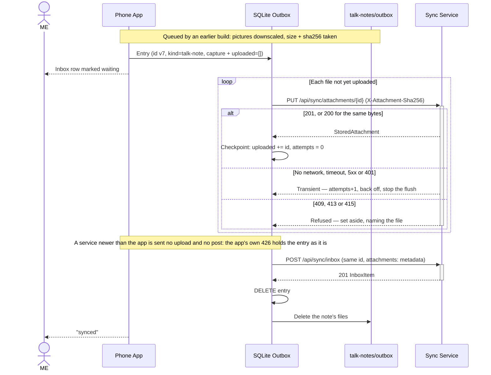

## Mobile My Day and Task Push

```meta
related: [".devbook/arc42/05-building-block-view.md#mobile-app", ".devbook/arc42/06-runtime-view.md#mobile-capture-and-sync", ".devbook/domain/tasks/features.md#my-day", ".devbook/domain/tasks/domain.md#agenda-time", ".devbook/domain/tasks/domain.md#completed", ".devbook/arc42/adr/0032-my-day-preferences-ride-the-task-feed.md"]
```

The phone's Today tab is My Day and nothing else. It reads the owner's existing
task feed rather than a My Day endpoint. It writes four things, all through the
device outbox: a task added for today, and three edits to a task already in
today's My Day. Those edits are done or undone, a step ticked or unticked, and
the task moved to tomorrow. The phone keeps no task store of its own, only a
projection of the feed.

- **Fold the feed.** The phone pulls `GET /api/sync/tasks?since=` from a cursor it
  keeps, page after page until `hasMore` is false. Each page is kept with the
  cursor after it in one transaction. Records fold into one row per task in a
  local `task_view` table:
  - the later `UpdatedAt` wins;
  - an equal stamp goes to the higher server stamp, and then to the tombstone;
  - a `DeletedAt` hides the row;
  - a document of a kind that is not a task never becomes a row. A `capture` is
    the Inbox's (ADR 0009), and a `note` folds into its own view (ADR 0025).

  A deleted task keeps its row, hidden, so the order pages arrive in never
  changes the result.
- **The My Day preferences are kept, not folded.** A `my-day-preferences`
  document is taken out of the page, and the later `UpdatedAt` wins. It is saved
  in the same transaction as the page and its cursor. The phone never writes it
  and reads `clearsOvernight: true` until one arrives (ADR 0032).
- **My Day is arithmetic**, as `.devbook/domain/tasks/domain.md#my-day` defines
  it. With Clear My Day overnight on, the list is the rows whose `in_my_day_on` is
  the phone's current local date and whose status is not `archived`. With it off,
  an unfinished row with an earlier `in_my_day_on` stays in the list too. A row
  with `completed_on` today is in Done today, and a row completed earlier is out.
  The phone applies the same rule as the desktop (ADR 0032 §5). The other rows are
  grouped by their agenda time against the phone's clock into Now, Agenda and
  Anytime today, as `.devbook/domain/tasks/features.md#my-day` describes. A
  carried row has no agenda time, so it sits in Anytime today.
- **A rejected cursor starts over.** `sync.cursor_malformed` or
  `sync.cursor_expired` drops the cursor and pulls once from the beginning; the
  rows already kept fold to the same result. Any other failure keeps the list on
  screen with one line saying why.
- **Adding is a push.** The phone builds the task as a `TaskChange` with a
  `Guid.CreateVersion7()` id, the typed title, type `task`, status `draft`,
  priority `medium`, `CreatedAt` now and `InMyDayOn` today. Added here means
  picked for today. The task is queued as outbox kind `task` and posted to
  `POST /api/sync/tasks`, with the same order, backoff and waiting marker as a
  capture. A retry sends the same id, and the replica's whole-document upsert
  makes that idempotent (ADR 0005).
- **At once, then replaced.** The row is written into `task_view` when the task
  is queued, with server stamp 0, so it is in today's list immediately and marked
  waiting until the outbox delivers it. The pull that delivery triggers brings
  back the replica's copy of the same write, which replaces it.
- **An edit is a whole document.** The replica keeps one document per task and
  the later `UpdatedAt` wins whole (ADR 0005), so the phone cannot send a field
  on its own. It takes the task's row from `task_view`, applies the one edit,
  stamps `UpdatedAt` now and queues the whole `TaskChange` as outbox kind `task`.
  When the phone's clock is behind the stamp the row already carries, the edit
  is stamped one millisecond past it instead, so it is still the later write.
  Done ticks the task as the desktop's checkbox does. Undone clears
  `completed_on`. A step edit changes one sub-item's status. Move to tomorrow
  sets `InMyDayOn` to the phone's local date plus one day and drops the agenda
  time. An edit that changes nothing, such as ticking a task already ticked
  today, queues nothing.
- **An edit rewrites the entry text.** The desktop's next save reads a task's
  fields back off its text, so the phone edits the text and not only the
  fields. It builds the task's title, a metadata line and its body from
  `ContentMd`, then applies the same `EntryTextParser` rewrite the desktop's
  control uses. It reads status, `completed_on` and `in_my_day_on` back off the
  result. When the body changed, it also reads the body and the steps'
  statuses, by position, as the desktop's save syncs them. So done writes
  `!done` on to every step chapter, and a step tick flips a `[ ]` marker or
  writes the step's own `!done` or `!ready`. A step that has no place in the
  text is still set in the sub-item list. `TaskEdits` is the one service the
  screens call for the three edits.
- **Every edit gets its own entry.** Each edit is a new outbox entry with its own
  entry id, carrying the task's own id in the `TaskChange`. A retry sends the
  same document, so the replica's upsert keeps it idempotent. Entries queue
  behind the ones before them, so two quick taps on the same task arrive
  in the order they were made. The edit is applied to `task_view` at once and
  marked waiting, the same as an added task. Because an edit's entry id is not
  the task's, the waiting marker looks for the task's id inside the queued
  document, not for an entry with that id. A pull that brings back an older
  copy before delivery does not undo the edit, because the edit's stamp is
  later.
- **A refused edit stays on the phone.** The service may refuse an edit and
  answer the same way on every retry. The outbox then sets the entry aside, and
  the phone's row keeps the edit until a later write from another device
  replaces it.
- **A concurrent desktop edit loses or wins whole.** When the desktop changes the
  same task while a phone edit waits in the outbox, the later `UpdatedAt` decides
  the whole task. The phone's narrow edits make this rare, but it is the cost of
  sending documents rather than field changes.

```mermaid
sequenceDiagram
    actor ME
    participant Tasks as Phone Today tab
    participant View as task_view (SQLite)
    participant Outbox as SQLite Outbox
    participant Sync as Sync Service

    ME->>Tasks: Add "Buy a charger"
    Tasks->>Outbox: INSERT outbox (id v7, kind=task, TaskChange with InMyDayOn=today)
    Tasks->>View: UPSERT row (server stamp 0)
    Tasks-->>ME: In My Day at once, marked waiting

    Outbox->>+Sync: POST /api/sync/tasks (same id every attempt)
    Sync-->>-Outbox: 200 Accepted
    Outbox->>Outbox: DELETE entry

    loop Until hasMore is false
        Tasks->>+Sync: GET /api/sync/tasks?since=cursor
        alt Page
            Sync-->>-Tasks: TaskChangeRecords, next cursor
            Tasks->>View: Fold page (LWW, tombstones kept, captures skipped) + cursor
        else 400 sync.cursor_malformed / sync.cursor_expired
            Tasks->>View: Forget the cursor; pull again from the beginning
        end
    end
```

An edit to a task already in My Day takes the same path from the outbox onward:

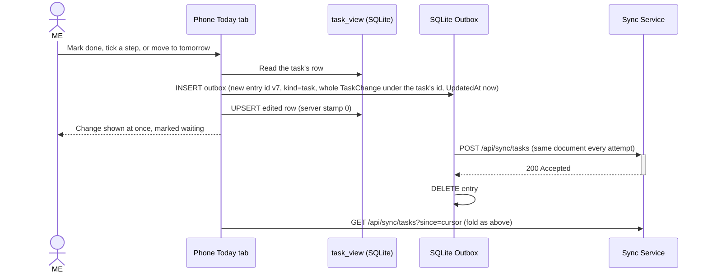

A repeating task the phone ticks gets its next occurrence from the desktop:

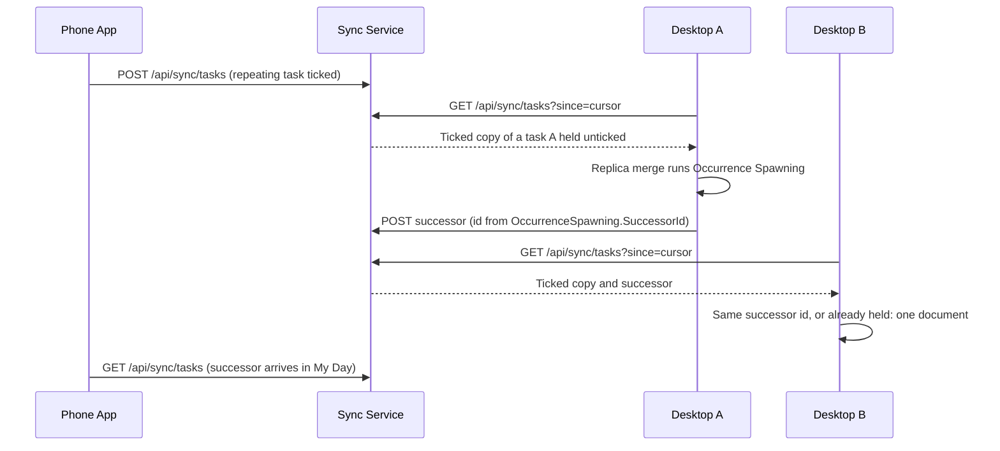

- **The phone never spawns an occurrence.** The desktop's merge runs Occurrence
  Spawning, the use case the desktop's own tick runs. The successor is a desktop
  write, so the next sync pushes it and the phone pulls it.
- **Nothing spawns twice.** A re-pull of the same document changes nothing,
  because the merge refuses a version it already holds. A task that arrives
  already ticked, never seen before, spawns nothing. Two desktops that each see
  the tick derive the same successor id, so the replica keeps one document. A
  desktop that already holds the successor, live or deleted, spawns nothing.
- **An untick leaves the successor.** An untick arriving after the spawn leaves
  the successor in place, as the desktop's own untick does
  (`.devbook/domain/tasks/domain.md#occurrence-spawning`).

## Sync Item Lifecycle

```meta
related: [".devbook/arc42/05-building-block-view.md#mobile-app"]
```

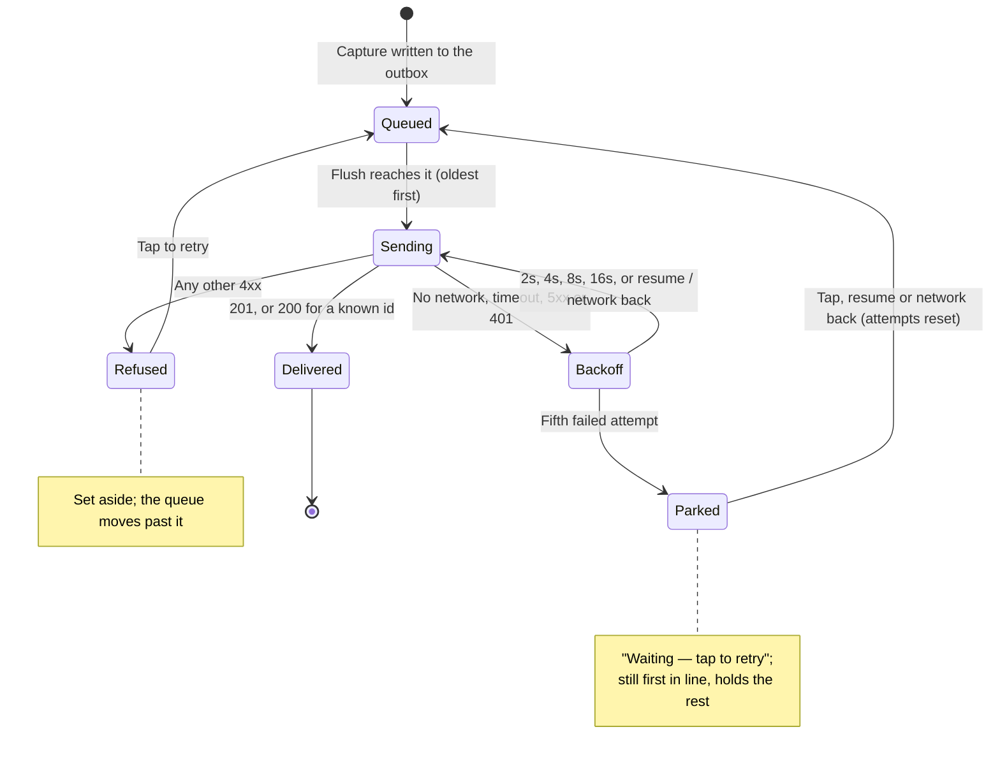

## IDE Context-aware Capture

```meta
related: [".devbook/arc42/05-building-block-view.md#ide-extensions", ".devbook/arc42/adr/0005-azure-hosted-task-replica-for-multi-device-sync.md"]
```

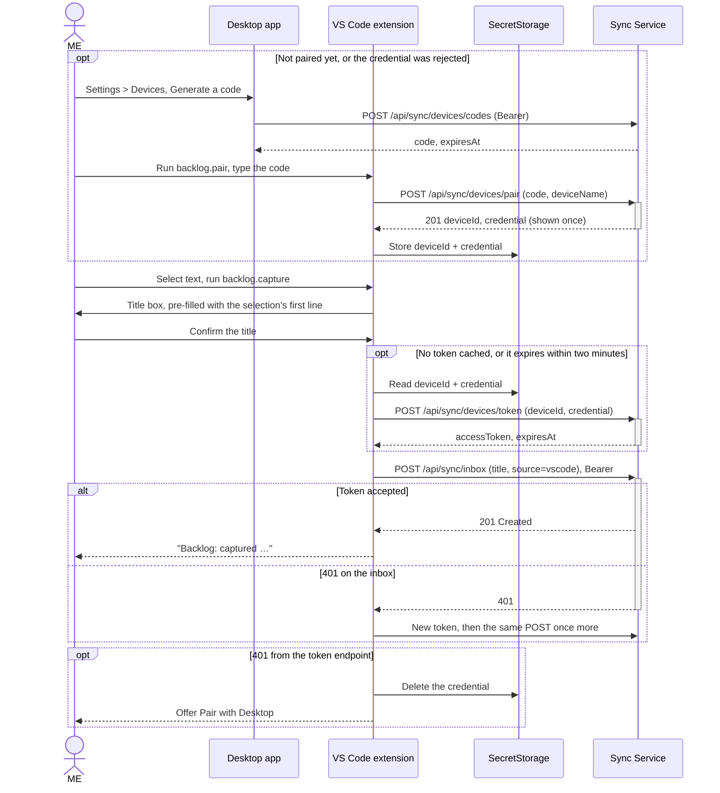

The extension sends the selection as a title only. It carries no repository
context (file, line, branch), caches nothing but the token, and reaches the sync
service at `backlog.cloudUrl` rather than the desktop
(`.devbook/arc42/05-building-block-view.md#ide-extensions`).

A 401 from the inbox says only that the token was refused, so a fresh token is worth
one retry. A 401 from the token endpoint is a verdict on the credential itself, which
pairing again is the only fix for. Without a stored credential the extension asks to
pair before the title box and sends no inbox request.

## Copilot App Session Capture

```meta
related: [".devbook/arc42/05-building-block-view.md#ide-extensions", ".devbook/domain/capture/domain.md#source-adapter", ".devbook/domain/capture/features.md#copilot-app-session-capture"]
```

> Not built. No `/inbox/items` route exists; agent sessions reach the desktop through
> its MCP server (local ADR 0012). The diagram is the intended flow.

A GitHub Copilot App session can capture a backlog follow-up or knowledge note from
local session metadata (`session_id`, `worktree_path`, `branch`). It goes through the
source adapter (`.devbook/domain/capture/domain.md#source-adapter`) and reuses the
local capture pipeline of the IDE extensions and desktop workers.

```mermaid
sequenceDiagram
    actor ME
    participant Copilot as GitHub Copilot App Session
    participant Adapter as Source Adapter
    participant Capture as Capture Service
    participant Store as Local Markdown
    participant API as Backend API

    ME->>Copilot: /capture "follow-up"
    Copilot->>Adapter: Build source metadata (session_id, worktree_path, branch)
    Adapter->>Capture: createItem(title, body, source=ide, metadata)
    Capture->>Store: Write to local markdown cache
    Capture->>API: POST /inbox/items
    API-->>Capture: 201 Created (id)
    Capture-->>Copilot: Item created (id, deep_link)
    Copilot-->>ME: Confirmation + deep-link

    Note over Copilot,API: Local-first path only; no credential forwarding through Cloud Service
```

## Repository Baseline Scan and Health Signal

```meta
related: [".devbook/arc42/05-building-block-view.md#desktop-app", ".devbook/arc42/08-crosscutting-concepts.md#shared-data-types"]
```

> Not built. No scheduler, package-registry scan or `ProgressSignal` exists in the
> code; the diagram is the intended flow.

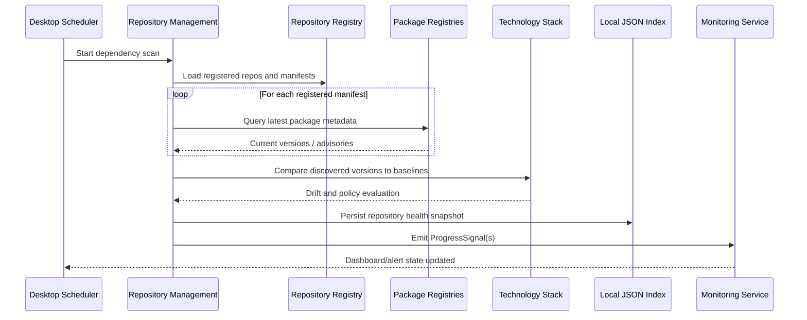

## Remote PC Wake and Status Update

```meta
related: [".devbook/arc42/05-building-block-view.md#desktop-app", ".devbook/arc42/05-building-block-view.md#cloud-service"]
```

> Not built. The cloud service has no PC registry and no `/pc/wake` or
> `/pc/heartbeat` route; the diagram is the intended flow.

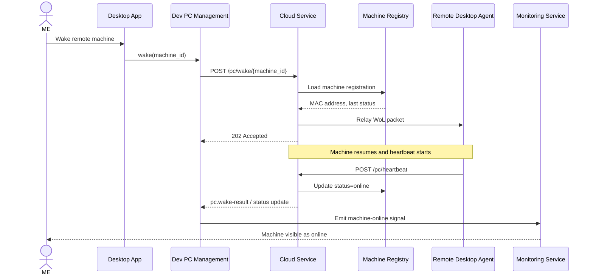

## Mobile Note Sync

```meta
related: [".devbook/domain/inbox/domain.md#note", ".devbook/domain/inbox/features.md#notes", ".devbook/arc42/06-runtime-view.md#mobile-capture-and-sync", ".devbook/arc42/06-runtime-view.md#mobile-my-day-and-task-push", ".devbook/arc42/06-runtime-view.md#capture-attachments", ".devbook/arc42/adr/0009-captures-are-a-document-kind-on-the-replica.md", ".devbook/arc42/adr/0005-azure-hosted-task-replica-for-multi-device-sync.md", ".devbook/arc42/adr/0025-notes-ride-the-task-feed.md"]
```

A note (`.devbook/domain/inbox/domain.md#note`) is the one Inbox item that
syncs both ways. The phone pulls every note, whichever device made it, and pushes the notes
it creates and edits. The desktop pushes its own note edits back, and a
tombstone when it archives or deletes one. The sync and the phone's Notes tab,
which reads `note_view`, are built.
`.devbook/arc42/adr/0025-notes-ride-the-task-feed.md` records why notes ride the
task feed.

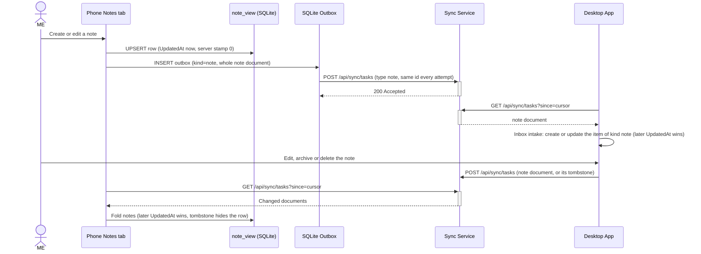

- **A third document kind.** A note travels on the replica as a task-shaped
  document in the `tasks` container with its own kind token, `type: "note"`,
  under the Inbox item's id. It follows the pattern
  `.devbook/arc42/adr/0009-captures-are-a-document-kind-on-the-replica.md` set
  for `capture`. The difference is that nobody acknowledges a note away: the
  desktop takes it in and keeps pushing it.
- **Pulled with the task feed.** The phone already pages through
  `GET /api/sync/tasks?since=` for My Day. It folds every `note`-type document
  into a local `note_view` table the way it folds tasks into `task_view`. The
  later `UpdatedAt` wins, an equal stamp goes to the higher server timestamp, and
  a `DeletedAt` hides the row. The note pull keeps its own cursor beside
  `task_view`'s, so neither view's progress depends on the other's. The task fold
  skips `note` documents. The Notes tab reads `note_view` and searches it on the
  phone.
- **Pushed through the outbox.** A note the phone creates or edits is written
  into `note_view` at once, then queued as outbox kind `note` and posted whole to
  `POST /api/sync/tasks`. It keeps the order, backoff and waiting marker of every
  other outbox entry. A retry sends the same id, so the replica's whole-document
  upsert makes it idempotent. Each edit is an entry of its own, so two edits made
  offline go out in order. An edit is never stamped earlier than the copy it
  replaces, so a phone clock behind the desktop's cannot undo it.
- **The desktop owns triage.** The desktop's merge hands each `note` document to
  the Inbox's note port, which creates the item or applies the later edit by the
  note's own `edited_at`. On every push the desktop sends each live note it
  changed itself and has not pushed yet, as a note document. That is a flag on
  the note rather than a watermark, because a note's stamp may come from the
  phone's clock. A note it only pulled is never sent back. A change made here is
  stamped after the copy it replaces, whatever the two clocks say. When the desktop
  archives or deletes a note, the acknowledgement outbox pushes the note's
  tombstone as a `note` document, and the phone drops the row on its next pull. A
  phone edit that arrives after the archive or the deletion leaves it standing
  and owes the tombstone again, under a later stamp, so the phone drops the note
  anyway. A deleted note's id is kept, so no later copy makes it again.
  The phone never pushes a tombstone, because it never archives an item.
- **Files keep their own path.** A note's photos and files travel as
  **Capture Attachments** describes: each is uploaded before the note document
  that names it, and the desktop fetches it from the attachment store. An edit
  uploads only the files it added. The service releases a note's files when it
  takes the note's tombstone, as it does a capture's.

## Notification Reply

```meta
status: proposed
related: [".devbook/domain/notifications/domain.md#reply", ".devbook/domain/notifications/requirements.md#answering-from-another-device", ".devbook/arc42/08-crosscutting-concepts.md#notifications", ".devbook/arc42/adr/0038-notifications-are-an-owned-document-kind-and-push-only-nudges.md", ".devbook/arc42/06-runtime-view.md#mobile-note-sync"]
```

A question raised on a desktop is answered from the phone. Desktop A owns the
notification, so the phone's reply only proposes an answer, and Desktop A decides.
Local ADR 0038 records the decision. The scenario is built; the Android push is not
deployed, and no push reaches a phone until the hub has its FCM credential.

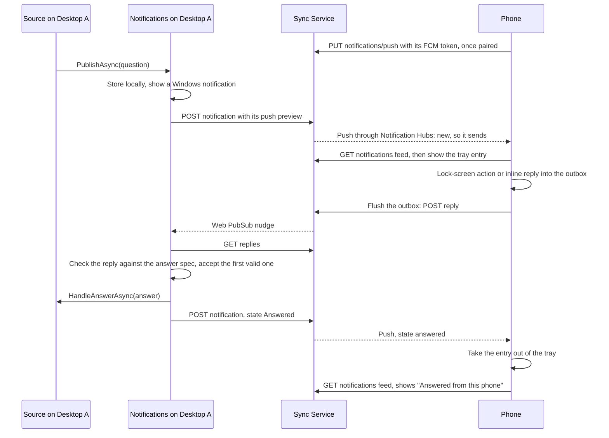

- **The push carries no body.** It is a data-only message, and the phone's OS
  notification shows the title and summary from it. The phone pulls the feed
  before it shows the entry, because the actions come from the pulled answer spec.
  It pulls the body when the person opens the notification.
- **Only a transition pushes.** The sync service pushes when a notification is
  new or changes state. The owner's 10-minute presence re-push sends nothing.
- **The tray answers only what fits.** A single-choice question with up to three
  choices gets one action per choice. An open answer gets an inline reply, beside
  up to two choices. Anything else, an owner-only question included, gets no
  actions, and a tap opens the notification in the app.
- **An offline owner delays the answer, not the reply.** The reply waits in the
  `notificationReplies` container. The phone shows "delivers on wake" until Desktop A
  wakes, pulls the reply and accepts it.
- **A missed nudge costs only time.** On every nudge, Desktop A runs a full
  exchange. When its socket opens, it runs one exchange to catch up. While a
  question is open and the socket is down, it polls for replies every two minutes.
  So a lost Web PubSub message delays the answer and never loses it.
- **The answer survives a restart.** Desktop A stores the accepted answer in
  SQLite before it calls the source's handler. It replays the answer to a handler
  that was not running, so the handler must accept the same answer twice.
- **A late reply is rejected with its reason.** A reply to a question that was
  already answered or closed is rejected, and the phone shows which answer won.
