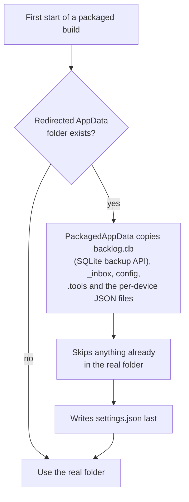
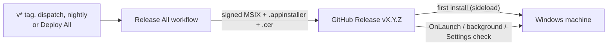
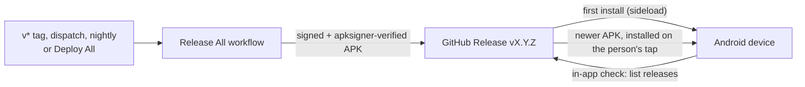
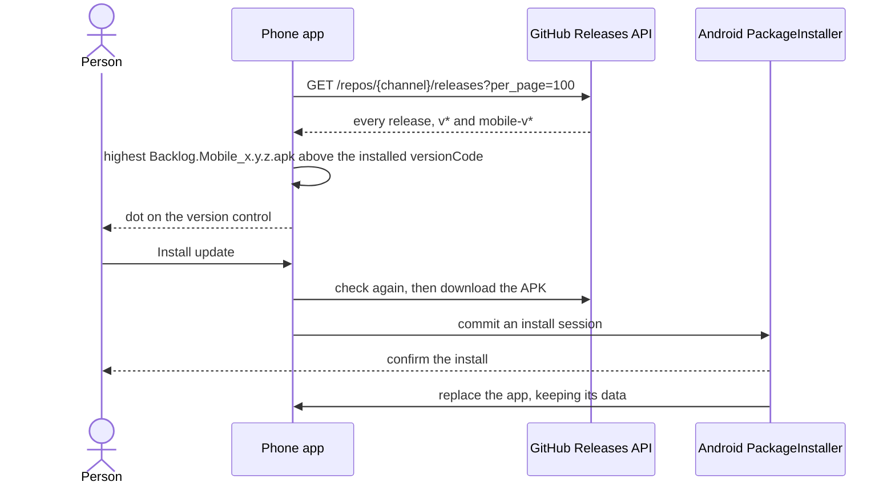
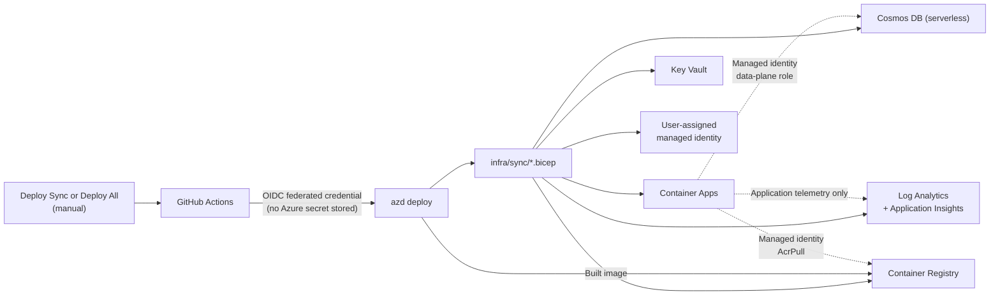
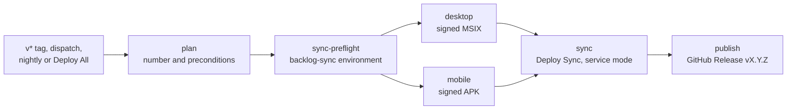

# 07. Deployment View

```meta
```

There are two deployment domains: the **user's local machines** (canonical) and the
**optional Azure-hosted cloud service** (additive).

## Local Deployment (Desktop)

```meta
related: [".devbook/arc42/05-building-block-view.md#desktop-app", ".devbook/arc42/08-crosscutting-concepts.md#storage-and-sync", ".devbook/arc42/adr/0044-devbook-subject-state-lives-in-backlogs-own-store.md"]
```

The desktop app, installed on Windows machines, is the canonical deployment: core workflows run here.


- **Local Storage.** One SQLite database, `backlog.db`, under a user-owned root is the source of truth for tasks and the inbox. The roadmap plan is one document row in it, and a task's content is markdown inside it. Per-device JSON files hold workspace settings and feature flags. One file to back up, and one to keep off a synced disk.
- **Repository Devbook.** Devbook folders are read in place from each registered repository's working copy and are not deployed with the app. The app builds the generated index (`devbook.db`) into its own storage, one per repository path under the devbook cache folder, never into the repository (`.devbook/arc42/08-crosscutting-concepts.md#devbook-database`).
- **Capture sources and workers.** `Backlog.Infrastructure.Capture` holds the YouTube, website and feed, and import capture sources. The sync, backup, MCP server and linked-task workers run in the desktop process.
- **IDE Extensions.** The VS Code extension runs on the same machine and talks to the sync service, not the desktop's store. Visual Studio has no extension (`.devbook/arc42/05-building-block-view.md#ide-extensions`).

The storage root defaults to `%LOCALAPPDATA%\Backlog` and holds:

```
<storage root>/
  backlog.db               # tasks, roadmap plan, inbox items, lists and groups
  _inbox/                  # the files inbox items carry
  config/repos.json        # the repository registry
  .tools/                  # the tools catalog, when kept here
  devbook-annotations/     # remarks on devbook chapters, one JSON file per repository
  devbook-subjects/        # workflow state of proposals, decision and debt records, one JSON file per repository
  devbook-imports/         # which repositories' devbook import has run, one JSON file
  devbook-cache/           # branch snapshots and the generated devbook databases
```

### Installation and Updates

```meta
related: [".devbook/tech/desktop.md#msix-packaging", ".devbook/tech/desktop.md#app-installer-appinstaller", ".devbook/arc42/07-deployment-view.md#release"]
```

The desktop app is a **signed MSIX sideloaded from GitHub Releases**, updated through an App Installer manifest. There is no Microsoft Store listing and no custom update server.

- **Package** — Release builds produce a single signed MSIX
  (`WindowsPackageType=MSIX`, `AppxBundle=Never`, `SideloadOnly`). Debug stays
  unpackaged so the Aspire desktop resource and WebView2 CDP attach keep working.
- **App Installer** — `Backlog.Desktop.appinstaller` is published alongside the
  MSIX. Its own `Uri` points at the stable `releases/latest/download/...`
  location; its `MainPackage` points at the tagged release asset. Its
  `Name`/`Publisher`/`ProcessorArchitecture` match the MSIX exactly, or Windows
  refuses the update.
- **Update checks** — `UpdateSettings` requests an `OnLaunch` check (every 8 hours, with a prompt) plus an `AutomaticBackgroundTask`. The app header's version is the on-demand control: activating it checks, and an "Install update" action appears for a newer build, backed by `PackageManager.CheckUpdateAvailabilityAsync` and `AddPackageByAppInstallerFileAsync`. The check is yes/no only, so the window reads `MainPackage/@Version` from the published `.appinstaller` to name the version, best effort, falling back to an unnamed update.
- **Trust** — the certificate is self-signed, so the target machine must trust it before the first install.
- **Where the data lives** — a packaged app's `%LOCALAPPDATA%` writes are redirected into `Packages\<family>\LocalCache\Local` unless its manifest opts out. Ours does (`desktop6:FileSystemWriteVirtualization=disabled` plus the `unvirtualizedResources` capability), so the folder the Storage settings page names is the folder that exists. Installs from before the opt-out kept everything in the redirect, and a newer build adopts it on first start, as the flowchart shows.
- **Release automation** — Release All builds and signs the MSIX and generates the `.appinstaller` ([Release](#release)). Latest is the desktop's update channel: a tag, dispatch or Deploy All release takes it, and a nightly only when no higher version holds it.



The adoption never deletes the redirected copy; the person deletes it once the new install shows everything. A failed copy is retried on the next start, because `settings.json` is written last.



## Local Deployment (Mobile)

```meta
related: [".devbook/arc42/05-building-block-view.md#mobile-app", ".devbook/arc42/08-crosscutting-concepts.md#storage-and-sync", ".devbook/tech/mobile.md#xamarinfirebasemessaging"]
```

The mobile app is a capture-first, sync-dependent Android channel and not canonical, so this section covers only how the APK reaches a device. `.devbook/tech/mobile.md#local-offline-store` documents its SQLite outbox.

For the Android push (local ADR 0039), the APK carries
`Platforms/Android/google-services.json` and the
[Firebase Messaging binding](../tech/mobile.md#xamarinfirebasemessaging). The JSON file holds the Firebase project's identifiers, not a secret. On Android 13 and later the app asks for `POST_NOTIFICATIONS` at runtime, and no push shows until the person allows it.

### Installation and Updates (Mobile)

```meta
related: [".devbook/tech/mobile.md#apk-packaging", ".devbook/arc42/07-deployment-view.md#installation-and-updates", ".devbook/arc42/07-deployment-view.md#release", ".devbook/arc42/05-building-block-view.md#mobile-app"]
```

The mobile app is a **signed APK sideloaded from GitHub Releases**. A released build checks those releases and installs a newer APK through Android's `PackageInstaller` on the person's tap. There is no Google Play listing and no custom update server.

- **Package** — Release builds produce a signed `.apk`
  (`AndroidPackageFormat=apk`), not an `.aab`. Only Google Play consumes an `.aab`.
- **Signing** — signing values come only from repository secrets
  (`ANDROID_KEYSTORE_BASE64`, `ANDROID_KEYSTORE_PASSWORD`, `ANDROID_KEY_ALIAS`,
  `ANDROID_KEY_PASSWORD`). The workflow refuses to produce an unsigned package
  when they are absent. It runs `apksigner verify` on the staged APK before
  publishing.
- **Versioning** — `ApplicationDisplayVersion` is the semantic version.
  `ApplicationVersion` (the Android `versionCode`) is a packed integer,
  `major*10^7 + minor*10^5 + patch`, so `v1.2.3` becomes `10200003` and
  `v0.1.123` becomes `100123`. Android needs a monotonically increasing integer
  to recognize a package as an upgrade. `ApkVersion` in the app and
  `build/Get-NextReleaseVersion.ps1` in the workflow pack it the same way.
- **Release channel** — every release carries the APK beside the desktop MSIX under one `vX.Y.Z` tag, nightlies included ([Release](#release)). Earlier nightlies sit under `mobile-v*` tags, and phones still run them.
- **Trust** — the keystore is self-signed, so installing prompts to allow
  installs from unknown sources. Android rejects a signature change, so an APK
  signed with a different key cannot upgrade an existing install. Switching
  between a developer build and a release build means uninstalling first.
- **Update channel** — the repository a build checks is compiled in from the
  `BacklogUpdateRepository` build property, which only `release-all.yml`
  passes (`.devbook/tech/mobile.md#apk-packaging`). Every other build has no
  channel. Its update window says a development build cannot update itself,
  and it asks GitHub for nothing.
- **Developer sideload** — `build/Install-AndroidApp.ps1` builds a signed APK
  and installs it via `adb`, generating a throwaway developer keystore under
  the gitignored `build/.local/` so a local build never needs the release
  signing secrets.



The in-app update runs in two steps, a check and an install:



- **Which APK** — the check reads the release list, not `/releases/latest`, which Release All keeps for the desktop's App Installer. Older `v*` releases carry no APK. The asset `Backlog.Mobile_x.y.z.apk` with the highest packed versionCode wins, whichever tag it sits under. Only an uploaded asset with an https `github.com` download URL and a stated size is offered.
- **When it checks** — quietly once the app is on screen, at most every eight hours. A failed quiet check says nothing and retries on the next launch; a find only puts a dot on the version control. A check the person asks for always runs and reports failures.
- **Installing** — the install checks again, then downloads from the fresh URL, bounded by the asset's recorded size. Android asks for `REQUEST_INSTALL_PACKAGES` and the person's "install unknown apps" allowance for Backlog. When that is missing, the app opens Settings and the person taps Install again.
- **Integrity** — Android's signature check is the integrity check. An APK signed with another key is refused, worded as a key mismatch. An update keeps the package, so the outbox, the pairing and the cached inbox survive.

## Cloud Deployment (Azure)

```meta
related: [".devbook/arc42/05-building-block-view.md#cloud-service", ".devbook/arc42/09-architecture-decisions.md", ".devbook/arc42/adr/0014-attachments-travel-through-a-blob-store-beside-the-replica.md", ".devbook/arc42/adr/0039-notifications-are-an-owned-document-kind-and-push-only-nudges.md", ".devbook/arc42/adr/0044-devbook-subject-state-lives-in-backlogs-own-store.md", ".devbook/tech/cloud.md#azure-notification-hubs"]
```

The optional cloud service runs in Azure as a single-region, low-cost footprint sized for sync coordination and webhook forwarding.


- **Cosmos DB:** [Cloud Service](05-building-block-view.md#cloud-service) names the eight containers.
- **Clients:** the desktop and IDE extensions reach the service over HTTPS for state sync; the mobile app does too, and for its offline flush.
- **Identity:** managed identities reach Cosmos DB with a data-plane role, Storage as Blob Data Contributor, and Web PubSub as Web PubSub Service Owner.
- **Notification Hubs:** the service uses SAS Send and Manage keys. The hub reaches Firebase Cloud Messaging over FCM v1, which delivers a data-only push to the mobile app.
- **Pull now:** Web PubSub tells the desktop to pull.
- **GitHub:** webhook events arrive at the service.

Deployment considerations:

- **Single region**, one Container App instance: enough for a personal tool.
- **TTL-based cleanup** — Cosmos expires what ages out, so no reaper runs. Local ADR 0005 fixes the retentions: task and annotation tombstones at 180 days, session records at 12 months; webhook events (24h) are not built. The `devbookSubjects` container has no TTL, since a subject's state is never deleted and leaves no tombstone (local ADR 0044).
- **Webhook timeout handling** — GitHub expects a response within ~10s, so the service stores and forwards.
- **Secrets in Key Vault** — webhook secrets and OAuth tokens go there when they arrive. `infra/sync/main.bicep` provisions the vault and the identity's read role; nothing reads it yet.
- **The token signing key is not in Key Vault.** The device-token signing key (`Modules:Sync:Tokens:SigningKey`) is required outside Development; the service refuses to start without it. It reaches the container as a **container app secret** from a `@secure()` Bicep parameter, fed by the GitHub environment secret `SYNC_TOKEN_SIGNING_KEY`. A missing key fails the provision rather than the app, the value never touches disk or a log, and a scale-to-zero app pays no vault round-trip on cold start. `docs/deployment/sync.md#the-device-token-signing-key` covers what a rotation invalidates.
- **Attachment blob store** *(local ADR 0014)* — `infra/sync/main.bicep`
  provisions one Standard LRS storage account beside the Cosmos replica:
  - `allowSharedKeyAccess: false`, TLS 1.2, and no public blob access;
  - a private container `attachments`, with blobs keyed `{ownerId}/{attachmentId}`;
  - a **Storage Blob Data Contributor** assignment for the sync identity, scoped
    to the container.

  `ConnectionStrings__attachments` gives the service an endpoint and a container name, no key. Locally it is the AppHost's `storage` resource, Azurite in a persistent container, with the same container declared.

  Devices reach a capture's files only through the sync service (`PUT`/`GET /api/sync/attachments/{id}`), owner-scoped from the token, with a size cap and a content-type allowlist, and hold no storage credential.

  The acknowledgement tombstone releases a capture's blobs. A 30-day lifecycle rule removes leftovers, in Azure only, because Azurite runs no management policies. A task's own attachment stays a path on the desktop's file system.
- **Scale-to-zero** — Container Apps on the consumption plan costs nothing while nobody syncs.
- **No keys for Cosmos or Storage** — the container app reaches Cosmos through a
  user-assigned managed identity with a data-plane role assignment. The account carries `disableLocalAuth`, so no key works, and none is issued, per inherited ADR 0013. The identity is user-assigned because a system-assigned one does not exist until its container app does, and the app could then not be granted the registry pull it needs to start.
- **Two Notification Hubs keys, because that service takes no identity** *(local
  ADR 0039 §5)* — the only data credentials handed to the service are the connection strings of the hub's `sync-send` and `sync-manage` rules. Bicep reads them with `listKeys()` into the container app secrets `notification-hubs-send-connection-string` and `notification-hubs-manage-connection-string`. The service reads them as `Sync__NotificationHubs__SendConnectionString` and `…ManageConnectionString`, beside `Sync__NotificationHubs__Hub`. No output echoes either; `docs/deployment/sync.md` lists the resources.
- **The FCM credential is entered by hand** — the hub's FCM v1 credential (project id, client email, private key) is not in Bicep. A person enters it on the hub once Firebase is set up; until then no phone is pushed.
- **First provisioned 2026-11-04** — the Web PubSub and Notification Hubs
  resources in `infra/sync/main.bicep` exist in Azure, and the sync container app
  carries their settings. Pushes wait on the hub's FCM credential.

### Provisioning and Delivery

```meta
related: [".devbook/arc42/adr/0005-azure-hosted-task-replica-for-multi-device-sync.md", ".devbook/arc42/adr/guidelines/0003-aspire-for-web-services.md", ".devbook/arc42/adr/guidelines/0013-authorization-zero-trust.md"]
```

Local ADR 0005 introduced the delivery artifacts `infra/sync/main.bicep`, `azure.yaml` and `.github/workflows/deploy-sync.yml`. The Cosmos emulator runs locally.

**Provisioned and running, by hand.** The whole `infra/sync/` template sits in
resource group `JS-AI`, beside `backlog-foundry`. It holds:

- the Cosmos DB account, the Key Vault, and the Storage account;
- the Container Apps environment and the sync container app;
- the Container Registry and the user-assigned managed identity;
- the Log Analytics workspace, with Application Insights over it.

A local run of `build/Deploy-Azure.ps1` provisioned it on 2026-09-14, and the service image came later from a manual `azd deploy`. On 2026-10-05 Azure showed one active revision, created 2026-10-01 and healthy with one replica.

**Proven as far as a preview.** `deploy-sync.yml` first completed a run on
2026-10-20 (run 39494451800, dispatched from `main`). That run was a `preview`: it passed `Verify deployment target`, signed in through the OIDC federated credential and ran `azd provision --preview`, so the `backlog-sync` environment's variables and the credential work. Still unverified:

- a `provision`, `deploy` or `service` run of the workflow;
- the budget alert;
- a second device syncing against the deployed service in real use.

`docs/deployment/sync.md` writes those manual prerequisites down.

**Two callers, two scopes.** A person starts every infrastructure run, from Deploy Sync or Deploy All. Deploy All's sync component previews or provisions and never deploys the service; its release component does.

The service deploys unattended: every Release All run that publishes, the nightly included, calls Deploy Sync in `service` mode ([Release](#release)), which runs `azd deploy` alone. A provision reads the running image back and hands it to the template, so it keeps the running service; only the first provision, with no app yet, runs the placeholder image.

**The service version is a release decision.** Every desktop and phone stops syncing while the service reports a version above its own (local ADR 0005 §Version compatibility). So:

- `<Version>` in `Backlog.Modules.Sync.Api.csproj` is raised only on purpose, in the change that breaks older clients.
- The service is deployed at `0.1.0` before any desktop or phone release that
  carries the check. A service built before `<Version>` was set reports the SDK default `1.0.0`, above every released client, so a client carrying the check would stop syncing on every device. After that first deploy, order does not matter until `<Version>` is raised.

| Concern | Approach |
|---|---|
| **Infrastructure as code** | Bicep under `infra/sync/`, beside the existing `infra/foundry/`. |
| **Provision and deploy** | `azd` (Azure Developer CLI), against `azure.yaml` at the repository root. |
| **Environments** | One (`backlog-sync`). A personal tool does not earn a staging ring. |
| **CI/CD** | GitHub Actions, authenticating with **OIDC federated credentials**. Infrastructure is **started by hand**. |
| **Local development** | The Cosmos DB preview emulator as an Aspire resource, declaring the same database and the same five containers. |
| **Observability** | Log Analytics and Application Insights, with only application telemetry going to either. |

- **Infrastructure as code:** the template is resource-group scoped, so it deploys into a group created by hand.
- **CI/CD:** a person starts infrastructure from `Deploy Sync` or `Deploy All`. The service deploys through Release All, nightly and on every release, in Deploy Sync's `service` mode. The path-filtered push-to-`main` trigger ADR 0005 describes stays parked. The repository holds no publish profile or service principal secret; the one secret carried is the token signing key.
- **Local development:** Azurite is the `storage` resource with the `attachments` container (local ADR 0014), so the sync path builds and tests with no cloud account.
- **Observability:** OpenTelemetry already flows through `AddServiceDefaults()`. No domain data goes to either sink, because a telemetry pipeline samples and drops under load and nothing a dashboard answers from may inherit that. A 1 GB/day ingestion cap (`logDailyQuotaGb`) stops runaway logging; once reached, Azure drops the rest of the day, exceptions included, which is intended since the volume is the incident. See `docs/deployment/sync.md`.

The Bicep declares one resource ADR 0005 did not name: a container registry, where `azd` pushes the built image. Its admin user is off, and the managed identity that reaches Cosmos holds the pull role.

Indicative cost at single-user volume is well under €5/month: Cosmos serverless a few cents, Container Apps nothing while scaled to zero, Key Vault and Log Analytics inside the free grants. The registry is the one fixed charge.



## Release

```meta
related: [".devbook/arc42/07-deployment-view.md#installation-and-updates", ".devbook/arc42/07-deployment-view.md#installation-and-updates-mobile", ".devbook/arc42/07-deployment-view.md#provisioning-and-delivery", ".devbook/tech/tooling.md#github-actions", ".devbook/tech/desktop.md#msix-packaging", ".devbook/tech/mobile.md#apk-packaging"]
```

One workflow, Release All (`.github/workflows/release-all.yml`), releases every channel from one commit under one number. Each publishing run creates one GitHub Release `vX.Y.Z` carrying:

- the desktop MSIX;
- its `.appinstaller`;
- the public signing certificate (`.cer`);
- the Android APK.

The same run deploys the sync service under that number.



- **Numbering** — `build/Get-NextReleaseVersion.ps1` takes the highest `MAJOR.MINOR.PATCH` over the `v*` and `mobile-v*` tags and raises the patch by one, so the MSIX version and APK versionCode rise past what every device runs. A pushed tag, a dispatched version, or Deploy All's `release_version` names the number instead; the plan job refuses one lower than the highest tag before anything builds. Runs queue workflow-wide, so two never number a release at once.
- **The server before the clients** — the sync job starts only after both packages built, so a broken app build never moves the server. It calls Deploy Sync in `service` mode with `release` set to `X.Y.Z`, running `azd deploy` alone. The deploy stamps the number as the MSBuild property `BacklogRelease`, which `GET /` reports as `release` beside `version` and `commit`. Deploy Sync reads `GET /` until `release` and `commit` match the run, failing after ten minutes.
- **The release never moves `version`** — only the project's `<Version>` sets the compatibility number ([The service version is a release decision](#provisioning-and-delivery)). A service deployed outside Release All reports `release` as null.
- **Publishing** — the publish job runs only after the service took the number and refuses a release with any asset missing, so a failed sync deploy publishes nothing and takes no number. An explicit release always takes Latest; a nightly only when no higher version holds it.
- **Nightly** — the schedule runs at 05:00 UTC. It releases only when a file one of the three heads builds from changed since the newest `v*` release. It skips the whole release when any channel's settings are missing: the signing secrets, `BACKLOG_SYNC_SERVICE_URL`, or the `backlog-sync` environment's variables. The channels never drift apart by a number. A requested release fails instead.
- **Re-runs** — an existing tag is republished only from the commit it points at, which the plan job, Deploy Sync and the publish job each check. An older failed run never puts an older build under a newer run's number.
- **Deploy All** — its release component calls Release All with its `release_version` (blank takes the next number) and its sync environment. Its sync component is infrastructure alone, so one run never deploys the service twice ([Provisioning and Delivery](#provisioning-and-delivery)).
- **Failure** — when any job fails, the `report-failure` job opens an issue, or comments on the open one, saying whether the sync service already took the number.


