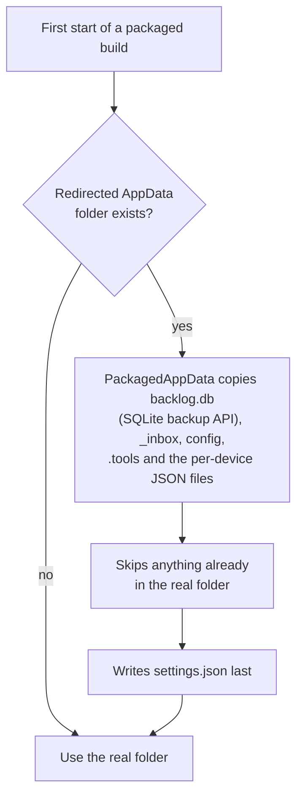
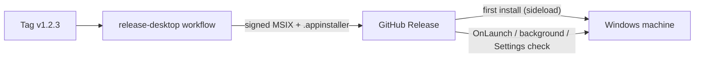
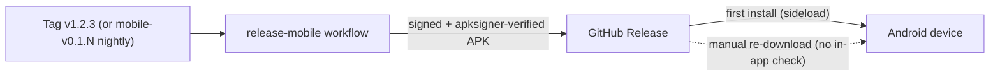
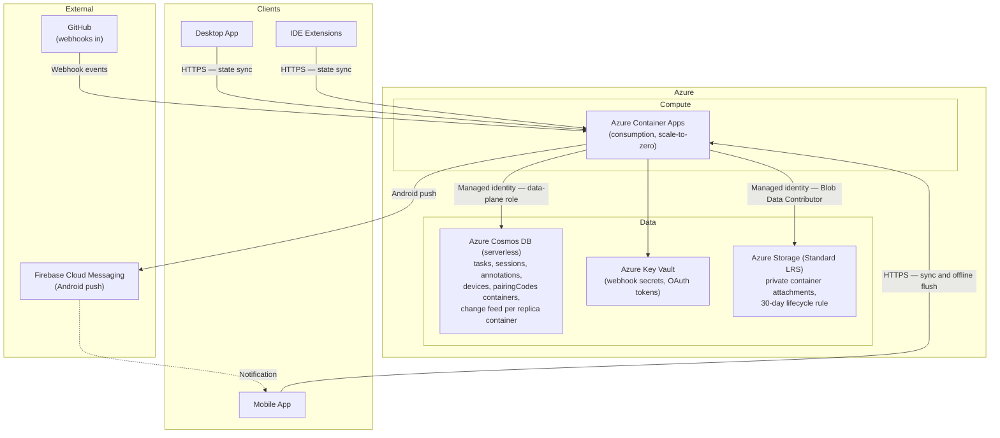
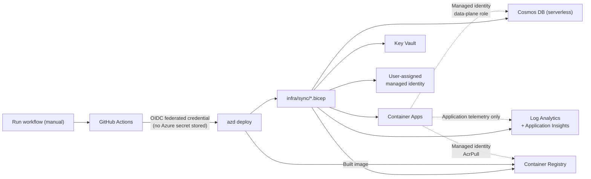

# 07. Deployment View

```meta
```

There are two deployment domains: the **user's local machines** (canonical) and the
**optional Azure-hosted cloud service** (additive).

## Local Deployment (Desktop)

```meta
related: [".devbook/arc42/05-building-block-view.md#desktop-app", ".devbook/arc42/08-crosscutting-concepts.md#storage-and-sync"]
```

The desktop app is installed on Windows machines and is the canonical deployment. Everything needed for core workflows runs here.

- **Local Storage.** One SQLite database, `backlog.db`, under a user-owned root is
  the source of truth for tasks and the inbox. The roadmap plan is a single document
  row in it, and a task's content is markdown text inside it. JSON files hold the
  workspace settings and feature flags, which are per-device. There is one file to
  back up, and one to keep off a synced disk.
- **Repository Devbook.** Knowledge folders are not deployed with the app. They live
  in each registered repository's own working copy, wherever the user cloned it, and
  are read in place. The app builds the generated index over them (`devbook.db`) into
  its own storage, one per repository path under the devbook cache folder, and never
  into the repository. See `.devbook/arc42/08-crosscutting-concepts.md#devbook-database`.
- **Capture sources and workers.** `Backlog.Infrastructure.Capture` holds the
  YouTube, website and feed, and import capture sources. The sync, backup, MCP
  server and linked-task workers run in the background of the desktop process.
- **IDE Extensions.** The VS Code extension runs on the same machine and talks to the
  sync service, not to the desktop's store. Visual Studio has no extension
  (`.devbook/arc42/05-building-block-view.md#ide-extensions`).

The storage root defaults to `%LOCALAPPDATA%\Backlog` and holds:

```
<storage root>/
  backlog.db               # tasks, roadmap plan, inbox items, lists and groups
  _inbox/                  # the files inbox items carry
  config/repos.json        # the repository registry
  .tools/                  # the tools catalog, when kept here
  devbook-annotations/     # remarks on devbook chapters, one JSON file per repository
  devbook-cache/           # branch snapshots and the generated devbook databases
```

### Installation and Updates

```meta
related: [".devbook/tech/desktop.md#msix-packaging", ".devbook/tech/desktop.md#app-installer-appinstaller"]
```

The desktop app is distributed as a **signed MSIX sideloaded from GitHub
Releases**, with an App Installer manifest driving updates. There is no
Microsoft Store listing and no custom update server.

- **Package** — Release builds produce a single signed MSIX
  (`WindowsPackageType=MSIX`, `AppxBundle=Never`, `SideloadOnly`). Debug stays
  unpackaged so the Aspire desktop resource and WebView2 CDP attach keep working.
- **App Installer** — `Backlog.Desktop.appinstaller` is published alongside the
  MSIX. Its own `Uri` points at the stable `releases/latest/download/...`
  location; its `MainPackage` points at the tagged release asset. Its
  `Name`/`Publisher`/`ProcessorArchitecture` match the MSIX exactly, or Windows
  refuses the update.
- **Update checks** — `UpdateSettings` requests an `OnLaunch` check (every 8
  hours, with a prompt) plus an `AutomaticBackgroundTask`. The version shown in
  the app header is itself the on-demand control. Activating it checks, and an
  "Install update" action appears when a newer build is found, backed by
  `PackageManager.CheckUpdateAvailabilityAsync` and
  `AddPackageByAppInstallerFileAsync`. The availability check is yes/no only, so
  the window names the newer version by reading `MainPackage/@Version` from the
  published `.appinstaller`. That is best effort, falling back to an unnamed update.
- **Trust** — the certificate is self-signed for personal-scope use, so it must
  be trusted on the target machine before the first install.
- **Where the data lives** — a packaged app's `%LOCALAPPDATA%` writes are
  redirected into `Packages\<family>\LocalCache\Local` unless its manifest opts
  out. Ours opts out (`desktop6:FileSystemWriteVirtualization=disabled` plus the
  `unvirtualizedResources` capability). The folder the Storage settings page
  names is therefore the folder that exists. Installs from before the opt-out
  kept everything in the redirect, and the first start of a newer build adopts
  it, as the flowchart below shows.
- **Release automation** — `.github/workflows/release-desktop.yml` builds, signs
  (from repository secrets), generates the `.appinstaller`, and uploads both
  artifacts to the GitHub Release on a `v*` tag.



The adoption never deletes the redirected copy; that copy is the person's to delete
once the new install shows everything. Because `settings.json` is written last, a
failed copy is retried on the next start.



## Local Deployment (Mobile)

```meta
related: [".devbook/arc42/05-building-block-view.md#mobile-app", ".devbook/arc42/08-crosscutting-concepts.md#storage-and-sync"]
```

The mobile app is installed on Android devices as a capture-first,
sync-dependent channel. It is not canonical, so this section covers only how the
APK reaches a device. `.devbook/tech/mobile.md#local-offline-store` documents its
on-device SQLite outbox.

### Installation and Updates (Mobile)

```meta
related: [".devbook/tech/mobile.md#apk-packaging", ".devbook/arc42/07-deployment-view.md#installation-and-updates"]
```

The mobile app is distributed as a **signed APK sideloaded from GitHub
Releases**. There is no Google Play listing and no in-app update mechanism.

- **Package** — Release builds produce a signed `.apk`
  (`AndroidPackageFormat=apk`), not an `.aab`. The package is sideloaded
  straight onto a device, and only Google Play consumes an `.aab`.
- **Signing** — signing values come only from repository secrets
  (`ANDROID_KEYSTORE_BASE64`, `ANDROID_KEYSTORE_PASSWORD`, `ANDROID_KEY_ALIAS`,
  `ANDROID_KEY_PASSWORD`). The workflow refuses to produce an unsigned package
  when they are absent. It runs `apksigner verify` on the staged APK before
  publishing.
- **Versioning** — `ApplicationDisplayVersion` is the semantic version.
  `ApplicationVersion` (the Android `versionCode`) is a packed integer,
  `major*10^7 + minor*10^5 + patch`, so `v1.2.3` becomes `10200003`. Android
  needs a monotonically increasing integer to recognize a package as an upgrade.
- **Release channel** — tagged `v*` releases share one GitHub Release with the
  desktop MSIX. Nightly `main` builds publish under a separate
  `mobile-v0.1.<run_number>` tag marked not-latest. `github.run_number` is a
  per-workflow counter, and would otherwise collide with the desktop's own
  nightly numbering.
- **Trust** — the keystore is self-signed, so installing prompts to allow
  installs from unknown sources. Android rejects a signature change, so an APK
  signed with a different key cannot upgrade an existing install. Switching
  between a developer build and a release build means uninstalling first.
- **Updates** — Android has no in-app auto-update here, unlike the desktop's App
  Installer. Updating means re-downloading the latest APK from GitHub Releases
  and reinstalling over the existing app, with the same signing key.
- **Developer sideload** — `build/Install-AndroidApp.ps1` builds a signed APK
  and installs it via `adb`, generating a throwaway developer keystore under
  the gitignored `build/.local/` so a local build never needs the release
  signing secrets.
- **Release automation** — `.github/workflows/release-mobile.yml` builds,
  signs (from repository secrets), verifies, and uploads the APK to the
  GitHub Release on a `v*` tag or the nightly schedule.



## Cloud Deployment (Azure)

```meta
related: [".devbook/arc42/05-building-block-view.md#cloud-service", ".devbook/arc42/09-architecture-decisions.md", ".devbook/arc42/adr/0014-attachments-travel-through-a-blob-store-beside-the-replica.md"]
```

The optional cloud service is deployed to Azure as a single-region, low-cost
footprint sized only for sync coordination and webhook forwarding.



Deployment considerations:

- **Single region** is sufficient for a personal tool; a single Container App
  instance meets demand.
- **TTL-based cleanup** — Cosmos expires what ages out, so no reaper runs and no
  scheduled job can fail silently. Local ADR 0005 fixes the retentions: task and
  annotation tombstones at 180 days, and session records at 12 months. Webhook
  events (24h) are not built.
- **Webhook timeout handling** — GitHub expects a response within ~10s, so the
  service stores and forwards.
- **Secrets in Key Vault** — webhook secrets and OAuth tokens go there when they
  arrive. `infra/sync/main.bicep` provisions the vault and the service identity's
  read role for them, and nothing reads it yet.
- **The token signing key is not in Key Vault.** The device-token signing key
  (`Modules:Sync:Tokens:SigningKey`) is a required setting outside Development, and
  the service refuses to start without one. It reaches the container as a
  **container app secret** from a `@secure()` Bicep parameter, fed by the GitHub
  environment secret `SYNC_TOKEN_SIGNING_KEY`. A missing key therefore fails the
  provision rather than the app. The value never touches disk or a log, and a
  scale-to-zero app pays no vault round-trip on cold start.
  `docs/deployment/sync.md#the-device-token-signing-key` also covers what a
  rotation invalidates.
- **Attachment blob store** *(local ADR 0014)* — `infra/sync/main.bicep`
  provisions one Standard LRS storage account beside the Cosmos replica:
  - `allowSharedKeyAccess: false`, TLS 1.2, and no public blob access;
  - a private container `attachments`, with blobs keyed `{ownerId}/{attachmentId}`;
  - a **Storage Blob Data Contributor** assignment for the sync identity, scoped
    to the container.

  `ConnectionStrings__attachments` tells the service where it is: an endpoint and
  a container name, and no key. Locally it is the AppHost's `storage` resource,
  Azurite in a persistent container, with the same container declared. Devices
  upload and download a phone capture's files only through the sync service
  (`PUT`/`GET /api/sync/attachments/{id}`), owner-scoped from the token, with a
  size cap and a content-type allowlist. They never hold a storage credential. The
  capture document holds metadata only. The desktop's acknowledgement tombstone
  releases a capture's blobs. A 30-day lifecycle rule removes anything left
  behind, in Azure only, because Azurite runs no management policies. A task's own
  attachment stays a path on the desktop's local file system.
- **Scale-to-zero** — Container Apps on the consumption plan costs nothing while
  nobody is syncing, which is most of the time for a personal tool.
- **No keys in configuration** — the container app reaches Cosmos through a
  user-assigned managed identity with a data-plane role assignment. The account
  carries `disableLocalAuth`, so a key cannot be used even if one existed.
  Connection strings and account keys are not issued at all, per inherited ADR
  0013. The identity is user-assigned because a system-assigned one does not
  exist until its container app does. The app could then not be granted the
  registry pull it needs in order to start.

### Provisioning and Delivery

```meta
related: [".devbook/arc42/adr/0005-azure-hosted-task-replica-for-multi-device-sync.md", ".devbook/arc42/adr/guidelines/0003-aspire-for-web-services.md", ".devbook/arc42/adr/guidelines/0013-authorization-zero-trust.md"]
```

Local ADR 0005 introduced the delivery artifacts: `infra/sync/main.bicep`,
`azure.yaml`, and `.github/workflows/deploy-sync.yml`. The Cosmos emulator runs
locally.

**Provisioned and running, by hand.** The whole `infra/sync/` template sits in
resource group `JS-AI`, beside `backlog-foundry`. It holds:

- the Cosmos DB account, the Key Vault, and the Storage account;
- the Container Apps environment and the sync container app;
- the Container Registry and the user-assigned managed identity;
- the Log Analytics workspace, with Application Insights over it.

A local run of `build/Deploy-Azure.ps1` provisioned it on 2026-09-14, and the
service image came later from a manual `azd deploy`. Read from Azure on
2026-10-05, the container app had one active revision, created 2026-10-01 and
healthy with one replica.

**Still unproven.** `deploy-sync.yml` has never completed a run. Its `Verify
deployment target` preflight fails because the `backlog-sync` GitHub environment
has no variables set. So these are unverified:

- the workflow path itself;
- the OIDC federated credential it authenticates with;
- the budget alert;
- a second device syncing against the deployed service in real use.

`docs/deployment/sync.md` writes those manual prerequisites down.

| Concern | Approach |
|---|---|
| **Infrastructure as code** | Bicep under `infra/sync/`, beside the existing `infra/foundry/`. Resource-group scoped, so it deploys into a group created by hand rather than creating one. |
| **Provision and deploy** | `azd` (Azure Developer CLI), against `azure.yaml` at the repository root. |
| **Environments** | One (`backlog-sync`). A personal tool does not earn a staging ring. |
| **CI/CD** | GitHub Actions, **started by hand** (`Deploy Sync` or `Deploy All`), authenticating with **OIDC federated credentials**. The path-filtered push-to-`main` trigger ADR 0005 describes is parked until a first deploy has been watched succeed. There is no publish profile and no service principal secret in the repository; the one secret carried is the service's own token signing key. |
| **Local development** | The Cosmos DB preview emulator as an Aspire resource, declaring the same database and the same five containers. Azurite is the `storage` resource, with the `attachments` container (local ADR 0014). The sync path, attachments included, builds and tests with no cloud account. |
| **Observability** | Log Analytics and Application Insights. OpenTelemetry already flows through `AddServiceDefaults()`, so this is wiring rather than design. Only application telemetry goes to either. No domain data does, because a telemetry pipeline samples and drops under load, and nothing a dashboard answers from may inherit that. The workspace carries a 1 GB/day ingestion cap (`logDailyQuotaGb`) as an emergency stop against runaway logging. Once it is reached, Azure drops the rest of the day, exceptions included. That is intended: on such a day the volume is the incident. See `docs/deployment/sync.md`. |

The Bicep declares one resource ADR 0005 did not name: a container registry.
`azd` deploying a container app has to push the built image somewhere. The
registry issues no credentials: its admin user is off, and the same managed
identity that reaches Cosmos holds the pull role.

Indicative cost at single-user volume is well under €5/month. Cosmos serverless
costs a few cents per month, Container Apps nothing while scaled to zero, and Key
Vault and Log Analytics stay inside the free grants. The registry is the one small
fixed charge, so it is the only resource here that costs anything while nobody is
syncing.




