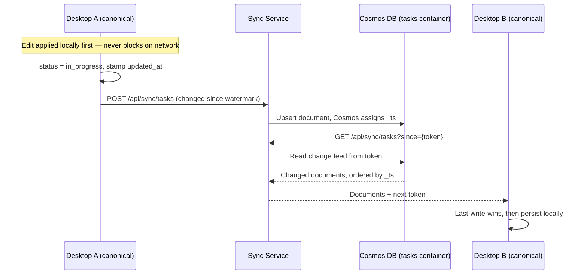
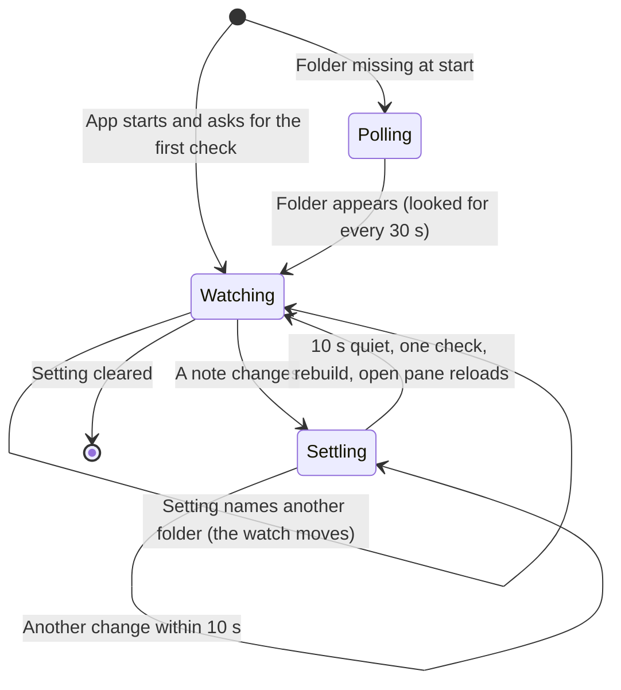
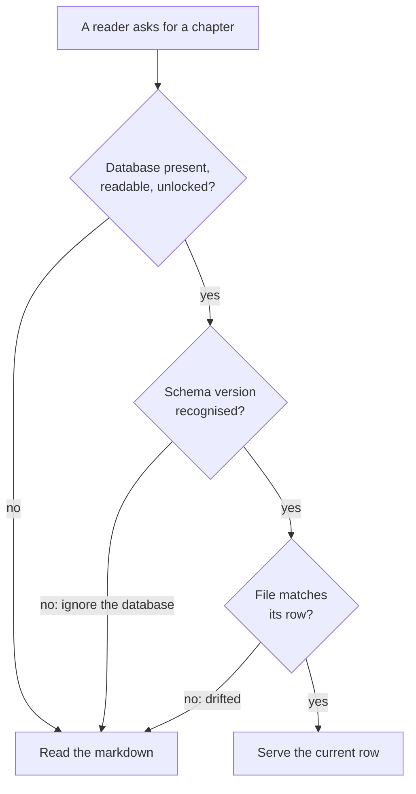

# 08. Cross-cutting Concepts

```meta
```

## Storage and Sync

```meta
related: [".devbook/arc42/02-constraints.md#technical-constraints", ".devbook/arc42/06-runtime-view.md#state-sync-and-webhook-forwarding", ".devbook/arc42/06-runtime-view.md#copilot-app-session-capture", ".devbook/arc42/08-crosscutting-concepts.md#session-record-sync", ".devbook/arc42/08-crosscutting-concepts.md#task-sync", ".devbook/arc42/adr/0005-azure-hosted-task-replica-for-multi-device-sync.md", ".devbook/arc42/adr/0009-captures-are-a-document-kind-on-the-replica.md", ".devbook/arc42/adr/0011-devbook-annotations-are-a-third-replica-container.md", ".devbook/arc42/adr/0018-roadmap-plan-and-pace-ride-the-task-feed.md", ".devbook/arc42/adr/0019-roadmap-counts-the-working-week.md", ".devbook/arc42/adr/0021-github-accounts-and-repository-registry-ride-the-task-feed.md", ".devbook/arc42/adr/0025-notes-ride-the-task-feed.md", ".devbook/arc42/adr/0032-my-day-preferences-ride-the-task-feed.md", ".devbook/domain/capture/domain.md#source-adapter", ".devbook/domain/sessions/domain.md#session-log", ".devbook/domain/progress/features.md#syncing-goals-and-impediments", ".devbook/arc42/adr/0035-goals-and-impediments-replace-sprints.md", ".devbook/arc42/adr/0039-notifications-are-an-owned-document-kind-and-push-only-nudges.md"]
```

- **Local-first, one canonical local store.** The desktop's own store is the single
  source of truth. Tasks live in one SQLite database, `backlog.db`, under the
  workspace root, with a task's content held as markdown text. Markdown is the
  content of a task, not the storage format. The roadmap plan is one document row
  in the same database. Three owners share the file and not the schema: Tasks
  (`tasks`), Roadmap Planning (`roadmap_plan`) and the Inbox (`inbox_items`,
  `inbox_lists`, `inbox_groups`). JSON files hold the workspace settings and
  feature flags, which are per-device. See
  `.devbook/arc42/adr/0003-sqlite-is-the-canonical-local-task-store.md`.
- **The Devbook is the other way round.** A repository's devbook folders stay
  markdown-canonical, and only the layer derived from them is a database. The two
  decisions are not in tension: the app owns a task, and the repository owns a
  devbook chapter, which is edited outside the app. See
  `.devbook/arc42/08-crosscutting-concepts.md#devbook-database`.
- **Configurable repo paths** via a repo registry (`config/repos.json`).

Optional cloud sync carries this state between a person's devices:

| State | Travels as | Reconciled by | Decision |
|---|---|---|---|
| Task aggregate | a task document in the `tasks` container | [last-write-wins](12-glossary.md#terms), whole document ([Task Sync](#task-sync)) | local ADR 0005 |
| Phone capture | kind `capture` in `tasks` | the desktop takes it into the Inbox and acknowledges it by tombstone | local ADR 0009 |
| Note | kind `note` in `tasks` | the later edit wins, in both directions | local ADR 0025 |
| Roadmap plan | kind `roadmap-plan` in `tasks` | last-write-wins on `roadmap_plan.updated_at` | local ADR 0018 |
| Planning pace and working week | kind `planning-pace` in `tasks`, with a `workingWeek` key | last-write-wins | local ADRs 0018 and 0019 |
| Repository registry | kind `repository-registry` in `tasks` | last-write-wins | local ADR 0021 |
| GitHub accounts | kind `github-accounts` in `tasks`, never a token | last-write-wins | local ADR 0021 |
| My Day preferences | kind `my-day-preferences` in `tasks`, written by a desktop and folded read-only by the phone | last-write-wins | local ADR 0032 |
| Goal | kind `goal` in `tasks`, one document per goal under its own id | last-write-wins per goal on its `updated_at` | local ADR 0018's arrangement, local ADR 0035 |
| Impediment | kind `impediment` in `tasks`, one document per impediment under its own id; the phone's edits go through the device outbox | last-write-wins per impediment on its `updated_at` | local ADR 0018's arrangement, local ADR 0035 |
| Session records | a record in the `sessions` container | not reconciled: one machine writes each ([Session Record Sync](#session-record-sync)) | local ADR 0005 |
| Remarks on devbook chapters | a remark in the `annotations` container | the task container's last-write-wins and tombstone terms | local ADR 0011 |
| Notifications and replies | a notification in the `notifications` container, a reply in `notificationReplies` | not reconciled: the owner instance writes each notification, and a viewer writes each reply once ([Notifications](#notifications)) | local ADR 0039 |

- **A capture is a task-shaped document with its own kind token.** On the desktop
  it is handed to the Inbox's intake before the task merge. It becomes an inbox
  item with the capture's own id, never a task row. The desktop acknowledges it by
  pushing a tombstone of that document from an outbox.
- **A [remark](../domain/devbook/domain.md#remark) is Devbook's own record.** It is
  kept as one JSON file per repository in `devbook-annotations/` under the storage
  folder, and moves with the backlog. It is never in the generated devbook
  database and never a table in `backlog.db`.
- **The pace is a second document.** The pace is `planning-velocity.json`: the
  typed pace, the chosen source and the per-repository pairs. It travels apart
  from the plan, so a pace change and a plan edit never overwrite each other. Placement
  counts the person's working hours, so the working week travels inside the pace
  document. Each device keeps `working-hours.json` as its copy, and a document
  without the key reads that copy. A device that never saved a plan or a pace
  sends none.
- **Session records do not reconcile at all.** Only the machine that ran a session
  writes records for it. There is never a second version to discard, so the
  lost-edit failure mode does not reach them.

This state deliberately stays on the machine:

| State | Why it stays | Where |
|---|---|---|
| Agent transcripts | They are the [sanitization boundary](12-glossary.md#terms) that lets session records travel at all | the agents' own folders on this machine |
| Workspace settings | They describe one machine's disk | per-device JSON files |
| Feature flags | Per-device by design: an experiment on one machine is not a change on both | per-device JSON files |
| Inbox lists and groups | The lists and groups the Inbox organises items into are this machine's | `backlog.db` |
| Derived knowledge layer | Regenerated on the second machine, not shipped to it | app storage ([Devbook Database](#devbook-database)) |
| Branch snapshot cache | The index of a named commit plus the files read so far; refetched, and safe to delete | the devbook cache folder |
| [Settled-fact caches](12-glossary.md#terms) of the dashboard | A copy of a provider's answer about something that cannot change again; refetched, and safe to delete | `activity-cache`, `spend-cache` and `session-activity-cache`, beside the per-user settings |

The three dashboard caches hold different answers. `activity-cache` holds the
merged pull requests, closed issues and per-pull-request detail a listing walk
found. `spend-cache` holds Claude Code days and Copilot months that are over.
`session-activity-cache` holds what a pass over this machine's own transcripts
established. Each is keyed per author, login, actor or file, so a second identity
never reads the first's. None may sit under the workspace root: a per-machine cache
carried by a file-sync product is the hazard
`.devbook/arc42/adr/0005-azure-hosted-task-replica-for-multi-device-sync.md` exists
to remove.

- **Seven containers in the cloud.** The replicas `tasks`, `sessions`,
  `annotations`, `notifications` and `notificationReplies` are all partitioned on
  `/ownerId`. They are separate because each
  wants its own change feed, indexing policy, and retention, and serverless
  billing levies no per-container charge to trade against. Beside them, `devices`
  and `pairingCodes` hold the device registry. They are not replicas, since no
  change feed is read from them. They are partitioned on `/id`, because the read
  on every token mint has only the device id in hand.
- **Retention is a store setting, not code.** Cosmos TTL expires task and
  annotation tombstones after 180 days, stamped on each tombstone. It expires
  whole session records after 12 months, set on the `sessions` container. It
  expires a notification 30 days after it settled, and an unprocessed reply after
  30 days, both stamped per document. Nothing
  reaps, so no scheduled job can fail silently at the moment nobody is watching,
  which is when a code-based reaper stops running.
- **The sync service, not the store, keeps a device inside its own data.** The
  service holds an account-scoped managed identity and can see every partition of
  every container. Service code confines a device: it reads the `ownerId` out of
  that device's JWT and refuses to issue a query outside the partition it names.
  The isolation is one check in one service, not a property of the storage layer.
- **Never file-sync the local store.** The workspace root is a local folder. A
  binary SQLite database in OneDrive or any other file-sync product is
  unmergeable, and its WAL sidecars sync out of step with it, so committed
  transactions silently roll back. Multi-device use goes through the sync service.
  See `.devbook/arc42/adr/0005-azure-hosted-task-replica-for-multi-device-sync.md`.
- **Desktop works fully standalone**; the cloud connection is purely additive. The
  one qualification is a repository configured to read its knowledge from a branch
  rather than from a clone. That needs the network to list the branch and the
  first time each area is opened, and what has been opened reads offline
  afterwards. A repository with a clone is unaffected, and is what an install with
  no stored preference reads. See
  `.devbook/arc42/adr/0008-knowledge-reads-from-a-branch-snapshot-when-there-is-no-clone.md`.
- **Local credential handling includes Copilot sessions** — desktop workers and
  GitHub Copilot App session adapters both run on the same machine. They pass local
  context (`session_id`, `worktree_path`, `branch`) without routing credentials
  through the optional Cloud Service.
- **Copilot capture vs. the session record** — capture uses session context to
  create Inbox, Tasks or Devbook items. The session record Sessions keeps
  (`.devbook/domain/sessions/domain.md#session-log`) is a separate monitoring
  concern.

## Task Sync

```meta
related: [".devbook/arc42/02-constraints.md#technical-constraints", ".devbook/arc42/07-deployment-view.md#cloud-deployment-azure", ".devbook/arc42/08-crosscutting-concepts.md#storage-and-sync", ".devbook/arc42/adr/0005-azure-hosted-task-replica-for-multi-device-sync.md", ".devbook/domain/capture/domain.md#capture", ".devbook/domain/sessions/domain.md#session-log", ".devbook/domain/tasks/domain.md#task"]
```

Local ADR 0005 settles the direction for the Task aggregate. Everything below is
built: the identity model (pairing, tokens, and the query-scoping check), the
Cosmos replica, the change feed over it, and the reconciliation it carries. The
service is provisioned by hand
(`.devbook/arc42/07-deployment-view.md#provisioning-and-delivery`). The desktop
half sits behind the `Beta`-status `sync` feature flag, off by default. Tombstone
expiry is the one behaviour here that nothing local can exercise.

Tasks are one kind of the synced state listed under
[Storage and Sync](#storage-and-sync). Session records travel on different terms,
under [Session Record Sync](#session-record-sync).

**Reconciliation between equals, not client and server.** Each device's SQLite
database is canonical for that device. Azure holds a replica and the change feed
over it, and carries no invariant, no query path, and no domain logic.



- **Every task carries `updated_at` and `deleted_at`.** The device stamps the
  first on each mutation. The second marks a tombstone
  (`.devbook/domain/tasks/domain.md#tombstone`), because a deletion has to
  replicate and a row that is simply gone cannot.
- **The server orders, the device does not.** Two machines' clocks disagree, and
  last-write-wins decided by a skewed clock discards real edits. The Cosmos `_ts`
  assigned on write orders the feed. `updated_at` breaks ties, and the device id
  breaks those, so two devices never flap.
- **Nothing moves a document backwards.** Whether a copy *replaces* one already
  held has one answer at both ends. The replica on a push and the device on a pull
  take only a later version by `updated_at`, or a tombstone of the very version
  held (local ADR 0005).
- **Whole-document resolution**, matching how the aggregate is already persisted
  everywhere else. A per-field merge would invent a reconciliation the domain has
  no rule for.
- **A local write is pushed within seconds, not on the next tick.** The
  five-minute schedule is the budget for a quiet machine. It is also the whole
  window in which two machines can edit one task without either knowing, and
  whole-document resolution drops one side when they do. The repository announces
  every local write, and the loop runs a cycle a few seconds after the last one, so
  the window is seconds wide. A document applied from the replica is written
  through the same repository and is deliberately not announced.
- **Progress belongs to one identity.** The push watermark says what one owner's
  replica has accepted from one device, and the pull cursor is signed for one
  owner. Both are recorded with the owner and device ids they were written under.
  A device whose credential names a different pair starts both from nothing; that
  is a device that forgot its registration and registered or paired again.
  Carrying progress across that line once left a second machine seeing a fraction
  of the first one's tasks and none of its sessions, with nothing to say why.
- **Pairing, not accounts.** A first device generates an `ownerId`, and a second
  is paired with a short code entered once, out of band. Each holds its own
  registration credential in the OS credential store and exchanges it for a
  short-lived JWT. `ownerId` is the Cosmos partition key of the replica
  containers. The registry that holds the devices and codes is persisted in
  Cosmos as well, so a pairing survives a restart of the service.
- **The partition key authorizes nothing.** It organizes the store. The service
  confines a device, as [Storage and Sync](#storage-and-sync) says. Cosmos cannot
  authorize a device-session principal it has never heard of, so the service is
  the only place the check can live.
- **Tombstones expire after 180 days** ([Storage and Sync](#storage-and-sync)).
  The number is chosen against how long a device may plausibly stay offline. A
  tombstone that expired first would let a returning device push its still-live
  copy and resurrect a task the person deleted. The adapter stamps the expiry on
  every tombstone it writes, but **nothing local can show it working**. The Cosmos
  emulator does not honour TTL, so this is deployed-only behaviour that no test or
  QA run here has exercised.
- **A cycle against a newer service sends nothing.** While the service reports a
  version above the app's (local ADR 0005 §Version compatibility), each cycle stops
  before its first request, and the person reads why. The push watermark and the
  pull cursor do not move, so everything waiting goes once the app is updated or
  the service rolled back.

## Session Record Sync

```meta
related: [".devbook/arc42/07-deployment-view.md#cloud-deployment-azure", ".devbook/arc42/08-crosscutting-concepts.md#storage-and-sync", ".devbook/arc42/08-crosscutting-concepts.md#task-sync", ".devbook/arc42/adr/0005-azure-hosted-task-replica-for-multi-device-sync.md", ".devbook/domain/sessions/domain.md#session-log", ".devbook/domain/sessions/features.md#sessions-from-another-machine"]
```

Session records replicate through the same service and the same pairing identity
into the `sessions` container. They reconcile on different terms, as a consequence
of who writes them.

`Backlog.Modules.Sync.Api` serves the two operations local ADR 0005 names, over the
`sessions` container that the AppHost and `infra/sync/main.bicep` declare:

- `POST /api/sync/sessions` pushes the records a machine has read since its
  watermark.
- `GET /api/sync/sessions?since={token}` pulls the other environments' records
  from a cursor.

Both sit behind the paired-device identity and the query-scoping check task sync
uses. On the device, an exchange runs on its own schedule. What it pulls is
composed into the session list a person already reads, not shown apart from it.

The desktop half sits behind the one `Beta`-status `sync` feature flag, off by
default, that also gates pairing and the task loop. One switch is enough because
the question a person answers is whether this machine takes part in sync at all.
The [sanitization boundary](12-glossary.md#terms) makes that one answer safe to
give.

Two behaviours rest on a store nothing local has exercised. The change feed the
pull reads needs a real Cosmos, emulator or deployed, and the unit suite runs
against an in-memory replica instead. The twelve-month container `defaultTtl`
([Storage and Sync](#storage-and-sync)) is deployed-only behaviour, because the
emulator does not honour TTL.

A device keeps the records it pushed when they come back down the feed. A session
whose transcript the assistant has cleaned away is therefore still answered from
its record. The local reading of a session wins wherever there is one.

A pull keeps what it read in one write, made when the pull ends. That holds
whichever way it ends: at the end of the feed, on a failed page, on an exception or
on a cancellation. Only then does it save the cursor that covers those records. The
activity log names the sessions the pull received only after both writes. The
replica store writes its file to a sibling and moves it over the original, so the
file is replaced whole or not at all. The cursor therefore never runs ahead of the
records it covers. A pull the process did not survive is read again from the last
cursor it saved. That costs repeated work and loses nothing, because a record
merges idempotently on its identity and server timestamp.

A cycle against a sync service newer than the app sends nothing, as under
[Task Sync](#task-sync). The watermark and the cursor stay where they were, and the
records still to push go once the app is updated.

- **Single-writer, so last-write-wins does not apply.** A session ran on one
  machine and only that machine holds the evidence for it, so there is never a
  second version to discard. The conflict policy under
  `.devbook/arc42/08-crosscutting-concepts.md#task-sync`, and the silent loss it accepts,
  is not reachable here.
- **Machine-stamped and append-only.** Each record names the machine that wrote
  it, and that machine is not on the wire. The service stamps it from the caller's
  validated token, so a caller cannot compose a record attributed to another box.
  The document is keyed on that machine, the agent kind and the session id
  together. That puts single-writer in the shape of the store rather than in a
  check somebody has to keep: a machine can only address records under its own
  device id. A session that moves gets a later record rather than an edit to an
  earlier one, so the container needs neither a tombstone nor an `updated_at`.

**The sanitization boundary is a whitelist, not a filter.** A filter that misses a
field leaks it; a whitelist that misses one merely omits it. A record carries these
fields and nothing else:

| Group | Fields |
|---|---|
| Identity | session id, agent kind, machine id (stamped by the service from the token), machine name (a display label only) |
| Place | repository alias (never a path); resolved repository alias (the registered clone the working folder lay in, as an alias); branch; worktree key (the folder's leaf and eight hex characters of a one-way hash of its path) |
| Time | started at, last activity at, turn count, duration, runs and waits (pairs of timestamps), human turns (instants), usage-limit refusals |
| Description | title, entrypoint (`claude-desktop`, `cli`), the pull requests the session linked, token usage per model |

A record never carries a prompt, tool output, file contents, or a working folder's
path. The title is the one prompt-derived exception. Adding a field is a decision
taken in local ADR 0005, which argues each one, and never in the pushing code.

- **Sections key on the machine id.** The machine name is a label, and a rename
  does not move the id.
- **The intervals travel because a transcript does not.** The Dashboard folds
  per-machine active and waiting time out of transcript bodies. The machine that
  holds them folds, and the result crosses.
- **Lists are capped.** Runs, waits and human turns are capped at 500 per list,
  and the service refuses a longer one. Null means "no record", and an empty list
  means "a record that held nothing". The wire, the replica file and the store all
  keep that distinction.

## Devbook Database

```meta
related: [".devbook/arc42/adr/0004-knowledge-index-is-a-generated-local-database.md", ".devbook/arc42/adr/0015-devbook-database-lives-in-app-storage-and-the-app-builds-it.md", ".devbook/arc42/02-constraints.md#technical-constraints", ".devbook/domain/devbook/features.md#repository-devbook-areas"]
```

- **Markdown is canonical and the layer over it is generated.** The graph between
  chapters, the resolved reading outline, the retrieval indexes, the diagram
  artifact index, the click demo index and the C4 nodes and edges are all derived. Nothing derived is
  authoritative, and nothing authored lives only in the derived layer.
- **One generated SQLite database per repository path, in the app's storage.** It
  sits at `_databases/<name>-<hash>/devbook.db` under the devbook cache folder the
  branch snapshots use, keyed by the repository root's absolute path. It is
  outside every repository, so nothing about it is committed or needs ignoring,
  and a repository the app reads is left as it was found. It is per path, so two
  worktrees of one repository, and a branch snapshot, each get their own.
- **The authored half stays text.** The hand-written Archify specifications and
  the Structurizr C4 workspace, `workspace.dsl` in the arc42 folder with any files
  it includes from its `c4/` folder, are committed and reviewed in diffs. Only what a generator produces goes into the database. The
  rendered Archify pages are not committed at all: the app draws them on demand
  from the specifications into `_archify-renders/` beside `_databases/` (local
  ADR 0034). The
  reading order is not authored at all. Both writers derive it the way the devbook
  generator does, from `index: root`, the folder's convention root and the numbers
  in filenames (local ADR 0016). The C4 workspace's derived half is its graph:
  both writers add an `element` node per element and a `view` node per view, with
  `contains`, `relationship`, `embeds`, `c4` and `c4-touches` edges. The app draws
  each view from the DSL on demand, so no rendering of it is stored.
- **Structural first, semantic optional.** The structural tier is deterministic and
  builds offline. Embeddings are keyed by chapter content hash, need a model, and
  are versioned by it. A reader must work correctly with the semantic tier absent,
  falling back to full-text search. The app fills it after each check, through the
  Foundry deployment `text-embedding-3-small`, embedding only the chapter texts the
  database has no vector for and carrying the rest across a rebuild; with no
  deployment configured it calls nothing.
- **The app builds it.** A C# builder beside the reader parses the folders the
  way the devbook generator does and writes every table; the reader stays
  read-only. `tools/devbook/build-database.mjs` remains as CI's build check. It is
  also the reference a comparison test holds the C# builder to, row for row, on
  this repository's own corpus, which keeps the two parsers in step. A chapter the
  app has just edited is still treated as drifted, and served from its markdown
  until the next check rebuilds.
- **Refresh is an optimisation, never a precondition.** The app's own write
  triggers nothing. A background check runs when a repository's database is first
  asked for, and again after a quiet interval. It stats each file against its row
  and rebuilds the whole database when anything differs, and the read that
  triggered it never waits. **Nothing runs on startup** for a repository. A watcher
  for repositories and an idle pass for repositories nobody has opened remain
  unbuilt optimisations.

The Brain is the one folder that is watched, because its notes change from outside
the app through the folder's own sync:



- **The Brain is built the same way, under its own convention** (local ADR
  0026). Its database sits under `_databases/`, keyed by the Brain folder's
  absolute path. Nothing derived is written into the folder, which is often
  synced. Its folders are the areas its `CONVENTIONS.md` declares.
- **A OneDrive placeholder is indexed by its name.** While its content is still in
  the cloud it is not opened, since opening it would download it. Once the sync
  client hydrates it, the changed attributes make the database stale, and the next
  build reads the note's `meta` and text.

A reader degrades in defined steps rather than on or off:



- **Browsing always works.** Every failed step ends in the markdown.
- **Search is the one exception.** Without an index it is unavailable and says so,
  because scanning the corpus per query is a hang, not a fallback.
- **One artifact, every channel.** Desktop, mobile and the IDE extensions read the
  same schema rather than each carrying its own markdown parser.

## Notifications

```meta
status: proposed
related: [".devbook/arc42/adr/0039-notifications-are-an-owned-document-kind-and-push-only-nudges.md", ".devbook/domain/notifications/context.md", ".devbook/arc42/06-runtime-view.md#notification-reply", ".devbook/arc42/05-building-block-view.md#cloud-service", ".devbook/arc42/08-crosscutting-concepts.md#storage-and-sync", ".devbook/tech/cloud.md#azure-web-pubsub", ".devbook/tech/cloud.md#azure-notification-hubs"]
```

Every context that needs to tell the person something, or ask them a question,
publishes through one port, `INotifications`, in
`Backlog.Modules.Notifications.Abstractions`. No context builds its own channel
between devices. Local ADR 0039 records the decision, and the
[Notifications context](../domain/notifications/context.md) owns the model.
The owner's side is built: the port, the handler and probe contracts, the
`notifications` table in `backlog.db`, the answer replay and the startup probe
pass, and each subject context's close and probe. So is the transport: the two
replica containers, the sync routes and the owner desktop's exchange, and the
desktops' Web PubSub nudge. So are the first publishers: a run's Personal
Validation, the device that redeemed a pairing code, and a remark left on another
device. So are the screens: the desktop's notification centre and the phone's
list and answer screens. So is the Android phone push, declared in Bicep and not
deployed; no push reaches a phone until the hub has its FCM credential.

| Concern | How it works |
|---|---|
| Publishing | A source on a desktop calls `PublishAsync` with an alert or a question. That desktop becomes the notification's owner instance. |
| Answering | A source that asks questions registers an `INotificationAnswerHandler` for its source name. The owner hands it the accepted answer, at least once. |
| Ending | The context that owns a notification's subject calls `CloseForSubjectAsync` when the subject ends. It calls it from wherever it notices the end — a change synced in from another device included, since the context applies that change itself. Its `INotificationSubjectProbe` answers at startup and after a sync, to catch an end the owner missed. |
| Storage | The owner keeps SQLite as its local store. Notifications replicate through the `notifications` container, which expires them 30 days after they close. Replies wait in `notificationReplies` until the owner deletes them. |
| Exchange | The owner desktop pushes what it published or settled, and while a question is open lists the replies addressed to it every two minutes. It accepts the first valid reply, rejects the rest as already answered, closed or invalid, and puts each rejection on the notification it pushes next. A quiet desktop sends nothing. |
| Realtime | A nudge only says "pull now". Desktops get it through Azure Web PubSub, one group per owner, on a socket the sync service's negotiate route hands out. The Android phone gets it through Azure Notification Hubs to FCM, as a data-only push with the tray text, sent only when a notification is published or changes state. While a desktop's socket is down, its two-minute reply poll is the fallback. |

- **One writer per document.** Only the owner instance writes a notification. A
  viewer writes a reply document once, and the owner accepts or rejects it. The
  first valid reply the owner processes wins.
- **Push payloads hold no body.** A push carries the id, kind, severity, state,
  title and summary, from the push preview the owner writes on the envelope, and
  never the body. An OS notification shows the title and the summary. A source
  can mark a notification private, and the summary then reads "Backlog has a
  question for you".
- **Logs never hold content.** The service and the apps never log a body or the
  text of an open answer. One trace follows each notification from publish to
  answer, with the reply hop as a linked span. The metrics are time to first
  view, time to answer, rejected replies and push failures. The sync service
  counts pushes as `backlog.sync.push_sent` and contained failures as
  `backlog.sync.push_failed`, tagged with the call that failed. No log line holds
  an FCM token.
- **Who may answer.** The sync API accepts a reply only from a device under the
  same owner, and the owner checks again. Any paired viewer may answer, critical
  questions included, unless the question says `answerOn: owner`.
- **The flag is per device.** Off on a phone means no push and no list. Off on a
  desktop means its sources fall back to toasts, and an MCP `ask` answers that
  notifications are not available.
- **The sync service still scales to zero.** No connection to the sync service
  stays open. Web PubSub holds the desktop connections instead.

## Feature Enablement

```meta
status: proposed
related: [".devbook/arc42/04-solution-strategy.md", ".devbook/domain/devbook/features.md#repository-devbook-areas", ".devbook/domain/dev-pc-management/features.md#copilot-tool-catalog"]
```

- **Optional capabilities are switchable per installation** — repository knowledge,
  the individual knowledge areas, additional repositories, system tools, GitHub
  integration, feedback reporting, Copilot CLI, and AI assistance can each be turned
  on. Core backlog editing is always available and is never switchable.
- **Disabled is the default**; the stored setting records only what has been switched
  *on*, so a capability added later stays out of the way until it is deliberately
  chosen.
- **A disabled capability leaves no surface behind** — its entry points are absent
  rather than present-but-inert, and dependent settings disappear with it.
- **The switch is local to the installation**, kept with the other machine-local
  settings rather than inside the backlog folder, so it never travels with synced
  content.
- **Unreadable or unknown settings fall back to "everything disabled"** rather than
  failing startup, leaving only the always-available core.

Each feature also carries a status, `AppFeatureStatus` in `Backlog.SharedKernel`.
It says how far along the feature is, which is a separate question from whether it
is switched on:

| Status | Means | Mark in the UI |
|---|---|---|
| `Released` | Finished. The default for a feature nobody has classified. | none |
| `Beta` | Built and reachable, but not yet proven: worth trying, not yet worth trusting. | `BETA` |
| `Dev` | Under construction and not usable yet. | `DEV` |

The scale is not a chapter's `draft`/`proposed`/`active`/`deprecated` ladder. That
ladder says how settled a written model is; this one says whether the thing on
screen can be relied on.

> Not yet implemented: the current build defaults every optional capability to
> enabled and stores only the disabled ones. This section records the intended
> reversal, so treat it as the target state rather than a description of today's
> behavior.

## Tagging and Organization

```meta
related: [".devbook/domain/roadmap/domain.md#roadmap-item-gathering"]
```

- `#tags` embedded inside markdown, multiple per item.
- Project tags, cross-cutting tags, and PARA-inspired grouping (Projects, Areas,
  Resources, Archive).
- A tag index enables search across all domains.

Tags are not drawn from a single vocabulary. Alongside freely authored tags, every
roadmap item contributes its own slug as an available tag in both the backlog and the
knowledge base. That is how a roadmap item gathers contributing work without
referencing each piece. A roadmap slug is derived from the item's title when it is
created, and stays editable. It is deliberately **not** rewritten when the title is
later renamed, because tags already written elsewhere would silently stop matching.
Because a devbook chapter's `roadmap:` entries are tag slugs rather than chapter
references, they stay node attributes and produce no edges in the knowledge graph.

## Authentication and Authorization

```meta
related: [".devbook/arc42/09-architecture-decisions.md", ".devbook/arc42/adr/0030-stored-credentials-go-through-the-os-protected-envelope.md"]
```

- **No account required** for personal use in standalone mode.
- **OAuth 2.0** for GitHub integration (issue sync, webhook registration).
- **Cloud connection uses device-based auth**: JWT device sessions, and no user
  login. `Backlog.Modules.Sync.Api` implements it:
  - every sync request is bearer-only;
  - the JWT's issuer, audience, lifetime, signature, and algorithm are all validated;
  - a fallback-deny policy covers any endpoint not explicitly opened;
  - an owner-scoping filter reads the owner out of the token and refuses to serve a
    query outside it.

  [Task Sync](#task-sync) has the pairing flow that issues the token.
- The current architecture assumes a single personal user and does not include team-oriented authorization roles.
- **Credentials at rest are sealed by the OS.** Every third-party key or token the
  app stores is sealed under the signed-in Windows user with DPAPI, or in the
  platform secure store on Android. The settings files seal only the secret value
  and stay legible otherwise. The MCP server's loopback token is the one stated
  exception. Local ADR 0030 has the threat model.

For the cloud service specifically, the inherited identity, authorization, and
error-contract decisions apply — `.devbook/arc42/adr/guidelines/0012-authentication-external-identity-providers.md`,
`0013-authorization-zero-trust.md`, and `0017-http-error-contract-and-problem-details.md`.

## Observability

```meta
related: [".devbook/arc42/09-architecture-decisions.md"]
```

Monitoring dashboards read telemetry signals from Application Insights (errors,
latency per project) alongside local queue/backlog health metrics. Telemetry follows
`.devbook/arc42/adr/guidelines/0010-opentelemetry-observability.md`, wired once in
`Backlog.Aspire.ServiceDefaults` for services and MAUI hosts alike.

## Shared Data Types

```meta
related: [".devbook/arc42/12-glossary.md", ".devbook/domain/inbox/domain.md#inbox-item", ".devbook/domain/tasks/domain.md#task", ".devbook/domain/devbook/domain.md#knowledge-note", ".devbook/domain/monitoring/domain.md#progress-signal", ".devbook/domain/dev-pc-management/domain.md#machine-registry", ".devbook/domain/sessions/domain.md#session-log", ".devbook/domain/repository-management/domain.md#repository-registry", ".devbook/domain/technology-stack/domain.md#technology-registry", ".devbook/domain/roadmap/domain.md#roadmap-item-gathering"]
```

Each bounded context in `.devbook/domain` owns the shape, invariants, and lifecycle
of the types it exchanges. This chapter only names the types that cross container
boundaries, which makes them an architectural concern:

| Type | Owning aggregate |
|---|---|
| **InboxItem** | `.devbook/domain/inbox/domain.md#inbox-item` |
| **TaskItem** (ubiquitous term: Task) | `.devbook/domain/tasks/domain.md#task` |
| **KnowledgeNote** | `.devbook/domain/devbook/domain.md#knowledge-note` |
| **ProgressSignal** (planned; no type in the code yet) | `.devbook/domain/monitoring/domain.md#progress-signal` |
| **RoutingRule** | Not yet modeled in `.devbook/domain` — tracked in `.devbook/arc42/11-risks-and-technical-debt.md` |
| **MachineRegistration** | `.devbook/domain/dev-pc-management/domain.md#machine-registry` |
| **SessionLog** | `.devbook/domain/sessions/domain.md#session-log` |
| **RepositoryRegistration** | `.devbook/domain/repository-management/domain.md#repository-registry` |
| **TechBaseline** | `.devbook/domain/technology-stack/domain.md#technology-registry` |

**Effort** (`.devbook/domain/tasks/domain.md#effort`) is the one shared *scalar*
rather than a shared type. It appears in three places:

- on tasks;
- on devbook chapters, as the `effort` field of a `meta` block, emitted into the
  knowledge graph as a number;
- as the arithmetic rollup a roadmap item reports over what it gathers.

It is architectural only because the same unit has to mean the same thing in all
three places.

The cloud service persists only sync-oriented state derived from these types, as
the glossary's *Thin cloud* says (`.devbook/arc42/12-glossary.md#terms`).
[Storage and Sync](#storage-and-sync) lists its Cosmos containers, and capture
files sit beside them in the `attachments` blob container (local ADR 0014).


