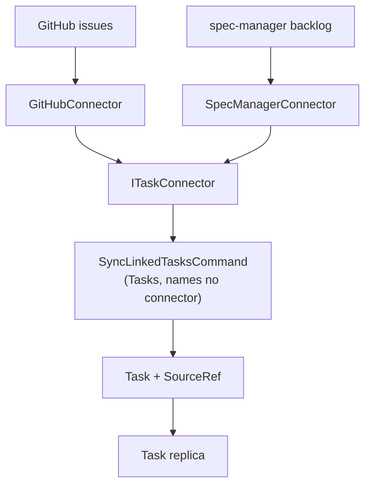

# ADR 0020: Items from GitHub and spec-manager arrive as linked tasks, through one connector contract

```meta
date: 2026-10-15
related: [".devbook/domain/tasks/domain.md#source-ref", ".devbook/domain/tasks/domain.md#linked-task", ".devbook/domain/tasks/domain.md#task-connector", ".devbook/domain/tasks/domain.md#source-state", ".devbook/domain/tasks/domain.md#connected-target", ".devbook/domain/tasks/domain.md#projection-ref", ".devbook/domain/tasks/domain.md#tombstone", ".devbook/domain/tasks/features.md#linked-tasks", ".devbook/domain/tasks/requirements.md#linked-tasks", ".devbook/domain/tasks/flow.md#task-lifecycle", ".devbook/domain/roadmap/domain.md#roadmap-tag", ".devbook/domain/roadmap/domain.md#source-label", ".devbook/arc42/adr/0005-azure-hosted-task-replica-for-multi-device-sync.md", ".devbook/arc42/adr/0006-additive-schema-bootstrapping-is-the-local-migration-mechanism.md", ".devbook/arc42/adr/0007-import-reuses-the-entry-text-grammar.md", ".devbook/arc42/adr/0013-imported-plan-is-a-roadmap-item-laid-out-by-import.md", ".devbook/arc42/adr/0017-inbox-import-is-a-capture-source-with-a-markdown-manifest.md"]
```

Every open item in a connected GitHub repository or spec-manager product
becomes a Backlog task directly, with no Inbox step, whoever it is assigned to.
Such a task is a **linked task**: it carries a `SourceRef` that says where it
came from, and each sync updates the fields the source owns. The Tasks module
reaches every source through one contract, `ITaskConnector`, and never names a
connector. GitHub and spec-manager are the first two connectors.

## Status

```meta
```

Accepted, 2026-10-15. Proposed on 2026-10-05 by the flow-spec run that drafted
it. The connector contract, the sync, the GitHub and spec-manager connectors,
the settings page and write-back to the source are built. The record now
describes them as built, and the amendments below say where that differs from
the proposal.

> **Amended 2026-10-15: "Assigned to me" is gone.** PR #1018 removed the
> "Assigned to me" filter from the Tasks pane, the per-target setting that
> turned it on by default, and the "Who am I" call from `ITaskConnector`. The
> sync still overwrites the assignee and keeps it in `SourceRef`, but no screen
> filters on it. spec-manager still reads which backlog member is the signed-in
> one, only to name the account on the settings page.

> **Amended 2026-10-15: Promote to plan is dropped.** It was never built. PR
> #1266 removed its setting, and the repository owner confirmed that it stays
> dropped. No action on a linked task creates a Roadmap Item, and nothing breaks
> an item down from sub-issues, a checklist or a generated plan.
> [Section 7](#7-promote-to-plan-was-dropped) keeps the proposal and says why.

> **Amended 2026-10-15: on-demand sync lives in Settings.** Each connected
> target's card has a "Sync now" button, which syncs that one target. The Tasks
> pane has none. The timer runs each target at its own interval, 15 minutes by
> default ([section 9](#9-the-open-questions-are-settings-per-connected-target)).

> **Amended 2026-10-15: what was added after the proposal.** A failed fetch
> names its kind and stays on the target's card until the next success. The
> settings page offers a list to pick a target from. A connector whose targets
> are repositories files each task under its target. The settings page also
> clears the tasks a disconnected target left behind, and each successful sync
> logs one line. [Section 3](#3-itaskconnector-is-the-one-contract) and
> [section 9](#9-the-open-questions-are-settings-per-connected-target) give the
> detail.

> **Amended 2026-10-13: a repository and a status map per connected target.** A
> spec-manager product whose statuses carry no development, AI or review flag
> normalised every status after its first to `Active`. Every one of its tasks
> therefore landed In progress. A connected target now has a status map that overrides
> the fixed map per source status name, and a repository its tasks are filed
> under. [Section 4](#4-the-source-owns-three-fields-backlog-owns-the-rest) says
> how the map applies, [section 9](#9-the-open-questions-are-settings-per-connected-target)
> lists both settings, and the rejected "status map per connector" is reworded
> so that it stays true. Connectors still only normalise.

A **local** decision, numbered in the local sequence. Every bare ADR number below
means the local one.

This is the first entry (`adr-linked-tasks`) of the `external-task-connectors`
plan. It records the design note "External Task Sources"
(<https://claude.ai/artifact/FeMoriPegRA6tP77tCMva9>, updated 2026-10-05), so
that every later entry of the plan implements one decision. The owner settled
three choices before this record was written. They are inputs here, not open
questions:

| Choice | Settled as |
|---|---|
| How items come in | **Linked tasks, directly.** No Inbox capture, and no read-only federated pane. |
| Which items come in | **Every open item** in a connected repository or product, whoever it is assigned to. |
| How Backlog reaches spec-manager | **Its REST API with OAuth**: authorization code with PKCE on a loopback redirect. Never a pasted token. |

The note's open questions are answered in [section 9](#9-the-open-questions-are-settings-per-connected-target):
each one is a setting per connected repository or product.

## Context

```meta
```

The person's work lives in three places: Backlog, GitHub issues, and the backlog
of a spec-manager product. Today only the first is on the Tasks list, in My Day
and on the roadmap. The other two are read in their own tools.

Backlog already has pieces that point toward an answer:

- **Capture** fetches from a source and normalises each item through an
  `ICaptureSourceAdapter`. It derives one id per item with `CaptureIds.For`, a
  name-based UUID, so a repeated fetch creates nothing twice (ADR 0017).
  A captured item has no state, assignee or update stamp, so it cannot follow
  later changes at the source.
- **Projection** sends a task out. A `ProjectionRef` records the GitHub issue or
  CLI task created *from* a task. It points the wrong way for an item that
  started somewhere else.
- **The task replica** carries every task between devices and merges a task
  whole, last writer wins on `UpdatedAt` (ADR 0005).
- **Roadmap Planning** gathers tasks by their `+` plan tag, and changes only
  through a person's gesture (ADR 0013, ruling 3).

Three ways in were weighed. Inbox capture reuses triage but freezes each item
the day it is routed. A live federated pane is always current but holds no
tasks, so nothing reaches My Day, search, the roadmap or the other devices. A
linked task costs field-ownership rules and a sync-safe merge, and it is the
only one of the three that keeps a task's status honest.

## Decision

```meta
```



### 1. External items become linked tasks, with no Inbox step

```meta
```

A connector fetches every open item of each connected target, plus the items
closed since its last run. Each one becomes a task, or updates the task it
already became. The item does not pass through the Inbox, because triage would
freeze it. The assignee does not filter what arrives: it is data on the task,
kept in its `SourceRef`. The proposal had the Tasks pane filter on it with
"Assigned to me". That filter was removed, so today no screen filters on the
assignee.

The GitHub connector fetches issues only. Pull requests and review requests stay
in the Pull Requests pane.

### 2. `SourceRef` is the inbound counterpart of `ProjectionRef`

```meta
```

A linked task carries one `SourceRef` with seven values:

| Value | Holds |
|---|---|
| `ConnectorId` | The connector's id, such as `github` or `spec-manager` |
| `ExternalId` | The source's own stable id: the GitHub issue's `node_id`, the spec-manager item's uuid |
| `Url` | Where the item opens at the source |
| `DisplayKey` | How a person names the item, such as `#412` |
| `Assignee` | The source's assignee, as a display name; absent when unassigned |
| `SourceState` | The source's own status name, kept for display |
| `SourceUpdatedAt` | The source's update stamp from the last sync |

`ConnectorId` is a string, not an enum. A new connector needs no schema change,
and a device that meets an id it does not know still shows the stored display
key under a neutral badge. The local store holds `SourceRef` in an additive
`source_ref` JSON column (ADR 0006), and the replica payload carries it. A task
without a `SourceRef` is local work and shows no source badge.

`ProjectionRef` keeps its meaning: an artifact created *from* a task. The GitHub
connector skips an issue that already backs a `ProjectionRef`, so a task pushed
to GitHub never comes back as a second task.

### 3. `ITaskConnector` is the one contract

```meta
```

The port sits in `Backlog.Modules.Tasks.Abstractions`. Everything that differs
between two systems sits behind it:

| Part | What the connector supplies |
|---|---|
| Descriptor | A stable id, a display name, an icon and a colour token. The source badge, the Source filter and the settings page are drawn from it. |
| Targets | What a person connects: repositories, or product slugs. Never credentials. `ListTargetChoicesAsync(ct)` offers them as a list to pick from, each with the name a person knows it by, or says in a sentence why it cannot list them. |
| Fetch | `FetchAsync(target, since, ct)`: every open item, plus the items closed since `since`, each normalised to a `SourceItem`. |
| Fetch failure | A failure the connector recognises throws `TaskConnectorFetchException` with its kind: not found, no access, not configured, sign-in required, or unreachable. Its message is a sentence the person can act on. |
| Complete | `CompleteAsync(item, ct)`: finishes the item at the source, or answers why it could not (write-back, §9). |
| Display key | How a person names an item. |
| Normalised state | One of `Open`, `Active`, `Done` or `Dropped`, beside the source's own status name. |
| Source statuses | `ListSourceStatusesAsync(target, ct)`: each status name the target uses, with its normalised state, so a person can map them (§9). A connector with nothing to list answers none. |
| Blocked | Whether the item cannot be worked on now, and the reason. |
| Capabilities | Flags the sync and the UI read: has effort, has dependencies, can set status, can comment, can complete, and whether a target is a repository. |

The proposal had a "Who am I" call, so that "Assigned to me" knew who "me" was.
It was removed with that filter.

**A target that is a repository files its tasks under itself.** A connector sets
the `TargetIsRepository` capability when its targets are spelled `owner/name`.
The sync then files each new linked task of that target under the repository.
GitHub sets it, and spec-manager does not. A repository set on the target
overrides it ([section 9](#9-the-open-questions-are-settings-per-connected-target)).

A connector is registered with `AddTaskConnector<T>()`. The Tasks module never
names GitHub or spec-manager, and `ModuleBoundaryTests` hold that. The GitHub
connector lives in `Backlog.Infrastructure.GitHub`, beside the client it uses.
The spec-manager connector gets its own project, `Backlog.Infrastructure.SpecManager`.

### 4. The source owns three fields; Backlog owns the rest

```meta
```

The source owns the title, the state and the assignee. Each sync overwrites
them. Backlog owns everything else: priority, My Day, area, order, sub-items,
notes, scheduling, and effort once the person changes it. The body is copied
once, when the task is created, and never again, because the person's notes
grow in it.

A fixed map turns a normalised state into a task status, the same for every
connector:

| Normalised state | Task status |
|---|---|
| `Open` | Ready |
| `Active` | In progress |
| `Done` | Done |
| `Dropped` | Archived |

**A connected target may override the fixed map.** Its status map is keyed on
the source's own status name, compared without regard to case. A name the map
holds gives that task status, and any other name takes the fixed map. The map is
the person's, set per target ([section 9](#9-the-open-questions-are-settings-per-connected-target)),
and Tasks applies it. A connector still only normalises and never maps to
`EntryStatus` itself.

The override exists because normalising can lose what a person needs. A
spec-manager product whose statuses carry no development, AI or review flag
normalises every status after its first to `Active`. With the fixed map alone,
every one of its tasks lands In progress.

The map follows four rules:

- **It never applies to a `Dropped` item.** An archived spec-manager item keeps
  the name of its last status, and mapping that name would bring archived work
  back as open work.
- **It reads the name, not only the state.** When an item moves between two
  source statuses that normalise alike but map to different task statuses, the
  sync moves the task.
- **An edit to the map moves no task.** The sync reads the held status name and
  the new one through the current map, so an item that did not move stays where
  it is. A new task takes the map at once, and an existing one on its item's
  next move.
- **A Done the map gives is the source's Done.** The task is not flagged as
  finished locally, and it follows the item's next move at the source.

The sync moves the task along the edges of `EntryStatusFlow` and never sets a
status past the graph. The graph has no edge from Ready to Done, so a closed
issue walks its task through In progress first, and an archived item walks
through Done.

**A local Done is never reopened.** When the person finished a task the source
still holds open, the sync leaves the task Done and flags the mismatch. The
person's finish is information the source does not have yet. This holds with a
status map too.

### 5. One id per item on every device; tombstones and quiet syncs

```meta
```

- **Identity.** `LinkedTaskIds.For(connectorId, externalId)` derives the task's
  id on the `CaptureIds` scheme: a name-based UUID over
  `linked:{connectorId}:{externalId}`. Two desktops syncing the same repository
  create one task, not two. Every desktop may sync. Mobile never fetches from a
  source and sees linked tasks through the replica.
- **Tombstones.** A linked task the person deleted leaves a tombstone. The sync
  skips a tombstoned id and never re-creates it.
- **A quiet sync stays quiet.** A sync that changes no field leaves `UpdatedAt`
  alone. The replica merge is whole-task last writer wins on `UpdatedAt`, so an
  idle machine that stamped every task would overwrite real edits made elsewhere.
- **An item that disappears** archives its task with a flag. Deleted,
  transferred out of a connected repository and archived in spec-manager all
  count. The task is never deleted, so the person's notes survive.

### 6. A `+` label is the plan tag; sync never creates a Roadmap Item

```meta
```

Labels become tags by Backlog's own sigil rule, the same way for both sources:

| On the item | On the linked task |
|---|---|
| A label whose name starts with `+`, such as `+offline-sync` | The plan tag of the same name |
| Any other label, such as `Blocked` | A general tag, `#blocked` |
| Two or more `+` labels | The first becomes the plan tag, and the task is flagged |

Label names are made into slugs: lower case, spaces to hyphens. A task counts in
one plan only, so no effort is counted twice.

The sync writes tags onto tasks and nothing else. **It never creates a Roadmap
Item**, because the roadmap changes only through a person's gesture (ADR 0013,
ruling 3). A plan tag with no item yet shows on the roadmap's shelf, where the
person places it with one click.

### 7. Promote to plan was dropped

```meta
```

**Promote to plan is dropped and was never built.** PR #1266 removed its
setting, and the repository owner confirmed on 2026-10-15 that it stays
dropped. No action on a linked task creates a Roadmap Item, and linked tasks
never call `IRoadmapPlanIntake`. An item that is really an epic reaches the
roadmap the way §6 says: a `+` label makes the plan tag, and the person places
it from the shelf.

The proposal is kept below, so that someone arriving to propose it again finds
what it was. Promote to plan was to be a person's action on one linked task,
for an item that is really an epic. It would have created a Roadmap Item through `IRoadmapPlanIntake`, the port
Import already uses (ADR 0013, ruling 3). The item would have been titled after
the source item and carried its link in its notes. Its tag would have been the
item's `+` label, or else a slug made from the display key and the title, such
as `gh-412-offline-sync`.

It would then have broken the item down from one of three places:

- **Sub-issues.** Each would become a linked task with the plan tag.
- **A checklist** in the body. Each line would become a local task with the plan tag.
- **A generated plan.** The body would be the specification for `import-plan`
  (ADR 0007).

A per-target setting would have said whether the original task was archived or
kept as an umbrella step. That setting is the one PR #1266 removed.

### 8. spec-manager is reached over REST with OAuth

```meta
```

The spec-manager connector calls the product's REST API, not its MCP server, so
the desktop app takes on no MCP client. It authorizes with OAuth: the
authorization code flow with PKCE, on a loopback redirect the app listens on for
the one sign-in. This is the same authorization the spec-manager MCP server
uses, so a person grants Backlog access the way they grant an agent access. The
app never asks for a pasted token. It stores the refresh token per user in the
platform's credential store, beside the GitHub credentials.

spec-manager cannot set an item's status or filter by change date today. Those
two calls, and a field for the Backlog task id, are added to spec-manager's own
API in its own repository. They are prerequisites of write-back and of an
incremental fetch, not of this decision.

### 9. The open questions are settings per connected target

```meta
```

Each question the design note left open is a setting on one connected
repository or product. Two targets may answer it differently.

| Setting | Default |
|---|---|
| Skip items untouched for longer than a set age, on the first sync only | Off |
| The title follows the source, or can be renamed locally | Follows the source |
| Sync interval | 15 minutes, on the desktop's timer |
| Finishing a task here completes its item at the source | Off |
| The repository the target's tasks are filed under | None set: a GitHub repository files its tasks under itself, and a spec-manager product under no repository |
| A status map from the source's own status names to task statuses | Empty: every status takes the fixed map ([section 4](#4-the-source-owns-three-fields-backlog-owns-the-rest)) |

A target's settings hold its connector id, whether it is enabled, the target
itself, and the values above, its repository and its status map among them.
They also hold when the target last synced, and the last failure's message and
time until the next success clears them. They never hold credentials.

The proposal had two more settings: "Assigned to me" on by default, and what
Promote to plan did with the original task. Both were removed with the
features they served (see the amendments under [Status](#status)).

**A person syncs a target on demand from Settings.** Each connected target's
card has a "Sync now" button. It syncs that one target at once, whatever its
interval, and the card shows how it went. `LinkedTaskSyncWorker` runs the timer
and syncs each target whose interval has passed. Every successful sync logs one
Information line with what it fetched, created, updated and archived.

**The settings page clears what a disconnected target left behind.** A
"Disconnected sources" section lists each connector and target pair that still
has linked tasks but is no longer connected. After the person confirms, it
deletes those tasks through `DeleteDisconnectedLinkedTasks`. Each deleted task
leaves a tombstone (§5), so a later reconnect does not bring it back.

**A repository set on a target wins for every connector.** The sync files the
target's new tasks under it, and the tasks it brought in earlier that are still
filed under no repository. A task already filed under a repository keeps it. A
spec-manager product's tasks can then land under the repository the product is
built in.

**The settings page offers one status row per source status.** It asks the
connector through `ListSourceStatusesAsync(target)`, which answers each status
name with its normalised state. spec-manager lists the product's statuses in the
product's order. GitHub lists none, so a GitHub target has no status rows: an
issue is only open or closed, which the fixed map already tells apart.

A locally renamed title stops following the source until the person resets it.
Completing at the source changes what finishing a task here does. The other
settings change only what the next sync fetches or does.

**Connectors ship inside the app for now.** A connector is a class and one
registration line in this repository. The contract is kept plugin-shaped: a
string id, a self-describing descriptor, and no connector named in Tasks. A later
record can then open it to connectors shipped as plugins, once a third system
asks for one. Loading code from outside the app raises signing and trust
questions that two built-in connectors do not justify.

## Consequences

```meta
```

- `TaskItem` gains `SourceRef`, the local store gains an additive `source_ref`
  column, and the replica payload carries it. An older device keeps the field as
  written.
- `SyncLinkedTasksCommand` in Tasks upserts by deterministic id. It runs on the
  desktop's timer and on demand from a target's "Sync now" in Settings.
- The Tasks pane gains a source badge on the row, in the editor header and in My
  Day, and a Source filter. Both are drawn from the connector descriptors, so a
  new connector needs no UI change.
- `ConnectedTarget` gains `RepositoryId` and `StatusMap`, and the settings file
  keeps both. A file written before them reads as neither set.
  `ITaskConnector` gains `ListSourceStatusesAsync`, which answers none unless a
  connector lists its statuses.
- `IGitHubClient` gains `SearchIssuesAsync`. The spec-manager connector needs a
  REST client, the OAuth sign-in and a status-name cache.
- Write-back closes the source item when its task is done here. It came in a
  later slice, behind the per-target setting "Finishing a task here completes
  its item at the source", and it needs the spec-manager status call above.
- Linked tasks take part in My Day, search, the roadmap and sync like any other
  task. A Tasks list over a busy repository grows, which is what the Source
  filter is for.

### Known gaps

```meta
```

Two parts of the contract do less than this record implies. Neither is a
decision; each is how the code stands on 2026-10-15.

- **spec-manager re-reads the whole open backlog on every sync.** The connector
  passes the `gewijzigdSinds` (changed since) filter only when it asks for
  archived items. The quiet-sync rule (§5) keeps the unchanged tasks from being
  stamped, but every sync still fetches every open item.
- **Most capability flags drive nothing yet.** The sync and the settings page
  read only `CanComplete` and `TargetIsRepository`. `HasEffort`,
  `HasDependencies`, `CanSetStatus` and `CanComment` are declared by the
  connectors and read by no code.

## Rejected

```meta
```

- **Capture into the Inbox.** A routed item stops following its source, so its
  status goes stale the day it is triaged.
- **A live federated pane.** It holds no tasks, so nothing reaches My Day,
  search, the roadmap or the other devices.
- **Only the items assigned to me.** Reassignment would make tasks appear and
  vanish. Everything open arrives, and the assignee is data on the task.
- **`ConnectorId` as an enum.** Every new connector would change the schema, and
  an older device could not read a newer device's tasks.
- **A status map inside each connector.** The map would be repeated in each
  connector and drift. Connectors normalise, and Tasks maps. A person's status
  map on one connected target is not this: Tasks applies it over the fixed map
  ([section 4](#4-the-source-owns-three-fields-backlog-owns-the-rest)).
- **Reopening a local Done** to match the source. It would undo the person's own
  finish on the next sync.
- **Creating a Roadmap Item from a `+` label during sync.** The roadmap would
  change with no person's gesture (ADR 0013, ruling 3).
- **The spec-manager MCP server as the transport.** The desktop app would need
  an MCP client for one source, while REST serves the same data.
- **A pasted personal token for spec-manager.** It would be a second
  authorization beside the one its MCP server already uses, and a long-lived
  secret typed into a field.

## History

```meta
```

| Date | Change |
|---|---|
| 2026-10-15 | Accepted, as built: "Assigned to me" and Promote to plan are dropped, on-demand sync is a target's "Sync now" in Settings, and the record gains the fetch failures, target picker, repository filing, disconnected-source cleanup and sync log line added since. |
| 2026-10-13 | Amended: each connected target gets a repository its tasks are filed under and a status map over the fixed one, because a spec-manager product with no status flagged as work put every task In progress. |
| 2026-10-05 | Proposed: linked tasks through `ITaskConnector`, from the "External Task Sources" design note. |
