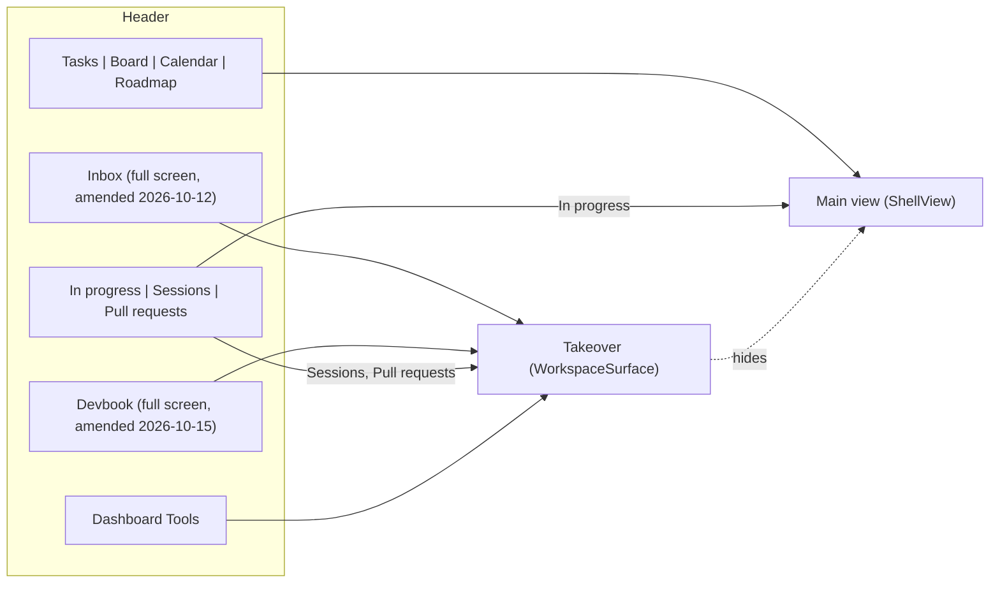

# ADR 0022: The desktop shell shows one main view, picked by a view switch, and takeovers replace it

```meta
date: 2026-10-07
related: [".devbook/design/interaction-guidelines.md#shell-header", ".devbook/design/interaction-guidelines.md#workspace-panes", ".devbook/design/interaction-guidelines.md#group-shape-says-cardinality", ".devbook/domain/tasks/features.md#search-filter-and-organize", ".devbook/domain/tasks/features.md#board-view", ".devbook/domain/tasks/features.md#calendar-view", ".devbook/domain/roadmap/features.md#reading-and-rescheduling-on-a-timeline", ".devbook/domain/sessions/features.md#session-inventory", ".devbook/domain/sessions/features.md#in-progress-by-task", ".devbook/arc42/adr/0001-desktop-stack-maui-blazor-hybrid.md", ".devbook/domain/inbox/context.md#inbox-pane", ".devbook/domain/inbox/features.md#incoming-queue", ".devbook/arc42/adr/0027-the-brain-is-a-scope-beside-the-repositories.md"]
```

The desktop shell's workspace always shows exactly one **main view** — Tasks,
Board, Calendar, Roadmap or In progress — chosen in the header and never closed,
only replaced. Sessions, Pull requests, Dashboard and Tools stay **takeovers**
that hide the workspace and that Escape closes. The Inbox and the Devbook were
first **side panes** beside the view. Since the [amendment](#amendment) of
2026-10-12 the Inbox takes the whole screen like a takeover, and Escape stays
with its own keys. Since the amendment of 2026-10-15 the Devbook takes it too,
as a takeover Escape closes, so no side pane remains. What the shell remembers in
`shell-navigation.json` gains a `lastView`, and a file from before the change is
read into the new shape rather than rejected.

## Status

```meta
```

Accepted, 2026-10-14, by the repository owner when signing off the `task-views`
plan (its step 18). Proposed on 2026-10-07 and recorded after the fact by the
flow-spec run of the plan's step 9, from the code the plan's steps 1, 5, 7 and 8
merged into `plan/task-views` (pull requests #1040, #1044, #1043 and #1045); the
deferred pieces step 18 settled landed in pull request #1134.

A **local** decision, numbered in the local sequence. Every bare ADR number below
means the local one.

## Context

```meta
```

**The header used to switch panes, not views.** Before the plan the header's
middle region was a fused strip of three panes — Inbox, Tasks, Devbook — of which
a plain press showed one and a Ctrl-press added one beside the others. The
shell kept at least one of them open, so the strip's last open option was
disabled. A "side panes only" state, the Inbox and the Devbook with no task list,
was a real arrangement. Beside the strip stood the takeovers: Roadmap, Sessions,
Pull requests, Dashboard and Tools, each a `WorkspaceSurface` member that took the
whole screen.

**The plan adds three ways to read the same tasks.** The Board lays the filtered
tasks out in columns of cards, the Calendar on a month by due date, and In
progress lists the tasks in progress with their sessions and pull requests. Each
is another reading of the task list, not another place beside it. As panes they
would have had to share the screen with the list they replace. As takeovers they
would have hidden the Inbox and the Devbook, which the person reads beside the
list.

**The roadmap was a takeover for no reason of its own.** It took the screen
because it was wide, not because reading it meant leaving the backlog. The
Inbox and the Devbook are as useful beside a plan as beside a list.

**The shell's choices are stored names.** `shell-navigation.json` holds the open
surface and the open panes as enum names (`ShellNavigationStore`). A file written
before the change names `Roadmap` as a surface and may list `Tasks` among the
open panes. Neither is a member the new shape writes.

## Decision

```meta
```



### 1. One main view, always

```meta
```

`ShellView` names the main view: `Tasks`, `Roadmap`, `Calendar`, `Board` and
`InProgress`. Exactly one is on screen whenever the workspace is. A view is never
closed: pressing the pressed option changes nothing, and nothing but another view
replaces it. Tasks is always offered and is what the shell opens on when nothing
was remembered. Roadmap is offered while `RoadmapFeatures.Roadmap` is on, and In
progress while the Sessions or the Pull requests feature is. A view whose feature
goes off falls back to Tasks, and the choice is kept, so the view comes back when
the feature does.

Tasks, Board and Calendar are one pane, the Tasks pane, in three layouts. They
share its filter bar, its open task and its selection. Roadmap and In progress
render their own content and carry no Tasks filter bar.

### 2. The view switch holds the task views; In progress sits with the work in progress

```meta
```

The header's view switch is one fused group, `Tasks | Board | Calendar | Roadmap`.
In progress is a main view too, but its option leads the work in progress group,
`In progress | Sessions | Pull requests`. It answers "what is moving", the
question that group asks, and it summarises the two lists beside it.

### 3. The Inbox and the Devbook are side panes

```meta
```

Superseded in full by the [Amendment](#amendment) of 2026-10-15: the Devbook
is no longer a side pane, so no side pane remains. `GlobalPane`,
`GlobalPaneSelection`, the side slots, the viewport's count of panes and the
draggable side-pane edge are gone. The text below is the decision as first
taken, and nothing in it holds today.

Superseded in part by the [Amendment](#amendment) of 2026-10-12: the Inbox is
no longer a side pane, and `GlobalPane` holds only `Devbook`. The text below is
the decision as first taken; where it names the Inbox, read the Amendment.

~~`GlobalPane` holds only `Inbox` and `Devbook`.~~ Each side pane is a plain
toggle that opens beside whichever view is showing. No side pane at all is an
ordinary state, so no toggle is ever disabled. The modifier press is gone: there is no "switch
to" a side pane, because switching away from the main view is the view switch's
question. The viewport still sets how many panes fit, the main view included, and
leaves at least one side slot. A pane that opens into a full set closes the first
open one in the stable order, and a narrowed window trims in that order.

The Tasks pane toggle and the "side panes only" state are gone.

### 4. Sessions, Pull requests, Dashboard and Tools stay takeovers

```meta
```

`WorkspaceSurface` keeps `Workspace`, `Tools`, `Dashboard`, `Sessions` and
`PullRequests`. A takeover hides the workspace, takes focus when it opens, and
closes on Escape, on its own close button, or on a second press of its option.
Pressing a view option or a side-pane toggle during a takeover also closes it and
shows the workspace. The main view and the open side panes are kept underneath,
so closing a takeover shows them as they were.

### 5. Roadmap is no longer a takeover

```meta
```

The roadmap is the Roadmap view inside the workspace. As first taken it had the
Inbox and the Devbook beside it; since the [Amendment](#amendment) both take
the screen over it instead. It is not closed by Escape, which on the roadmap already puts a
grabbed bar back and dismisses its planning dialogs. A window resize never closes
it. The `WorkspaceSurface.Roadmap` member stays only so that an older file still
reads. Nothing assigns it.

### 6. `lastView` and the migration of an older file

```meta
```

`shell-navigation.json` gains `lastView`, the `ShellView` member's name, written
on every view change. The Board's column grouping (`boardColumns`) and the
Calendar's plans choice (`calendarPlansShown`) are written beside it. Reading a
file migrates it in `ShellNavigationStore.Normalize`, and the shell checks the
surface again when it initialises, so no path puts the old takeover back:

| The file holds | It reopens as |
|---|---|
| No `lastView` | The Tasks view |
| `lastSurface: Roadmap` | The Roadmap view over the workspace, never the takeover |
| `Tasks` (or the older `Backlog`) in `lastEnabledPanes` | Ignored; the other panes keep their state (an `Inbox` or a `Devbook` beside it is superseded by the [Amendment](#amendment)) |
| `Knowledge` in `lastEnabledPanes` | The Devbook, as before; superseded by the [Amendment](#amendment) of 2026-10-15, which reopens it as the Devbook surface |
| An unknown or numeric name | The default for that field |

`Roadmap` is never written as a surface again. The names are appended to the
enums, never reordered, because the names are what is stored.

## Consequences

```meta
```

Positive:

- **A new reading of the tasks costs one enum member and one option.** The Board,
  the Calendar and In progress landed that way, with nothing existing revisited.
- **The Inbox and the Devbook work beside every view.** Triage beside the roadmap,
  or a chapter beside the board, is an ordinary arrangement.
- **The shell can never render empty.** A view is always showing, so the "at least
  one pane" rule and its disabled option are gone.
- **Every earlier file reopens.** A person who left the shell on the roadmap
  takeover comes back to the roadmap, now as a view.

Negative:

- **The Inbox and the Devbook cannot be read alone.** The "side panes only"
  arrangement is gone. A person who wants the Devbook wide drags the side-pane
  edge.
- **A Ctrl-press on a side pane is now a plain press.** Anyone used to the old
  modifier finds it does nothing different.
- **`WorkspaceSurface.Roadmap` is a dead member kept for reading.** Removing it
  would make an older file read as nothing rather than as the Roadmap view.

Neutral:

- In progress sits in the work in progress group but behaves as a view. Its shape
  matches its neighbours; its behaviour matches the view switch's.
- The phone keeps its own tab bar. This record is about the desktop shell.

## Rejected

```meta
```

- **Board, Calendar and In progress as more panes.** They would sit beside the
  list they replace and compete with the Inbox and the Devbook for the side slots.
- **Board, Calendar and In progress as takeovers.** They would hide the Inbox and
  the Devbook, and Escape would close what is the person's working view.
- **Keeping the roadmap a takeover.** Nothing about reading a plan means leaving
  the backlog, and as a takeover it could not have the Inbox or the Devbook beside
  it.
- **In progress in the view switch.** It reads sessions and pull requests, not the
  filtered tasks, and is offered only while one of those lists is. Placed with
  them, it leads the group it summarises.
- **Rejecting or resetting an older `shell-navigation.json`.** The person would
  lose the screen they left for no reason of theirs; reading the old names into
  the new shape costs a few lines in one store.

## Amendment

```meta
```

**2026-10-12: the Inbox takes the whole screen.** The Inbox stops being a side
pane and becomes the `WorkspaceSurface.Inbox` member, appended after
`PullRequests`. Its header option keeps its place before the view switch. A
press gives the Inbox the whole screen in place of the main view, and a second
press returns to the view that was showing, which was kept underneath. A view
option, the Devbook toggle or another takeover also leaves it. Routing an item
reloads the task list's data and changes neither the view nor the surface, so
the queue keeps the screen.

Why:

- **Triage wants the whole screen.** Triage reads one item at a time, full width,
  with its Up next list beside it. Next to the main view the Inbox had a third of
  the window and restacked its columns at the first narrowing.
- **Beside the main view the Inbox covered its own dialogs.** The pane is a size
  container, which makes it the containing block of every fixed descendant, so
  its dialogs were drawn inside the pane rather than over the window. The shared
  `Modal` now renders in the browser's top layer, which fixes that for every
  pane; giving the Inbox the screen removes the cramped arrangement that made it
  visible.

**Escape stays with the Inbox.** Unlike the other takeovers, the Inbox surface
carries no Escape-to-close: Escape is the Inbox's own key, which leaves triage
for the list and puts an AI pass under review away. A shell-level Escape that
also left the Inbox would take the reader out of the queue on the press meant
for triage.

**The persisted state migrates.** `shell-navigation.json` may now hold `Inbox`
as `lastSurface`, restored on a fresh shell like the other surfaces. A file from
before lists `Inbox` in `lastEnabledPanes`; `ShellNavigationStore` reads it on
load:

| The file holds | It reopens as |
|---|---|
| `Inbox` in `lastEnabledPanes`, `lastSurface` absent or `Workspace` | The Inbox surface, over the remembered view |
| `Inbox` in `lastEnabledPanes` under another stored surface, `Roadmap` included | That surface (the Roadmap view for `Roadmap`); the Inbox was hidden under it |

Either way `Inbox` leaves the pane list, so the next save never writes it there.
`GlobalPaneSelection.TryParsePersistedPane` reads `Inbox` as no pane rather than
throwing. The `AppFeatures.InboxPane` flag still gates the option, and turning it
off returns the reader to the workspace.

What changes in this record: section 3 now holds for the Devbook alone, the
Inbox joins the takeovers of section 4 with the Escape exception above, the
positive consequence of side panes beside every view holds for the Devbook alone,
and the negative consequence that the Inbox cannot be read alone no longer holds.

**2026-10-13: the repository scope gains the Brain.** ADR 0027 makes the Brain
the scope of everything filed against no repository
(`.devbook/arc42/adr/0027-the-brain-is-a-scope-beside-the-repositories.md`).
The decision is recorded there. Three things change here:

- **The Identity region leads with the Brain chip.** The header's repository
  scope starts with a permanent Brain chip, set off by a divider. The scope
  renders even when no repository is configured.
- **The Devbook side pane shows the Brain when nothing is scoped.** It no longer
  asks for a repository. It follows the scope's anchor, and an anchor of Brain
  shows the Brain.
- **`repositoryScope` may hold the reserved Brain value.** In
  `shell-navigation.json` the empty string `""` stands for Brain, in its place in
  the order. ADR 0027 §5 holds its migration table.

What changes in this record: section 3's Devbook pane has something to show with
no repository scoped, and the shell's remembered scope may name the Brain.

**2026-10-15: the Devbook takes the whole screen.** The Devbook stops being a
side pane and becomes the `WorkspaceSurface.Devbook` member, appended after
`Inbox`. Its header toggle keeps its place after the view switch and still reads
**Brain** while it shows the Brain. A press gives the Devbook the whole screen in
place of the main view, which is kept underneath. A second press, a view option,
another takeover option or Escape returns to that view. The links that opened the
side pane now open the Devbook surface: the task row's Brain badge and every
other "open in the Devbook" link.

Why:

- **Side by side, each had half a screen.** The split left the main view and the
  Devbook each part of the window, and the repository owner did not want the
  side-by-side arrangement. A chapter, its diagrams and the Brain read full width,
  as triage does in the Inbox.

**Escape closes the Devbook.** The Devbook follows section 4's takeover rules,
Escape included, so it carries none of the Inbox's exception. An Escape that a
field, a draft or a dialog inside the Devbook handles stays there and does not
also close the surface. Turning the `repository-devbook` flag off while the
Devbook has the screen returns the reader to the workspace, as for the Inbox.

**The side-pane machinery goes.** `GlobalPane`, `GlobalPaneSelection`, the
side-pane slots, the viewport rule that counted how many panes fit, and the
draggable side-pane edge are removed. The Brain scope of the 2026-10-13
amendment and ADR 0027 is unchanged; only where the Devbook is shown changes.

**The persisted state migrates.** `shell-navigation.json` may now hold `Devbook`
as `lastSurface`, restored on a fresh shell like the other surfaces. A file from
before lists `Devbook`, or the older `Knowledge`, in `lastEnabledPanes`;
`ShellNavigationStore` reads it on load:

| The file holds | It reopens as |
|---|---|
| `Devbook` or `Knowledge` in `lastEnabledPanes`, `lastSurface` absent or `Workspace` | The Devbook surface, over the remembered view |
| `Devbook` or `Knowledge` in `lastEnabledPanes` under another stored surface | That surface; the Devbook was hidden under it |
| `Inbox` and `Devbook` (or `Knowledge`) both in `lastEnabledPanes`, `lastSurface` absent or `Workspace` | The Inbox surface. An older file could hold both; the Inbox wins and the Devbook is dropped |

Either way the name leaves the pane list, and `lastEnabledPanes` is never written
again. Only one surface can be restored, so a file that lists both panes reopens
on the Inbox, which the 2026-10-12 table already restored.

What it costs: a chapter can no longer be read beside the task list. The reader
moves between them with the toggle, and the view waits underneath.

What changes in this record: section 3 no longer holds at all. The Devbook joins
the takeovers of section 4 without the Inbox's Escape exception, and section 4's
side-pane toggle and side panes kept underneath no longer exist. Section 5's
roadmap has nothing beside it, and section 6's `Knowledge` row reads as the table
above. The positive consequence of side panes beside every view no longer holds,
nor does the negative consequence about dragging the side-pane edge. The
2026-10-13 amendment's Devbook side pane is now the Devbook surface.

## Verification

```meta
```

The bUnit tests in `Backlog.Desktop.UI.UnitTests` hold this record:

1. **One view, never closed.** `HomeWorkspaceSurfaceTests.Pressing_the_pressed_view_again_changes_nothing`,
   `The_roadmap_view_replaces_the_task_list_inside_the_workspace`.
2. **The side pane beside any view.** Withdrawn with the side pane by the
   amendment of 2026-10-15; its tests were removed, and item 8 holds what replaced it.
3. **Header order and groups.** `The_nav_reads_inbox_views_devbook_then_the_work_in_progress_and_the_other_takeovers`,
   `In_progress_is_a_main_view_that_leads_the_work_in_progress_group`.
4. **Takeovers.** `A_takeover_keeps_the_view_switch_unpressed_and_a_view_option_returns_to_the_workspace`,
   `Escape_heard_at_the_document_closes_the_takeover`,
   `Closing_a_takeover_opened_from_the_roadmap_returns_to_the_roadmap`.
5. **Roadmap is a view.** `Escape_heard_at_the_document_leaves_the_roadmap_open`,
   `A_window_resize_never_closes_the_roadmap`,
   `GlobalPaneMarkupTests.Roadmap_option_is_feature_gated_and_is_a_view_not_a_takeover`.
6. **Migration.** `A_roadmap_surface_from_before_the_view_switch_reopens_as_the_roadmap_view`,
   `A_tasks_pane_from_before_the_view_switch_is_ignored_and_the_inbox_reopens`,
   `An_inbox_pane_from_before_the_inbox_took_the_screen_reopens_as_the_inbox_surface`,
   `The_view_is_remembered_and_a_fresh_shell_instance_reopens_on_it`, and
   `ShellNavigationStoreTests`.
7. **The Inbox takes the screen** (amendment). `HomeWorkspaceSurfaceTests.Opening_the_inbox_reopens_it_after_a_restart`,
   `HomeInboxWiringTests.Routing_an_item_reloads_the_tasks_from_the_store_and_keeps_the_inbox_on_screen`,
   `HomeInboxWiringTests.Escape_heard_at_the_document_does_not_leave_the_inbox`,
   `GlobalPaneMarkupTests.Inbox_renders_as_its_own_surface_and_never_beside_the_main_view`,
   and the
   `ShellNavigationStoreTests` whose names start `An_inbox_pane_` or `A_migrated_inbox_pane_`.
8. **The Devbook takes the screen** (amendment of 2026-10-15).
   `HomeWorkspaceSurfaceTests.The_devbook_takes_the_screen_over_the_view_and_a_second_press_returns_to_it`,
   `Each_way_back_from_the_devbook_returns_to_the_view_underneath` (a view option,
   Escape on the surface, Escape heard at the document, another takeover),
   `The_devbooks_close_button_returns_to_the_view_underneath`,
   `Pressing_the_devbook_during_another_takeover_gives_it_the_screen`,
   `The_devbook_and_the_inbox_each_take_the_screen_over_the_roadmap`,
   `Opening_the_devbook_reopens_it_after_a_restart`,
   `A_devbook_pane_from_before_the_devbook_took_the_screen_reopens_as_the_devbook_surface`,
   `A_devbook_pane_under_another_takeover_reopens_on_that_takeover`,
   `Turning_the_devbook_flag_off_while_it_has_the_screen_returns_to_the_workspace`,
   `The_devbook_toggle_takes_no_modifier_and_is_never_disabled`,
   `The_devbook_tooltip_says_what_the_press_will_do`;
   `HomeRepositoryScopeTests.A_task_rows_brain_badge_gives_the_devbook_the_screen_on_the_brain`,
   `An_entrys_devbook_reference_gives_the_devbook_the_screen_on_that_repository`,
   `An_escape_in_the_devbooks_source_field_does_not_close_the_devbook`;
   `MarkdownCommentTests.A_key_pressed_in_a_comment_draft_does_not_reach_the_host`;
   `GlobalPaneMarkupTests.Devbook_renders_as_its_own_surface_and_closes_on_escape`,
   `No_side_pane_remains_and_neither_does_its_pin_or_modifier`; and the
   `ShellNavigationStoreTests` whose names start `A_devbook_pane_` or
   `A_migrated_devbook_pane_`, with `The_devbook_surface_survives_a_restart`.
   No test yet holds the row where a file lists both the Inbox and the Devbook.
