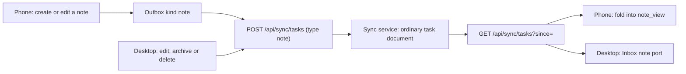

# ADR 0025: Notes ride the task feed as a second Inbox document kind, synced both ways

```meta
date: 2026-10-12
related: [".devbook/arc42/adr/0009-captures-are-a-document-kind-on-the-replica.md", ".devbook/arc42/adr/0005-azure-hosted-task-replica-for-multi-device-sync.md", ".devbook/arc42/adr/0014-attachments-travel-through-a-blob-store-beside-the-replica.md", ".devbook/arc42/adr/0018-roadmap-plan-and-pace-ride-the-task-feed.md", ".devbook/arc42/adr/0021-github-accounts-and-repository-registry-ride-the-task-feed.md", ".devbook/arc42/06-runtime-view.md#mobile-note-sync", ".devbook/domain/inbox/domain.md#note", ".devbook/domain/inbox/features.md#notes", ".devbook/domain/capture/features.md#talk-note"]
```

A note is an Inbox item of content kind `note`. It travels between the desktop
and the phone as a whole task-shaped document on the existing `/tasks` feed,
under the kind token `note` and the Inbox item's id. Unlike a capture, nobody
acknowledges it away: either side edits it, and the later write wins.

## Status

```meta
```

Proposed, 2026-10-12. Already built, by entries 2 and 9 of the plan
`+phone-app-redesign` (pull requests #1049 and #1057). This record writes down a
decision the code already holds. It awaits acceptance at the Personal Validation
gate of the flow-spec run that drafted it.

A **local** decision, numbered in the local sequence. Every bare ADR number below
means the local one.

This record **extends** ADR 0009, which made a capture a document kind on the
replica. A note is a second Inbox document kind beside `capture`. ADR 0009's
rules for `capture` stand unchanged.

## Context

```meta
```

**A capture is one-way.** The phone posts a capture to `POST /api/sync/inbox`.
The desktop takes it in and acknowledges it by tombstone (ADR 0009). The phone
then forgets it. That suits a thought sent to triage, but not a note the person
keeps writing.

**The talk note was a capture.** The phone's talk note was a `text` capture with
a speaker and tags, sent through `POST /api/sync/inbox` under outbox kind
`talk-note`. Once the desktop took it in, the phone could not show it or change
it again.

**The phone already pages the task feed.** My Day folds
`GET /api/sync/tasks?since=` into a local `task_view`
(`.devbook/arc42/06-runtime-view.md#mobile-my-day-and-task-push`). ADR 0018 and
ADR 0021 showed that the feed carries a whole document under its own kind token
with no change to the service.

**The replica's upsert is whole-document, last write wins** (ADR 0005). A retry
that sends the same id and the same document is idempotent.

## Decision

```meta
```



### 1. A note is a `note` document on the task feed

```meta
```

A note travels as a task-shaped document in the `tasks` container, with
`type: "note"`, under the Inbox item's id. It goes up on `POST /api/sync/tasks`
and comes down on `GET /api/sync/tasks?since=`.

The sync service treats it as an ordinary task document. `PushTasksCommand`
knows the literal `note` for one reason only: a tombstoned note releases its
files, as a tombstoned capture does. No route, container or index changes.

### 2. The task feed, not the inbox route

```meta
```

The inbox route is one-way. A capture is acknowledged away by tombstone, and the
phone forgets it. A note syncs both ways, and either side edits it.

The phone already pages the task feed for My Day. Folding the `note` documents
into a local `note_view`, with its own `note_cursor`, costs no new route, no new
container and no service change. The whole-document upsert makes a retry
idempotent.

### 3. The phone folds and pushes through its outbox

```meta
```

The phone's task fold skips `note` documents. The note fold writes them into
`note_view`. A later `UpdatedAt` wins, and a tombstone hides the row.

A note the phone creates or edits is queued under the outbox kind `note`
(`NoteOutboxKind`). The entry uploads the files the note newly names, then posts
the whole document. The phone never pushes a tombstone, because it never
archives an item.

### 4. The desktop pushes by a flag, not a watermark

```meta
```

The desktop's `TaskReplicaMerge` hands a `note` document to the Inbox's note
port before the task path. The port creates the item or applies the later edit.

On every push the desktop sends each live note it changed itself and has not
pushed yet. `InboxItem.NotePushPending` marks such a note. A watermark would not
work, because a note's stamp may come from the phone's clock. A note the desktop
only pulled is never sent back. A desktop change is stamped after the copy it
replaces, whatever the two clocks say.

When the desktop archives or deletes a note, the acknowledgement outbox
(`ReplicaAckPending`) pushes a tombstone `note` document. A phone edit that
arrives later owes the tombstone again, under a later stamp. A deleted note's id
is kept, so no later copy makes it again.

### 5. A capture never claims `note`

```meta
```

`ReceiveCaptureCommand` sets a capture's claimed kind only when it is not
`ContentKind.Note`. A capture that claims `note` stays the plain thought it
arrived as. A note is made as a note and syncs as a note document. So the
one-way capture path and the two-way note path never meet on one item.

## Consequences

```meta
```

Positive:

- **A note stays on the phone.** The person reads, searches and edits it there
  after the desktop has taken it in.
- **Either side edits.** An edit on the desktop reaches the phone, and an edit on
  the phone reaches the desktop.
- **The service does not change.** Notes ride the route, container and paging the
  task feed already has.

Negative:

- **An older desktop turns a note into a draft task.** A desktop build from
  before the `note` token does not know the type. The document goes down the task
  path and lands as a draft task, as ADR 0009 accepted for captures before their
  token. Every desktop must be updated before notes are made on a phone.
- **Whole-document last write wins per note.** Two devices that edit one note
  before either syncs keep only the later edit.
- **The documents are task-shaped without being tasks**, as ADR 0018 already
  accepts.

Neutral:

- **The talk note is retired.** The phone's former talk note is now a note
  written in the Notes tab (`.devbook/domain/capture/features.md#talk-note`). A
  talk note an earlier build left in the outbox is still sent as the capture it
  was.

## Rejected

```meta
```

- **Sending notes through `POST /api/sync/inbox`.** That route is one-way. The
  desktop acknowledges a capture away, and the phone forgets it.
- **A new route or container for notes.** The task feed carries a whole document
  with no service change, as ADR 0018 showed.
- **A watermark for the desktop push.** A note's stamp may come from the phone's
  clock, so a watermark on the desktop's clock would skip or repeat notes.
- **Letting a capture claim `note`.** It would turn a one-way capture into a
  two-way note the phone had already forgotten.

## Open question

```meta
```

**How a note's files reach the phone.** The phone uploads a note's files before
the document that names them (ADR 0014), and the desktop fetches them from the
attachment store. Nothing yet brings the files of a note made or edited on
another device down to the phone. This stays open until a decision on it lands.

## Verification

```meta
```

Look for tests that show these behaviours:

1. **A note round-trips both ways.** A note made on the phone lands in the
   desktop Inbox as an item of kind `note`. A desktop edit reaches the phone's
   `note_view`.
2. **A pulled note is not echoed.** A note the desktop only pulled is not in its
   next push.
3. **A tombstone hides the row.** The desktop archives a note, and the phone drops
   it on its next pull.
4. **A capture claiming `note` stays text.** `ReceiveCaptureCommand` keeps such a
   capture a plain thought.

One behaviour is accepted rather than tested: a desktop build from before the
`note` token makes a phone note into a draft task.
