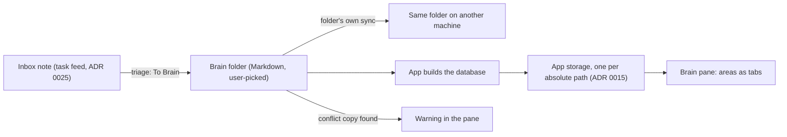

# ADR 0026: The Brain is a personal devbook, one folder per user outside any repository

```meta
date: 2026-10-28
related: [".devbook/arc42/adr/0004-knowledge-index-is-a-generated-local-database.md", ".devbook/arc42/adr/0015-devbook-database-lives-in-app-storage-and-the-app-builds-it.md", ".devbook/arc42/adr/0016-knowledge-folders-adopt-the-devbook-convention.md", ".devbook/arc42/adr/0025-notes-ride-the-task-feed.md", ".devbook/arc42/02-constraints.md#technical-constraints", ".devbook/arc42/08-crosscutting-concepts.md#devbook-database", ".devbook/arc42/12-glossary.md#terms", ".devbook/domain/inbox/features.md#route-to-brain", ".devbook/domain/brain/domain.md#knowledge-note", ".devbook/domain/brain/domain.md#para-category"]
```

The Brain is the person's own notes. It is one folder per user, outside every
repository, laid out as a devbook. The person picks the folder on first use. The
folder holds the Markdown and its convention, and nothing else. The app builds
the derived database into its own storage, as it does for a repository.

## Status

```meta
```

Accepted, 2026-10-14. Built by the plan `+brain` (pull requests #1168 and #1197
into `plan/brain`).

Amended 2026-10-28 by the change that makes the folders on disk the tabs
([§2](#2-the-convention-lives-in-the-folder)). A Brain's agent may reorganise it
and put notes into a new top folder. Under the first rule those notes vanished
from the pane until someone also edited `CONVENTIONS.md`. Now the folders on
disk are the tabs, and `CONVENTIONS.md` is an overlay with an `Ignore` list.

> **Superseded in part, 2026-10-29, by
> [ADR 0040](0040-the-brain-is-its-own-bounded-context.md) (proposed).** The
> Brain's place inside the Devbook bounded context gives way to a context of its
> own. The folder, its convention, the three fields, the database in app storage
> and the reuse of the devbook machinery still stand.

A **local** decision, numbered in the local sequence. Every bare ADR number below
means the local one.

This record **builds on** three earlier decisions:

- **ADR 0004.** The Markdown is canonical. The derived layer is generated and
  disposable, and a reader falls back down the degrade ladder when it is absent.
- **ADR 0015.** The database lives in the app's storage, keyed by the normalized
  absolute path, and the app builds it in C#.
- **ADR 0016.** The devbook convention: a fenced `meta` block per chapter,
  `annotation` fences, `index: root`, and a derived reading order.

It **amends** the *Scope-portable dot-folder contract* row of
`.devbook/arc42/02-constraints.md#technical-constraints`. That row put a `.brain/`
folder at workspace, repository and project level. This record replaces it for
the Brain: there is one Brain per user, and no repository holds one.

## Context

```meta
```

**The Brain was a dot-folder per scope.** The constraints listed `.brain/` beside
`.inbox/` and `.backlog/` at workspace, repository and project level. Nothing
built reads such a folder. A person's notes span repositories, so a folder per
repository splits them.

**A devbook already has the reading machinery.** The app reads a repository's
devbook folders, builds their database in its own storage (ADR 0015), and
renders chapters, links and annotations (ADR 0016). A personal notes folder in
the same shape reuses all of it.

**People keep notes in a synced folder.** OneDrive is the likely home. A
file-sync product corrupts SQLite and its WAL sidecars, so nothing derived may be
written into a synced folder (`.devbook/arc42/02-constraints.md`, *The local
store is never file-synced*). OneDrive also writes a conflict copy,
`<name>-<MACHINE>.md`, when two machines change one file before it syncs.

**The Inbox has notes too.** A note in the Inbox rides the task feed between the
desktop and the phone (ADR 0025). It waits for triage. The Inbox's *Route to
Devbook* step (`.devbook/domain/inbox/features.md#route-to-devbook`) needs a
place to send it.

## Decision

```meta
```



### 1. One folder per user, outside every repository

```meta
```

The Brain is one folder per user. It sits outside every repository. The person
picks it on first use, and there is no default path.

Settings › Storage holds the path in the app's settings. The path is never
written into the folder. OneDrive is the expected place, but any folder works.

### 2. The convention lives in the folder

```meta
```

The folder carries its own convention in two files:

- `README.md`, marked `index: root`.
- `CONVENTIONS.md`, which declares the areas and lists the folders to ignore.

Each area is a top folder, and the Brain shows each area as a tab. The tabs come
in two groups:

1. **Declared areas come first.** They are the areas the `## Areas` section of
   `CONVENTIONS.md` lists, in its order. When it declares none, the PARA set
   applies: `_inbox`, `projects`, `areas`, `resources`, `people`, `journal` and
   `archive`. A declared area keeps its tab when its folder is empty or missing,
   so capture always has a target.
2. **Discovered areas follow.** Every other top folder that holds at least one
   Markdown note, at any depth, is an area too. Its tab is named after the
   folder, so `side-projects` reads "Side projects". Discovered areas are
   ordered by folder name, ignoring case. A top folder with no note is not an
   area until it gets one.

Some folders are never an area:

- A dot-folder, such as `.obsidian`.
- Every folder the `## Ignore` section of `CONVENTIONS.md` lists. Ignore uses
  the same list syntax as Areas and matches case-insensitively. It wins over a
  declaration of the same folder.

Markdown files at the Brain's root, such as `README.md`, `CONVENTIONS.md` and
`AGENTS.md`, stay outside every area. Search, the Brain database and the atlas
index the same set of areas the tabs show.

**Show hidden** in the pane's menu is a view switch, off by default and kept in
the app's settings per device: while on, ignored folders and dot-folders show as
tabs marked hidden. It changes no area, so search and the database still leave
them out.

`CONVENTIONS.md` is the one structure file the app parses. An `AGENTS.md` or
`CLAUDE.md` in the Brain holds the agent's own instructions, for example "when
you add a top folder, describe it in `CONVENTIONS.md`". The app never parses it.

The app ships a template. **Create conventions** scaffolds both files and the
declared folders from it. The template's `## Ignore` section lists `_templates`,
the folder note templates usually live in.

### 3. A note is a devbook chapter with three more fields

```meta
```

A Brain note keeps the devbook `meta` block and `annotation` fences (ADR 0016).
It adds three fields:

| Field | Holds |
|---|---|
| `para` | The note's area. It is derived from the folder, and written only to override it. |
| `repos` | The repositories a project note concerns. Project notes only. |
| `tasks` | The tasks the note links to. |

### 4. The database is built into app storage, never into the folder

```meta
```

The app builds the Brain's database into its own storage, one per absolute
path, exactly as ADR 0015 does for a repository. Nothing derived is written into
the folder. A synced folder therefore never carries SQLite.

The database stays disposable (ADR 0004). When it is absent, the pane reads the
Markdown.

### 5. Conflict copies are shown, never merged

```meta
```

When the folder holds a OneDrive conflict copy, `<name>-<MACHINE>.md`, the pane
shows a warning. The app never merges the copy. The person resolves it.

### 6. A Brain note is not an Inbox note

```meta
```

An Inbox note rides the task feed between the desktop and the phone and waits
for triage (ADR 0025). Triaging it **To Brain** writes it into the Brain as a
note.

A Brain note never rides the task feed. The folder's own sync carries it between
machines.

## Consequences

```meta
```

Positive:

- **One place for a person's notes.** Notes about several repositories live
  together, not split across `.brain/` folders.
- **The devbook machinery is reused.** Reading, the database build, links and
  annotations work on the Brain as they do on a repository.
- **A synced folder stays safe.** No SQLite file or sidecar is ever written into
  it.
- **The folders on disk are the tabs.** A note in a new top folder shows at once,
  even when an agent made the folder. `CONVENTIONS.md` names, orders and
  describes the areas, and PARA is only the fallback.

Negative:

- **First use asks a question.** With no default path, the Brain is empty until
  the person picks a folder.
- **Each machine builds its own database.** A second machine reads the synced
  Markdown and builds again from scratch.
- **Conflicts are left to the person.** A conflict copy stays until someone
  merges or deletes it by hand.
- **The phone does not see the Brain** through the app. Only Inbox notes reach
  the phone, on the task feed.
- **A stray folder becomes a tab.** A folder of attachments or an agent's
  scratch notes shows as a tab once it holds a note. It stays one until the
  person lists it under `Ignore`.

Neutral:

- **The dot-folder contract loses `.brain/`.** `.inbox/` and `.backlog/` keep
  their place in the constraint. The Brain is the one folder per user this
  record describes.
- **A moved folder gets a new database.** The key is the absolute path (ADR
  0015), so a new path builds a new one and the old one is orphaned.

## Rejected

```meta
```

- **A default path.** No path suits every person, and a guessed one may land
  inside a repository or outside the synced folder.
- **A `.brain/` folder per repository or workspace.** It splits one person's
  notes across repositories and puts personal notes into shared history.
- **Storing the path in the folder.** The app must know the path before it can
  read the folder.
- **Writing the database into the folder.** A file-sync product corrupts SQLite
  and its sidecars (`.devbook/arc42/02-constraints.md`).
- **Merging conflict copies.** Two edits to one note cannot be merged safely
  without the person. A wrong merge loses text silently.
- **Carrying Brain notes on the task feed.** The folder already syncs itself. A
  second channel would race the folder's sync and duplicate every note in the
  replica.
- **Declared areas only.** This was the first rule. Notes in a new folder
  vanished from the pane until a second file was edited.
- **Folders only, with no `CONVENTIONS.md`.** It loses tab names, order,
  `Holds`, dated areas, and an inbox target that exists before its folder does.
- **Skipping every `_` folder.** `_inbox` is one, so the rule would need
  exceptions. An explicit `Ignore` list says what it means.
- **Reading the areas from `AGENTS.md`.** It is prose an agent rewrites freely,
  so any rewording would move the tabs.
- **Showing every top folder, empty or not.** An attachments folder or an
  agent's scratch folder would become an empty tab. Holding a note is the
  signal.

## Verification

```meta
```

Look for tests that show these behaviours:

1. **No folder, no Brain.** On first use the Brain asks for a folder and assumes
   no default path.
2. **The path stays in settings.** After the person picks a folder, the path is
   in the app's settings and no file in the folder names it.
3. **Declared areas first, then discovered folders.** Declared areas show as
   tabs in their order, even when empty; with none declared, the seven PARA
   folders show. Every other top folder holding a note follows, ordered by
   name. A top folder without a note and a dot-folder show no tab.
4. **Create conventions scaffolds.** It writes `README.md` with `index: root`,
   `CONVENTIONS.md` with an `## Ignore` section listing `_templates`, and every
   declared folder.
5. **`para` follows the folder.** A note's area is its top folder unless its
   `meta` block sets `para`. A note in a discovered folder has that folder as
   its area.
6. **Nothing derived lands in the folder.** After a build the folder holds no
   SQLite file and no sidecar, and the database sits in app storage under the
   folder's absolute path.
7. **A conflict copy warns.** A `<name>-<MACHINE>.md` beside `<name>.md` shows a
   warning, and neither file changes.
8. **To Brain writes a note.** Triaging an Inbox note To Brain writes a Markdown
   note into the Brain, and no `note` document for it goes onto the task feed.
9. **Ignore hides a folder.** A folder listed under `## Ignore` shows no tab,
   even when it holds notes or is also declared. Search and the database leave
   its notes out.
