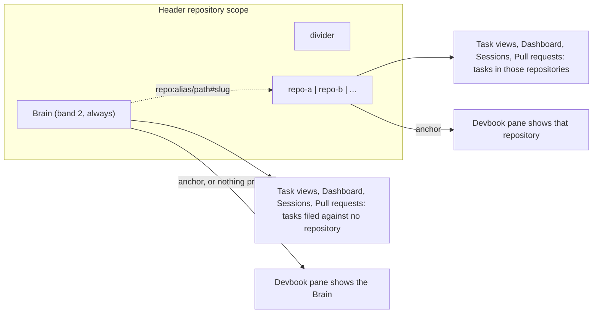

# ADR 0027: The Brain is a scope beside the repositories, the scope of everything filed against no repository

```meta
date: 2026-10-13
status: proposed
related: [".devbook/arc42/adr/0022-the-shell-shows-one-main-view-picked-by-a-view-switch.md", ".devbook/arc42/adr/0026-the-brain-is-a-personal-devbook-outside-any-repository.md", ".devbook/design/interaction-guidelines.md#shell-header", ".devbook/design/interaction-guidelines.md#focus-and-selection", ".devbook/design/color-scheme.md#band-identity-tokens", ".devbook/domain/tasks/features.md#search-filter-and-organize", ".devbook/domain/tasks/features.md#board-view", ".devbook/domain/devbook/features.md#area-selection-and-scope", ".devbook/domain/devbook/features.md#bi-directional-linking", ".devbook/arc42/12-glossary.md#terms"]
```

The header's repository scope gains a **Brain** chip. It comes first, it cannot
be removed, and it needs no repository. Brain is the scope of everything filed
against no repository. It replaces the Tasks filter bar's "No repo" chip and the
Board's "No repository" column. The Devbook pane shows the Brain when the
scope's anchor is Brain, and when nothing is pressed.

## Status

```meta
```

Proposed, 2026-10-13. Not yet built: the plan `+brain` builds it. It awaits
acceptance at the Personal Validation gate of the flow-spec run that drafted it.

A **local** decision, numbered in the local sequence. Every bare ADR number below
means the local one.

This record **builds on** ADR 0026. The Brain is one personal devbook folder per
user, outside every repository. This record gives that folder a place in the
shell.

It **amends** ADR 0022. The header's Identity region leads with the Brain chip
and renders with no repository configured. The Devbook side pane shows the Brain
when nothing is scoped. `shell-navigation.json` may hold the reserved Brain value
in `repositoryScope`. ADR 0022's [Amendment](0022-the-shell-shows-one-main-view-picked-by-a-view-switch.md#amendment)
of 2026-10-13 records the change there.

## Context

```meta
```

**"No repository" is a second scope beside the scope.** The Tasks filter bar
carries a "No repo" chip. It sets `TasksDesktopState.NoRepositoryOnly` through
`SetNoRepositoryFilter`, a boolean kept apart from `SelectedRepositoryAliases`.
The header's scope and the chip both narrow the same rows, in two places, under
two names. The Board has a "No repository" column (`TasksPane.Board.cs`,
`TaskBoardGrouping`). A task's repository picker, `RepositorySelector`, reads
"No repo" as its `EmptyLabel`.

**The chip is not remembered.** `NoRepositoryOnly` lives for the session only.
`shell-navigation.json` remembers the header scope
(`ShellNavigationStore.RepositoryScope`) and nothing else about it.

**The Devbook pane has nothing to show without a repository.** With no
repository scoped it reads "Select a repository to read its devbook."
(`DevbookFolderSource.NoRepositoryScoped`). The header's Identity region renders
only while a repository is configured
(`.devbook/design/interaction-guidelines.md#shell-header`).

**The Brain needs a way in.** ADR 0026 makes the Brain a devbook outside every
repository. Work filed against no repository and notes kept outside every
repository are the same person's own things.

**Aliases are never empty.** `GitHubRepositoryRef.NormalizeAlias` trims and
lower-cases an alias. `WorkspaceSettingsStore` falls back to the repository name
when the alias is blank. So no configured repository has the empty string as its
alias.

## Decision

```meta
```



### 1. A permanent Brain chip leads the scope

```meta
```

The repository scope gains a **Brain** chip. It sits first, and a divider sets it
off from the repository chips. It wears band 2, teal `#7FD1C1` (`color-band-2`).

The chip cannot be removed. It depends on no machine and no repository. The
scope therefore renders even when no repository is configured. That changes the
shell-header row, which today renders the scope only while a repository is
configured.

When the person has not picked a Brain folder yet (ADR 0026 §1 has no default
path), the chip still shows and still scopes tasks.

### 2. Brain is the scope of everything filed against no repository

```meta
```

Picking Brain alone shows only tasks with no repository. That holds in Tasks,
Board, Calendar, In progress, Dashboard, Sessions and Pull requests.

- **The "No repo" chip goes.** Brain in the scope replaces the Tasks filter bar's
  chip and its separate `NoRepositoryOnly` boolean.
- **The Board's column is renamed.** The "No repository" column becomes "Brain".
- **The repository picker lists Brain first.** In `RepositorySelector`, picking
  Brain clears the task's repository. It replaces the "No repo" empty label.
- **Pull requests narrow too.** The list narrows to what is filed against no
  repository. For pull requests that is normally nothing, since every pull
  request belongs to a repository. The list shows those linked to tasks filed
  against no repository, if any exist. Otherwise it is empty, and its empty
  state says why.

### 3. Ctrl adds Brain as it adds a repository

```meta
```

The scope keeps the *Modifier-click scope* rule
(`.devbook/design/interaction-guidelines.md#focus-and-selection`). A plain press
picks Brain alone. Ctrl adds Brain to the repositories already pressed, as it
adds a repository today. Nothing pressed still means everything.

### 4. The Devbook pane follows the anchor, and the Brain is its default

```meta
```

The Devbook pane follows the scope's anchor, the first chip chosen.

| The scope holds | The Devbook pane shows |
|---|---|
| Nothing pressed | The Brain |
| Brain as the anchor | The Brain |
| A repository as the anchor | That repository's devbook |
| Brain and a repository | The anchor's devbook, with a `Brain \| <repo>` switch |

With nothing pressed the pane shows the Brain, because the Brain is always there.
That replaces "Select a repository to read its devbook."

With Brain and a repository pressed, a `Brain | <repo>` switch in the pane flips
what it shows. The switch never changes the task filter.

When no Brain folder is picked yet, the pane on the Brain shows the Brain's
first-use folder prompt (ADR 0026 §1).

### 5. The scope is remembered with a reserved Brain value

```meta
```

`shell-navigation.json` keeps the scope in `repositoryScope`, as today
(`ShellNavigationStore.RepositoryScope`). The aliases are stored in order. The
first is the anchor, and an empty list means everything.

Brain is stored as the empty string `""`. No configured alias is ever empty (see
*Context*), so the value cannot collide with a repository. Reading a file
migrates it:

| The file holds | It reopens as |
|---|---|
| No `repositoryScope` | Everything |
| `""` in `repositoryScope` | Brain in that position, the anchor if first |
| An unknown alias | Dropped, as today |
| The old "no repository" state | Brain |

Today's "No repo" chip is not persisted, so nothing writes the last row's value
now. The row stays as a guard.

### 6. Links run from the Brain into a repository, never back

```meta
```

A Brain note may link into a repository devbook with
`repo:<alias>/<devbook path>[#slug]`. A repository devbook never links into a
Brain.

A repository chapter shows **From your Brain** backlinks to its owner only. The
backlinks come from the owner's own Brain database in app storage (ADR 0026 §4).
Nothing is written into the repository.

## Consequences

```meta
```

Positive:

- **One place to say "no repository".** The header scope answers it, and every
  view that reads the scope follows. The filter bar loses a chip.
- **The Devbook pane always has something to show.** The empty "select a
  repository" state is gone.
- **The scope works with no repository configured.** A new user with only the
  Brain still has a working header.
- **"No repository" becomes remembered.** It rides the stored scope, so it comes
  back on a fresh shell.
- **A repository stays clean.** Backlinks live in the owner's app storage, so
  personal notes never reach shared history.

Negative:

- **Band 2 is shared.** Repository identity marks also cycle through the bands, so
  a repository whose mark is band 2 wears the Brain's teal. The divider and the
  chip's first place set the Brain apart, not the colour alone.
- **Pull requests under Brain alone are normally empty.** The person sees an empty
  list and its explanation.
- **The empty string is a magic value.** Code that reads `repositoryScope` must
  know that `""` means Brain.
- **A repository chapter cannot cite a Brain note.** Links run one way only.

Neutral:

- **The Board's column changes name, not content.** It still holds the tasks with
  no repository.
- **Backlinks differ per person.** Two people reading one repository chapter see
  their own Brain backlinks, or none.
- **The Roadmap view is not settled here.** The scope collapses to the anchor
  there, and what an anchor of Brain shows on the roadmap is left to the plan.

## Rejected

```meta
```

- **Keeping "No repo" as a Tasks-only chip beside the scope.** Two controls would
  keep narrowing the same rows under two names, and only one would be
  remembered.
- **Brain as a separate header toggle outside the scope.** It would be a second
  scope beside the first, and Ctrl could not combine it with a repository.
- **Storing Brain as a readable word like `brain`.** It collides with a
  repository whose alias is `brain`.
- **Two-way links.** A repository devbook is shared history, and the Brain is
  personal. A link back would point everyone else at a note they cannot read.
- **Showing Brain backlinks to everyone.** They would expose one person's notes to
  every reader of the repository.

## Verification

```meta
```

Look for tests that show these behaviours:

1. **The Brain chip leads.** The scope renders the Brain chip first, behind a
   divider, in band 2, with no remove control.
2. **No repository, still a scope.** With no repository configured the scope
   renders with the Brain chip alone.
3. **Brain alone narrows to no repository.** Tasks, Board, Calendar, In progress,
   Dashboard, Sessions and Pull requests show only tasks with no repository.
4. **The old chip is gone.** The Tasks filter bar renders no "No repo" chip.
5. **The Board column reads Brain.** The column of tasks with no repository is
   titled "Brain".
6. **The picker lists Brain first.** Picking Brain in `RepositorySelector` clears
   the task's repository.
7. **Ctrl adds Brain.** A Ctrl-press on Brain adds it to the pressed
   repositories, and a plain press picks it alone.
8. **The pane follows the anchor.** Nothing pressed or the anchor Brain shows the
   Brain. A repository anchor shows that repository.
9. **The switch leaves the filter alone.** With Brain and a repository pressed,
   the `Brain | <repo>` switch flips the pane and the task rows do not change.
10. **No folder yet.** With no Brain folder picked, the chip scopes tasks and the
    pane on the Brain shows the first-use folder prompt.
11. **The scope is remembered.** `""` in `repositoryScope` reopens as Brain in its
    position, the anchor if first. An unknown alias is dropped.
12. **Pull requests under Brain alone.** The list holds only pull requests linked
    to tasks with no repository, and shows its empty state when there are none.
13. **Links run one way.** A `repo:<alias>/<path>#slug` link in a Brain note
    resolves. A repository chapter shows "From your Brain" backlinks to its owner,
    and no file in the repository changes.
