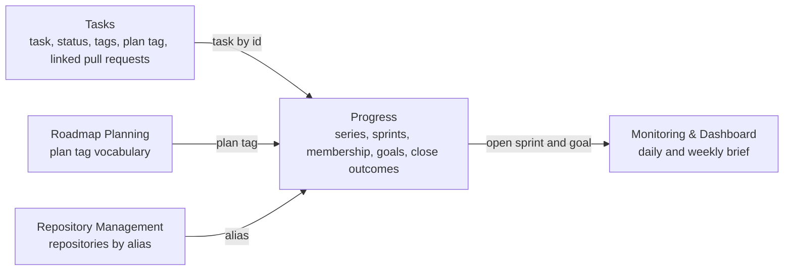

# ADR 0028: Progress is its own boundary, and Tasks knows no sprints

```meta
date: 2026-10-13
status: proposed
related: [".devbook/domain/progress/context.md", ".devbook/domain/context-map.md", ".devbook/domain/tasks/domain.md#task", ".devbook/domain/roadmap/domain.md#roadmap-tag", ".devbook/domain/sessions/features.md#in-progress-by-task", ".devbook/arc42/adr/0035-goals-and-impediments-replace-sprints.md"]
c4: [backlog.desktop.backlogModule]
```

Sprints get a bounded context of their own, **Progress**. It names a task by its
id and a plan by its plan tag. Tasks holds no field, tag or status that knows a
sprint exists.

## Status

```meta
```

Proposed, 2026-10-13. Not yet built: the plan `+progress-sprints` builds it. It
awaits acceptance at the Personal Validation gate of the flow-spec run that
drafted it.

> **Superseded in part, 2026-10-17, by
> [ADR 0035](0035-goals-and-impediments-replace-sprints.md) (proposed).** Its
> sprint parts give way to goals and impediments: §1's sprint series, sprints,
> membership, goal rules and close outcomes, §2's sprint items and plan links,
> and §4's `progress` flag, now `goals`. Progress as its own boundary, references
> by id and tag, and Tasks knowing nothing of Progress still stand.

A **local** decision, numbered in the local sequence. Every bare ADR number below
means the local one.

## Context

```meta
```

**People want to work in sprints.** A set of repositories runs to a fixed
cadence of one or two weeks. Each sprint has a goal, and closing it decides what
happens to the work left unfinished.

**Sprint membership is not a property of a task.** A task may be in Sprint 4,
carried into Sprint 5, and dropped there. Which sprint it is in, whether it is a
goal task, and the note kept on it in a sprint are facts about the sprint. Stored
on the task, they would need history the task does not keep. They would also
change the task's entry text, which Tasks owns (ADR 0002).

**A whole plan joins a sprint.** A person links a plan by its tag and expects
every task of that plan to be in the sprint, including tasks filed under it
later. Copying the tasks in at link time would miss those.

**Repositories without sprints must not change.** A repository in no series
keeps today's In progress view.

## Decision

```meta
```



### 1. Progress owns sprints, membership and outcomes

```meta
```

Progress is a Supporting subdomain, downstream of Tasks, Roadmap Planning and
Repository Management, and upstream of Monitoring & Dashboard. It owns the
sprint series, the sprints, which tasks and plans are in each, the goal rules,
the per-item note and open-question mark, and each unfinished item's close
outcome.

### 2. References are ids and tags, read on every reading

```meta
```

A sprint item holds a task id. A plan link holds a plan tag. Progress reads the
task's status, tags and linked pull requests from Tasks each time it shows a
sprint, and keeps no copy. A task filed under a linked plan later is a member
without anyone adding it.

### 3. Tasks knows no sprints

```meta
```

No task field, tag, status or entry-text token names a sprint. Adding a task to a
sprint, closing a sprint and every close outcome leave the task as it was. Drop
is recorded in the sprint only.

### 4. The context sits behind one flag

```meta
```

The app feature key `progress`, status `DEV`, switches the whole context. With it
off, every repository shows the In progress view.

## Consequences

```meta
```

Positive:

- **The task model stays as it is.** Tasks, its entry text and its sync need no
  change for sprints.
- **A sprint keeps its own history.** A closed sprint still shows what it held,
  what was carried and what was dropped, whatever the tasks did later.
- **A plan stays one link.** New tasks of a linked plan join the sprint on their own.

Negative:

- **A sprint is only as current as its reads.** Showing a sprint reads every
  member's task, and its linked pull requests' merged state, each time.
- **A deleted task leaves an id behind.** A sprint item may name a task that no
  longer exists, and the sprint view has to show that.
- **Task views cannot filter by sprint on their own.** A sprint filter in the task
  list has to ask Progress.

Neutral:

- **Owner is derived.** A row's owner is the authors of the linked pull requests,
  so there is no owner to keep current.

## Rejected

```meta
```

- **A `sprint:` token in the task's entry text.** It would put a time box into
  the task's own text, need a history for carried tasks, and sync with every task.
- **A sprint as a Roadmap Item.** A Roadmap Item is planned work with a window. A
  sprint is a cadence over repositories with its own membership and close rules.
- **Copying a plan's tasks in when the plan is linked.** Tasks filed under the
  plan later would be missed.

## Verification

```meta
```

Look for tests that show these behaviours:

1. **No sprint on the task.** The task model and its entry text carry no sprint
   field or token.
2. **A plan brings its later tasks.** A task filed under a linked plan after the
   link is a member of the sprint.
3. **Outcomes leave the task alone.** Carry, Back to the backlog and Drop each
   leave the task's status, tags and plan unchanged.
4. **One series per repository.** Giving a repository to a second series is refused.
5. **The flag withdraws the context.** With `progress` off, every repository shows
   the In progress view.
