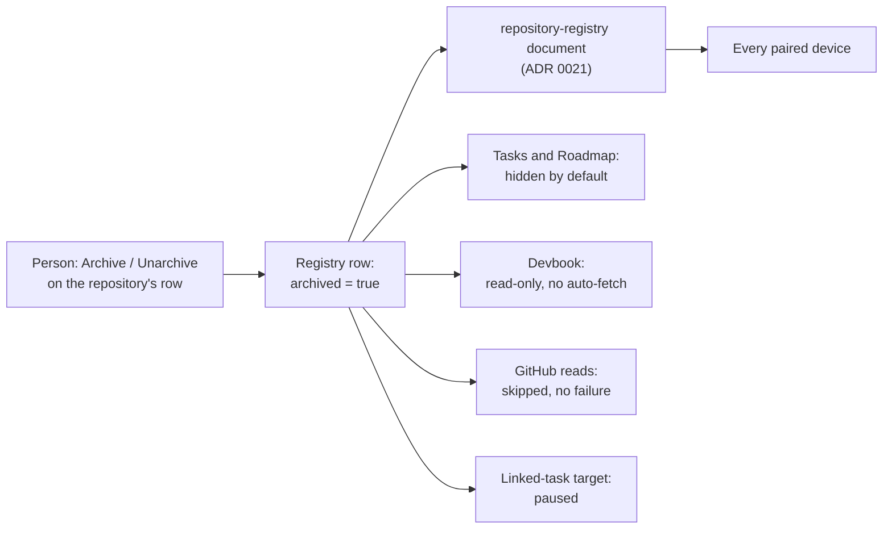

# ADR 0029: An archived repository stays in the registry, and every consumer reads the flag

```meta
date: 2026-10-15
status: proposed
related: [".devbook/domain/repository-management/requirements.md#archiving-a-repository", ".devbook/domain/repository-management/domain.md#repository", ".devbook/domain/repository-management/domain.md#repository-registry", ".devbook/domain/repository-management/domain.md#removal-record", ".devbook/domain/repository-management/features.md#repository-registry-configuration", ".devbook/domain/repository-management/features.md#following-a-repository-rename", ".devbook/domain/repository-management/features.md#github-integration", ".devbook/arc42/adr/0008-knowledge-reads-from-a-branch-snapshot-when-there-is-no-clone.md", ".devbook/arc42/adr/0011-devbook-annotations-are-a-third-replica-container.md", ".devbook/arc42/adr/0020-external-items-arrive-as-linked-tasks.md", ".devbook/arc42/adr/0021-github-accounts-and-repository-registry-ride-the-task-feed.md", ".devbook/arc42/adr/0027-the-brain-is-a-scope-beside-the-repositories.md", ".devbook/domain/tasks/features.md#search-filter-and-organize", ".devbook/domain/tasks/features.md#board-view", ".devbook/domain/tasks/features.md#linked-tasks", ".devbook/domain/roadmap/features.md#reading-the-plan-by-repository", ".devbook/domain/devbook/features.md#area-selection-and-scope", ".devbook/domain/devbook/features.md#the-devbook-on-the-repositorys-latest-version", ".devbook/domain/sessions/features.md#pull-request-readiness", ".devbook/domain/sessions/features.md#in-progress-by-task", ".devbook/domain/productivity/features.md#personal-productivity-dashboard", ".devbook/domain/progress/features.md#pull-request-status"]
```

A person can mark a registered repository **Archived**. It stays in the registry
with its identity, settings and tasks, and Backlog stops treating it as active
work. The flag is one optional field on the registry row, and every consumer of
the registry reads it. Unarchive restores everything.

## Status

```meta
```

Proposed, 2026-10-15, by the flow-spec run that drafted it. Built, proposed: the
implementing flow-code run built it, and the record awaits acceptance at a
Personal Validation gate.

A **local** decision, numbered in the local sequence. Every bare ADR number below
means the local one.

The behaviour lives in the
[repository-management requirements](../../domain/repository-management/requirements.md#archiving-a-repository).
This record holds the choice and what it costs to reverse. It **amends** four
standing records, each by link from the section that changes it:

| Record | What changes |
|---|---|
| [ADR 0008](0008-knowledge-reads-from-a-branch-snapshot-when-there-is-no-clone.md) | "Only a clone is editable" becomes "only a clone of an active repository is editable" ([§4](#4-the-devbook-of-an-archived-repository-is-read-only)). |
| [ADR 0020](0020-external-items-arrive-as-linked-tasks.md) | A connected target pauses while its repository is archived ([§5](#5-a-linked-task-target-pauses-by-derivation)). |
| [ADR 0021](0021-github-accounts-and-repository-registry-ride-the-task-feed.md) | The `repository-registry` document's row gains a field ([§1](#1-the-flag-is-one-optional-field-on-the-registry-row)). |
| [ADR 0027](0027-the-brain-is-a-scope-beside-the-repositories.md) | The scope offers no archived repository unless "show archived" is on ([§3](#3-every-consumer-reads-the-flag)). |

## Context

```meta
```

**A retired repository fails on every refresh.** `innovadis-dev/Budgetbeheer` is
no longer worked on. The Pull requests pane and the In progress view still read it
from GitHub, and both report "Couldn't read innovadis-dev/Budgetbeheer" on every
refresh. What GitHub answers for it was not captured.

**Remove is the only way to quiet it, and Remove forgets.** A removal leaves a
[Removal Record](../../domain/repository-management/domain.md#removal-record) and
drops the row with its settings. Its tasks keep the name, show no repository and
fall under Brain. Its devbook becomes Unavailable. Nothing brings the settings
back.

**The registry already travels whole.** ADR 0021 carries the registry to every
paired device as one document, last write wins. A field on the row travels with
it at no extra cost.

**GitHub has its own archived state, and it is a different fact.** The REST "Get a
repository" response carries a required boolean `archived`
([docs](https://docs.github.com/en/rest/repos/repos#get-a-repository)). The
GraphQL `Repository` object is said to carry `isArchived`
([docs](https://docs.github.com/en/graphql/reference/objects#repository)); that
field was not confirmed against the page in this run, so treat it as unverified.
GitHub makes an archived repository read-only, and its issues and pull requests
stay searchable
([docs](https://docs.github.com/en/repositories/archiving-a-github-repository/archiving-repositories)).
So a read of a GitHub-archived repository succeeds. A failing read means a deleted
repository, or one the bound account cannot see.

## Decision

```meta
```



### 1. The flag is one optional field on the registry row

```meta
```

The shared registry row gains one boolean, written only when true. It is omitted
when false, as the row already omits an empty set of pull-request labels. The
machine half, `github.json`, does not change. The row travels inside the
`repository-registry` document of ADR 0021, so the flag reaches every paired
device with the rest of the row.

The repository keeps its `RepositoryId`, alias, colour, account binding, clone
directory and devbook settings. Every task keeps its `repo:` id. A rename or merge
of an archived repository keeps the flag on the row it lands on.

### 2. Archive is always a person's edit, never inferred

```meta
```

Archive and Unarchive are a sixth registry edit, beside Rename, Merge, Removal,
Relabel and Alias swap. The person makes it on the repository's own row in
Settings. GitHub's `archived` field never sets or clears it. Settings offers
Archive as a hint when GitHub reports the repository archived, or when its reads
fail as not found.

| Edit | Reversible | Identity kept | Settings kept | Tasks keep their repository | Reads GitHub |
|---|---|---|---|---|---|
| Remove | No | No | No | The name only; they show no repository | No |
| Archive | Yes | Yes | Yes | Yes | No |

The last active repository cannot be archived. No other edit may leave the
repository list with no active repository either: Remove, retyping the list and
a merge into an archived repository are refused the same way, with "One
repository must stay active." Removing every repository stays allowed, because
an empty list has nothing to default to. The default repository is the
first entry that is not archived. That entry is also the fallback while
[Additional repositories](../../domain/repository-management/context.md#additional-repositories)
is off.

At Archive, Backlog offers to move the repository's open tasks to another
repository or to drop them. Dropping sets each open task's status to `archived`,
the status a dropped linked item already takes, and deletes nothing. Open tasks
move only to another active repository, and a refused move leaves the
repository active. The same offer stays on the archived row for later.

An import or an inbox triage that names an archived repository files under it.
The repository stays archived, and the import report says so.

### 3. Every consumer reads the flag

```meta
```

Each consumer reads the flag from the registry row. None keeps a copy. "Show
archived" is a per-device switch, remembered on that device and never synced.

| Consumer | While archived | With "show archived" on |
|---|---|---|
| [Tasks](../../domain/tasks/features.md#search-filter-and-organize): scope chips, [board columns](../../domain/tasks/features.md#board-view), repository pickers, task list and Calendar | Hidden. A task leaves the list and the Calendar only when every repository it names is archived. A remembered scope that names it drops it on restore. | Shown. |
| [Roadmap](../../domain/roadmap/features.md#reading-the-plan-by-repository) | The band stays drawn, greyed and tagged Archived, showing only finished work, while the timeline's whole drawn window holds some. The window is the one the rest of the plan sets, not where the person has scrolled. Its open work is hidden, never folded into the "No repository" band. Finished work still counts toward history and pace. | The whole band, open work included. |
| [Devbook](../../domain/devbook/features.md#area-selection-and-scope) | Browsable and read-only, per §4. | The repository is offered in the repository switch. |
| GitHub reads: [Pull requests](../../domain/sessions/features.md#pull-request-readiness), [In progress](../../domain/sessions/features.md#in-progress-by-task), [dashboard activity](../../domain/productivity/features.md#personal-productivity-dashboard), [Progress goal pull requests](../../domain/progress/features.md#pull-request-status) (sprints retired by ADR 0035) | Not read. No "Couldn't read" line names it. | Still not read. |
| [Linked-task sync](../../domain/tasks/features.md#linked-tasks) | Paused, per §5. | Still paused. |
| [Settings](../../domain/repository-management/features.md#repository-registry-configuration) | The row stays in the list, marked Archived, with Unarchive and the open-task offer. | No difference. |

This amends ADR 0027: the header scope offers an archived repository only while
"show archived" is on.

### 4. The devbook of an archived repository is read-only

```meta
```

This amends ADR 0008. Only a clone of an active repository is editable. An
archived repository's devbook reads from its clone or its cached snapshot, as
before, with every edit refused.

- **No automatic snapshot fetch.** The snapshot on disk is served as it is.
  The devbook database still builds when the devbook is opened.
- **No "bring the clone up to date" offer.**
- **Remarks are read-only.** Remarks on a chapter
  ([ADR 0011](0011-devbook-annotations-are-a-third-replica-container.md)) cannot
  be added, resolved, edited or deleted in the app. Remarks already kept stay
  readable. The `handle-remarks` skill refuses to write `annotation` fences
  there, and the MCP `resolve_annotation` tool refuses with
  `repository.archived`.
- **The Instructions area is read-only too.** It reads the clone's instruction
  files as before and offers no edit.

### 5. A linked-task target pauses by derivation

```meta
```

This amends ADR 0020. A connected target whose tasks file under an archived
repository does not sync, on its timer or from "Sync now". The pause is derived
from the flag at sync time. The target's own enabled setting is never written, so
Unarchive resumes it with the setting it had. Connector settings are per device,
while the flag travels; a written setting would pause the target on one device
only.

### 6. The older-build narrowing is accepted

```meta
```

ADR 0021 already accepts that a build predating a field drops it on its next
registry write. Here that means a paired device on an older build silently
unarchives the repository everywhere when it next edits the registry. The owner
accepts this, as ADR 0021 does for every later field.

## Consequences

```meta
```

Positive:

- **A retired repository goes quiet without being forgotten.** Its pull-request
  and activity reads stop, so no failure line names it. Its tasks, settings and
  devbook stay.
- **The choice is reversible.** Unarchive restores the row's place in every view,
  the target's sync and the devbook's refresh, with nothing re-entered.
- **Past work keeps its history.** The Roadmap draws an archived repository's
  finished work where it ran, and the pace still counts it.
- **It is set once.** The flag travels with the registry, so every paired device
  agrees.

Negative:

- **Consumers in six bounded contexts filter on one field.** Reversing the decision
  means unwinding each of them, and a new consumer of the registry has to read
  the flag too.
- **An older build unarchives everywhere.** See §6.
- **The two archived states can disagree.** A repository GitHub archived stays
  active here until the person archives it. Settings shows the hint until then.
- **"Archived" now names a repository state and a task status.** The two are
  different facts. The domain chapters keep them apart by naming the repository's
  state on the `Repository` entity.

Neutral:

- **No feature flag gates it.** It is a registry edit, like Rename.
- **Remove stays.** It is still the edit for a repository the person wants
  forgotten.

## Rejected

```meta
```

- **Remove plus the Removal Record.** It already quiets the reads. It also drops
  the settings, leaves the tasks under no repository and makes the devbook
  Unavailable, and none of that comes back.
- **A per-device hide that never syncs.** It would leave the reads running and the
  failure lines showing on every other device. The person would have to hide the
  repository again on each one.
- **Inferring the state from GitHub's `archived` field.** GitHub archives a
  repository for its own reasons, and a person may still plan or read work there.
  A deleted or unreachable repository, the motivating case's likely failure,
  carries no such field at all. A rename is never inferred either, for the same
  reason.
- **Writing the connected target's enabled setting to false.** It loses the
  setting the person had, and it pauses the target on one device only.
- **A dated amendment note on ADR 0021 alone, with no record.** It would hide the
  changes to ADRs 0008, 0020 and 0027.

## Verification

```meta
```

The implementing `flow-code` run turns these into tests. The requirements chapter
holds the scenarios; these are the decision's own checks:

1. **The row round-trips.** An archived row writes the field. An active row omits
   it, and its stored JSON is unchanged from today.
2. **The flag travels.** Device A archives a repository and syncs. Device B pulls,
   and the repository is archived there.
3. **No read, no failure.** With an archived repository registered, the Pull
   requests pane, the In progress view, dashboard activity and Progress make no
   GitHub call for it and report no failure for it.
4. **The target pauses without a write.** A connected target filed under an
   archived repository does not sync, and its enabled setting is unchanged.
   Unarchive resumes it.
5. **The devbook refuses edits.** An archived repository's clone reports the
   devbook not editable, and no snapshot auto-fetch starts for it.
6. **The default skips archived entries.** With the first entry archived, the
   default repository is the next active one. Archiving the last active
   repository is refused.
7. **GitHub's field never sets the flag.** A read that reports `archived: true`
   leaves the registry row unchanged and raises the Settings hint.
8. **Unarchive restores everything.** Settings, tasks, scope, bands, reads and the
   target's sync match their state before Archive.
