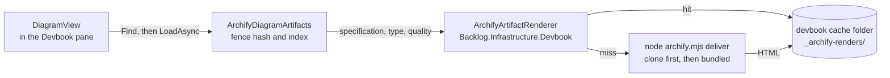

# ADR 0029: Archify renders are generated on demand into app storage, not committed

```meta
date: 2026-10-15
status: proposed
related: [".devbook/arc42/adr/0004-knowledge-index-is-a-generated-local-database.md", ".devbook/arc42/adr/0008-knowledge-reads-from-a-branch-snapshot-when-there-is-no-clone.md", ".devbook/arc42/adr/0015-devbook-database-lives-in-app-storage-and-the-app-builds-it.md", ".devbook/arc42/tdr/0001-archify-artifacts-are-invisible-on-a-branch-snapshot.md", ".devbook/arc42/11-risks-and-technical-debt.md#technical-debt", ".devbook/arc42/08-crosscutting-concepts.md#devbook-database", ".devbook/tech/tooling.md#archify"]
```

The repository commits an Archify diagram's specification and its index entry, and
never the rendered HTML. The Devbook pane draws the picture itself, from the
specification, into a cache beside the devbook databases.

## Status

```meta
```

Proposed, 2026-10-15, with the issue-sweep draft pull request for issue #752 that
builds it. It awaits acceptance when that pull request is reviewed.

A **local** decision, numbered in the local sequence. Every bare ADR number below
means the local one.

## Context

```meta
```

**The renders were more than half the repository.** Each Archify artifact is a
self-contained HTML page of roughly 700 KB with two fonts embedded in it. The 42
renders under `.devbook/**/_archify/` and the 5 vendored examples under
`tools/archify/examples/` came to about 34 MB of a 55 MB tracked tree.

**Every regeneration rewrote history.** A render is derived from its
specification by `tools/diagrams/archify-artifacts.mjs`. Redrawing the stale
pictures after a fence edit, or after an Archify upgrade, rewrote megabytes at a
time. Pull request #1201 redrew 20 of them in one commit.

**The pattern to draw on demand already exists.** The Sessions pane draws a
delivery run's stages with `ArchifyDeliveryRunDiagrams`. It runs the vendored
generator with Node and files the result under a hash of the specification, so
the generator runs once per specification per machine.

**The index is what ties a picture to a fence, not the HTML.** The app finds a
diagram's artifact by hashing the mermaid fence and looking the hash up in
`_archify/index.json` (ADR 0004). The index entry records the specification that
`render` validated for that fence. The HTML adds nothing the specification and
the generator cannot produce again.

## Decision

```meta
```



### 1. Only specifications and the index are committed

```meta
```

The 42 renders and the 5 example renders are deleted from the tree. `.gitignore`
carries `**/_archify/*.html` and `tools/archify/examples/*.html`, so a preview
that `render` leaves beside a specification stays on the machine that made it.
History is not rewritten.

### 2. The app draws the picture from the specification

```meta
```

When a diagram's index entry matches its fence hash and the specification it
names exists, the lookup says a picture can be drawn. `DiagramView` shows the
mermaid at once and asks the host to draw. `ArchifyArtifactRenderer` runs
`archify.mjs deliver`, which validates before it writes, and the artifact replaces
the mermaid when it lands.

### 3. The cache sits beside the databases

```meta
```

The artifact is written to `_archify-renders/` under the devbook cache folder,
beside `_databases/` (ADR 0015). Moving that folder on the Storage settings tab
moves the cache too. Nothing is written into a repository.

### 4. The key is everything the picture depends on

```meta
```

An artifact is filed under a hash of the specification's text, its type, its
quality and the generator's identity. The identity is a hash of the generator's
template, renderers, schemas, assets and package manifest. An edited
specification, a patched template or a bumped Archify is a new key, and the
generator draws again. An unchanged specification is served from the cache
without starting Node.

### 5. The clone's generator first, then the bundled one

```meta
```

The renderer uses the clone's own `tools/archify` first, because it is the copy
the specification was authored against. A clone without one uses the copy the
desktop project bundles beside the executable.

### 6. A failure is said and never cached

```meta
```

No Node, no generator, a timeout or a rejected specification comes back as a
reason. `DiagramView` keeps the mermaid and states the reason, and the Render
button stays as the retry. Only successes are kept, so a reason that went away
stops being the answer.

## Consequences

```meta
```

Positive:

- **The tracked tree loses about 34 MB, and stops growing with every redraw.**
  An Archify upgrade or a fence edit changes a small JSON file, not a 700 KB page.
- **D4's cost premise is gone.** `_archify/` now holds only small JSON, so the
  reason the branch snapshot excluded it no longer applies. See TDR 0001.
- **A generator upgrade redraws every diagram by itself.** The key changes, so
  nobody has to remember to regenerate and commit.

Negative:

- **Node becomes a runtime dependency of the Archify pictures.** Without Node a
  reader sees the mermaid and a sentence saying why. The feature flag
  `archify-diagrams` stays off by default.
- **The first view of a diagram on a machine waits for a render.** A render takes
  well under a second; the mermaid is shown meanwhile.
- **The app runs the clone's generator script.** Viewing a chapter with the flag
  on starts `node` on `tools/archify/bin/archify.mjs` from the configured clone.
  Before, only the Render button did. A person should only switch the flag on for
  clones they trust.
- **GitHub no longer shows a rendered picture beside a chapter.** Nobody browsed
  the 700 KB pages there, and the mermaid fence still renders.

Neutral:

- **The index and the database are unchanged.** An index entry keeps its
  `artifact` basename, so `archify_artifact` rows and the builder parity test do
  not move.
- **`scan` and `verify` judge the index, not the HTML.** A diagram is `rendered`
  when its entry matches its fence and its specification exists.

## Considered options

```meta
```

### Render on demand into app storage (chosen)

```meta
```

What this record decides. It reuses the Sessions pattern and the app-storage
location of ADR 0015.

### Keep the renders committed, in Git LFS

```meta
```

Store `**/_archify/*.html` in Git LFS through a `.gitattributes` `filter=lfs`
rule, enable LFS in every CI checkout, and delete only the five vendored example
renders.

- *Pro:* the app keeps reading a file off disk. Node stays a build-time tool, and
  GitHub still serves the picture.
- *Con:* every clone, worktree and CI job needs LFS, or it checks out pointer
  files the app would show as broken pages. LFS storage and bandwidth are metered.
  A regeneration still uploads megabytes, and the branch snapshot of ADR 0008
  would have to resolve LFS pointers to show anything.

Choosing it instead would restore the 47 files as LFS objects, replace the
`.gitignore` rules with the `filter=lfs` rule, and drop
`ArchifyArtifactRenderer` and the on-demand path in `DiagramView`. The lookup
would read the HTML beside the specification again.

### Rewrite history to remove the renders

```meta
```

Rejected. `git filter-repo` and a force-push would break every clone and open
pull request to reclaim space the working tree no longer uses.

## Verification

```meta
```

Look for tests that show these behaviours:

1. **Nothing generated is tracked.** No `_archify/*.html` and no
   `tools/archify/examples/*.html` is in the index, and a fresh render is ignored.
2. **A cache hit starts nothing.** A second lookup of an unchanged specification
   is served from the cache without starting the generator.
3. **The key moves with each input.** The specification, its type, its quality
   and the generator each change the key on their own.
4. **A failure is not cached.** A failed render returns its reason, leaves
   nothing in the cache, and the next lookup tries again.
5. **Drift is unchanged.** An entry under another hash is reported out of date and
   is not drawn.
6. **The view says what is happening.** `DiagramView` shows the mermaid while a
   render runs, the artifact when it lands, and the reason when it fails.
