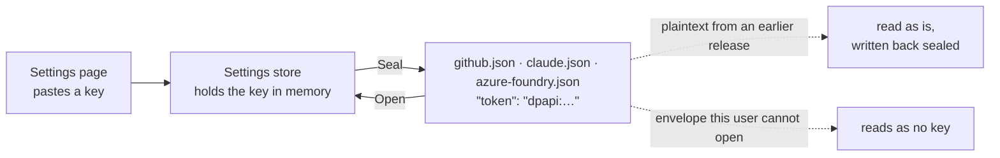

# ADR 0030: Every stored credential goes through the OS-protected envelope

```meta
date: 2026-10-15
status: proposed
related: [".devbook/arc42/08-crosscutting-concepts.md#authentication-and-authorization", ".devbook/arc42/11-risks-and-technical-debt.md#architectural-risks", ".devbook/arc42/05-building-block-view.md#desktop-app", ".devbook/tech/desktop.md#systemsecuritycryptographyprotecteddata", ".devbook/arc42/adr/0005-azure-hosted-task-replica-for-multi-device-sync.md#identity", ".devbook/arc42/adr/0012-backlog-is-an-mcp-server-inside-the-desktop-app.md", ".devbook/arc42/adr/0021-github-accounts-and-repository-registry-ride-the-task-feed.md", ".devbook/arc42/adr/0010-backup-is-the-database-committed-to-a-repository.md"]
c4: [backlog.desktop, backlog.mobile]
c4-touches: [github, claude, azureFoundry, backlog.cloud]
```

Every third-party credential Backlog keeps on a device is sealed by the operating
system before it is written. On Windows that is DPAPI under the signed-in user. On
Android it is the platform secure store. The one stated exception is the MCP
server's own loopback token, which local ADR 0012 keeps in plaintext.

## Status

```meta
```

Proposed, 2026-10-15, and built in the same change. It awaits acceptance at the
Personal Validation gate of the run that drafted it. It answers issue #753.

A **local** decision, numbered in the local sequence. Every bare ADR number below
means the local one.

## Context

```meta
```

**Two credentials were sealed and three were not.** The sync device credential
(ADR 0005, *Identity*) and the spec-manager sign-in tokens each go through a DPAPI
envelope. Three settings stores wrote their secrets as plaintext JSON under
`%LOCALAPPDATA%\Backlog`:

| File | Store | Secret |
|---|---|---|
| `github.json` | `GitHubSettingsStore` | each account's personal access token, and each repository's token |
| `claude.json` | `ClaudeSettingsStore` | each account's Admin API key |
| `azure-foundry.json` | `AzureFoundrySettingsStore` | the API key |

**Nothing recorded why.** Only the MCP token had a written reason, in ADR 0012's
Consequences. That reason covers a token that guards a loopback server for the
same user. It does not cover these three, which are bearer keys that work from
any machine on the internet.

**Risk R8 already named the answer.** Its mitigation was "use OS secure storage",
and nothing had built it for these stores.

### Threat model

```meta
```

The envelope defends against a copy of the file leaving the person's logon:

- another account on the same machine reading `%LOCALAPPDATA%`;
- the file copied to another machine, a support bundle, a backup of the profile
  folder, or a repository by mistake;
- a disk image read without the person's Windows password.

It does not defend against code already running as the signed-in user. Such code
can ask DPAPI to open the envelope, just as it can read the app's memory. No
local design defends against that, and this one does not claim to.

## Decision

```meta
```



### 1. Every stored credential is sealed

```meta
```

| Credential | Store | Windows | Android |
|---|---|---|---|
| Sync device credential | `DpapiDeviceCredentialStore`, `SecureValueDeviceCredentialStore` | DPAPI, whole file | Keystore-backed `SecureStorage` |
| Spec-manager OAuth tokens | `DpapiSpecManagerTokenStore` | DPAPI, whole file | not composed |
| GitHub account and repository tokens | `GitHubSettingsStore` | DPAPI, per value | not composed |
| Claude Admin API keys | `ClaudeSettingsStore` | DPAPI, per value | not composed |
| Azure Foundry API key | `AzureFoundrySettingsStore` | DPAPI, per value | not composed |

The three settings stores are desktop-only. Only the Windows head and the desktop
web harness construct them, so they need no Android secure store.

### 2. The envelope is on the value, not the file

```meta
```

A sealed value is `dpapi:` followed by the base64 of a `ProtectedData` envelope
under `CurrentUser` scope. Every other field stays legible JSON, so the clone
directory, the endpoint and the account login can still be read and diagnosed.
One helper, `SecretEnvelope`, does this for all three stores. It lives in the
GitHub adapter and the Claude and Azure Foundry adapters compile it in, the way
they share `IsoTimestamps`.

### 3. Plaintext from an earlier release is sealed on first read

```meta
```

A value without the prefix is read as it is. The store then writes the file back
sealed, during that first read, rather than at the next save. The legacy Claude
flat file and the legacy GitHub global token are covered the same way. The
GitHub store skips this write only when a registry carry-over failed, because
that write would drop fields the carry-over still needs. The next start seals it.

### 4. An envelope this user cannot open reads as no key

```meta
```

A corrupt envelope, or one sealed under another profile or on another machine,
reads as no key. The rest of the file still loads. The Settings page then shows an
empty key field, and entering the key again is the recovery. Nothing logs, for the
reason the device credential store gives.

### 5. Saving the device credential is asynchronous

```meta
```

`IDeviceCredentialStore.SaveAsync` replaces `Save`. `DevicePairingClient` awaits it
and still maps a failure to `CredentialStoreFailed`. The Android store awaits the
platform write instead of blocking on it. The DPAPI and in-memory stores have
nothing to wait for and complete at once.

### 6. The MCP token stays the one exception

```meta
```

ADR 0012 keeps the MCP server's bearer token in plaintext in `settings.json`. That
token only opens a loopback listener for the same user. Sealing it against that
same user would defend against nothing. Any new stored credential follows this
record unless its own ADR states an exception the same way.

## Consequences

```meta
```

Positive:

- **A copied settings folder carries no usable key.** That covers a profile
  backup, a support bundle or a file pasted into a chat.
- **One rule covers every credential.** A new store has one helper to use and one
  record to cite.
- **The files stay readable.** Diagnosing a wrong endpoint or clone path still
  means opening the JSON.

Negative:

- **Moving to a new machine means entering the keys again.** Copying
  `%LOCALAPPDATA%\Backlog` across no longer brings them. The backup of ADR 0010
  holds the database only, so it never carried them either.
- **A Windows profile reset loses the keys.** DPAPI ties the envelope to the
  user's master key. The keys can be issued again at GitHub, Anthropic or Azure.
- **Rotation stays manual.** A key is rotated at its provider and pasted into
  Settings. The new value is sealed on that save.

Neutral:

- **A development harness off Windows keeps plaintext.** There is no DPAPI there,
  and the harness only holds development values.
- **The replicated documents are unchanged.** ADR 0021's registry and accounts
  documents carry no token, and sealing a token is not an identity change, so it
  never restamps the accounts.

## Considered options

```meta
```

- **Plaintext accepted under the OS profile (not chosen).** The decision would be
  that `%LOCALAPPDATA%` is protected by the Windows profile's file permissions,
  with this threat model stated and a doc comment on each store. It lost because
  those permissions only stop other accounts. The file itself still leaves the
  machine in backups, bundles and copies, and these keys work from anywhere.
  DPAPI was already in the code twice, so sealing three more values was cheap.
  Choosing it instead would remove `SecretEnvelope` and its migration, and keep
  the plaintext JSON with a comment pointing here.
- **Seal the whole file, as the device credential does.** It lost because the
  files hold non-secret settings that people and the diagnose procedure read. A
  sealed file also could not keep ADR 0021's accounts stamp legible.
- **Windows Credential Manager.** It lost because it needs a separate entry per
  secret through P/Invoke, it cannot be reached from the unit tests the same way,
  and DPAPI already serves the two existing stores.

## Verification

```meta
```

Look for tests that show these behaviours:

1. **No key in the clear.** After a save, `github.json`, `claude.json` and
   `azure-foundry.json` do not contain the key text, and a new store reads it back.
2. **Plaintext is sealed on first read.** A file from an earlier release loads
   with its key, and afterwards holds only the sealed form.
3. **An unopenable envelope reads as no key.** The rest of the settings load.
4. **Nothing reaches the shared documents.** The registry and the accounts
   document carry no token, and sealing one does not restamp the accounts.
5. **Pairing awaits the save.** A save that fails after it was handed off is still
   a failed pairing.
