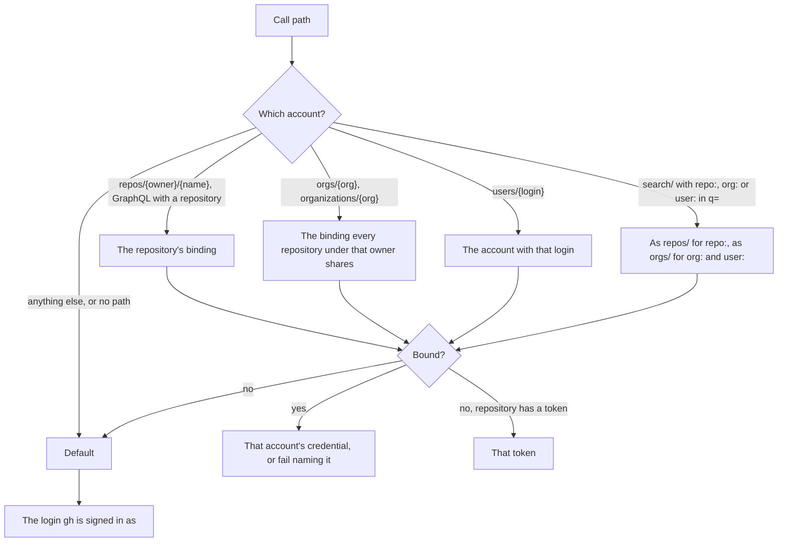

# ADR 0031: GitHub calls resolve their account per repository, and a token taken from the GitHub CLI is never stored

```meta
date: 2026-10-15
status: proposed
related: [".devbook/arc42/adr/0021-github-accounts-and-repository-registry-ride-the-task-feed.md", ".devbook/tech/desktop.md#github-cli", ".devbook/arc42/adr/guidelines/0015-resilience-for-outbound-dependencies.md", ".devbook/arc42/adr/0006-additive-schema-bootstrapping-is-the-local-migration-mechanism.md", ".devbook/arc42/08-crosscutting-concepts.md#authentication-and-authorization"]
```

Every GitHub call picks its account from the path it calls. A repository bound to
an account is called as that account and no other. The `gh` CLI is a source of
credentials: a token taken from it is held in memory only and never written to
disk. Claude organizations are credentials in `claude.json`. The folders where
agents keep their sessions are a separate setting and never go into that file.

## Status

```meta
```

Proposed, 2026-10-15. The decision is already built: PR #493 (merge `6f54ce82`)
implemented it, and a performance change on 2026-10-13 amended it (§3). This
record writes down what an implementation design document decided. That document
sat beside the agent context files, referenced by nothing, and this record
replaces it. It awaits acceptance at the Personal Validation gate of the run that
drafted it.

A **local** decision, numbered in the local sequence. Every bare ADR number below
means the local one. ADR 0021 came later and made the accounts and bindings sync
between devices. This record covers how one machine uses them.

## Context

```meta
```

**One identity served every call.** The owner had two `gh` logins, `JSdotNet` and
`j-schepers_innobv`. Their repositories were spread across `JSdotNet/Backlog` and
`innovadis-dev/spec-manager`. `ResolvingGitHubTransport` sent every call through
`gh api`, which has no per-call account selector. So calls for `innovadis-dev`
went out as the active login and came back 404. Switching the active login broke
the other owner instead.

**There were three failures, not one.**

| Where | What happened |
|---|---|
| Transport credential | The `gh` active account, or the first repository holding any token. |
| Activity author filter | The login was resolved once and applied to every repository, so work done as the second login was invisible even when the call succeeded. |
| Paths that are not `repos/` | `orgs/{org}`, `organizations/{org}` and `users/{login}` (Copilot and billing) fell through to the first token in the list. |

**`gh` can hand out a token for any signed-in login.** `gh auth token --user
<login>` works for an inactive login, and `gh auth status --json hosts` lists them
all. `gh api` can only take `--hostname`.

## Decision

```meta
```



### 1. The account is resolved per call, from the path

```meta
```

`GitHubSettings.AccountForPath` resolves every call path. A `repos/` path and a
GraphQL call that names a repository take that repository's binding. An
`orgs/{org}` or `organizations/{org}` path takes the binding shared by every
configured repository under that owner. When those repositories disagree, or none
is bound, the path takes the default. A `users/{login}` path takes the account with
that login. A `search/` path names its subject in its `q=` query instead: the
first `repo:{owner}/{name}` qualifier routes as that repository does, and the first
`org:` or `user:` qualifier as that owner's shared binding (there it names whose
repositories to search, not whose account the report is about). Any other path, a
search with no scope qualifier, and the pathless availability probe take the
default.

The order is: the binding, then the repository's own token, then the default (the
login `gh` is signed in as). A bound repository whose account has no usable
credential on this machine fails with the login named. **It never falls back to
another identity**, because the 404 came from falling back. The "first repository
with any token" lookup is gone. Whether this machine holds any credential at all
is a separate question, `HasAnyCredential`, and that answer never picks a
credential for a call.

The binding is the optional `account` field on the repository's row in the shared
registry. The account list and its credentials live in the machine's
`github.json`, so no row is split across two files. The repository text grammar
does not change. The binding is chosen from a list in Settings, the way a
repository's colour is.

The activity source picks the author filter per repository: the bound login, or
the signed-in login when the repository is unbound.

### 2. The GitHub CLI is a credential source

```meta
```

`GhCliAccountSource` lists the logins `gh` is signed in to, which feeds the
Settings picker. It also takes one login's token with `gh auth token --user`.
Where `gh` is absent or too old, an account can hold a personal access token
instead.

**A token taken from `gh` is never persisted.** `gho_` tokens are OAuth tokens
that `gh` refreshes and rotates, so a copy written to `github.json` would be a
stale secret in a file. Such a token is held in memory, keyed by login, for five
minutes (`GhCliAccountSource.TokenLifetime`). "Check the connection" in Settings
clears it.

### 3. Amendment, 2026-10-13: the default path borrows the CLI's token

```meta
```

Starting a `gh api` process for each unbound call cost 100 to 300 ms on Windows.
So for a call that names no account, `ResolvingGitHubTransport` now asks `gh` for
the login `gh api user` reports. It borrows that login's github.com token and
sends the call over HTTP. The borrowed token follows §2: memory only, five
minutes, never persisted.

`gh api` remains the fallback when `gh` holds no github.com token for that login,
when the install-wide endpoint is not `api.github.com`, and when `GH_HOST` or
`GH_ENTERPRISE_TOKEN` is set. A 401 on a borrowed token is not resent (inherited
ADR 0015: no resend after an authentication failure). It surfaces as a
`GitHubException` with status 401, and the token and the CLI's cached availability
are forgotten. The next call then probes `gh` again. This amendment reverses "the
app never extracts a credential" for the default path. Injecting `GH_TOKEN` is
still rejected.

### 4. Claude organizations are kept apart from session folders

```meta
```

A Claude organization is an Admin API key, an optional workspace and an actor. It
lives in `claude.json` as a list of `ClaudeAccount` entries, and the spend of
every configured one is added up. The Admin API reports by date, model and actor.
It has no repository dimension, so no Claude figure is ever shown per repository.

The folders where Claude Code and Copilot keep their sessions are a Sessions
setting, not a Claude credential. They never go into `claude.json`. Reading more
than one such folder on the same machine belongs inside `LocalAgentSessionSource`,
because those sessions still ran on this machine. A second source implementation
is reserved for sessions that ran somewhere else. That widening is not built yet:
the source still reads the two default folders.

### 5. The settings files change only additively

```meta
```

The new fields (`account` on a registry row, `accounts` in `github.json`, the
Claude account list) follow ADR 0006's discipline by convention: each one is
added, idempotent and unversioned. An unbound workspace writes a registry
byte-identical to the one it had before. A repository's existing token is not
turned into an account, because the login it belongs to is unknown.

## Considered options

```meta
```

- **Switching the active login with `gh auth switch`.** Rejected. It rewrites
  `gh`'s `hosts.yml`, which the person's terminals, VS Code and any other Backlog
  window also read. It would race with them and change state the app does not own.
- **Running `gh api` with `GH_TOKEN` injected into the child process.** Rejected.
  It sends the same token as an HTTP call, but adds a process per call and returns
  `gh`'s error text instead of the mapped messages. It also makes `gh` a hard
  dependency for a call the app can already make itself.
- **Dropping `GhCliTransport`.** Rejected. It is kept as the fallback for the
  default path (§3).
- **Storing a token taken from `gh` in `github.json`.** Rejected. It would be a
  stale secret on disk (§2).
- **Keeping the account list in the shared registry, with tokens in `github.json`
  keyed by login.** Rejected. It splits one row across two files, and a partial
  write would leave the row inconsistent. ADR 0021 later carried the accounts
  between devices as their own document instead.
- **Extending the repository grammar to `alias = owner/repo as login`.** Rejected.
  It touches five parsing sites for a value that is better picked from a list than
  typed.
- **Deleting the design document with no record.** Not chosen. Git history,
  ADR 0021 and [the GitHub CLI chapter](../../tech/desktop.md#github-cli) cover part
  of it. Only the design document held the rejected options above and the rule
  that a token from `gh` is never written down. Without this record, nothing a
  flow loads would tell it why `gh auth switch` is out.

## Consequences

```meta
```

Positive:

- **Each repository is called as its own account.** A repository under another
  owner no longer comes back 404 because the wrong login is active.
- **Organization and user paths follow the binding too**, so Copilot and billing
  figures come from the account that owns them.
- **No token from `gh` touches disk.** A rotated token is picked up within five
  minutes, or at once after "Check the connection".
- **Unbound use is unchanged.** Someone who never opens the Accounts panel sees
  today's behaviour.

Negative:

- **A bound repository fails until its account has a credential here.** This is
  the intended trade: a refusal that names the login, never a call made as the
  wrong identity.
- **Repositories under one owner bound to different accounts make `orgs/` calls
  take the default.** That is safe. Whether Settings should warn instead was left
  open by the design.
- **The default path now holds a credential in memory** for up to five minutes,
  where before only `gh` held it.

Neutral:

- Reading several session folders on one machine is decided but not built.
