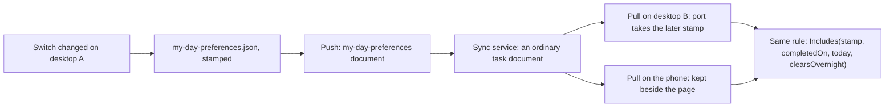

# ADR 0032: The My Day preferences ride the task feed as one whole document, and the phone folds it

```meta
date: 2026-10-15
related: [".devbook/arc42/adr/0005-azure-hosted-task-replica-for-multi-device-sync.md", ".devbook/arc42/adr/0018-roadmap-plan-and-pace-ride-the-task-feed.md", ".devbook/arc42/adr/0021-github-accounts-and-repository-registry-ride-the-task-feed.md", ".devbook/arc42/adr/0025-notes-ride-the-task-feed.md", ".devbook/arc42/08-crosscutting-concepts.md#task-sync", ".devbook/arc42/08-crosscutting-concepts.md#storage-and-sync", ".devbook/arc42/06-runtime-view.md#mobile-my-day-and-task-push", ".devbook/domain/tasks/features.md#my-day", ".devbook/domain/tasks/domain.md#my-day", ".devbook/domain/tasks/context.md#clear-my-day-overnight"]
c4: [backlog.desktop.backlogModule, backlog.mobile, backlog.cloud]
```

The person's My Day preferences replicate between paired devices as one whole
document on the existing `/tasks` feed, under the kind token `my-day-preferences`.
Today it holds one switch, Clear My Day overnight. The document is last-write-wins
on its own stamp, as ADR 0018 does for the pace. Only a desktop writes it. The phone
folds it, keeps it, and applies the same My Day rule as the desktop.

## Status

```meta
```

Accepted, 2026-10-15, by the repository owner at the Personal Validation gate of
the flow-spec run that drafted it. Not yet built; the flow-code run that follows
it builds it.

A **local** decision, numbered in the local sequence. Inherited ADR 0018 under
`.devbook/arc42/adr/guidelines/` is configuration and options binding, a different
subject. Every bare ADR number below means the local one.

The flow-code run `run-mv9v919f-je84qi` escalated here. Its scope added the switch
to the desktop alone, and the owner wants it to sync. The owner settled the
behaviour, so these are inputs here, not open questions:

| Choice | Settled as |
|---|---|
| Switch on, the default | Today's rule. A task is in My Day only while its `myday:` stamp equals the reader's local date. |
| Switch off | An unfinished task with an earlier stamp stays in My Day until the person finishes it or takes it out. |
| Completed tasks | A task completed before today is out. A task completed today stays, ticked. |
| Future stamps | A stamp for a later day is never in today's My Day. |
| Agenda | A carried task shows no agenda slot. |
| Stamps | The rule applies at read time only. The switch never rewrites a stamp. |
| Reach | The switch syncs. The phone's Today tab, Focus and task page apply the same rule. |

## Context

```meta
```

**My Day expires by arithmetic.** A task is in My Day while its stamp equals the
reader's local date, as `.devbook/domain/tasks/domain.md#my-day` defines it. No
timer clears the list. Each head computes the list from the stamp and its own
clock, so both heads agree because they read the same stamps.

**A switch kept on one machine would split My Day.** With the switch off on the
desktop and absent on the phone, a carried task would show on one and not the
other. The owner wants one My Day on every paired device.

**The feed already carries small whole documents.** ADR 0018 put the plan and the
pace on it, and ADR 0021 added the registry and the accounts. `WholeDocumentChange.Of`
(`src/Infrastructure/Backlog.Infrastructure.Sync/WholeDocumentChange.cs`) builds
each one. The service never looks inside them.

**The phone has skipped every such document until now.** `TaskFold`
(`src/App/Backlog.Mobile.UI/Tasks/TaskFold.cs`) keeps a `NotTasks` list, and every
whole-document kind is on it. ADR 0025 made the phone fold notes, but a note is
content the person edits on the phone. This document is the first preference the
phone reads.

**ADR 0005 is not amended.** Its out-of-sync list keeps workspace settings and
feature flags per device. The switch is a per-person preference, neither of those,
as the pace was when ADR 0018 synced it.

## Decision

```meta
```



### 1. The preferences are one `my-day-preferences` document

```meta
```

The desktop writes the document as a task-shaped `TaskChange` through
`WholeDocumentChange.Of`, on the fields ADR 0018 §1 lists:

| Field | Value |
|---|---|
| `Id` | One constant id, chosen once in the implementing change and never changed. A changed id forks the preferences, as `RoadmapReplicaDocuments.PlanId` warns for the plan. |
| `UpdatedAt` | The file's `updatedAt` |
| `DeletedAt` | Never set. The document is never tombstoned. |
| `Task.Type` | `my-day-preferences` |
| `Task.ContentMd` | The file's stored JSON, verbatim |
| `Task.Title` | `My Day preferences` |
| `Task.Status`, `Task.Priority` | `draft`, `medium` |
| `Task.InMyDayOn` | `null`, so no list ever picks the document |

The content is the file's JSON:

```json
{ "updatedAt": "2026-10-15T08:00:00Z", "clearsOvernight": false }
```

The name is plural so that a later My Day preference can join the same document.
A key a later build adds rides along unread. An older build that writes the
document drops it, the narrowing cost ADR 0018 already accepts.

**The stamp.** The file's `updatedAt` is written on every change and stays
monotonic. `PlanningVelocitySettingsStore` keeps the pace stamp monotonic the same
way, with `Next(pace.UpdatedAt)`.

**The conflict rule.** The later stamp wins the whole document, per ADR 0018 §3 and
ADR 0021 §4. Only desktops write it, so the phone-clock problem of ADR 0025 §4 does
not arise.

**The default.** A device that holds no document reads `clearsOvernight: true`,
which is today's behaviour.

### 2. The desktop keeps a per-user file behind a Tasks port

```meta
```

**The store.** The switch lives in `%LOCALAPPDATA%\Backlog\my-day-preferences.json`,
beside `planning-velocity.json`. Its store sits in
`Backlog.Infrastructure.FileSystem/Workspace/` and follows
`PlanningVelocitySettingsStore`: it stamps each change, replaces the file verbatim
on intake, and takes a path overload. The web harness passes a content-root path,
so it never writes the shared `%LOCALAPPDATA%` folder. This file replaces the
unsynced `my-day-settings.json` the escalating run had planned.

**The port.** Tasks publishes a replication port in
`Backlog.Modules.Tasks.Abstractions`. It mirrors `IRoadmapReplication`
(`src/Modules/Roadmap/Backlog.Modules.Roadmap.Abstractions/Services/`) and
`IGitHubSettingsReplication`
(`src/Modules/Sync/Backlog.Modules.Sync.Abstractions/Services/`). It offers
`ReadAsync`, `ApplyAsync` and a `Changed` event. `ApplyAsync` answers one of four
outcomes: Taken, Echo, Refused or Unreadable. The implementer names the port.

The desktop's My Day settings surface reads the same store, so the screen and the
sync see one value.

### 3. The desktop's intake and push follow ADR 0018 §3

```meta
```

**Pull.** `TaskReplicaMerge`
(`src/Infrastructure/Backlog.Infrastructure.Sync/TaskReplicaMerge.cs`) hands each
`my-day-preferences` document to the port before it reads a local task. Without
the port, the document counts as Skipped. The port applies ADR 0018's stamp rules:

- a later stamp is taken whole and written at the inbound stamp;
- an equal stamp is an echo and writes nothing;
- an older stamp is refused;
- a payload that does not parse is Unreadable, and the local file stays.

A taken copy is not announced as a local change. The Tasks pane renders again on
it, so My Day redraws under the new rule.

**Push.** `TaskSyncSession.PushAsync` makes one more call to
`PushWholeDocumentsAsync`. It sends the document when its stamp is later than the
one last accepted. The kind token is the mark in `TaskSyncState.DocumentWatermarks`.
A new `SyncItemKind` member in `SyncActivityLog.cs` names the document in the
activity log. `TaskSyncWorker` subscribes to the port's `Changed` event, as it does
for the roadmap's.

**A device that never set the switch sends nothing.** No file means no document. So
a newly paired desktop takes the other desktop's setting and never replaces it with
the default.

### 4. The phone folds this kind and keeps it, read-only

```meta
```

This section breaks the rule of ADR 0021 §Verification 10, which says the phone
keeps no row for a whole-document kind. `TaskFold` keeps its `NotTasks` list and
never turns this document into a task row.
`TaskViewProjection.PullAsync`
(`src/App/Backlog.Mobile.UI/Tasks/TaskViewProjection.cs`) takes the document out of
each page instead:

- the later `UpdatedAt` wins, in the order `TaskFold.Wins` uses;
- the document is kept in a one-row table in the phone's SQLite file, beside
  `task_view`;
- the projection saves it in the same write as the page and its cursor, so a pull
  cut short cannot lose it.

A separate pull with its own cursor, as notes have, would page the whole feed
twice. A hidden row in `task_view` would make every later query exclude it.

**The phone is read-only for this kind.** It shows no switch, queues no outbox kind
and never pushes the document. It reads `clearsOvernight: true` until a document
arrives.

### 5. One rule serves both heads

```meta
```

The rule `Includes(stamp, completedOn, today, clearsOvernight)` sits in
`Backlog.Modules.Tasks.Abstractions`. The phone already references that project,
because `TaskViewRow` uses `AgendaTime`. The phone needs no new field, because
`TaskPayload.CompletedOn` already travels.

The phone applies the rule in `TaskViewRow.IsInMyDay`, `TaskViewProjection.Day`,
`FocusPage.razor` and `TaskPage.razor`. `TaskViewRow.AgendaTime` shows a slot only
when the stamp equals today. Focus stays slot-only: a carried task has no slot
today, so Focus sends it to its own page. The task page admits a carried task, so
Mark done and Move to tomorrow work on it there. `TaskEdits.MoveToTomorrowAsync`
stays as it is, because a future stamp leaves today's My Day.

The desktop call sites are those the escalating run already scoped.

### 6. The service does not change

```meta
```

No route, record, container, index, AppHost resource or bicep file changes, as in
ADR 0018 §4 and ADR 0021 §5. `PushTasksCommand` needs no new literal, unlike
`note` in ADR 0025 §1. To the service, the document is an ordinary task document
with a type string it does not interpret, as ADR 0005 requires.

## Consequences

```meta
```

Positive:

- **One My Day everywhere.** Every paired device lists the same tasks for today,
  whichever way the switch is set.
- **No stamp is rewritten.** The switch changes how a stamp is read, never the
  stamp. Turning it back on restores today's list at once.
- **It works against the deployed service.** No redeploy has to happen first.

Negative:

- **The later flip wins.** Two desktops that flip the switch between syncs keep
  only the later flip. The switch changes rarely, so the owner accepts this, as
  ADR 0018 does for the pace.
- **An older phone build keeps clearing overnight.** It skips the kind, as it
  skips every unknown kind, until it is upgraded.
- **An older build has moved its cursor past the document.** After the upgrade it
  sees the document only when the switch next changes. The implementing run should
  give each head a one-time replay of the feed from the start. The rows already
  kept fold to the same result, as `06-runtime-view.md` says of a restarted pull.
- **The document is task-shaped without being a task**, as ADR 0018 already
  accepts.

Neutral:

- Each device applies the rule at its own local date. Devices in different time
  zones roll over at different moments, as they do today.
- The switch never writes a task, so it adds no task churn to the feed.

## Rejected

```meta
```

- **A per-machine local setting.** This was the escalating run's first design. The
  phone and a second desktop would show a different My Day from the first.
- **Re-stamping carried tasks to today.** It would write every unfinished task each
  morning on every device. That churns the feed, and two devices would race to
  write the same tasks. It also loses the day the person picked the task.
- **A phone-only setting.** The desktop would still clear overnight, so the two
  heads would disagree. A phone that writes the document would also bring back the
  clock problem of ADR 0025 §4.
- **A field inside an existing document.** The `planning-pace` document is the
  nearest. A pace change on one PC and a flip on another would then overwrite each
  other under whole-document last-write-wins. The pace also belongs to Roadmap,
  and the switch belongs to Tasks.
- **A hidden row in the phone's `task_view`.** Its `InMyDayOn` is null, so today's
  lists already miss it. Every later query would still have to exclude it.
- **A separate phone pull with its own cursor, as for notes.** It would page the
  whole feed twice for one small document.

## Verification

```meta
```

The implementing `flow-code` run turns these into tests:

1. **A flip travels.** Desktop A turns the switch off and syncs. Desktop B and the
   phone pull, and all three list the same My Day.
2. **Stamps decide.** A later stamp is taken. An echo writes nothing. An older
   stamp is refused. An unreadable payload is skipped and leaves the local value.
3. **A new device sends nothing.** A newly paired desktop with no file pushes no
   document, and afterwards holds A's value.
4. **The phone defaults to clearing.** A phone with no document clears My Day
   overnight.
5. **The phone keeps the document, not a row.** `TaskFold` produces no task row for
   the kind. The projection keeps the preference across a restart.
6. **One rule, both heads.** The rule table from the escalating run holds on the
   desktop and on the phone.
7. **A carried task has no slot.** It shows no agenda time on the phone or the
   desktop.
8. **The service is unchanged.** The existing push, pull and inbox-listing tests
   pass unmodified, and `ListInbox` returns no `my-day-preferences` document.
9. **An older desktop build skips harmlessly.** A merge without the port counts the
   kind Skipped and moves its cursor on.
10. **An upgraded head catches up.** After the one-time replay, a head that skipped
    the document before it knew the kind holds the current value.
