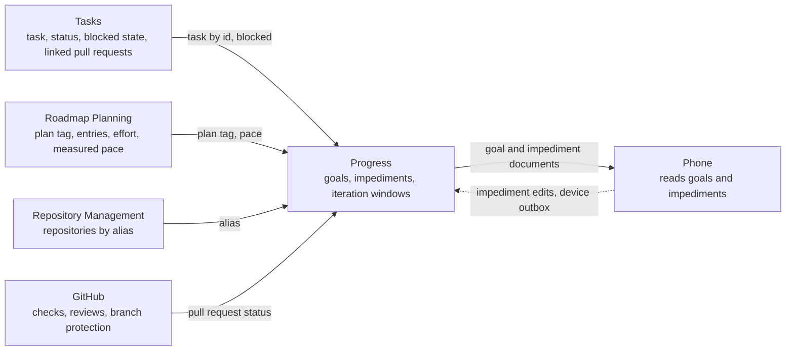
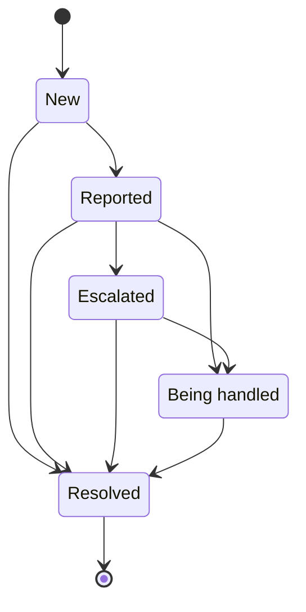

# ADR 0035: Goals and impediments replace sprints

```meta
date: 2026-10-26
status: proposed
roadmap: [goals-standup]
related: [".devbook/domain/progress/context.md", ".devbook/domain/progress/domain.md#goal", ".devbook/domain/progress/domain.md#goal-forecast", ".devbook/domain/progress/domain.md#impediment", ".devbook/domain/progress/domain.md#iteration", ".devbook/domain/progress/features.md#the-goals-view", ".devbook/domain/progress/features.md#the-stand-up", ".devbook/domain/progress/features.md#tracking-an-impediment", ".devbook/domain/progress/features.md#raising-an-impediment-from-a-blocked-task", ".devbook/domain/progress/features.md#pull-request-status", ".devbook/domain/progress/features.md#goals-on-the-phone", ".devbook/domain/progress/features.md#syncing-goals-and-impediments", ".devbook/domain/sessions/features.md#in-progress-by-task", ".devbook/arc42/adr/0022-the-shell-shows-one-main-view-picked-by-a-view-switch.md", ".devbook/arc42/adr/0028-progress-is-its-own-boundary-and-tasks-knows-no-sprints.md", ".devbook/arc42/adr/0042-repository-management-owns-pull-request-state.md", ".devbook/arc42/08-crosscutting-concepts.md#storage-and-sync"]
c4-touches: [backlog.desktop.shell, backlog.desktop.dashboard, backlog.mobile, backlog.cloud, backlog.taskStore]
```

Progress stops modelling sprints. It owns two aggregates instead: a **Goal**,
which gathers plans, tasks and pull requests toward a due date, and an
**Impediment**, which tracks what holds a task back. An **iteration** is a
viewing window over that work, not a thing anyone creates. The In progress view
becomes the **Goals** view, always on: the `goals` flag that replaced the
`progress` flag while the plan was built is retired with the In progress view.

## Status

```meta
```

Proposed, 2026-10-17, and amended on 2026-10-26 ([History](#history)). Not yet built: the plan `+goals-standup` builds it and
removes the sprint code it retires. It awaits acceptance at the Personal
Validation gate of the flow-spec run that drafted it.

It supersedes the sprint parts of ADR 0022 §2 and of ADR 0028, as
[Supersedes](#supersedes) names them. Progress as its own boundary stands.

A **local** decision, numbered in the local sequence. Every bare ADR number below
means the local one.

## Context

```meta
```

**Sprints asked for more ceremony than the work has.** ADR 0028 gave Progress
sprint series, sprints with start and close, per-item membership, and a close
outcome for every unfinished item. A person working alone or in a small team
opened a sprint, closed it, and decided each leftover's fate, to answer two
questions: are we getting to what we promised, and what is in the way?

**A stand-up asks those questions on any cadence.** What did I finish, what is
next, and what blocks me can be asked daily, weekly or monthly. The answer is a
reading of work already recorded. Nobody needs to open a time box first.

**What is promised has a date, not a sprint.** A person commits to an outcome,
"the importer ships by the 31st", and attaches the work that delivers it: a
whole plan, a few tasks, a pull request. Whether it lands in time is a forecast
from the pace so far.

**What blocks work has its own life.** A blocked task waits on someone. That
someone is told, perhaps escalated to, and checked on again later. A `blocked:`
token on a task records that the task cannot move. It does not record who was
told, when to check again, or how it ended.

**The In progress view's Now board did not earn its place.** Its needs-you
sessions and pull requests repeat the Sessions and Pull requests lists beside it
in the header.

## Decision

```meta
```



### 1. Sprints are retired

```meta
```

Sprint series, sprints, their membership, goal rules and close outcomes leave
the model. So do the sprint settings and the `sprint-series` document kind on
the task feed. Nothing replaces a series: a repository no longer belongs to
anything in Progress.

### 2. A Goal gathers work toward a due date

```meta
```

A [Goal](../../domain/progress/domain.md#goal) has a title, an optional outcome
line and an optional due date. A goal without a due date is due on the last day
of the current iteration, the window the domain calls
[next](../../domain/progress/domain.md#iteration). Progress works that day out
on every reading and never stores it, so At risk below applies to every goal.

It holds attachments of three kinds:

| Attachment | Named by | Counts |
| --- | --- | --- |
| A plan | its roadmap `+tag` | each of the plan's entries |
| A task | its id | 1; its linked pull requests ride along and do not count again |
| A pull request | repository and number | 1 |

Progress is shown as `done/total` over those counts
([Goal Progress](../../domain/progress/domain.md#goal-progress)). An item belongs
to at most one goal.

A goal is **At risk** when either of two things holds
([Goal Forecast](../../domain/progress/domain.md#goal-forecast)):

- the forecast landing date falls after its due date, the forecast being drawn
  from the done rate of the last 4 iterations of the chosen length;
- an open impediment holds back one of its tasks.

Otherwise it is **On track**.

### 3. An iteration is a viewing window

```meta
```

An [Iteration](../../domain/progress/domain.md#iteration) is a window over dates,
computed when read. Progress stores none.

| Length | Window |
| --- | --- |
| Day | one working day of the person's working week |
| Week | Monday to Friday |
| 2 weeks | fourteen days from a start date kept in the settings |
| Month | a calendar month |

"Next" is the window that holds today, or the first one after today, and "last"
the window just before next. The
chosen length is a per-person setting.

### 4. The stand-up is a reading, in four blocks

```meta
```

[The stand-up](../../domain/progress/features.md#the-stand-up) shows four
blocks:

1. Goal progress.
2. Finished in the last iteration, grouped by goal and then "No goal".
3. Planned for the next iteration.
4. Impediments.

**Planned** is derived. It holds the goal-attached items in progress, the items
due in the next window, and the next ready entries of attached plans. Its points
tag compares the planned `effort:` with the Roadmap's measured pace, scaled to the
iteration length, as `21 / 18 pts`. Copying the stand-up is a desktop action.

### 5. An Impediment has its own lifecycle

```meta
```



An [Impediment](../../domain/progress/domain.md#impediment) has a title, a state,
who it was reported or escalated to, who handles it, a check-again date and a
note. It keeps its state history with dates, and it holds back one or more tasks,
and through them their goals. Escalated is optional, and any state may move to
Resolved.

Marking a task blocked, by the `blocked:` token or the `set_blocked` tool, raises
a New impediment that holds the task back. It does not when an impediment already
holds that task back
([Raising an impediment from a blocked task](../../domain/progress/features.md#raising-an-impediment-from-a-blocked-task)).

### 6. Tasks knows no goals or impediments

```meta
```

ADR 0028 §3 stands in a wider form. No task field, tag, status or entry-text
token names a goal or an impediment. Progress reacts to a task's blocked state;
Tasks never calls Progress and never stores an impediment id. Attaching a task
to a goal, and every impediment change, leave the task as it was.

### 7. Every pull request row shows its status

```meta
```

[Pull request status](../../domain/progress/features.md#pull-request-status)
sits on every pull request row as two icons with counts:

- **Checks**, as `passed/total`, with a running and a failing variant.
- **Approvals**, as `approvals/required`. The required count is read from the
  base branch's rules: the larger of its branch protection rule's
  `requiredApprovingReviewCount` and the `requiredApprovingReviewCount` of every
  pull request rule a ruleset applies to it, read through GraphQL on the base ref
  (`branchProtectionRule` and `rules`)
  ([GitHub GraphQL API: Ref](https://docs.github.com/en/graphql/reference/objects#ref)).
  A base branch no rule asks an approval of has no required total.

The words "checks" and "approvals" appear only as screen-reader labels.

> **Amended by [ADR 0042](0042-repository-management-owns-pull-request-state.md).**
> Progress no longer reads this status from GitHub itself: Repository Management
> publishes it, and Progress reads it through that contract
> ([§5](0042-repository-management-owns-pull-request-state.md#5-progresss-reader-goes-through-the-contract)).
> The diagram's `GitHub --> Progress` edge now runs through Repository Management.

### 8. The phone reads, and edits impediments only

```meta
```

[On the phone](../../domain/progress/features.md#goals-on-the-phone) a person
reads goals, the stand-up blocks and impediments. The one change it may make is
to an impediment's state, check-again date and note, through the device outbox.
Copying the stand-up and attaching work to a goal are desktop only.

The phone reads the stand-up with the desktop's own rule code: the counting and
stand-up rules live in `Progress.Abstractions` (`GoalItems`, `StandUpReading`),
and both heads call them. What only a desktop can find out — each pull
request's state, checks and approvals, the pace, the working week and the
iteration choice — a desktop writes as one `stand-up-context` document, so the
phone never asks GitHub. A desktop writes it once it has a goal, and the phone
shows its Stand-up tab while it holds one. A phone edit is a command, not the impediment: one
`impediment-edit` document per change, carrying the value the phone saw. A
desktop applies it through the impediment features only while the field still
holds that value, so a change made on a desktop since stands, and then retires
the edit with a tombstone.

The phone offers only the moves `ImpedimentMoves.Allows` permits, the rule the
aggregate refuses by, published in `Progress.Abstractions` beside `GoalItems`. It
shows an edit as asked until a copy of the impediment says it, or says what a
desktop changed since.

A desktop's tombstone of an edit is its answer to that edit, and the phone
settles by it. The phone keeps the `impediment-edit` documents the task feed
returns, live and retired, so an edit it sent outlives a restart and the next
edit of the field still names what that one asked. Once every edit asked of a
field is retired and the impediment does not say the last of them, a desktop
refused or found stale part of the run, and the phone shows its copy. An edit
no tombstone has answered yet gives way only to a newer copy that bears out
none of the run, and the phone then marks it settled itself, so a restart does
not bring it back. A desktop applies the edits a page carries after the page's
other documents: an edit a closed desktop never retired, arriving in one page
with a later copy of its impediment, meets that copy first, and a change made
since stands.

### 9. Goals and impediments ride the task feed

```meta
```

A goal and an impediment each travel as one document under their own id, of the
kinds `goal` and `impediment` in the `tasks` container. They are reconciled
last-write-wins per document on its `updated_at`. That is local ADR 0018's
arrangement, as the series had, and the two kinds take the place of
`sprint-series` ([Syncing goals and impediments](../../domain/progress/features.md#syncing-goals-and-impediments)).
Two more kinds serve the phone (§8): the one `stand-up-context` document under
a constant id, newest reading wins, and an `impediment-edit` document per edit.
A desktop never takes either as a task.

### 10. The view is Goals, always on

```meta
```

The In progress view is renamed **Goals** and its Now board, the needs-you
sessions and pull requests, is dropped. Goals keeps In progress's place as the
first option of the work in progress group, `Goals | Sessions | Pull requests`,
and stays a main view in ADR 0022's sense. It is offered whether or not Sessions
and Pull requests are.

Goals, impediments and the stand-up are always on. While the plan was built, the
app feature key `goals`, off and marked `DEV`, switched the whole context in place
of the `progress` key, and with it off the header showed the In progress view
without its sprint switch. The plan's last entry retires the key, every check of
it and that view. A task's side panel keeps its sessions and pull requests, which
the view's cards also drew. The impediment tools on the Backlog server have no key
of their own left to sit behind, so they ride the Tasks key, which is always on as
well.

## Consequences

```meta
```

Positive:

- **No ceremony to keep up.** Nobody opens or closes anything for the stand-up to
  have an answer. Changing the iteration length re-reads the same work.
- **A promise is checked against the pace.** At risk comes from the measured done
  rate, not from a person's feeling at a sprint close.
- **What blocks work is followed through.** An impediment says who knows, who
  handles it and when to look again, and a blocked task raises one on its own.

Negative:

- **The sprint code goes.** The plan `+goals-standup` removes the Progress
  module's series aggregate and its features, the sprint components in
  `Backlog.UI.Components/Progress`, the sprint parts of the In progress view, the
  sprint storybook pages, the sprint brief source behind the Dashboard and the
  briefs, the `sprint-series` replica documents and their phone fold, and the
  `progress` flag.
- **Recorded series are dropped, not converted.** A series, its sprints and its
  close outcomes do not become goals. The `progress_series` table stays in
  `backlog.db` unread, because local ADR 0006 adds and never drops. A
  `sprint-series` document on the replica is ignored by the merge.
- **A stored identifier changes.** `ShellView` gains a `Goals` member appended
  after the others, and a stored `InProgress` reads as Goals. A person's earlier
  choice of the `progress` flag is not carried to `goals`.
- **Every reading reads its owners.** The stand-up reads each attached task, each
  plan's entries and each pull request's state, as the sprint did.
- **Branch protection may hide the required count.** A ruleset's pull request
  rule is read as well as a protection rule, so a branch protected by either gives
  its count. A token that cannot read a branch's rules leaves the required
  approvals unknown, the same answer as a branch no rule asks an approval of. How
  the row shows that is the build's to settle.

Neutral:

- **The briefs lose their sprint block** and gain no goal block in this change.
- **The iteration needs no storage.** Its length and the 2-week anchor are
  settings; the window is computed.

## Options considered

```meta
```

| Option | Promise and blocker are modelled | Tasks stays unaware | Ceremony | Outcome |
| --- | --- | --- | --- | --- |
| Keep sprints (ADR 0028) | goal text per sprint; blockers not at all | yes | open and close every sprint, decide every leftover | rejected |
| Goals as tags on tasks, in Tasks | a tag; no due date or forecast of its own; blockers stay a token | no: a goal becomes a task fact | low | rejected |
| Goals and impediments in Progress | as aggregates with their own history | yes | none | **chosen** |

- **Keep sprints.** The ceremony is the cost, and it still never tracked a
  blocker past the `blocked:` token.
- **Goals as tags in Tasks.** A tag cannot hold a due date, an outcome line or a
  plan attachment. It would also put Progress's facts into the task's entry text,
  which ADR 0028 kept out for reasons that still hold.

## Supersedes

```meta
```

This record supersedes, by reference and without rewriting them:

- **ADR 0022 §2**, where it names the **In progress** view. The view is now
  **Goals**, in the same place, without the Now board.
- **ADR 0028**, in its sprint parts: §1's sprint series, sprints, membership,
  goal rules and close outcomes; §2's sprint items and plan links; §4's `progress`
  flag, retired with no flag in its place; and the sprint consequences, rejected
  options and verification items.

What stands: Progress as its own bounded context, downstream of Tasks, Roadmap
Planning and Repository Management (ADR 0028 §1's boundary). References by id
and tag, read on every reading (§2's rule). Tasks knowing nothing of Progress
(§3), widened by §6 above.

## Verification

```meta
tests: [unit:dotnet:Backlog.Desktop.UI.UnitTests.HomeWorkspaceSurfaceTests.A_stored_in_progress_view_reopens_on_goals, unit:dotnet:Backlog.Desktop.UI.UnitTests.HomeWorkspaceSurfaceTests.Goals_leads_the_work_in_progress_group, unit:dotnet:Backlog.Desktop.UI.UnitTests.HomeWorkspaceSurfaceTests.Goals_is_offered_without_sessions_or_pull_requests, unit:dotnet:Backlog.Desktop.UI.UnitTests.HomeWorkspaceSurfaceTests.The_goals_view_draws_the_board_over_the_shells_tasks, unit:dotnet:Backlog.Desktop.UI.UnitTests.GoalsHostTests.An_item_another_goal_holds_asks_first_and_moves_on_confirm, unit:dotnet:Backlog.Modules.Progress.UnitTests.GoalForecastingTests]
```

Look for tests that show these behaviours:

1. **Counting.** A plan counts each of its entries, a task counts 1 with its
   linked pull requests not counted again, and a pull request counts 1.
2. **One goal per item.** Attaching an item that another goal already holds is
   refused.
3. **At risk.** A goal is At risk when its forecast lands after its due date, or
   when an open impediment holds one of its tasks back. A goal without a due date
   is held to the last day of next, and that day is never stored.
4. **Windows.** Each length gives the window above, and the 2-week window follows
   its anchor date.
5. **Blocked raises once.** Marking a task blocked raises a New impediment, and
   marking it again while one holds it back raises none.
6. **Tasks is untouched.** No task field or entry-text token names a goal or an
   impediment.
7. **The phone's limits.** The phone changes only an impediment's state,
   check-again date and note, and only through the outbox.
8. **Goals is always on.** The header offers the Goals view with no flag turned
   on, and with Sessions and Pull requests both off.

## History

```meta
```

| Date | Change | Why |
| --- | --- | --- |
| 2026-10-26 | Amended §2 and verification item 3: the due date is optional, and a goal without one is due on the last day of next, derived on every reading and never stored. | A goal already sits in the iteration, so the person should not have to give it a date. |
| 2026-10-17 | Proposed: goals and impediments in Progress replace sprints. | Sprints asked for more ceremony than the work has. |
| 2026-10-13 | ADR 0028: Progress owns sprint series, sprints, membership and close outcomes. | Sprints got a boundary of their own, so Tasks knows none. |
| 2026-10-07 | ADR 0022 §2: an In progress main view lists the tasks in progress with their sessions and pull requests. | It answers what is moving. |
