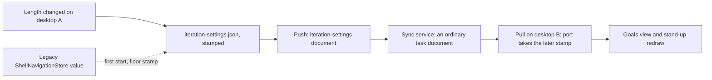

# ADR 0036: The iteration settings ride the task feed as one whole document

```meta
date: 2026-10-20
status: proposed
related: [".devbook/arc42/adr/0005-azure-hosted-task-replica-for-multi-device-sync.md", ".devbook/arc42/adr/0018-roadmap-plan-and-pace-ride-the-task-feed.md", ".devbook/arc42/adr/0032-my-day-preferences-ride-the-task-feed.md", ".devbook/arc42/adr/0035-goals-and-impediments-replace-sprints.md", ".devbook/arc42/08-crosscutting-concepts.md#task-sync", ".devbook/domain/progress/context.md#iteration-length", ".devbook/domain/progress/context.md#two-week-start", ".devbook/domain/progress/domain.md#iteration"]
```

The person's iteration settings replicate between their desktops as one whole
document on the existing `/tasks` feed, under the kind token `iteration-settings`.
The document holds the iteration length and the two-week start together. It is
last-write-wins on its own stamp, as ADR 0032 does for the My Day preferences.
Only a desktop writes it. The phone keeps reading the iteration from the
`stand-up-context` document, as it does today.

## Status

```meta
```

Proposed, 2026-10-20, drafted by the flow-spec run `run-mvghvg4z-6jl2mm`. Not yet
built; the flow-code run that follows its acceptance builds it. It awaits
acceptance at that run's Personal Validation gate.

A **local** decision, numbered in the local sequence. Every bare ADR number below
means the local one.

The owner asked for the setting to sync. A person chose 2-week iterations on one
PC, and the other PC still showed Week.

## Context

```meta
```

**The setting is kept per device today.** `IterationSettings`
(`src/Infrastructure/Backlog.Infrastructure.FileSystem/Progress/IterationSettings.cs`)
reads the length and the anchor from `ShellNavigationStore`, in the fields
`GoalsIterationLength` and `GoalsTwoWeekStart`. That store never leaves the machine.

**The model already says it travels.** ADR 0035 §3 calls the length a per-person
setting, and [Iteration length](../../domain/progress/context.md#iteration-length)
says it travels with the person to every device. The build does not yet do that.

**The feed already carries small whole documents.** ADR 0018 put the plan and the
pace on it, and ADR 0032 added the My Day preferences. This record reuses that
path unchanged: `WholeDocumentChange.Of`, a replication port, and a push watermark.

**ADR 0005 is not amended.** The setting is a per-person preference, as the pace
was in ADR 0018 and the My Day switch in ADR 0032.

## Decision

```meta
```



### 1. The settings are one `iteration-settings` document

```meta
```

The desktop writes the document through `WholeDocumentChange.Of` on the fields
ADR 0032 §1 lists. The id is one constant, chosen once in the implementing change.
The document is never tombstoned, `Task.InMyDayOn` is null, and `Task.Title` is
`Iteration settings`. `Task.ContentMd` holds the file's JSON verbatim:

```json
{ "updatedAt": "2026-10-20T08:00:00Z", "length": "two-weeks", "twoWeekStart": "2026-10-19" }
```

`length` takes the setting's stored values `day`, `week`, `two-weeks` and `month`.
`twoWeekStart` is an ISO date, or absent when none was chosen. A key a later build
adds rides along unread.

**Length and anchor travel together.** Two devices with the same length and
different anchors would show different 2-week windows. So one document carries
both, and a change to either replaces both.

**It is its own document.** It is not a field of `my-day-preferences` or of
`stand-up-context`, for the reasons under [Rejected](#rejected).

### 2. The later stamp wins the whole document

```meta
```

The file's `updatedAt` is written on every change and stays monotonic, with
`Next(previous)` as `PlanningVelocitySettingsStore` does. The later stamp wins the
whole document, per ADR 0018 §3 and ADR 0032 §1.

Two desktops that change the setting between syncs both end on the later change
after the next cycle. Length and anchor never mix from two changes. Only desktops
write the document, so no phone clock takes part.

### 3. The desktop keeps a per-user file behind a Progress port

```meta
```

**The store.** The setting lives in `%LOCALAPPDATA%\Backlog\iteration-settings.json`.
Its store sits in `Backlog.Infrastructure.FileSystem/Progress/` and follows
`MyDayPreferencesStore`: it stamps each change, replaces the file verbatim on
intake, and takes a path overload for the web harness. `IterationSettings` reads
and writes through it instead of `ShellNavigationStore`. A taken copy raises
`Changed`, so the Goals view and the stand-up redraw.

**The port.** Progress publishes a replication port in
`Backlog.Modules.Progress.Abstractions`. It mirrors the port of ADR 0032 §2, with
`ReadAsync`, `ApplyAsync` and `Changed`, and the four outcomes Taken, Echo, Refused
and Unreadable. The implementer names it.

### 4. Intake and push follow ADR 0032 §3

```meta
```

**Pull.** `TaskReplicaMerge` hands each `iteration-settings` document to the port
before it reads a local task. Without the port, the document counts as Skipped.
The stamp rules are ADR 0032 §3's. A length value this build does not know is still
taken verbatim, so it rides along, and reads as Week, as `IterationSettings.Parse`
already does.

**Push.** `TaskSyncSession.PushAsync` makes one more `PushWholeDocumentsAsync`
call, marked by the kind token in `TaskSyncState.DocumentWatermarks`. A new
`SyncItemKind` member names the document in the activity log. `TaskSyncWorker`
subscribes to the port's `Changed` event.

**A device that never set it sends nothing.** No file means no document. A newly
paired desktop takes the other desktop's value and never pushes the default, Week.

### 5. The legacy per-device value seeds the file at a floor stamp

```meta
```

On the new build's first start, the store may find no `iteration-settings.json`
while `ShellNavigationStore` holds a length the person chose. Then the store seeds
the file from it, length and anchor, at a fixed floor stamp: the Unix epoch.

- **A document already on the feed wins.** Another desktop that upgraded first and
  pushed its value has a later stamp, so the seeded copy gives way on the next pull.
- **With none on the feed, the seeded copy is pushed.** It becomes the person's
  value on every desktop.
- **Two seeded desktops converge.** At the floor stamp alone, the port takes an
  inbound copy with an equal stamp instead of treating it as an echo. Two upgraded
  desktops with different legacy values both end on the copy the feed holds.
- **A change made after the upgrade is stamped normally**, so it beats every seeded
  copy.

After seeding, the store no longer writes `ShellNavigationStore`'s two fields.
When the old fields are removed is the implementer's question, not this record's.

### 6. An upgraded desktop replays the feed once

```meta
```

An older build skipped the `iteration-settings` document and moved its cursor past
it. `TaskSyncWorker.ApplyFeedReplays` adds the kind to its list. Once, where the
head has the port, it forgets the pull cursor and records the kind in
`TaskSyncState.FeedReplays` in the same save. Rows already held fold to the same
result. The sibling branch that generalises `ApplyFeedReplays` to goals and
impediments gives this kind one more entry in that list.

### 7. The phone does not change its reading

```meta
```

The phone already reads the iteration choice from the `stand-up-context` document a
desktop writes, per ADR 0035 §8. A desktop writes that document from its own
settings, so a synced setting reaches the phone through it. `TaskFold.NotTasks`
gains the kind token, so the phone never lists the document as a task.

### 8. The service does not change

```meta
```

No route, container, index, AppHost resource or bicep file changes, as in
ADR 0018 §4, ADR 0021 §5 and ADR 0032 §6. To the service, the document is an
ordinary task document.

## Consequences

```meta
```

Positive:

- **One iteration everywhere.** Every paired desktop shows the same window, so the
  Goals view and the stand-up agree between PCs.
- **The earlier choice survives the upgrade.** A person who set 2 weeks before
  upgrading keeps it, on every desktop.
- **It works against the deployed service.** No redeploy has to happen first.

Negative:

- **The later change wins whole.** Two desktops that change the setting between
  syncs keep only the later change, anchor included. The setting changes rarely,
  so the owner accepts this, as ADR 0032 does for the My Day switch.
- **An older phone build lists the document as a task.** `TaskFold.IsTask` treats
  every type not on `NotTasks` as a task. Until the phone is upgraded, it shows a
  task row titled "Iteration settings".
- **An older desktop build moved its cursor past the document.** The one-time
  replay of §6 brings it in after the upgrade.
- **The document is task-shaped without being a task**, as ADR 0018 already
  accepts.

Neutral:

- **The anchor travels with the length.** A person who changes only the start date
  sends the whole document, length included.
- **ADR 0035's "the iteration needs no storage" still holds for the window.** The
  settings are now a synced per-user file; the window is still computed.

## Rejected

```meta
```

- **A field in `my-day-preferences`.** Tasks owns that document and Progress owns
  this setting. Under whole-document last-write-wins, a My Day flip on one PC and
  an iteration change on another would overwrite each other.
- **A field in `stand-up-context`.** Every desktop writes that document as a
  reading for the phone, and the newest reading wins. A desktop never takes it
  (ADR 0035 §9), so it cannot carry a choice from one desktop to another.
- **A per-device setting, as today.** It is what the owner reported as wrong.
- **Seeding the legacy value at the time of upgrade.** A desktop that upgrades late
  with a stale value would overwrite the value the person set since on the other PC.
- **Dropping the legacy value.** A person who set 2 weeks on desktop A before
  upgrading would lose it on every device.
- **A separate phone pull.** The phone already has the iteration through
  `stand-up-context`, and a second cursor would page the feed twice, as ADR 0032
  rejected for its document.

## Verification

```meta
```

The implementing `flow-code` run turns these into tests:

1. **A change travels.** Desktop A sets two weeks from a Monday and syncs. Desktop B
   pulls and reads the same length and anchor, in a `PairedDesktops`-style test.
2. **Stamps decide.** A later stamp is taken. An echo writes nothing. An older stamp
   is refused. An unreadable payload leaves the local value.
3. **The later change wins whole.** Two desktops that change the setting between
   syncs end on the later change, length and anchor together.
4. **A new device sends nothing.** A newly paired desktop pushes no document, and
   afterwards holds A's value.
5. **The legacy value seeds at the floor.** It seeds the file at the floor stamp. A
   document already on the feed wins over it. With none on the feed, it is pushed.
   Two seeded desktops converge.
6. **An upgraded desktop catches up once.** It replays the feed through
   `ApplyFeedReplays`, and a restart does not replay again.
7. **An older desktop build skips harmlessly.** A merge without the port counts the
   kind Skipped and moves on.
8. **The phone lists no task row** for the kind.
9. **The service is unchanged.** The service tests pass unmodified.
