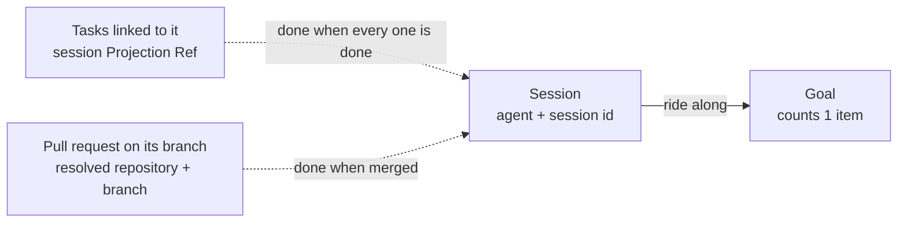

# ADR 0037: A session attaches to a goal as its own item

```meta
date: 2026-10-26
status: proposed
roadmap: [goals-standup]
related: [".devbook/arc42/adr/0035-goals-and-impediments-replace-sprints.md", ".devbook/arc42/adr/0005-azure-hosted-task-replica-for-multi-device-sync.md", ".devbook/domain/progress/domain.md#goal-attachment", ".devbook/domain/progress/domain.md#goal-progress", ".devbook/domain/progress/domain.md#done", ".devbook/domain/progress/domain.invariants.md#goal", ".devbook/domain/progress/requirements.md#attaching-work-to-a-goal", ".devbook/domain/progress/features.md#attaching-work-to-a-goal", ".devbook/domain/progress/features.md#goals-on-the-phone", ".devbook/domain/sessions/domain.md#agent-session", ".devbook/domain/sessions/domain.md#session-identity", ".devbook/domain/sessions/domain.md#working-location", ".devbook/domain/tasks/domain.md#projection-ref"]
```

A goal gains a fourth attachment kind, the **session**: one Claude Code or Copilot
session, named by its agent and session id. It counts as one item. It is done by
its work: when the pull request on its branch merges, or when every task linked to
it is done. Those tasks and that pull request ride along and do not count again.
Typing a session's number in a goal's attach search offers the session, then its
linked tasks, then the pull request on its branch.

## Status

```meta
```

Proposed, 2026-10-26. Not yet built. It awaits acceptance at the Personal
Validation gate of the flow-spec run `run-mvp6w11d-m0shrr` that drafted it.

It amends local ADR 0035 §2, §8 and §9, as [Amends](#amends) names them. The rest
of ADR 0035 stands.

A **local** decision, numbered in the local sequence. Every bare ADR number below
means the local one.

The owner asked for a quick add by session number that attaches "session, task and
PR depending on what is available". Asked whether the session should be an item of
its own or only bring in its linked task, the owner chose the session as its own item.

## Context

```meta
```

**A session is how the owner names the work.** A side session in the Claude desktop
app has a title and a short id, "Session abcd1234". It often has no task yet, and it
opens its pull request late. The owner sees the session first and wants it on the
goal from the start.

**A goal names work only by plan, task or pull request today.** ADR 0035 §2 lists
the three kinds. A session that has no task and no pull request yet cannot be
attached. Attaching its linked task later loses the time it ran without one.

**The facts already exist, owned elsewhere.** [Sessions](../../domain/sessions/context.md)
reads every session, its [state](../../domain/sessions/domain.md#session-state) and its
[branch](../../domain/sessions/domain.md#working-location), and records replicate between
the person's desktops (ADR 0005). Tasks records a link to a session as a
[Projection Ref](../../domain/tasks/domain.md#projection-ref) of target type `session`,
written by `link_session` or the side panel. A pull request's state is read from
GitHub, as ADR 0035 §7 does.

**A session ending is not work done.** A session can finish without shipping
anything, or stop and be resumed. Its state says whether the agent is still going,
not whether the goal moved.

## Decision

```meta
```



### 1. A session is a fourth attachment kind

```meta
```

| Attachment | Named by | Counts |
| --- | --- | --- |
| A plan | its roadmap `+tag` | each of the plan's entries |
| A task | its id | 1; its linked pull requests ride along and do not count again |
| A pull request | repository and number | 1 |
| A session | its agent and session id | 1; its linked tasks and the pull request on its branch ride along and do not count again |

The session id is the full id the agent gave the session. The short id the screens
show, its first eight characters, only finds a session and is never stored. The agent
is part of the name because a session id is unique only within its agent, as
[Session Identity](../../domain/sessions/domain.md#session-identity) says.

An item still belongs to at most one goal. A session counts in the goal that holds
it, whichever goal holds its tasks.

### 2. A session is done by its work

```meta
```

A session is [done](../../domain/progress/domain.md#done) when either holds:

- the pull request on its branch is merged;
- it has linked tasks, and every one of them is done.

Its state never makes it done. The day it was done is the earlier of the day that
pull request merged and the day its last linked task was done.

**The pull request on its branch** is the newest pull request whose head is the
session's branch, in the session's resolved repository. A session with no branch,
or no resolved repository, has none. Its **linked tasks** are the tasks whose
`session` Projection Ref names its session id.

An open session item is **blocked** when one of its linked tasks is marked blocked.
It is **doing** when the session is running or stalled, when its pull request is open
or a draft, or when a linked task is in progress. Otherwise it is **to do**.

### 3. A session counts once beside what rides with it

```meta
```

- A linked task the goal counts on its own, attached directly or as an entry of an
  attached plan, counts as that task. The session then does not count again.
- A pull request attached directly that is the session's branch pull request counts
  once, as the session.
- An open impediment holds a session back through a linked task. Its goal is then At
  risk, as ADR 0035 §2 already says of a task.

### 4. Quick add by session number offers what is there

```meta
```

A goal's attach search finds a session by its id, typed whole or as its first eight
characters, with or without the word "Session". It lists:

1. the session itself, named "Session abcd1234" and its title;
2. each task linked to it;
3. the pull request on its branch, when there is one.

The person picks one row. An item another goal holds asks first, as every attach
does. The search offers the sessions the Session Log reads on this desktop,
replicated ones included.

### 5. The Sessions area switch reaches the goal

```meta
```

With the [Sessions area](../../domain/sessions/context.md#sessions-area) off, the
attach search offers no session. A session already attached stays on its goal. It
reads by its linked tasks alone, named "Session abcd1234", with no state and no
branch pull request.

### 6. The phone reads a session from the desktop's reading

```meta
```

A session is read on a desktop. For each attached session, the desktop writes into the
`stand-up-context` document what the phone cannot find out: the session's title and
state, and the reference of the pull request on its branch. The pull request's state
rides there already, as ADR 0035 §8 does for every pull request. The phone reads the
linked tasks from the tasks the feed carries, and counts with the same `GoalItems`
code. Attaching a session is a desktop action, like every attach.

### 7. The goal document carries the new kind

```meta
```

A session attachment travels inside its goal's `goal` document, as kind `session`
with the agent and the session id. Nothing else on the feed changes. The service is
untouched.

## Consequences

```meta
```

Positive:

- **A session reaches the goal from its start.** It counts before it has a task or a
  pull request, and moves the goal when its work lands.
- **One number finds all of it.** The short id the person reads in the desktop app
  attaches the session, its task or its pull request.
- **Nothing counts twice.** The ride-along rule extends the one a task and its pull
  requests already follow.

Negative:

- **Progress reads one more owner.** A reading asks the Session Log for each attached
  session, and GitHub for the pull request on its branch. A session no record answers
  for reads as to do, named by its short id.
- **An older build does not know the kind.** The phone's reader leaves an attachment
  of an unknown kind out of the goal. The desktop's store refuses a goal document
  holding one. The implementing change confirms how an older desktop takes such a
  document from the feed, and whether its next save of that goal drops the session.
  Every desktop is upgraded together until then.
- **A finished session without a task or a merged pull request stays open.** The
  person detaches it, or links the task it did.

Neutral:

- **Tasks and Sessions are unchanged.** Attaching a session writes nothing on the
  session, on its tasks or on its pull request.
- **A session's hours and cost do not show on the goal.** They stay on the session list.

## Options considered

```meta
```

| Option | A session without a task counts | Nothing counts twice | Outcome |
| --- | --- | --- | --- |
| Attach only the session's linked task | no | yes | rejected |
| A session counts 1, done when it finishes | yes | yes | rejected |
| A session counts nothing, shown for context | no | yes | rejected |
| A session counts 1, done by its work | yes | yes | **chosen** |

- **Only the linked task.** The owner rejected it: a session often has no task yet.
- **Done when it finishes.** A session that ended without shipping would read as done.
- **Counts nothing.** The goal would show the session but its progress would ignore it
  until a task or pull request appeared, which is the case the owner wants covered.

## Amends

```meta
```

This record amends, without rewriting it:

- **ADR 0035 §2**, whose table of three attachment kinds gains the session row of §1
  above, and whose counting gains §2 and §3 above.
- **ADR 0035 §8**, whose `stand-up-context` document also carries what a desktop read
  of each attached session (§6 above).
- **ADR 0035 §9**, whose `goal` document also carries attachments of kind `session`
  (§7 above).

## Verification

```meta
```

The implementing `flow-code` run turns these into tests:

1. **Counting.** A session counts 1. Its linked tasks and its branch pull request do
   not count again.
2. **Done by its work.** A merged branch pull request makes it done. So does every
   linked task being done. A finished session with neither is not done.
3. **Once beside its task.** A goal holding a session and one of its linked tasks
   counts the task alone.
4. **Once beside its pull request.** A goal holding a session and its branch pull
   request counts 1.
5. **One goal per item.** Attaching a session another goal holds asks first.
6. **Quick add.** Typing a session's short id lists the session, then its linked
   tasks, then its branch pull request.
7. **The switch.** With the Sessions area off, no session is offered and an attached
   one counts by its linked tasks.
8. **The phone.** The phone counts a session item as the desktop does, from the
   `stand-up-context` document and the feed's tasks.

## History

```meta
```

| Date | Change | Why |
| --- | --- | --- |
| 2026-10-26 | Proposed: a session is a fourth goal attachment kind, done by its work | The owner names work by session and wanted it on a goal before it has a task or pull request |
