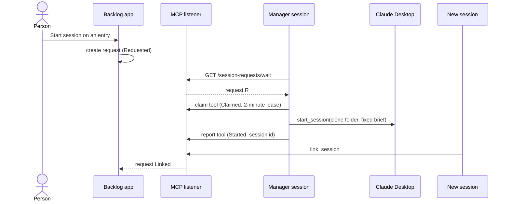
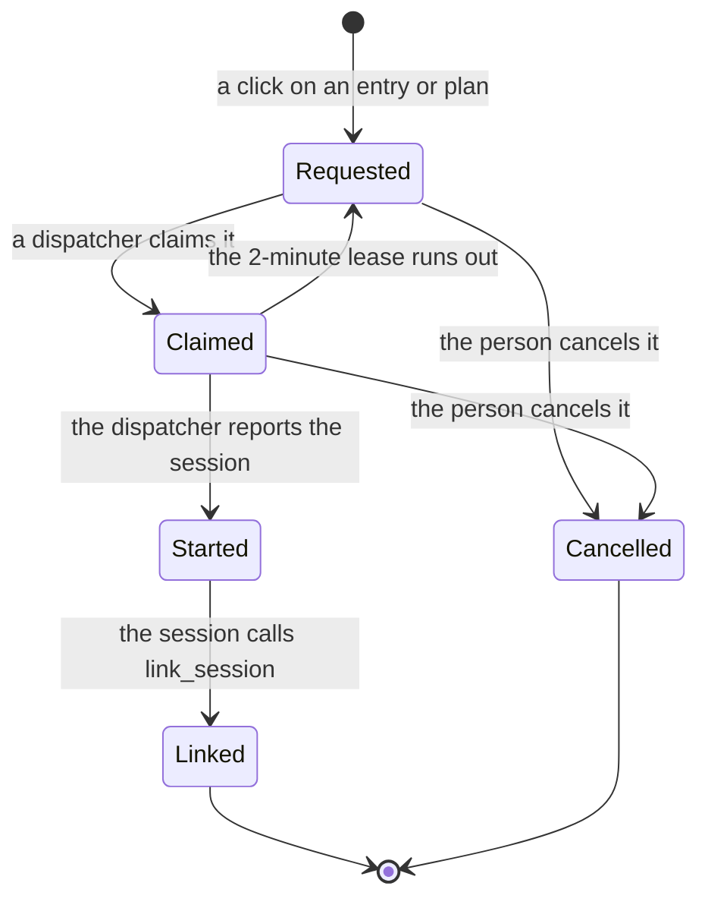

# ADR 0038: Backlog queues session requests and a Manager session dispatches them

```meta
date: 2026-10-27
related: [".devbook/arc42/adr/0012-backlog-is-an-mcp-server-inside-the-desktop-app.md", ".devbook/arc42/adr/0024-claude-code-telemetry-arrives-on-the-mcp-listener.md", ".devbook/arc42/08-crosscutting-concepts.md#feature-enablement", ".devbook/domain/sessions/context.md#session-requests", ".devbook/domain/sessions/domain.md#session-request-queue", ".devbook/domain/sessions/domain.md#session-request", ".devbook/domain/sessions/features.md#start-a-session-from-an-entry", ".devbook/domain/tasks/features.md#copy-as-a-runnable-paste", ".devbook/domain/tasks/features.md#filing-a-follow-up-after-an-entry", ".devbook/domain/notifications/requirements.md#asking-from-the-contexts"]
```

A click on an entry in the desktop app creates a **session request**: a Backlog record
that names the entry or the plan, the repository and its clone folder, and nothing
else. A **dispatcher** waits for requests on a long poll at
`GET /session-requests/wait` on the MCP listener, claims one through an MCP tool,
starts a session whose brief is a fixed line built from the request, and reports the
session back. The first dispatcher is a Manager session in Claude Desktop. The feature
sits behind the flag `session-requests`, off by default.

## Status

```meta
```

Proposed, 2026-10-22, and amended on 2026-10-27 ([History](#history)), by the flow-spec run `run-mviose3i-v0k24o` that drafted it, the
`record-decision` item of the `session-dispatch` plan, run unattended. It awaits
acceptance at the Personal Validation gate of that run's draft pull request. Not yet
built: the plan's later items build the record, the endpoint, the tools and the
Manager skill.

A **local** decision, numbered in the local sequence. Every bare ADR number below
means the local one. It adds a route and a tool group to the listener ADR 0012 built,
the way ADR 0024 added `/v1/logs`, and changes none of ADR 0012's decisions.

## Context

```meta
```

**A person wants a button that starts the work.** An entry already knows its
repository, and the GitHub settings on this machine know that repository's clone
folder. [Copy as a runnable paste](../../domain/tasks/features.md#copy-as-a-runnable-paste)
already puts the one line on the clipboard that runs an entry safely:
`/backlog-tools:run-plan-item entry `<id>`:`. The skill checks the entry is still
outstanding, moves it to In progress and calls `link_session`. What is missing is the
first link: something that starts an agent in that folder with that line.

**The app cannot start a Claude Desktop session.** Claude Desktop starts a session
with a worktree, its sidebar entry and its permission prompts only through its own
`start_session` tool, which a session running inside it can call. Nothing outside it
can. The app launches only Copilot CLI today, through `Process.Start`.

**The MCP server never pushes.** ADR 0012 made it stateless request/response. A
session that waits for work has to ask, and asking on a timer costs a model turn per
tick even when nothing changed.

**Entry text is not trusted.** Entries arrive through sync, imports and capture. A
queue that starts agent sessions from what an entry says would let anyone who can
write an entry run instructions on this machine.

## Decision

```meta
```



### 1. A session request is a Backlog record a click creates

```meta
```

The request is a record of the Sessions context, stored in the app's local database
beside the other records the app keeps for this machine. It carries the entry id or
the plan tag, the repository as `owner/name`, that repository's clone folder on this
machine, and nothing else. No title, body or note of the entry is copied into it.

Only a click in the app creates one. No MCP tool, import, sync or capture creates a
request, so nothing that writes entry text can start a session.

**No entry text ever becomes a brief.** The dispatcher builds the brief from the
request's kind and id alone (§2). The new session reads the entry through
`run-plan-item`, which treats it as an item to check, not as instructions to obey.

**Amended 2026-10-27: a gate answer can file a follow-up entry.** The Personal
Validation question a run asks
([Asking from the contexts](../../domain/notifications/requirements.md#asking-from-the-contexts))
can be answered **Approve + follow-up** on any paired device. That answer files one
ready prompt entry in the gated entry's plan and repository, `after:` the gated entry
([Tasks](../../domain/tasks/features.md#filing-a-follow-up-after-an-entry)). An attended `execute-plan` orchestrator then
dispatches it like any ready entry. The answer never creates a session request, so
only a click still creates one. The accepted trust is that a paired device already
approves the gate, so it may also queue the next step behind it. `run-plan-item` still
treats the follow-up's text as an item to check.

### 2. Two kinds, each with a fixed brief

```meta
```

| Kind | Created on | Brief |
| --- | --- | --- |
| Entry request | a prompt entry | `/backlog-tools:run-plan-item entry `<id>`:` |
| Plan request | a plan's roadmap item | `/backlog-tools:execute-plan +<tag>` |

An entry request runs one entry. A plan request starts one session that runs the whole
plan with its own sub-agents. Because both skills check what has already landed,
dispatching the same request twice does no harm.

### 3. Five states, a lease on the claim, no expiry

```meta
```



- **Requested.** Waiting for a dispatcher.
- **Claimed.** One dispatcher holds it under a lease of two minutes. A claim on a
  request that is not Requested is refused, so two dispatchers never start the same
  request. A lease that runs out returns the request to Requested.
- **Started.** The dispatcher reported the session it started, by its session id.
- **Linked.** That session called `link_session` on the entry. A plan request is
  Linked when its session links any entry of the plan.
- **Cancelled.** The person cancelled it.

**Requests never expire.** A request made while no dispatcher runs waits until one
does, or until the person cancels it. Linked and Cancelled are final.

### 4. Dispatchers wait on a long poll and act through MCP tools

```meta
```

**The wait is an HTTP route, not a tool.** `GET /session-requests/wait` is mapped on
the listener ADR 0012 §1 built, beside `/telemetry` and `/v1/logs`, behind the same
`Origin` check and bearer token. It answers as soon as a request is Requested, with
that request, oldest first. With none, it holds the call open for up to 50 seconds and
answers `204`. A route keeps the MCP transport stateless, as ADR 0012 has it, and lets
a dispatcher wait in a process that spends no model turn while it waits.

**Claiming and reporting are MCP tools.** A tool group behind the
`session-requests` flag claims a request and reports its session, per ADR 0012 §7.
The tools take a request id and a session id, never a brief.

**The Manager session is the first dispatcher.** It is a skill a person starts once
in a pinned Claude Desktop session. It waits on the route, claims each request, calls
`start_session` with the request's clone folder and the fixed brief, and reports the
started session. It holds no state of its own, so restarting it loses nothing. How
many sessions it runs at once, and when it holds back for machine load or usage, is
the skill's own policy and not this record's.

A direct launch from the app, the way it starts Copilot CLI, is left for later. It
would be a second dispatcher for the same request, and neither the request nor the
Manager would change.

### 5. Behind the flag `session-requests`, off by default

```meta
```

The flag `session-requests` gates the Start session action, the route, and the tool
group. Off, the action is not shown, the route answers `404` and the tools leave the
endpoint. It is off by default while the dispatchers are built
([Feature Enablement](../08-crosscutting-concepts.md#feature-enablement)).

## Consequences

```meta
```

Positive:

- **A button starts the work** in a real Claude Desktop session, with a worktree and
  the app's permission prompts, in the right repository.
- **A request survives a missing dispatcher.** The app can show it on the entry as
  waiting, with a Cancel action, until a Manager runs.
- **Any MCP-capable agent can dispatch.** The route and the tools name no agent.

Negative:

- **Someone has to start the Manager and keep it running.** Requests made while none
  runs wait, which may start work later than the person expected.
- **A request started late runs late.** A request made days ago starts when a
  dispatcher next runs. `run-plan-item` exits when the entry is already done.
- **The clone folder may need opening in Claude Desktop once**, so it is trusted
  before `start_session` uses it.
- **Each dispatch adds to the Manager's context.** Compaction covers it, and a
  restart costs nothing.

Neutral:

- **The Sessions context gains a command.** Until now it only read evidence. A request
  does not start a session itself: it asks a dispatcher to.

## Rejected

```meta
```

- **The Manager reads requests from chat or from entry text.** Rejected: whoever can
  write an entry could start a session with any brief.
- **Only a direct launch from the app.** It needs no Manager, but it starts a CLI
  session, not a Claude Desktop session with a worktree, and the app would have to
  pick an agent and a terminal. Kept as a later second dispatcher.
- **A cloud routine per request.** Cloud sessions start without the repository's
  plugins and cannot reach the loopback listener or the local database.
- **A Claude Desktop deep link.** Not confirmed that Claude Desktop accepts one for a
  Code session.
- **Waiting through an MCP tool.** A tool call held open for a minute ties up the
  stateless transport, and a session would have to spend a turn on each call.
- **A self-paced `/loop` as the wait.** It spends a turn on every tick when nothing
  changed. A Manager may still keep one as a slow heartbeat.
- **Requests that expire.** A request made while no dispatcher runs would be lost
  without the person knowing. Cancelling is explicit.

## History

```meta
```

| Date | Change | Why |
| --- | --- | --- |
| 2026-10-27 | §1 amended: an Approve + follow-up answer to a Personal Validation question, from any paired device, files one ready prompt entry `after:` the gated entry in the same plan and repository, which an attended `execute-plan` dispatches; it never creates a session request. | A paired device already approves the gate, so it may queue the next step; only a click still starts a session. |
| 2026-10-22 | Proposed: a click queues a session request, and a Manager session dispatches it through a long poll on the MCP listener. | A person wants a button that starts the work, and only a session inside Claude Desktop can start one there. |
