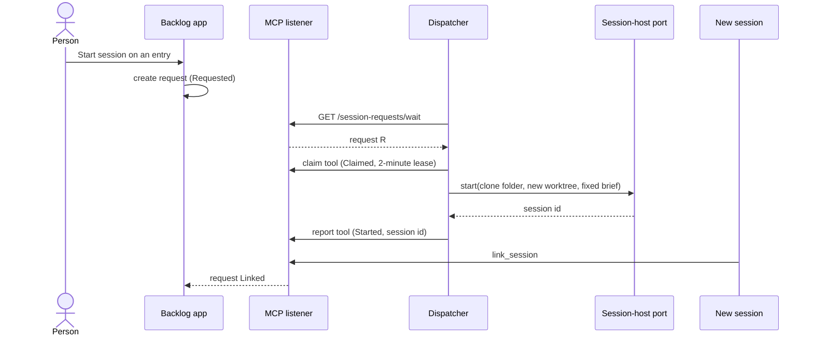
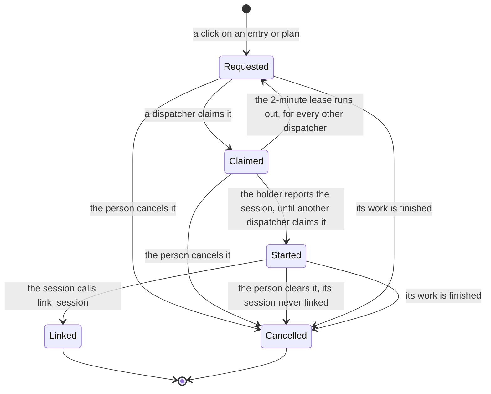
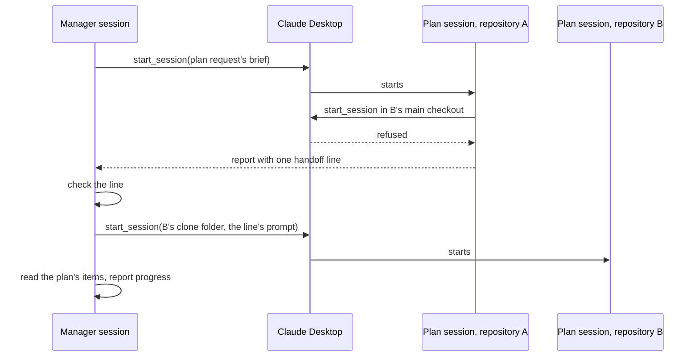

# ADR 0038: Backlog queues session requests and a Manager session dispatches them

```meta
date: 2026-11-26
related: [".devbook/arc42/adr/0012-backlog-is-an-mcp-server-inside-the-desktop-app.md", ".devbook/arc42/adr/0024-claude-code-telemetry-arrives-on-the-mcp-listener.md", ".devbook/arc42/08-crosscutting-concepts.md#feature-enablement", ".devbook/domain/sessions/context.md#session-requests", ".devbook/domain/sessions/domain.md#session-request-queue", ".devbook/domain/sessions/domain.md#session-request", ".devbook/domain/sessions/features.md#start-a-session-from-an-entry", ".devbook/domain/tasks/features.md#copy-as-a-runnable-paste", ".devbook/domain/tasks/features.md#filing-a-follow-up-after-an-entry", ".devbook/domain/notifications/requirements.md#asking-from-the-contexts", ".devbook/design/interaction-guidelines.md#drag-and-drop-reordering"]
```

A click on an entry in the desktop app creates a **session request**: a Backlog record
that names the entry or the plan, the repository and its clone folder, and nothing
else. A **dispatcher** waits for requests on a long poll at
`GET /session-requests/wait` on the MCP listener, claims one through an MCP tool,
starts a session whose brief is a fixed line built from the request, and reports the
session back. It acts on sessions only through a **session-host port** of five
operations, so the record names no host; each host is an adapter behind the port. The
feature sits behind the flag `session-requests`, off by default.

## Status

```meta
```

Accepted, 2026-11-02, at the Personal Validation gate of the flow-spec run
`run-mvzp51dk-5wwl1p`, which made the second amendment. Proposed 2026-10-22 by the
flow-spec run `run-mviose3i-v0k24o` that drafted it, the `record-decision` item of the
`session-dispatch` plan, run unattended. Amended on 2026-10-27, 2026-11-02, 2026-11-11,
2026-11-18, 2026-11-23 and 2026-11-26 ([History](#history)).

The 2026-11-26 amendment, the session-host port of §4, is proposed: the
`adr-session-host-port` item of the `agent-factory` plan drafted it, and the dispatcher
built in PR #1491 still calls one host directly until that plan's later items put it
behind the port.

Built and merged in PR #1491 on 2026-10-26: the request record and its queue table, the
wait route, the dispatcher tools, the Start session and Start plan session actions, and
the `dispatch-sessions` skill that is the Manager.

A **local** decision, numbered in the local sequence. Every bare ADR number below
means the local one. It adds a route and a tool group to the listener ADR 0012 built,
the way ADR 0024 added `/v1/logs`, and changes none of ADR 0012's decisions.

## Context

```meta
```

**A person wants a button that starts the work.** An entry already knows its
repository, and the GitHub settings on this machine know that repository's clone
folder. [Copy as a runnable paste](../../domain/tasks/features.md#copy-as-a-runnable-paste)
already puts the one line on the clipboard that runs an entry safely:
`/backlog-tools:run-plan-item entry `<id>`:`. The skill checks the entry is still
outstanding, moves it to In progress and calls `link_session`. What is missing is the
first link: something that starts an agent in that folder with that line.

**The app does not host sessions.** A session with a worktree, a place the person can
watch it and its permission prompts is started by the program that hosts it, through
that host's own interface. Hosts differ: one lets only a session running inside it
start another, another takes a command from any process. The app launches only Copilot
CLI today, through `Process.Start`.

**The host will change.** The person runs agents in more than one host, and the one that
dispatches today may not be the one that does next. A record that names a host has to be
rewritten each time it changes, and so does every skill that follows the record.

**The MCP server never pushes.** ADR 0012 made it stateless request/response. A
session that waits for work has to ask, and asking on a timer costs a model turn per
tick even when nothing changed.

**Entry text is not trusted.** Entries arrive through sync, imports and capture. A
queue that starts agent sessions from what an entry says would let anyone who can
write an entry run instructions on this machine.

## Decision

```meta
```



### 1. A session request is a Backlog record a click creates

```meta
```

The request is a record of the Sessions context, stored in the app's local database
beside the other records the app keeps for this machine. It carries the entry id or
the plan tag, the repository as `owner/name`, that repository's clone folder on this
machine, and nothing else. No title, body or note of the entry is copied into it.

Only a click in the app creates one. No MCP tool, import, sync or capture creates a
request, so nothing that writes entry text can start a session. A dispatcher starts two
kinds of session without a request. One is a fixer for a bot's red pull request (§6),
whose brief no text from the pull request reaches. The other is the cross-repository
hand-off of a plan session it started itself (§7), whose prompt has one fixed shape.

**No entry text ever becomes a brief.** The dispatcher builds the brief from the
request's kind and id alone (§2). The new session reads the entry through
`run-plan-item`, which treats it as an item to check, not as instructions to obey.

**Amended 2026-10-27: a gate answer can file a follow-up entry.** The Personal
Validation question a run asks
([Asking from the contexts](../../domain/notifications/requirements.md#asking-from-the-contexts))
can be answered **Approve + follow-up** on any paired device. That answer files one
ready prompt entry in the gated entry's plan and repository, `after:` the gated entry
([Tasks](../../domain/tasks/features.md#filing-a-follow-up-after-an-entry)). An `execute-plan` session running that plan
re-reads the plan after each entry lands and dispatches it like any ready entry. The answer never creates a session request, so
only a click still creates one. The accepted trust is that a paired device already
approves the gate, so it may also queue the next step behind it. `run-plan-item` still
treats the follow-up's text as an item to check.

### 2. Two kinds, each with a fixed brief

```meta
```

| Kind | Created on | Brief |
| --- | --- | --- |
| Entry request | a prompt entry | `/backlog-tools:run-plan-item entry `<id>`:` |
| Plan request | a plan's roadmap item | `/backlog-tools:execute-plan +<tag> branch` |

An entry request runs one entry. A plan request starts one session that runs the whole
plan with its own sub-agents. Because both skills check what has already landed,
dispatching the same request twice does no harm.

**Amended 2026-11-18: the plan brief names its landing mode.** It ends in `branch`, so a
dispatched plan lands its entries on the plan's integration branch whatever the skill's
default becomes. `execute-plan` always runs unattended: it asks the person nothing, and
each entry parks at its gate as a draft pull request the person validates.

### 3. Five states, a lease on the claim, no expiry

```meta
```



- **Requested.** Waiting for a dispatcher.
- **Claimed.** One dispatcher holds it under a lease of two minutes. A claim on a
  request that is not Requested is refused, so two dispatchers never hold the same
  request at once. A lease that runs out returns the request to Requested for every
  other dispatcher.
- **Started.** The holder of the claim reported the session it started, by its
  session id.
- **Linked.** That session called `link_session` on the entry. A plan request is
  Linked when its session links any entry of the plan.
- **Cancelled.** The person cancelled it, or cleared it once Started, or the app closed
  it because its work is finished.

**Requests never expire.** A request made while no dispatcher runs waits until one
does, or until the person cancels it. Linked and Cancelled are final.

**Amended 2026-11-02: the holder's late report still counts.** The port's start
operation can return after the two-minute lease ran out. The session exists by
then, so the holder's `started` report is still accepted while the request is stored
Claimed by that holder. Once another dispatcher claims the request, the late report is
refused with "Another dispatcher holds the claim". A holder whose lease ran out still
cannot release the request, because it already reads Requested. Answer deliveries follow
the same rule
([Only one Manager holds a delivery](../../domain/sessions/domain.invariants.md#invariant-only-one-manager-holds-a-delivery)).

The rule closes a race in which one dispatcher dispatched its own request twice. Before it,
the refused report left the request reading Requested, and the next wait handed it back.
A second session can still start when another dispatcher claims the request first. The
refused report then tells the holder so, and the dispatcher names both sessions.

**Amended 2026-11-18: a paused queue refuses every claim.** The person can pause the
queue as a whole (§4). While it is paused, a claim on a Requested request, a lapsed one
included, is refused with "The session queue is paused." and the request stays
Requested. The check runs in the same immediate transaction as the claim, so a claim
racing a pause cannot slip through. A pause is a property of the queue, not a sixth
state: no request changes state when the queue is paused or resumed, and none expires.
A claim already held is not revoked: its holder's `started` report, the late one
included, and its `released` are still accepted.

**Amended 2026-11-18: a Started request can be cancelled.** A dispatcher can report a
session that then never calls `link_session`: it failed to start its brief, or the
person closed it. Such a request read Started with nothing to end it. The person can now
cancel a Started request from the session queue, and it is Cancelled like any other.
Cancelling stops no session. A `link_session` that comes later links nothing, because
only a Started request is linked. A Claimed request still offers no Cancel in the app,
because a dispatcher is starting its session right then. *(Superseded 2026-11-26 by the
amendment below: a Claimed request offers Cancel too.)* Requests still never expire.

**Amended 2026-11-26: a Claimed request can be cancelled too.** The person could not take
back a claim whose session never starts. The session queue, the column docked
beside the Tasks list and its popover in a narrow window, now offers Cancel on a Claimed
request, as the state diagram's `Claimed --> Cancelled` already allows. Cancelling stops
no session already started, and a later `link_session` links nothing. The owner decided
this on 2026-11-26.

**Amended 2026-11-18: a finished request leaves the queue.** The person can finish the
work a request names without its session: mark the entry Done in the app, or every entry
of the plan. Such a request read Started, or waited Requested, with nothing left to do.
The app now closes a Requested or Started request once its entry is Done or Archived, or
once every entry of its plan is, the plan's entries read as `get_plan_items` reads them.
It sweeps when it starts and after every local task write, and the request is Cancelled
as a press of Cancel leaves it. A Claimed request is left to its dispatcher, and a plan
with no entries is not finished.

**Amended 2026-11-18: a link matches the dispatcher's session id.** A dispatcher reports
the id the host gave the session it started, while a session calls `link_session` with
its transcript id. `link_session` now matches a request under both. The plan's `execute-plan` session links itself to one entry of its plan, because
its entry sessions link with their own ids.

### 4. Dispatchers wait on a long poll and act through MCP tools

```meta
```

**The wait is an HTTP route, not a tool.** `GET /session-requests/wait` is mapped on
the listener ADR 0012 §1 built, beside `/telemetry` and `/v1/logs`, behind the same
`Origin` check and bearer token. It answers as soon as a request is Requested, with
the one at the head of the queue. With none, it holds the call open for up to 50 seconds and
answers `204`. A route keeps the MCP transport stateless, as ADR 0012 has it, and lets
a dispatcher wait in a process that spends no model turn while it waits.

**Claiming and reporting are MCP tools.** A tool group behind the
`session-requests` flag claims a request and reports its session, per ADR 0012 §7.
The tools take a request id and a session id, never a brief.

**Amended 2026-11-26: a dispatcher is a role, and it acts on sessions through a
session-host port.** The dispatcher waits on the route, claims each request with the
Manager grant of ADR 0058 §3, starts its session through the port, and reports the
session id the port returns. It acts on a session only through the port's five
operations:

| Operation | Does | The dispatcher uses it to |
| --- | --- | --- |
| Start | starts a session in a new worktree of the clone folder, with the fixed brief of §2 as its whole prompt | dispatch a request, or start a fixer (§6) |
| Report id | answers the id the host gave the session it started | report the request Started (§3) |
| List | lists the sessions the host is running, each with its id and name | count them against its capacity, and find a watched pull request (§6) |
| Read state | answers one session's state: working, waiting or idle | count only working sessions, as ADR 0041 has it |
| Deliver | sends one message to one session, and starts a turn in it when it is idle | hand back an answer (ADR 0041 §3) |

The port takes the clone folder, the fixed brief, a session id and a message built only
from a stored question and its accepted answer, never entry text, so the trust rule of
§1 holds whatever host is behind it. Each host is an **adapter** that
implements the port with that host's own commands. This record names no host, and the
queue, the claim lease, the pause, the order and the trust rules are the same for every
adapter.

**A dispatcher is a skill a person starts by hand** in a long-running session of the
host, as the person's own ask; nothing starts one on its own. It holds no state of its
own, so restarting it loses nothing. How many sessions it runs at once, and when it
holds back for machine load or usage, is the skill's own policy and not this record's.
The skills that need a host — the dispatcher's adapter, and anything else that calls a
host's own commands — ship in a plugin per host, `backlog-desktop` and `backlog-herdr`,
beside the shared `backlog-tools`, which keeps every skill that needs no host. The
plugins' READMEs say which host each one adapts.

**Amended 2026-11-11: the app notes when a dispatcher last waited.** Each call the wait
route lets in is recorded as dispatcher contact, in memory on this desktop, and counts
as now for as long as the call is held. A `404` while the flag is off records nothing.
The record names no dispatcher and is forgotten on restart, and the dispatcher still
holds no state. The Tasks filter bar's session queue lists every open request and warns when
one waits Requested and no dispatcher has been heard for more than two minutes.

**Amended 2026-11-18: the person can pause the queue.** The session queue offers Pause
queue and Resume queue. While the queue is paused, the wait route hands out no request:
with nothing else to hand out it holds the call and answers `204`, as on an empty queue,
and the call is still dispatcher contact. Answer deliveries of local ADR 0041 are not
paused, so the route still hands them out and a waiting session still gets its answer.
`list_session_requests` says whether the queue is paused, and a dispatcher waits
while it is rather than try claims it knows are refused. The person can still queue and
cancel requests. No MCP tool pauses or resumes the queue: like a request, a pause is the
person's act in the app. The paused state is kept in the app's local database beside the
requests, survives a restart and is never synced. A database written before the pause
existed reads as running.

**Amended 2026-11-18: the person orders the queue.** The queue was oldest first. Now
the person sets the order of the Requested requests, a lapsed claim included, in the
session queue's popover. Entry and plan requests share that one order, across every
repository on this machine. A new request joins at the end, and a request the person
never moved keeps its place by when it was asked. The wait route, `list_session_requests`
and every dispatcher take requests in that order. A Claimed or Started request does not move,
because a dispatcher already acts on it. The order is kept with the requests in the
app's local database, written in one transaction per move, and does not replicate. Only
the app reorders: no MCP tool moves a request, for the same reason that only a click
creates one. Deliveries still come before any request (ADR 0041).

The popover offers Move up, Move down and Move to top, and on a focused row Alt+ArrowUp
and Alt+ArrowDown, with Alt+Shift+ArrowUp to move it to the top. Drag-and-drop and an undo step are left for later. That departs from the
design guidelines'
[reordering rules](../../design/interaction-guidelines.md#drag-and-drop-reordering).

A direct launch from the app, the way it starts Copilot CLI, is left for later. It
would be a second dispatcher for the same request, and neither the request nor the
port would change.

### 5. Behind the flag `session-requests`, off by default

```meta
```

The flag `session-requests` gates the Start session action, the route, and the tool
group. Off, the action is not shown, the route answers `404` and the tools leave the
endpoint. It is off by default while the dispatchers are built
([Feature Enablement](../08-crosscutting-concepts.md#feature-enablement)).

### 6. The dispatcher mends a bot's red pull request

```meta
```

A pull request a bot opened — Dependabot, Renovate, a workflow — whose checks fail stays
open until someone fixes it, and no session owns it. After the queue, with room left under
the same limits, the dispatcher lists each clone folder's open pull requests and starts a
**fixer** session for one that is:

- opened by a bot, on a branch of the repository itself, and not a draft. A fork's is
  never mended: anyone can open one as a bot, and the fixer would build its code here;
- red: every check has settled and at least one failed;
- not watched: no session the port lists is working on it, no fixer for it is still
  open, and it has had fewer than two fixers.

The fixer starts through the port's Start, in the clone folder, in its own worktree,
named `CI fix <owner/name>#<number>`, which is how a later List sees it. Its brief is fixed and
built from the repository, the number and the head commit alone: watch your pull
request's checks and fix them, on its own branch and through the repository's gate,
push to that branch and stop at Personal Validation, open no second pull request and
never merge. It names no feature of a host: how a session watches checks is the
session's own tooling. The title, body, branch name and check logs never reach the
brief. A fixer that needs a decision stops and says so.

Session requests keep priority: a fixer starts only once the queue is empty, and a paused
queue starts none. The person's start of the dispatcher is the ask that starts it, as it
is for a request. The app counts no fixer among the dispatched sessions, so the dispatcher adds
its running fixers to the count itself. Merging stays with the repository's own rules,
such as an auto-merge workflow for a green dependency bump.

### 7. The Manager starts the hand-off of a plan session it started

```meta
```



**Added 2026-11-26.** A plan session (`execute-plan`) hands each entry of another
repository to a session there, which runs the same plan
([execute-plan's handoff](../../../plugins/backlog-tools/skills/execute-plan/assets/handoff.md)).
It tries `start_session` in that repository's main checkout first. Claude Desktop refuses
every session start on the turns of a session another session started, so a plan session
the Manager started is always refused. It then writes one fixed line in its report:

```text
handoff <owner/repo> <absolute clone folder> /backlog-tools:execute-plan +<tag> <landing>
```

The Manager reads the reports of the plan sessions it started itself, and of no other
session. It starts each hand-off line once, on its next turn that the host lets start a
session. The start is `user_asked`, in the line's folder, in its own worktree, with the
line's prompt verbatim. The Manager refuses a line when:

- its prompt does not have the fixed `execute-plan` shape;
- its `+<tag>` is not the plan the Manager started that session for — a plan session reads
  untrusted entry text, so a well-formed line for another plan is refused;
- its folder is not a known clone of that repository on this machine: a main checkout whose
  `origin` remote is `<owner/repo>`;
- it already started that line.

The hand-off creates no session request, adds no MCP tool and needs no new grant: the
app's queue and local ADR 0058 are unchanged. The Manager then follows the plan across
its repositories read-only, through `get_plan_items`, and reports each repository's
progress. A paused queue starts no hand-off, and the Manager adds its hand-off sessions
to the dispatched count itself, as it does its fixers.

The accepted trust is that the Manager built the plan session's brief from a click (§2),
and the hand-off's prompt is that same fixed brief for another repository. No entry text
reaches it beyond the plan tag and the landing mode.

## Consequences

```meta
```

Positive:

- **A button starts the work** in a real hosted session, with a worktree and the
  host's permission prompts, in the right repository.
- **A host changes without a new decision.** A new host is a new adapter behind the
  port, in its own plugin; the queue, the tools and this record stay as they are.
- **A request survives a missing dispatcher.** The app can show it on the entry as
  waiting, with a Cancel action, until a dispatcher runs.
- **Any MCP-capable agent can dispatch.** The route and the tools name no agent.
- **A plan crosses repositories without the person copying a prompt.** The Manager starts
  the other repository's plan session and reports the plan's progress in each repository.

Negative:

- **Someone has to start a dispatcher and keep it running.** Requests made while none
  runs wait, which may start work later than the person expected. Since the
  2026-11-11 amendment, the session queue says so when none is heard and names the
  command that starts one.
- **A paused queue starts nothing until the person resumes it**, however long that
  takes. The trigger and a callout in the popover say the queue is paused.
- **A request started late runs late.** A request made days ago starts when a
  dispatcher next runs. `run-plan-item` exits when the entry is already done.
- **The clone folder may need trusting in the host once** before the port's Start
  can use it, where the host asks for that.
- **Every adapter has to answer all five operations.** A host that cannot start a turn
  in an idle session, or cannot say whether a session is waiting, cannot be a
  dispatcher's host until its adapter makes up the gap.
- **Each dispatch adds to the dispatcher's context.** Compaction covers it, and a
  restart costs nothing.

- **A fixer waits on the person.** It stops at Personal Validation with its fix pushed,
  and counts against the session limit until the person archives it.
- **The two-fixer limit reads session names.** A fixer the person renames, or one the
  port's List no longer returns, no longer counts, so a pull request red for long can
  get a third.
- **A hand-off waits for a turn that may start a session.** Claude Desktop refuses
  `start_session` on any turn a Monitor event or a wake-up drives. Only a turn the person
  typed, or a `<side-sessions-event>` turn right after one, may start a session. A
  hand-off reported while the Manager only waits therefore starts at the person's next
  turn there. Lifting that limit needs a dispatcher that launches a CLI session, which
  [Rejected](#rejected) keeps for later.

Neutral:

- **The Sessions context gains a command.** Until now it only read evidence. A request
  does not start a session itself: it asks a dispatcher to.

## Rejected

```meta
```

- **The dispatcher reads requests from chat or from entry text.** Rejected: whoever can
  write an entry could start a session with any brief.
- **Only a direct launch from the app.** It needs no dispatcher, but it starts a CLI
  session, not a hosted session with a worktree, and the app would have to
  pick an agent and a terminal. Kept as a later second dispatcher.
- **A cloud routine per request.** Cloud sessions start without the repository's
  plugins and cannot reach the loopback listener or the local database.
- **A host's deep link opened by the app.** Not every host accepts one, and it would
  be a second way to start a session beside the port.
- **Naming the host in this record.** Each change of host rewrote the record and every
  skill that follows it, and the queue's rules never depended on the host. Hosts are
  named only in their adapters' code and their plugins' READMEs.
- **One plugin with every host's skills.** A person would install the commands of hosts
  they do not run, and one host's change would ship to all of them.
- **Waiting through an MCP tool.** A tool call held open for a minute ties up the
  stateless transport, and a session would have to spend a turn on each call.
- **A self-paced loop as the wait.** It spends a turn on every tick when nothing
  changed. A dispatcher may still keep one as a slow heartbeat.
- **Requests that expire.** A request made while no dispatcher runs would be lost
  without the person knowing. Cancelling is explicit.
- **A plan session queues its hand-off as a session request.** It needs an MCP tool
  that creates a request, against §1, and a new scope in the delivery grant of local
  ADR 0058. The Manager already started the plan session, so it can read the hand-off
  from that session's report instead.

## History

```meta
```

| Date | Change | Why |
| --- | --- | --- |
| 2026-11-26 | §3 amended: the session queue offers Cancel on a Claimed request too, as the state diagram allows. It stops no session already started, and a later `link_session` links nothing. It replaces the 2026-11-18 sentence that a Claimed request offers no Cancel. Built in PR #2089. | The owner wanted a claim whose session never starts to be taken back. |
| 2026-11-26 | §7 added, §1 amended: the Manager starts, once each, the hand-off line a plan session it started writes in its report, in that repository's known clone folder with the fixed `execute-plan` prompt, and follows the plan's progress read-only. No session request, tool or grant is added. | A plan session another session started cannot start sessions, so its hand-off waited for the person to copy a printed prompt. |
| 2026-11-26 | Proposed, §4 and §6 amended: the dispatcher is a role that acts on sessions only through a session-host port of five operations — start in a new worktree with the fixed brief, report its id, list, read state (working, waiting, idle), deliver a message — and claims with the Manager grant; a dispatcher is a skill a person starts by hand in a long-running session of the host; host skills ship in `backlog-desktop` and `backlog-herdr` beside `backlog-tools`; the fixer's brief is "watch your pull request's checks and fix them". Queue, lease, pause, order and trust unchanged. The §2 table's stray 2026-11-18 row moved here. | The record named one host, and the person moves dispatch to another; the queue never depended on which (plan `agent-factory`, item `adr-session-host-port`). |
| 2026-11-23 | §6 added, §1 amended: after the queue, the Manager starts one fixer session per bot-opened pull request on the repository's own branch whose settled checks fail and that no session watches, at most two per pull request, with a fixed brief from repository, number and head commit. | Dependency bumps sat open for days on one red check, and no session owned them. |
| 2026-11-18 | §3 amended: the app closes a Requested or Started request once its entry, or every entry of its plan, is Done or Archived, at start and after every task write; `link_session` matches a request under the session's desktop id as well as its transcript id, and `execute-plan` links its own session to one entry of its plan. | No request had ever reached Linked: the dispatcher reports the desktop id and a session links by its transcript id, and a plan's `execute-plan` session never linked at all. Plans the person had finished stayed in the session queue as Started. |
| 2026-11-18 | §2 amended: the plan brief is `/backlog-tools:execute-plan +<tag> branch`, and `execute-plan` always runs unattended, with no attended mode, gate relay or per-entry landing; §1 now says the plan's `execute-plan` session dispatches a follow-up entry. Built in PR #1846. | A dispatched plan session stopped on questions nobody answers, and a dispatched plan lands its entries on the plan's integration branch. |
| 2026-11-18 | §3 amended: the person can cancel a Started request, so a request whose session never called `link_session` leaves the queue. It stops no session, and a later `link_session` links nothing. Requests still never expire. Built in the same pull request. | Started rows whose session never linked sat in the session queue for days with nothing to clear them. |
| 2026-11-18 | §3 and §4 amended: the person can pause and resume the queue in the app. While it is paused, every claim is refused inside its transaction and the wait route hands out no request, while answer deliveries keep flowing, held claims still report and release, and requests can still be queued and cancelled. `list_session_requests` carries `paused`, and no MCP tool pauses or resumes. The state is a machine-local single-row table in the app's database. Built in the same pull request. | A person wants to stop new sessions from starting without cancelling every request or stopping the Manager. |
| 2026-11-18 | §4 amended: the person orders the Requested requests in the session queue, one order for entry and plan requests, new requests last; the wait route, `list_session_requests` and the Manager take them in that order, not oldest first. No MCP tool reorders. | The person wants the request they put first to be the one the Manager starts next. |
| 2026-11-11 | §4 amended: the app records dispatcher contact from the wait route, in memory, and the Tasks filter bar's session queue warns when none has come for two minutes while a request waits Requested. Built in PR #1799. | Requests waited unseen with no Manager running, and nothing said so. |
| 2026-11-02 | §3 amended: a lapsed lease returns the request to Requested for every other dispatcher, while the holder's late `started` report still counts until another dispatcher claims it. | `start_session` can outlast the lease, and the refused report let one Manager dispatch its own request twice. |
| 2026-11-02 | Accepted at the gate of `run-mvzp51dk-5wwl1p`. Status: built and merged in PR #1491 on 2026-10-26. | The Status still said the plan's later items would build it, and the person accepted the record. |
| 2026-10-27 | §1 amended: an Approve + follow-up answer to a Personal Validation question, from any paired device, files one ready prompt entry `after:` the gated entry in the same plan and repository, which an attended `execute-plan` dispatches; it never creates a session request. | A paired device already approves the gate, so it may queue the next step; only a click still starts a session. |
| 2026-10-22 | Proposed: a click queues a session request, and a Manager session dispatches it through a long poll on the MCP listener. | A person wants a button that starts the work, and only a session inside Claude Desktop can start one there. |
