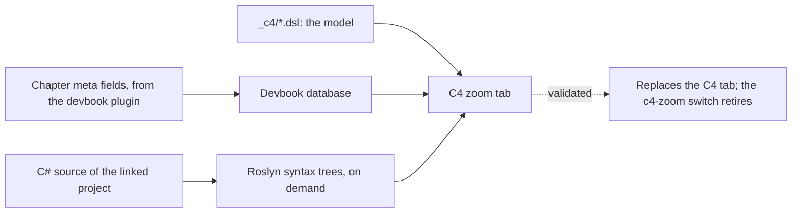

# ADR 0038: C4 zoom navigation is a second tab, its links are read from devbook metadata, and its code from syntax trees

```meta
date: 2026-10-21
status: proposed
roadmap: [c4-zoom-navigation]
related: [".devbook/domain/devbook/features.md#c4-zoom-navigation", ".devbook/domain/devbook/requirements.md#c4-zoom-navigation", ".devbook/domain/devbook/context.md#c4-zoom", ".devbook/arc42/adr/0004-knowledge-index-is-a-generated-local-database.md", ".devbook/arc42/adr/0015-devbook-database-lives-in-app-storage-and-the-app-builds-it.md", ".devbook/arc42/adr/0016-knowledge-folders-adopt-the-devbook-convention.md", ".devbook/arc42/08-crosscutting-concepts.md#devbook-database"]
c4: [backlog.desktop.devbook]
```

The architecture panel gains a **C4 zoom** tab that walks the C4 model from
context to code, built beside the **C4** tab behind the `c4-zoom` switch. It
replaces the **C4** tab only after it has been validated. Which element a record
names, a TDR's severity and lifecycle, which ADR supersedes which, and which code a
component maps to are read from devbook metadata fields that the devbook plugin
provides, never from a file this repository keeps beside the model. The Code level
is read from C# syntax trees with `Microsoft.CodeAnalysis.CSharp`, without
compiling anything.

## Status

```meta
```

Proposed, 2026-10-21. Not yet built: the plan `+c4-zoom-navigation` builds it. It
awaits acceptance at the Personal Validation gate of the flow-spec run
`run-mvha0qbp-ueo2j6` that drafted it.

A **local** decision, numbered in the local sequence. Every bare ADR number below
means the local one.

The design is the canvas "C4 Zoom Navigation": nine screens and a page on how to
move between levels.

## Context

```meta
```

**The C4 tab lists views; it does not navigate them.** With `c4-diagrams` on, the
**C4** tab shows the model kept as Structurizr DSL under `.devbook/arc42/_c4/`, one
view at a time, and links a view to the chapters that document it. A reader who
wants the containers of a system, then the components of one container, picks each
view by name. Nothing says that the second is inside the first, and no decision or
debt record is shown against the element it is about.

**The links that would make the model navigable are authored nowhere today.**

- Which chapter documents which view is in `_c4/references.json`, a file this
  repository authors beside the workspace.
- Which element an ADR or a TDR is about is in prose only.
- A TDR's severity and its lifecycle (identified, planned, in progress, resolved)
  are a `## Status` paragraph, not fields.
- Which ADR supersedes which is a sentence in each record and a note in the
  `adr/` index.
- No component names the code it is built from.

**The Code level has no authored source and should not get one.** C4 treats level 4
as optional and best generated, because a hand-drawn class diagram is stale the day
after it is drawn.

## Decision

```meta
```



### 1. A second tab behind its own switch

```meta
```

The zoom navigation is a new **C4 zoom** tab beside the **C4** tab, offered while
`c4-zoom` and `c4-diagrams` are both on. The **C4** tab is not changed to make room
for it. While `c4-zoom` is on, the **Chapters** tab also shows where an ADR or a
TDR lands on the container view, and an arc42 chapter embeds the views it
documents and flags where its mermaid fence and the model disagree.

Once the zoom tab has been validated against the requirements of
[C4 zoom navigation](../../domain/devbook/requirements.md#c4-zoom-navigation), it
replaces the **C4** tab, and the `c4-zoom` switch is retired in the same change. A
decision record amends this one at that point.

### 2. Links to the model are devbook metadata

```meta
```

Four facts are read from fields in a chapter's `meta` block, fields the devbook
plugin defines, checks and builds into the devbook database:

| Fact | Where it is written |
| --- | --- |
| The C4 elements an ADR, a TDR or an arc42 chapter is about | the record's or chapter's own block |
| A TDR's severity and its lifecycle state | the TDR's own block |
| The ADR a record supersedes, or the one superseding it | the record's own block |
| The code a C4 component is built from | the chapter or record that documents the component |

The app reads them from the devbook database, the way it reads every other field
(ADR 0004, ADR 0015). The overlays, the inspector and the decision chain are views
over those fields. This repository adds no file beside the model for any of them:
not a second `references.json`, and no table under `_c4/`.

### 3. The Code level is syntax trees only

```meta
```

Level 4 is drawn on demand when a reader opens it. The app parses the C# files of
the project the component's code link names with
`Microsoft.CodeAnalysis.CSharp` syntax trees and lists their types and members. It
never creates a compilation, never resolves symbols, and never loads a project file
or restores packages. What syntax alone cannot answer is left out of the view, such
as a member's resolved type or a call between types.

Nothing at this level is authored or committed. A component with no code link
stops at level 3.

## Consequences

```meta
```

- **The C4 tab and the zoom tab coexist for a while.** Two ways to read one model
  are on screen until validation. The switch keeps the zoom tab away from everyone
  who has not turned it on.
- **This repository waits on the devbook plugin.** The fields in §2 must exist in
  the devbook convention, its check and its database build before the overlays,
  the inspector's records and the decision chain have anything to show. Until
  then, the zoom tab navigates the model with empty record lists and no overlay
  counts. The C# builder follows the reference builder, as `DevbookBuilderParityTests`
  requires, in the same pull request that adopts each field.
- **`_c4/references.json` has no successor here.** The chapter-to-view link it
  holds today is read from the chapters' metadata once the plugin provides it, and
  the file is then removed in the change that switches the reader over.
- **The Code view is fast and approximate.** Parsing one project's syntax trees
  takes no build and no restore, so opening level 4 needs nothing but the source.
  In exchange it shows declarations, not a semantic model: a partial type is
  merged by name, and a member's type is shown as written.
- **A new package.** `Microsoft.CodeAnalysis.CSharp` joins the desktop's
  dependencies. The `tech/` graph records it when the implementing change adds it.

## Considered options

```meta
```

### Replace the C4 tab in place

```meta
```

Rejected. The **C4** tab is how the model is read today. A rework behind no switch
would take that away before the new navigation has been validated, and there would
be nothing to fall back to.

### Keep the links in a file beside the model

```meta
```

Rejected. A file such as `_c4/references.json`, extended with record and code
links, is a second place where a record states what it is about. It would be
checked by nothing the devbook plugin runs. Every other repository that adopts C4
zoom would need its own copy. A field on the record is written once, beside the
decision, and the devbook check reports it when it stops resolving.

### Infer the links from prose

```meta
```

Rejected. Matching element names in a record's text would put an ADR on every
element its context paragraph mentions. The design separates "decides" from
"touches", and only an explicit field can say which one applies.

### Compile the source for the Code level

```meta
```

Rejected. A Roslyn compilation needs the project's references restored and would
tie the view to a buildable checkout of the right SDK. A branch snapshot or a
repository the app does not build could not show level 4 at all. Syntax trees need
only the files.

### Author the Code level in the DSL

```meta
```

Rejected. A code diagram written by hand goes stale with the next refactor, and C4
itself recommends generating level 4.

## Open questions

```meta
```

- The names and shapes of the four fields in §2 are the devbook plugin's to choose.
  This record fixes what they carry, not how they are spelled.
- Whether a component's code link names a project, a folder or a namespace is for
  the plugin's field to settle. The Code view needs a set of C# files either way.
