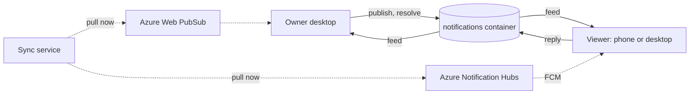

# ADR 0038: Notifications are an owned document kind on their own replica container, and the realtime channel only nudges

```meta
date: 2026-10-26
related: [".devbook/tech/mobile.md#xamarinfirebasemessaging", ".devbook/arc42/adr/0005-azure-hosted-task-replica-for-multi-device-sync.md", ".devbook/arc42/adr/0009-captures-are-a-document-kind-on-the-replica.md", ".devbook/arc42/adr/0011-devbook-annotations-are-a-third-replica-container.md", ".devbook/arc42/adr/0014-attachments-travel-through-a-blob-store-beside-the-replica.md", ".devbook/arc42/05-building-block-view.md#cloud-service", ".devbook/arc42/06-runtime-view.md#notification-reply", ".devbook/arc42/08-crosscutting-concepts.md#notifications", ".devbook/domain/notifications/context.md", ".devbook/tech/cloud.md#azure-web-pubsub", ".devbook/tech/cloud.md#azure-notification-hubs"]
```

A notification is a document one desktop instance owns and alone writes. It
travels on a fourth replica container, `notifications`. A viewer instance never
changes a notification: it writes a reply document, and the owner accepts or
rejects it. The realtime channel carries no document. It only tells a device to
pull: Azure Web PubSub for desktops, and Azure Notification Hubs to Firebase Cloud
Messaging (FCM) for the Android phone, whose push adds only the words its tray
shows.

## Status

```meta
```

Proposed, 2026-10-22. Drafted by an unattended `execute-plan` run of the
`+notifications` plan from the agreed proposal *Notifications that ask, and wait
for your answer* (21 October 2026), including its "Settled" list. It waits for the
repository owner's Personal Validation on the draft pull request. Every section is
now built, and the Azure resources are declared in Bicep. None of it is deployed,
and the hub has no FCM credential yet, so no push has reached a phone.

A **local** decision, numbered in the local sequence. Every bare ADR number below
means the local one. It **extends** ADR 0005 with a fourth replica container,
on ADR 0011's precedent, and builds the Notification Service that the building
block view reserved without deciding.

## Context

**Nothing lets a desktop ask a question and wait for the answer.** Backlog has
toasts, settings badges and confirm dialogs. All of them are local and gone once
dismissed. Impediments, Devbook remarks and Inbox captures each built their own
way to travel between devices. The case that drives this record is a Claude
session on the desktop that needs a decision. It asks through MCP, the phone
buzzes, the person answers on the lock screen, and the session continues.

**Polling is too slow for a waiting question.** All cross-device traffic today is
polling over the Cosmos replica, and the desktop's task exchange runs every five
minutes. That suits tasks. It does not suit an agent that is blocked on an answer.

**The sync service scales to zero.** It runs on Azure Container Apps with
`minReplicas: 0`, so its cost comes from being kept awake. Any channel that holds
a connection open on the sync service keeps a replica running around the clock.

**A replicated document with two writers needs merge rules.** The replica's
precedence rules settle which of two copies wins. They cannot merge a state
change from one device with an answer from another. The Inbox avoided the
problem for captures: the phone proposes, and the desktop decides (ADR 0009).

## Decision

### 1. A notification has exactly one writer, its owner instance

The desktop instance that publishes a notification owns it, identified by its
`DeviceIdentity`. Only the owner changes the notification's state. A second
desktop is a viewer for the first one's notifications and the owner of its own.
No instance takes over another's notifications, even when the owner is unpaired:
those expire.

### 2. A viewer replies by writing a reply document, and the owner decides

A viewer writes a reply document once and never edits it. The owner reads it,
checks it against the question's answer spec, and accepts or rejects it. The first
valid reply the owner processes wins, and the owner rejects the rest. Once the
owner has processed a reply, it deletes the reply document, as the Inbox does with
a capture's tombstone. So every document on the container has one writer, and the
replica needs no merge rule beyond the one ADR 0005 already has.

The sync API accepts a reply only from a device under the same owner. The owner
checks that again before it accepts.

### 3. Notifications get their own replica containers

Notification documents live in a fourth Cosmos container, `notifications`, and
reply documents in a fifth, `notificationReplies`. Both are partitioned on
`/ownerId`. The two have different lives: a notification is a feed every device
reads, and a reply is a mailbox its owner instance empties. They do not ride the
`tasks` feed:

- they expire, through Cosmos TTL, 30 days after they close; an open
  notification carries a 90-day backstop that its owner's weekly re-push keeps
  moving, so only an owner that is gone for good lets it lapse;
- they are high in volume compared with tasks;
- they need a faster exchange cycle than the task feed's.

This is ADR 0011's reasoning for `annotations`. Serverless billing charges nothing
per container to trade against it. The owner keeps SQLite as its local store, as
ADR 0003 does for tasks.

### 4. The feed is the truth, and the realtime channel only nudges



Solid arrows carry documents. Dotted arrows only say "pull now". A device that
misses a nudge still finds every document on its next pull.

- **Desktops** hold a WebSocket to an Azure Web PubSub hub on its Free tier. The
  sync service publishes to the hub when a notification or a reply lands. While a
  question is open and the socket is down, the owner polls every two minutes as
  the fallback.
- **One group per owner.** A desktop asks the sync service's negotiate route,
  behind its device token, for a client access URL. The URL's token joins it to
  its owner's group and grants nothing else. The message is
  `{"type":"pull","kind":"notification"|"reply"}`, with no id and no content.
- **No hub, no nudge.** The hub has no local emulator. Under Aspire the sync
  service runs without one, negotiate answers no URL, and every desktop polls.
- **The Android phone** receives an OS push. The sync service sends it through
  Azure Notification Hubs on its Free tier, which relays it to FCM. The payload
  is a data-only FCM v1 message at high priority. Its string values are `id`,
  `kind`, `severity`, `state`, `title` and `summary`, and never the body.
- **The owner writes the push preview.** The owner desktop puts kind, severity,
  title, summary and privacy beside the document, as a `NotificationPushPreview`
  on the `NotificationChange` envelope. So the sync service reads its own
  envelope and never opens the document. The owner leaves a private
  notification's summary out, and the service sends "Backlog has a question for
  you" in its place.
- **Only a transition pushes.** The service pushes when a notification is new to
  the replica or moves state. The owner's 10-minute presence re-push sends
  nothing, and nor does a stale change or one held under another owner instance.
- **One installation per phone.** A phone registers its FCM token through
  `PUT /api/sync/notifications/push`. The service keeps one installation per
  device, tagged `owner:<id>` and `device:<id>` from the device token, never from
  the body. Revoking the device deletes its installation.

Android is the only phone platform. Notification Hubs talks to FCM, so the sync
service never talks to Google. Firebase is a one-time console setup, and its FCM
credential lives only inside the hub.

### 5. Bicep wires two SAS keys, Send and Manage, into container app secrets

Notification Hubs supports no managed identity, so the service reaches the hub
with shared access signature (SAS) connection strings. Bicep declares two rules
on the `backlog` hub:

| Rule | Rights | The service uses it to |
| --- | --- | --- |
| `sync-send` | Send | send a push |
| `sync-manage` | Listen, Manage, Send | create, replace and delete a phone's installation |

A Send-only rule cannot register an installation, which needs Manage, and
Notification Hubs grants Manage only together with Listen and Send. Bicep reads
each rule's connection string with `listKeys()` and passes it straight into its own
container app secret, `notification-hubs-send-connection-string` and
`notification-hubs-manage-connection-string`. No person ever handles a key, and no
Bicep output echoes one. Web PubSub takes the sync service's managed identity, as
Cosmos does.

## Consequences

Positive:

- **An agent can wait for an answer from wherever the person is.** The owner
  hears of a reply within seconds, and the sync service still scales to zero.
- **No merge rules.** One writer per document keeps the replica's existing
  precedence rule sufficient.
- **The runtime stays Azure-only.** The sync service talks to Web PubSub and
  Notification Hubs, both through Bicep-provisioned resources.
- **Expected extra spend is about zero.** The Web PubSub Free tier (20
  connections, 20,000 messages a day) and the Notification Hubs Free tier (one
  million pushes a month, 500 devices) cover a personal setup. Cosmos reads for
  the feed cost cents a month on serverless.

Negative, and accepted:

- **A reply counts only when the owner is awake.** While the owner desktop is
  offline, a reply waits on the sync service and viewers show "delivers on wake".
- **Two secrets in the deployment.** The two SAS connection strings, Send and
  Manage, are the sync tier's only key-based data credentials beside managed
  identities. They live only in container app secrets, and no person sees them.
- **An installation can outlive its phone.** A phone uninstalled without being
  revoked keeps its installation until that device is revoked: a reinstalled
  phone pairs again as a new device. The Free tier's 500 devices leave room for that.
- **Free-tier limits bound the design.** Twenty desktop connections and 500 push
  devices are far above a personal setup, but a shared setup would need a paid tier.
  Check the current tier limits before building.
- **A fourth container and a fourth copy of the exchange loop.** ADR 0011 already
  accepted a third copy. Extraction stays deferred.

## Rejected

- **FCM directly from the sync service, with workload identity federation.** It
  avoids the SAS key, but federating the container app's identity into Google
  Cloud needs `gcloud` and a Google Cloud project. `gcloud` is outside the stack,
  and the runtime would no longer be Azure-only.
- **A server-sent events (SSE) stream on the sync service.** It needs no new
  resource, but each open stream holds a sync replica awake. That ends the
  scale-to-zero that keeps the service free while nobody syncs.
- **Riding the `tasks` container with a `notification` kind token** (the ADR 0009
  pattern). Notifications expire and are high in volume, and the task feed's cycle
  is minutes. The feed would carry two kinds with different retention needs.
- **Two writers per notification, with viewers changing its state.** It would need
  a merge rule for a state change against an answer. The single-writer pattern the
  Inbox already uses removes the question.

## Verification

The transport of §1 to §3 is built, and so are §4's desktop nudge and Android
push. §5's hub is declared in Bicep and not deployed. The hub's FCM v1 credential
is entered by hand later, so no test or device check has yet seen a push reach a
phone.

- `NotificationSyncEndpointTests.A_reply_from_a_device_under_another_owner_is_refused`
  proves that the sync API refuses a reply from a device under another owner, and
  `NotificationSyncTests.A_reply_stamped_with_another_owner_is_rejected_and_never_reaches_the_gate`
  that the owner checks again.
- `NotificationExchangeTests.Two_replies_racing_settle_on_the_first_and_the_second_is_rejected_as_already_answered`
  proves, against a real sync service, that the first valid reply wins and the
  later one is rejected with its reason.
- `NotificationSyncEndpointTests.A_notification_held_under_another_owner_instance_is_not_overwritten`
  proves the single writer, and
  `A_desktop_that_pairs_again_keeps_its_notifications_and_their_replies` that the
  owner is the installation rather than the pairing.
- `infra/sync/main.bicep` declares the `notifications` and `notificationReplies`
  containers, and the Web PubSub resource on `Free_F1` with local auth off, its
  `notifications` hub refusing anonymous connects, and the Web PubSub Service
  Owner role for the sync identity. It also declares the Notification Hubs
  namespace `ntfns-<token>` on the Free tier, its hub `backlog` with no FCM
  credential, the `sync-send` and `sync-manage` rules, and their two secrets.
- `NotificationNudgeEndpointTests` proves that negotiate refuses an unpaired
  caller, hands a paired one a URL for its own owner, and answers no URL without a
  hub. It also proves that a push that wrote something and a newly stored reply
  each publish one nudge to their owner, and that a refused push or a repeated
  reply publishes none.
- `NotificationNudgeListenerTests` proves that the desktop runs the loop on each
  pull and hands the replies back to the poll when its socket drops. It also proves
  the reconnect on a growing wait, and that a service without a hub leaves the
  desktop polling. `NotificationSyncTests` proves that the tick skips the reply
  listing only while the socket is open.
- `NotificationPushEndpointTests` proves the Android push's service side:
  - registration refuses an unpaired caller and a blank or oversized token, and
    tags the installation with the token's owner and device whatever the body says;
  - a service without a hub answers not registered, and a failing hub answers 503;
  - a published notification and a state change each send one push, and a
    same-state re-push sends none;
  - a hub that fails to send never fails the push request;
  - revoking a phone removes its installation, even when the hub fails;
  - the hub gets a data-only FCM v1 message at high priority, to the owner's tag.
- `NotificationPushMessagesTests` proves the data map: the six string values, no
  body, and the private text. `InMemoryNotificationReplicaTransitionTests` and
  `CosmosNotificationReplicaTransitionTests` prove which changes count as a transition, and `NotificationPushPreviewTests` that the
  owner desktop leaves a private summary out of the preview.
- The `Backlog.Mobile.UI.UnitTests` push tests prove the phone's logic seams:
  `PushActionsTests` the tray's actions, `PushReplyTests` the reply through the
  outbox, `PushMessageTests` and `PushTrayTests` show against cancel,
  `PushRegistrationTests` when the phone registers, and
  `NotificationOpenRequestTests` the tap. The Android head itself has no unit
  test; its build and a device check prove it.

## History

```meta
```

| Date | Change | Why |
| --- | --- | --- |
| 2026-10-26 | §5 amended: Bicep declares two hub rules, `sync-send` (Send) and `sync-manage` (Listen, Manage, Send), each into its own container app secret, in place of one Send-only key. | The service registers each phone's installation itself, and a Send-only rule cannot: an installation needs Manage. |
| 2026-10-26 | §4 amended: the Android push is built. Its payload adds kind, severity and state to the id, title and summary; the owner writes them as a push preview on the `NotificationChange` envelope; only a transition pushes; a phone registers through `PUT /api/sync/notifications/push`. | The service never reads the opaque document, and the owner's 10-minute presence re-push must not buzz the phone. |
| 2026-10-22 | Notifications are owned documents on a `notifications` container; Web PubSub and Notification Hubs to FCM only nudge. | A desktop must ask and hear the answer from any device while the sync service keeps scaling to zero. |
| 2026-10-22 | Replies move to their own `notificationReplies` container, and an open notification gets a 90-day backstop expiry. | The plan's transport step asked for two containers, a feed and a mailbox; and §1 says an unpaired owner's notifications expire, which an open one without a TTL never would. |
| 2026-10-22 | §4: the desktop nudge is built — one group per owner, a negotiate route behind the device token, and the poll only while the socket is down. Aspire runs without a hub. | The plan's desktop-nudge step built it, and a poll that keeps running beside an open socket would wake the sync service every two minutes for nothing. |
