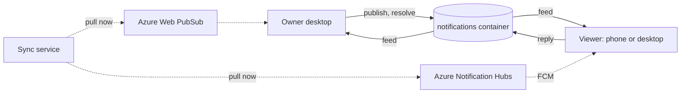

# ADR 0038: Notifications are an owned document kind on their own replica container, and the realtime channel only nudges

```meta
date: 2026-10-22
related: [".devbook/arc42/adr/0005-azure-hosted-task-replica-for-multi-device-sync.md", ".devbook/arc42/adr/0009-captures-are-a-document-kind-on-the-replica.md", ".devbook/arc42/adr/0011-devbook-annotations-are-a-third-replica-container.md", ".devbook/arc42/adr/0014-attachments-travel-through-a-blob-store-beside-the-replica.md", ".devbook/arc42/05-building-block-view.md#cloud-service", ".devbook/arc42/06-runtime-view.md#notification-reply", ".devbook/arc42/08-crosscutting-concepts.md#notifications", ".devbook/domain/notifications/context.md", ".devbook/tech/cloud.md#azure-web-pubsub", ".devbook/tech/cloud.md#azure-notification-hubs"]
```

A notification is a document one desktop instance owns and alone writes. It
travels on a fourth replica container, `notifications`. A viewer instance never
changes a notification: it writes a reply document, and the owner accepts or
rejects it. The realtime channel carries no data. It only tells a device to pull:
Azure Web PubSub for desktops, and Azure Notification Hubs to Firebase Cloud
Messaging (FCM) for the Android phone.

## Status

```meta
```

Proposed, 2026-10-22. Drafted by an unattended `execute-plan` run of the
`+notifications` plan from the agreed proposal *Notifications that ask, and wait
for your answer* (21 October 2026), including its "Settled" list. It waits for the
repository owner's Personal Validation on the draft pull request. Nothing is built.

A **local** decision, numbered in the local sequence. Every bare ADR number below
means the local one. It **extends** ADR 0005 with a fourth replica container,
on ADR 0011's precedent, and builds the Notification Service that the building
block view reserved without deciding.

## Context

**Nothing lets a desktop ask a question and wait for the answer.** Backlog has
toasts, settings badges and confirm dialogs. All of them are local and gone once
dismissed. Impediments, Devbook remarks and Inbox captures each built their own
way to travel between devices. The case that drives this record is a Claude
session on the desktop that needs a decision. It asks through MCP, the phone
buzzes, the person answers on the lock screen, and the session continues.

**Polling is too slow for a waiting question.** All cross-device traffic today is
polling over the Cosmos replica, and the desktop's task exchange runs every five
minutes. That suits tasks. It does not suit an agent that is blocked on an answer.

**The sync service scales to zero.** It runs on Azure Container Apps with
`minReplicas: 0`, so its cost comes from being kept awake. Any channel that holds
a connection open on the sync service keeps a replica running around the clock.

**A replicated document with two writers needs merge rules.** The replica's
precedence rules settle which of two copies wins. They cannot merge a state
change from one device with an answer from another. The Inbox avoided the
problem for captures: the phone proposes, and the desktop decides (ADR 0009).

## Decision

### 1. A notification has exactly one writer, its owner instance

The desktop instance that publishes a notification owns it, identified by its
`DeviceIdentity`. Only the owner changes the notification's state. A second
desktop is a viewer for the first one's notifications and the owner of its own.
No instance takes over another's notifications, even when the owner is unpaired:
those expire.

### 2. A viewer replies by writing a reply document, and the owner decides

A viewer writes a reply document once and never edits it. The owner reads it,
checks it against the question's answer spec, and accepts or rejects it. The first
valid reply the owner processes wins, and the owner rejects the rest. Once the
owner has processed a reply, it deletes the reply document, as the Inbox does with
a capture's tombstone. So every document on the container has one writer, and the
replica needs no merge rule beyond the one ADR 0005 already has.

The sync API accepts a reply only from a device under the same owner. The owner
checks that again before it accepts.

### 3. Notifications get their own replica container

Notification and reply documents live in a fourth Cosmos container,
`notifications`, partitioned on `/ownerId`. They do not ride the `tasks` feed:

- they expire, through Cosmos TTL, 30 days after they close;
- they are high in volume compared with tasks;
- they need a faster exchange cycle than the task feed's.

This is ADR 0011's reasoning for `annotations`. Serverless billing charges nothing
per container to trade against it. The owner keeps SQLite as its local store, as
ADR 0003 does for tasks.

### 4. The feed is the truth, and the realtime channel only nudges



Solid arrows carry documents. Dotted arrows only say "pull now". A device that
misses a nudge still finds every document on its next pull.

- **Desktops** hold a WebSocket to an Azure Web PubSub hub on its Free tier. The
  sync service publishes to the hub when a notification or a reply lands. While a
  question is open, the owner also polls every two minutes as the fallback.
- **The Android phone** receives an OS push. The sync service sends it through
  Azure Notification Hubs on its Free tier, which relays it to FCM. The payload
  carries the notification's id, title and summary, and never its body. A source
  can mark a notification private, and the summary is then replaced too.

Android is the only phone platform. Notification Hubs talks to FCM, so the sync
service never talks to Google. Firebase is a one-time console setup, and its FCM
credential lives only inside the hub.

### 5. Bicep wires a Send-only SAS key into a container app secret

Notification Hubs supports no managed identity. Bicep reads the hub's Send-only
shared access signature (SAS) key and passes it straight into a secret on the sync
container app. No person ever handles the key. It can only send, so it cannot
register devices or read the hub's configuration. Web PubSub takes the sync
service's managed identity, as Cosmos does.

## Consequences

Positive:

- **An agent can wait for an answer from wherever the person is.** The owner
  hears of a reply within seconds, and the sync service still scales to zero.
- **No merge rules.** One writer per document keeps the replica's existing
  precedence rule sufficient.
- **The runtime stays Azure-only.** The sync service talks to Web PubSub and
  Notification Hubs, both through Bicep-provisioned resources.
- **Expected extra spend is about zero.** The Web PubSub Free tier (20
  connections, 20,000 messages a day) and the Notification Hubs Free tier (one
  million pushes a month, 500 devices) cover a personal setup. Cosmos reads for
  the feed cost cents a month on serverless.

Negative, and accepted:

- **A reply counts only when the owner is awake.** While the owner desktop is
  offline, a reply waits on the sync service and viewers show "delivers on wake".
- **One secret in the deployment.** The SAS key is the sync tier's one key-based
  credential beside managed identities. It is Send-only, and no person sees it.
- **Free-tier limits bound the design.** Twenty desktop connections and 500 push
  devices are far above a personal setup, but a shared setup would need a paid tier.
  Check the current tier limits before building.
- **A fourth container and a fourth copy of the exchange loop.** ADR 0011 already
  accepted a third copy. Extraction stays deferred.

## Rejected

- **FCM directly from the sync service, with workload identity federation.** It
  avoids the SAS key, but federating the container app's identity into Google
  Cloud needs `gcloud` and a Google Cloud project. `gcloud` is outside the stack,
  and the runtime would no longer be Azure-only.
- **A server-sent events (SSE) stream on the sync service.** It needs no new
  resource, but each open stream holds a sync replica awake. That ends the
  scale-to-zero that keeps the service free while nobody syncs.
- **Riding the `tasks` container with a `notification` kind token** (the ADR 0009
  pattern). Notifications expire and are high in volume, and the task feed's cycle
  is minutes. The feed would carry two kinds with different retention needs.
- **Two writers per notification, with viewers changing its state.** It would need
  a merge rule for a state change against an answer. The single-writer pattern the
  Inbox already uses removes the question.

## Verification

Nothing is built, so nothing here is proved by a test. When slices 2 and 3 of the
plan land:

- the endpoint tests prove that a reply from a device under another owner is
  refused;
- the owner's unit tests prove that the first valid reply wins and later replies
  are rejected;
- `infra/sync/main.bicep` declares the `notifications` container, the Web PubSub
  hub, and the Notification Hubs namespace with the Send-only key passed as a
  container app secret.

## History

```meta
```

| Date | Change | Why |
| --- | --- | --- |
| 2026-10-22 | Notifications are owned documents on a `notifications` container; Web PubSub and Notification Hubs to FCM only nudge. | A desktop must ask and hear the answer from any device while the sync service keeps scaling to zero. |
