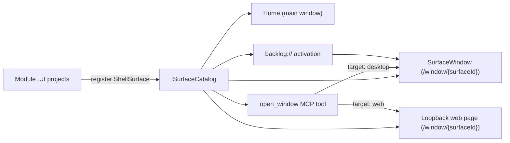

# ADR 0040: A surface can open in its own window, and modules register the surfaces the shell shows

```meta
date: 2026-10-28
status: proposed
related: [".devbook/arc42/adr/0022-the-shell-shows-one-main-view-picked-by-a-view-switch.md#amendment", ".devbook/arc42/adr/0012-backlog-is-an-mcp-server-inside-the-desktop-app.md#1-the-server-lives-in-the-desktop-process-over-streamable-http-on-loopback", ".devbook/arc42/adr/0027-the-brain-is-a-scope-beside-the-repositories.md", ".devbook/arc42/adr/0038-backlog-queues-session-requests-and-a-manager-session-dispatches-them.md", ".devbook/arc42/adr/guidelines/0005-modular-monolith-structure.md#deviations-and-gaps", ".devbook/design/interaction-guidelines.md#shell-header", ".devbook/design/interaction-guidelines.md#workspace-panes"]
```

Each module puts its screen in the desktop shell by registering a **`ShellSurface`** from
its `.UI` project, and one **`ISurfaceCatalog`** holds them all. Any registered surface
can also open in a separate OS window of its own, any number of times, beside the main
window. The same surfaces are served as web pages on the desktop app's loopback
listener, opened by a new `open_window` MCP tool, and reached from a `backlog://` link.
ADR 0022's one main view per window still holds: nothing is placed side by side inside
one window.

## Status

```meta
```

Proposed, 2026-10-28, by the flow-spec run `run-mvsnh91g-sidjhi` that drafted it, the
`adr-pop-out-windows` item (step 1) of the `shell-pop-out-windows` plan, run unattended.
It awaits acceptance at the Personal Validation gate of that run's draft pull request.
The decisions were settled with the repository owner before the plan was imported; this
record writes them down. Not yet built: the plan's later steps build them.

A **local** decision, numbered in the local sequence. Every bare ADR number below means
the local one. It keeps ADR 0022's rule of one main view per window and replaces ADR
0022's rule that the shell lists every surface itself (§1). It adds routes and a tool to
the listener ADR 0012 built, the way ADR 0024 and ADR 0038 did, and changes none of ADR
0012's decisions.

## Context

```meta
```

**One window holds one surface at a time.** ADR 0022 gave the workspace exactly one
main view, and its amendments turned the Inbox and the Devbook into takeovers, because
the repository owner did not want side-by-side panes. A person who reads a chapter while
planning, or watches the roadmap while triaging, switches back and forth. A second OS
window answers that without side-by-side panes inside one window.

**The shell lists every surface itself.** Each surface is a member of the
`WorkspaceSurface` or `ShellView` enum and a branch in `Home.razor`, which also passes
each pane its callbacks, such as `OnOpenTask`. `WorkspaceSurface.cs` calls the enum
deliberate: it keeps the takeovers exclusive for free. Opening a surface anywhere but
`Home` would mean listing it a second time. A module's new screen is a shell edit.

**Modules already register their Settings pages.** A module's `.UI` project registers a
`SettingsSection` (`src/Core/Backlog.SharedKernel/SettingsSection.cs`) in the container,
as `AddInboxSettings` does, and the settings screen draws whatever is registered. The
shell needs no edit for a new page.

**The MAUI head keeps window state process-wide.** `MauiProgram.cs` registers
`WindowStateLifetime` as `Singleton`, so two windows would share one view state. The web
harness already registers it as `Scoped`, one per circuit.

**The desktop app already serves loopback HTTP.** ADR 0012's listener serves `/mcp` on
`127.0.0.1`. Claude Desktop's browser pane can load a page from it, and the management
bots need a way to hand the person a link that opens a surface.

## Decision

```meta
```



### 1. A module registers its surface as a `ShellSurface`

```meta
```

A module puts its screen in the shell by registering a `ShellSurface` record in the
container from its `.UI` project, the way it registers a `SettingsSection` today.
`ShellSurface` lives in `Backlog.SharedKernel` beside `SettingsSection`. It carries:

| Field | Holds |
|---|---|
| Id | A stable string, such as `devbook`. What the route, the tool and the link name. |
| Title | The surface's name in the header and in its window's title. |
| Group | **View** (Tasks, Roadmap, Calendar, Board, Goals) or **takeover** (the rest). |
| `Order` | Its place within its group in the header, lowest first. |
| Component | The component type that renders it. |
| Feature flag | The flag it is offered behind, or none. |
| Query keys | The keys it accepts, such as `plan`, `entry`, `chapter` and `scope` (§6). |

`ISurfaceCatalog` holds the registered surfaces, ordered and filtered by their flags.
`Home`, `SurfaceWindow`, the desktop-served web pages, `open_window` and `backlog://`
activation all read this one catalog. A new module's surface appears in the header and
can pop out without any shell edit. A surface whose flag is off is hidden everywhere the
catalog is read.

The id `proposals` is reserved for the Review pane of the management bots' proposal
queue. Until that pane registers its `ShellSurface`, `proposals` answers "not
available", the same as an unknown id.

### 2. The surface enums are retired; stored names still load

```meta
```

The `WorkspaceSurface` and `ShellView` enums are retired, and surfaces are identified by
their string ids. The `LastSurface` and `LastView` values already stored in
`shell-navigation.json` still load: `ShellNavigationStore` maps each old enum name to the
new id, and ADR 0022 §6's migrations of older files read as before. The group, not an
enum, keeps a takeover exclusive with the main view in a window.

### 3. A jump goes through `ISurfaceNavigator`, scoped to its window

```meta
```

A surface jumps to another, as "Open task" or "Open in Devbook" do, through an
`ISurfaceNavigator` scoped to its window: `Show(surfaceId, query)`. It replaces the
`OnOpenTask`-style callbacks `Home` passes today. A jump stays in the window it was
clicked in: that window switches to the target surface, and its title follows.

### 4. Any surface pops out, as often as asked

```meta
```

Any registered surface can pop out. The trigger is a ⧉ **Open in new window** button
that shows on hover and on keyboard focus of each shell header item. There is no
Shift+click and no context menu.

A surface can be open in the main window and in its own windows at the same time, and
it can have any number of windows: each ⧉ click opens another one. The main window's
header does not change when a surface is popped out.

A popped-out window has a slim header and no view switch. The header shows the surface
title, the repository scope chips, a **Show in main window** control, which switches the
main window to this surface and closes this window, and the OS close button. The window
has no Ask AI; Ask AI stays in the main window only.

### 5. Each window has its own view state; the main window owns the app's life

```meta
```

Each window has its own view state. `WindowStateLifetime` becomes `Scoped` in the MAUI
head, the same as the web harness. Data and change signals stay process-wide singletons,
so a task saved in one window reloads in the others.

Closing the main window quits the app and closes every popped-out window. The layout is
not restored on the next start. Each surface remembers the size and position of its last
popped-out window, and the next pop-out of that surface opens there.

### 6. The route is `/window/{surfaceId}`, with the query keys the surface registered

```meta
```

A popped-out window renders `/window/{surfaceId}`. The query takes the keys the surface
registered:

| Key | Surfaces | Opens |
|---|---|---|
| `plan=<tag>` | Tasks, Roadmap, Board | Filtered to that plan chip. |
| `entry=<id>` | Tasks | That entry in its editor, widening the window's scope to the entry's repository when the entry is outside it. |
| `chapter=<path>`, optional `scope=<owner/name>` or `scope=brain` | Devbook | That chapter of that repository, or that Brain note when `scope=brain` (ADR 0027). Without `scope`, the window's repository scope. |

### 7. The surfaces are served as web pages, opened by `open_window` and `backlog://`

```meta
```

**The web harness opens the route in a new browser tab.**

**The installed desktop app serves `/window/{surfaceId}` as an interactive web page** on
its existing loopback MCP listener (ADR 0012 §1), for Claude Desktop's browser pane. A
web link carries a single-use token, minted by the MCP tool and valid for 10 minutes. The
first load exchanges it for a cookie scoped to that loopback origin.

**A new MCP tool, `open_window(surface, plan?, entry?, chapter?, scope?, target)`.**
`surface` must be a registered id. `target: "desktop"` opens a native window;
`target: "web"` returns a tokenized link and opens nothing. Both answers also carry the
matching `backlog://window/{surfaceId}?…` link.

**A `backlog://` protocol is registered for the installed app.** Activating
`backlog://window/{surfaceId}?plan=…&entry=…&chapter=…&scope=…` opens a native window on
that surface in the running app. A `backlog://` link carries no token, so it stays valid
in a file read days later. Bots write it into briefs and digests, and mint a web link
only in a live session.

**No feature flag.** Pop-out, the routes and the MCP tool are always available. A
surface's own feature flag still hides it everywhere the catalog is read (§1).

## Consequences

```meta
```

Positive:

- **Two surfaces can be read at once** without side-by-side panes inside a window: the
  Devbook in one window, the Roadmap in another, Tasks in the main one.
- **A new module's screen is the module's change alone.** It registers a `ShellSurface`
  and appears in the header, in a window, on the web, in the tool and behind a link.
- **Agents and bots can show the person a surface.** A finished plan links straight to
  its tasks, a brief to the entry or the Review pane, a digest to a Brain note.
- **Jumps stop being shell plumbing.** `ISurfaceNavigator` replaces the callbacks `Home`
  passes each pane.

Negative:

- **`WindowStateLifetime` turning `Scoped` is the riskiest change.** A root-resolved
  worker that holds window state becomes a captive dependency. The plan audits them and
  turns scope validation on in Debug.
- **Exclusivity is no longer free.** The enum kept a takeover from coexisting with the
  main view by construction; now the group field and the catalog keep it, and a test has
  to.
- **The loopback listener serves interactive pages.** It grows from an MCP endpoint into
  a Blazor Server host for the browser pane, guarded by a token and a cookie besides
  ADR 0012's `Origin` check.
- **Places that assume one window must change**: the single notification-centre
  listener, and the `FirstOrDefault()` window lookups behind app notifications and the
  Brain folder picker.

Neutral:

- **Nothing reopens at start.** Only each surface's last window bounds are remembered.
- **The phone is unchanged.** This record is about the desktop shell and the pages it
  serves.

## Rejected

```meta
```

- **Side-by-side panes inside one window.** ADR 0022 and its amendments removed them,
  and the repository owner did not want them back.
- **One window per surface, focused on a second ⧉.** A person may want the same surface
  twice, on two plans or two chapters; every click opens another window.
- **Shift+click or a context menu to pop out.** Neither is discoverable, and a button on
  hover and focus reaches keyboard users too.
- **Keeping the enums and listing each surface in the shell.** Every window, page, tool
  and link would need its own copy of the list, and a module's screen would stay a shell
  edit.
- **Restoring the window layout at start.** A layout of several windows across monitors
  that changed is more often wrong than right. Each surface's last bounds are enough.
- **Tokens in `backlog://` links.** A 10-minute token is dead in a digest read the next
  morning. The protocol opens only the installed app, so it needs none.
- **A feature flag for pop-out.** It adds no surface and removes none; a surface's own
  flag still governs where it shows.

## History

```meta
```

| Date | Change | Why |
| --- | --- | --- |
| 2026-10-29 | §1, §2, §3 and §6 built for the takeovers, and the one-window spots of the Consequences fixed. The Inbox (`AddInboxSurface`), Sessions (`AddSessionsSurface`, accepting `session=<id>`), the Dashboard (`AddDashboardSurface`), the notification centre (`AddNotificationsSurface`, accepting `notification=<id>`) and Tools (`AddToolsSurface`) register from their modules' `.UI` projects, each a takeover-group `ShellSurface` behind the flag its header option gated on. The pull requests list (`AddPullRequestsSurface`, accepting `pullRequest=<owner/name#number>`) registers from `Backlog.Desktop.UI`, beside the host's GitHub reads its pane needs, which no module `.UI` project may reference. `ShellSurface` gains `EscapeCloses`, off for the Inbox alone, whose keys keep Escape. `Home` renders the takeover on screen from the catalog through `DynamicComponent` and keeps each header option in its group; the `WorkspaceSurface` enum and the takeover `if` chain are retired, and one field holds the takeover's id. `lastSurface` holds that id, and `ShellNavigationStore.RetiredSurfaceNames` reads each old member name as its id and `Workspace` as none. What a takeover reads of its window — the repository scope and hues, the entries a session or a pull request names, a pull request's chip, the Inbox's Capture — comes through window-scoped wiring the host builds from the window's own state (`AddShellSurfaceWiring`), so a takeover draws the same in a window of its own; the Dashboard's Ask AI is added by the main window's shell only. Their jumps — an entry, a session, the Dashboard's Sessions link — go through `ISurfaceNavigator`. `NotificationCentreRequests` keeps every listener, so a centre open in a window of its own follows a Windows notification's press too; a press no shell heard is still kept for the next. App notifications activate the main window through `ShellWindows.MainWindow`, and the Brain folder picker, now one per window, stands over the window whose scope asked, named by `CurrentShellWindow`. `app.js`'s document-level Escape listener stays one owner per WebView: only the main window's shell registers, and a popped-out window marks nothing for it. The six header options carry no ⧉ yet. | Step 7 of the plan, `takeover-windows`. |
| 2026-10-29 | §7's web page built, in a Debug build only: the loopback listener of ADR 0012 §1 serves `/window/{surfaceId}` as an interactive server page, `SurfaceWindowDocument` around `SurfaceWindowHost`, which renders `SurfaceWindow` under the main layout without a router, so the listener answers no other page of the shell. The listener forwards every service the head composed, each singleton handed over as the instance so a page never disposes it, and one desktop scope per circuit, so a page has a window's own view state. In such a page `IShellWindows` is `BrowserTabShellWindows`, which opens a new tab; it lives in `Backlog.Desktop.UI`, and the web harness registers the same class in place of its own step-9 copy. The listener serves `app.js`, `components.js`, the module scripts, the CSS and `blazor.web.js` from the head's `wwwroot`. `/mcp` and the routes beside it keep the bearer token and the `Origin` check. A page and its files are held to the `Origin` check and a loopback `Host`, and carry no token until step 11's link token. A Release build maps none of this. | Step 10 of the plan, `desktop-web-pop-out`. |
| 2026-10-29 | §7's first line built: the web harness answers `IShellWindows` with `BrowserTabShellWindows`, one per circuit, so its header draws the ⧉ too, and a press opens `/window/{surfaceId}` with its query in a new browser tab. Each tab is a circuit and so a scope of its own, which is all §5's own view state asks. A browser keeps the rest from a page: a tab is opened under no window key, so `SurfaceWindow` asks to close or retitle none, and no tab can bring another to the front, so **Show in main window** switches the main-window tab whose shell attached last and leaves this tab open. | Step 9 of the plan, `harness-tabs`. |
| 2026-10-29 | §1, §2, §3 and §6 built for the five views: Tasks, Board and Calendar register from the Tasks module's `.UI` project (`AddTasksSurfaces`), the Roadmap from the Roadmap's (`AddRoadmapSurface`, behind its flag) and Goals from Progress's (`AddGoalsSurface`), each a view-group `ShellSurface`. `Home` renders the main view from the catalog through `DynamicComponent` and names none of their panes; what only the shell holds — a task's Brain badges, scenario screenshots and sessions and pull requests — reaches the Tasks views through the window's `TasksViewWiring`, and the Goals view's candidates through the window's `IGoalsViewSource`. Their jumps — a session, a Devbook reference, a Brain note, the roadmap's Open in Tasks — go through `ISurfaceNavigator`. `plan=<tag>` opens Tasks and Board on that plan chip through `TasksDesktopState.ShowPlan` and the Roadmap with that item's bar selected; Tasks also accepts `linked=<id>`, the roadmap item's linked task, beside it. `entry=<id>` opens the entry in its editor, widening the window's scope to the entry's repository, and an id the backlog does not hold opens Tasks with a toast. A query is followed once per request. The `ShellView` enum is retired: `lastView` holds the view's id, and `ShellNavigationStore` reads each old member name, and `InProgress`, as its id. A popped-out window loads its own task list. The view options carry no ⧉ yet, and `WorkspaceSurface` remains until step 7. | Step 6 of the plan, `view-windows`. |
| 2026-10-29 | §4's trigger built: every header item `Home` draws from the catalog carries a ⧉ **Open in new window** button, shown on hover and on keyboard focus and named `Open <surface> in a new window`, and each press asks `IShellWindows` for one more window on the surface's scope alone, leaving the main window as it was. A host that composes no `IShellWindows` draws no ⧉. §6's `chapter` query built in `DevbookSurface`: `scope=<owner/name>` resolves to that repository, `scope=brain` opens the Brain note at the path, and no `scope` reads the window's repository scope through `IDevbookWindowScope`, which the host answers from the window's own view state. The Devbook is still the only surface registered, so it is the one item with the button. | Step 5 of the plan, `devbook-window`. |
| 2026-10-29 | §4 and §5's windows built in the desktop head: `IShellWindows`, answered by the head's `ShellWindows`, opens `/window/{surfaceId}` in a window of its own, and every window's close flushes `ShellNavigationStore`; closing the main window closes the others and quits. `SurfaceWindow` draws the slim header and the surface from the catalog with the keys it registered, answers an unknown id or `proposals` as not available, and switches on a jump. The Devbook opens a `chapter` that comes without the main window's `request` token as a press of its own. A jump to a surface the catalog cannot show yet goes to the main window, and **Show in main window** reaches it through `MainWindowSurfaces`, which `Home` attaches to. Nothing opens a window yet: the ⧉ button is step 5. | Step 4 of the plan, `window-host`. |
| 2026-10-29 | §1 and §3 built for the first surface: `ShellSurface`, `ISurfaceCatalog` and `ISurfaceNavigator` are in `Backlog.SharedKernel`, and the Devbook registers through `AddDevbookSurface()`. `Home` draws the Devbook's header option from the catalog and renders it through `DynamicComponent`, and the Devbook's jumps go through the navigator. Besides `chapter` and `scope`, the Devbook accepts `switch` and `request`, which the main window's shell sets. The other surfaces keep their `Home` branches, and the enums of §2 remain, until steps 6 and 7. | Step 3 of the plan, `surface-catalog`. |
| 2026-10-28 | Proposed: modules register `ShellSurface`s in one catalog, any surface pops out into its own windows, and the loopback listener, `open_window` and `backlog://` open them. | A person wants two surfaces at once without side-by-side panes, and the bots need links that open a surface. |
| 2026-10-28 | §5's window state built: `WindowStateLifetime` is `Scoped` in the MAUI head, and a Debug build validates scopes at start. The audit found no root-resolved worker holding window state, so no new seam was needed. | Step 2 of the plan, `scoped-window-state`. |
