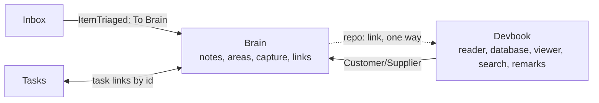

# ADR 0040: The Brain is its own bounded context

```meta
date: 2026-10-29
related: [".devbook/domain/brain/context.md", ".devbook/domain/devbook/context.md", ".devbook/domain/context-map.md", ".devbook/arc42/adr/0026-the-brain-is-a-personal-devbook-outside-any-repository.md", ".devbook/arc42/adr/0027-the-brain-is-a-scope-beside-the-repositories.md", ".devbook/arc42/adr/0016-knowledge-folders-adopt-the-devbook-convention.md"]
```

The Brain is a bounded context of its own, beside Devbook. It may link into a
repository's devbook, and it reads its notes with Devbook's machinery, but its
model, language and rules are its own.

## Status

```meta
```

Proposed, 2026-10-29. A specification change only: the domain chapters move to
`.devbook/domain/brain/`, and no code moves yet. The Brain's code stays in
`Backlog.Modules.Devbook.*` until a later `flow-code` change moves it into a
module of its own.

A **local** decision, numbered in the local sequence. Every bare ADR number below
means the local one.

It **supersedes in part** ADR 0026: the Brain's place inside the Devbook
boundary, which that record took by reusing the devbook machinery. The rest of
ADR 0026 stands, and so does ADR 0027.

## Context

```meta
```

**ADR 0026 put the Brain inside Devbook to reuse its machinery.** A Brain note is
a devbook chapter with three more fields, so reading, the database build,
rendering, links and remarks came for free. The Devbook context then held two
models: a repository's devbook, and one person's notes.

**The two have different owners.** A repository owns its devbook. It changes
through pull requests and is shared with everyone who reads the repository. The
Brain is one person's. That person and their agent curate its structure, add top
folders at will, and decide which ones are hidden (ADR 0026 §2).

**The two speak different languages.** The Brain's words are note, area, PARA,
capture, journal, Ignore and Show hidden. A repository devbook's words are
chapter, status, decision state, sync verdict, scenario and branch snapshot. Few
Brain rules apply to a repository chapter, and few repository rules apply to a
Brain note: a note is always editable, has no status gate, and never takes a
sync verdict.

**The links between them run one way.** A Brain note links into a repository
chapter with `repo:`. No repository devbook links into a Brain (ADR 0027 §6), and
the backlinks a chapter shows are read from the owner's Brain and never written
into the repository.

**The Brain has neighbours Devbook does not.** The Inbox routes items **To
Brain**. A note names Tasks by id, and a task row counts the notes that name it.
Neither relationship concerns a repository's devbook.

## Decision

```meta
```



### 1. The Brain is a bounded context

```meta
```

The Brain owns the Knowledge Note and its value objects, the areas, the Brain
folder setting, capture, the Brain scope, the Brain mode of the Devbook pane,
repo links and their backlinks, task links, and the Brain's MCP scope. Its
chapters live in `.devbook/domain/brain/`. It is a Core subdomain, as Devbook is.

### 2. Devbook supplies the reading machinery, as Customer/Supplier

```meta
```

Devbook is upstream and the Brain is its customer. Devbook supplies the Markdown
and `meta` reader, the database builder and refresher, the chapter viewer,
search and remarks. The Brain conforms to the devbook convention (ADR 0016) as a
published language.

It is not a Shared Kernel. A shared kernel is co-owned: each change to it needs
both contexts' agreement. The reader serves repositories first, and a devbook
release changes it on the repository's terms. The Brain's own needs, its three
fields (`para`, `repos`, `tasks`), its areas and its `Ignore` list, enter through a
hook Devbook offers, and Devbook knows no PARA, area or capture.

### 3. The planning fields stay Devbook's

```meta
```

`effort` and the `roadmap` list are fields any devbook chapter may carry. Devbook
registers them, and a Brain note carries them as any chapter does. They move from
the Knowledge Note to Devbook's shared value objects.

### 4. Links stay one way, and neighbours follow the Brain

```meta
```

The `repo:` link is a one-way reference from the Brain into Devbook. The Inbox's
**To Brain** route and the Tasks partnership now name the Brain, not Devbook.

## Consequences

```meta
```

Positive:

- **Each context has one language.** Devbook's chapters describe a repository's
  devbook, and the Brain's describe one person's notes.
- **The Brain can change without a repository rule.** A new area rule or a
  capture source touches the Brain only.
- **The neighbours are explicit.** The Inbox, Tasks and Devbook edges are on the
  context map.

Negative:

- **The code still sits in Devbook.** Until the code move, `Backlog.Modules.Devbook.*`
  holds the Brain's types, and `DevbookGraphBuilder` applies the Brain's fields.
- **One feature spans both.** The Brain mode of the Devbook pane is the Brain's
  feature on Devbook's pane, behind Devbook's `repository-devbook` flag.

Neutral:

- **No behaviour changes.** Every requirement and invariant keeps its words and
  its tests; only its address changes.

## Rejected

```meta
```

- **Keep the Brain inside Devbook, as ADR 0026 chose.** It keeps two models and
  two languages in one boundary, and lets a repository rule leak onto personal
  notes or the reverse.
- **A Shared Kernel for the reader and the database.** It would make every devbook
  convention release a joint change, for a reader the Brain only consumes.
- **A Brain reader of its own.** It would copy the parser, the builder and the
  viewer, and the two would drift.

## Verification

```meta
```

Look for these in the specification and, after the code move, in the code:

1. **No Brain chapter under Devbook.** `.devbook/domain/devbook/` holds no
   Knowledge Note, area, capture or Brain requirement.
2. **Devbook knows no Brain words.** After the code move, no Devbook type names a
   PARA area, the `Ignore` list or capture.
3. **Links run one way.** No repository chapter links into the Brain.

## History

```meta
```

| Date | Change | Why |
| --- | --- | --- |
| 2026-10-29 | Proposed: the Brain leaves the Devbook context for one of its own, downstream of Devbook as Customer/Supplier. | The Brain has its own owner, language and neighbours, and its folders became the person's to curate (ADR 0026, amended 2026-10-28). |
