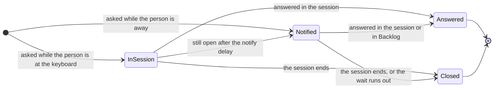
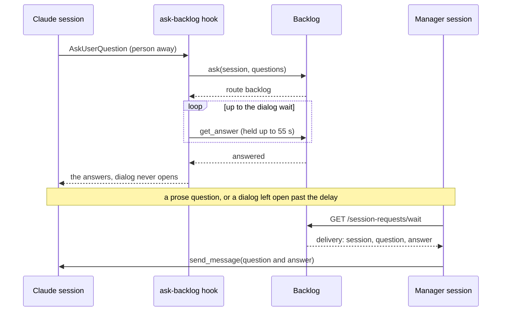

# ADR 0041: Agent questions reach Backlog by presence and come back through the hook or the Manager

```meta
date: 2026-10-27
status: proposed
roadmap: [question-relay]
related: [".devbook/arc42/adr/0012-backlog-is-an-mcp-server-inside-the-desktop-app.md", ".devbook/arc42/adr/0024-claude-code-telemetry-arrives-on-the-mcp-listener.md", ".devbook/arc42/adr/0038-backlog-queues-session-requests-and-a-manager-session-dispatches-them.md", ".devbook/arc42/adr/0039-notifications-are-an-owned-document-kind-and-push-only-nudges.md", ".devbook/arc42/08-crosscutting-concepts.md#notifications", ".devbook/domain/sessions/domain.md#question-relay", ".devbook/domain/sessions/domain.md#waiting-question", ".devbook/domain/sessions/domain.md#presence", ".devbook/domain/sessions/domain.md#session-state", ".devbook/domain/sessions/domain.invariants.md#question-relay", ".devbook/domain/sessions/requirements.md#answer-a-sessions-question-from-elsewhere", ".devbook/domain/sessions/features.md#answer-a-sessions-question-from-elsewhere", ".devbook/domain/notifications/context.md"]
```

A question a Claude session asks is registered with Backlog through MCP `ask`, as a
**waiting question** of the Sessions context. Backlog decides from the person's
**presence** whether it stays in the session for now or becomes a notification at
once. An answer given in Backlog returns one of two ways: the `PreToolUse` hook hands
it to a question dialog that is still held, or the Manager session sends it to the
session as a message. The relay sits behind the existing `notifications` flag.

## Status

```meta
```

Proposed, 2026-10-27. Drafted by an unattended `execute-plan` run of the
`+question-relay` plan, its `record-decision` item, from the agreed design note
*Backlog Question Relay* (revised 21 October 2026). It waits for the repository
owner's Personal Validation on the draft pull request. Not yet built: the plan's
later items build presence, the waiting question, the MCP changes, the deliveries,
the hook script and its install.

A **local** decision, numbered in the local sequence. Every bare ADR number below
means the local one. It amends ADR 0039's MCP tools and ADR 0038's wait route and
capacity rule, as [Amends](#amends) names them. The rest of both records stands.

## Context

```meta
```

**A session that waits on the person stops while they are away.** A Claude session
asks in one of two ways. It opens a question dialog (`AskUserQuestion`) mid-turn, and
the turn waits on it. Or it ends its turn with a question in prose, and the session
sits idle. Either way, nothing moves until the person is back at that desktop.

**Notifications already ask and wait.** ADR 0039 lets a desktop publish a question
and hear the answer from the phone or another desktop. The MCP server publishes
through it with `ask`, `get_answer` and `close`. What is missing is the decision of
*when* a session's question should leave the session, and a way to put the answer
back in.

**Asking elsewhere while the person is at the keyboard is noise.** A question the
person is about to answer in the session should not buzz their phone. Only the
desktop can tell whether they are at the keyboard.

**Only a hook can answer a dialog, and only before it opens.** A `PreToolUse` hook
on `AskUserQuestion` may return the tool's answers in place of the dialog. Once the
dialog is open, no hook reaches it. An idle session is woken only by a new message.

**The Manager already reaches every Claude Desktop session.** ADR 0038's Manager
waits on a long poll on the MCP listener and can send a message to any session it
can see.

## Decision

```meta
```



### 1. A session's question is registered through MCP `ask` and Backlog picks the route

```meta
```

A question dialog, or a question in prose at the end of a turn, is registered with
Backlog through MCP `ask` with the session's id. The call creates a
[Waiting Question](../../domain/sessions/domain.md#waiting-question) in the Sessions
context and answers with its route:

- **Away.** The person is away when there has been no keyboard or mouse input for
  10 minutes, or while the screen is locked. A question asked then becomes a
  notification at once.
- **At the keyboard.** Otherwise the question stays in the session. Backlog keeps it
  quietly and publishes it only if it is still unanswered after 15 minutes.

Backlog decides the route because only the desktop knows where the person is. The
caller passes the question and never a route. The away threshold, the notify delay
and the dialog wait of §3 are desktop settings, with these defaults.

A dialog holds one to four questions. The relay publishes one notification per
question under the same session subject, and the dialog is answered once all of them
are.

### 2. Coming back never takes a question back

```meta
```

A question that became a notification stays one when the person returns to the
keyboard. Opening Backlog to answer it is input too, so such a rule would close the
question as the person reached for it. Answering in the session closes it instead,
and the notification then shows where it was answered.

### 3. The answer comes back through the hook or through a delivery

```meta
```



- **A dialog asked while the person is away** is answered by the `PreToolUse` hook.
  The hook keeps the dialog from opening and long-polls `get_answer` for up to the
  dialog wait, 8 hours by default. When an answer comes, the hook returns it as the
  tool's answers. When the wait runs out, or Backlog stops answering, the hook exits
  without output and the dialog opens.
- **A dialog left open past the notify delay, and a prose question,** are answered
  through a **delivery**. Backlog records the answer as a delivery for the session.
  The Manager claims it from the dispatch wait route and sends the answer to the
  session with `send_message`, which wakes an idle session.

What that message does to a dialog still open is accepted as found. The plan's
end-to-end check records it, and this record does not promise it.

The Manager never answers a question itself and never writes its message from
anything but the stored question and the accepted answer. A session the Manager
cannot reach, such as a CLI session, gets its answer only through the hook or in the
session.

### 4. The desktop app ships the hook script and installs it beside the user-scope `backlog` server

```meta
```

The hook script is shipped and served by the Backlog desktop app, which writes it to
its own folder on every start, so it updates with the app. The hooks are installed
only at the user scope of the `backlog` MCP server registration of ADR 0012 §3, by
the Dev PC catalog's `backlog` row. A repository that registers the server in its
own `.mcp.json`, as this one does, lists no hooks in its project settings. User-scope
hooks already fire in every repository on the machine, so repository entries only
run each hook twice. They would also fire for every contributor, CI run and
sub-agent that checks the repository out, and fail with a hook error wherever no
release Backlog is installed. The `backlog-tools` plugin does not ship the script. A
person with no user-scope `backlog` registration gets no hooks; `ask` stays
idempotent per session and tool use, so hooks a person adds at a second scope do no
harm.

### 5. The relay sits behind the `notifications` flag

```meta
```

The relay adds no flag of its own. With `notifications` off, `ask` answers that
notifications are not available, as it does today. The hook then exits without
output and the session asks in place.

## Amends

```meta
```

This record amends, without rewriting them:

- **ADR 0039, the MCP tools** its Notifications context publishes through:
  - `ask` takes the session's id and a list of questions in the dialog's shape, or
    one free-text question. With a session, the call goes through the relay of §1
    and answers the route, the waiting question's id and the dialog wait. Without
    one, it behaves as before.
  - `get_answer` holds the call for at most 55 seconds and answers the moment the
    owner accepts a reply. That keeps one call under Claude Code's two-minute
    background limit and five-minute idle limit for an MCP call.
  - `close` also takes a waiting question's id, and gains three reasons:
    answered in the session, with the answers shown on every viewer; timed out;
    and session ended.
- **ADR 0038, the dispatch wait route and its capacity:**
  - `GET /session-requests/wait` also hands out deliveries, as items of kind
    `delivery` with the session id, the question and the answer. A delivery comes
    before a new session request, because its session already holds a worktree. A
    delivery is claimed and marked through its own tools under the same two-minute
    lease, so the session request states stay as ADR 0038 records them.
  - A session waiting on a question counts as waiting, not working, so waiting
    sessions do not hold up the queue.

## Consequences

```meta
```

Positive:

- **A session no longer stops for good while the person is away.** Its question
  reaches the phone, and the answer gets back into the session.
- **Nothing changes at the keyboard.** A question the person answers within the
  notify delay never leaves the session.
- **An idle session waits for free.** A prose question costs no model turn while it
  waits, because the Manager wakes the session only once an answer exists.
- **The hook reaches every session with the server**, the plugin installed or not,
  and updates with the app.

Negative, and accepted:

- **A dialog asked while the person is away holds a hook process** for up to the
  dialog wait. Claude Code documents no maximum hook timeout, so the end-to-end
  check proves 8 hours holds.
- **Someone has to run the Manager.** A delivery made while none runs waits in
  Backlog until one starts, or until the person answers in the session.
- **The effect of a message on an open dialog is unknown.** It is accepted as found.
- **A CLI session gets only the hook.** Its prose questions are notified, but the
  answer waits until the person answers in the session.

Neutral:

- **The Sessions context gains a waiting state.** An open waiting question makes a
  session read Waiting, which the context could not derive before.

## Rejected

```meta
```

- **A question store of the relay's own.** Notifications already holds the question,
  its answer and its replay after a restart.
- **MCP channels to push the answer into the session.** They need a research-preview
  flag and a stateful MCP session. The Manager's message wakes an idle session
  without either.
- **Holding the turn in a `Stop` hook.** The Manager answers a stopped session, so
  nothing needs to hold one.
- **Claude polling `get_answer` itself.** Each poll is a model turn. Ending the turn
  and being woken costs nothing while it waits.
- **Taking a question back when the person returns.** Opening Backlog to answer is
  input too, so the question would close as the person reached for it.
- **A flag of the relay's own.** The relay is part of asking through notifications,
  and a second switch would only add a combination nobody wants.
- **The hook in the `backlog-tools` plugin.** It would reach only sessions with the
  plugin installed, and would update with the plugin rather than with the app it
  talks to.

## History

```meta
```

| Date | Change | Why |
| --- | --- | --- |
| 2026-10-27 | Proposed: a session's question is registered through MCP `ask`, routed by presence, and answered through the hook or a Manager delivery. Amends ADR 0039's MCP tools and ADR 0038's wait route and capacity rule. | A session that asks while the person is away stops until they come back, and Notifications and the Manager already carry the rest. |
