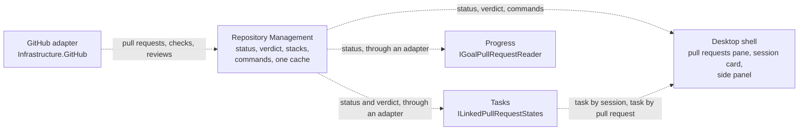

# ADR 0042: Repository Management owns pull-request state, and every reader goes through its one contract

```meta
date: 2026-10-29
status: proposed
related: [".devbook/domain/repository-management/context.md", ".devbook/domain/repository-management/features.md#pull-request-readiness", ".devbook/domain/repository-management/features.md#one-verdict-per-pull-request", ".devbook/domain/repository-management/features.md#github-integration", ".devbook/domain/repository-management/requirements.md#archiving-a-repository", ".devbook/domain/context-map.md", ".devbook/domain/sessions/context.md", ".devbook/domain/tasks/dependencies.md", ".devbook/domain/progress/dependencies.md", ".devbook/domain/progress/features.md#pull-request-status", ".devbook/arc42/adr/0020-external-items-arrive-as-linked-tasks.md", ".devbook/arc42/adr/0022-the-shell-shows-one-main-view-picked-by-a-view-switch.md", ".devbook/arc42/adr/0028-progress-is-its-own-boundary-and-tasks-knows-no-sprints.md", ".devbook/arc42/adr/0029-an-archived-repository-stays-in-the-registry.md", ".devbook/arc42/adr/0031-github-calls-resolve-their-account-per-repository-and-never-store-a-gh-token.md", ".devbook/arc42/adr/0035-goals-and-impediments-replace-sprints.md", ".devbook/arc42/adr/0037-a-session-attaches-to-a-goal-as-its-own-item.md", ".devbook/arc42/adr/guidelines/0009-feature-slices-module-structure.md", ".devbook/arc42/08-crosscutting-concepts.md#feature-enablement", ".devbook/arc42/12-glossary.md#terms"]
```

Repository Management owns the state of every pull request Backlog reads. It owns
each pull request's status, its readiness verdict, the stack it sits in, the
commands that act on it, and the one cache that keeps what GitHub said. It publishes
one contract for all of that. Tasks, Progress, the session list, the pull requests
pane and the shell read pull requests only through that contract, and Tasks
publishes the reverse lookup from a session or a pull request to its task.

## Status

```meta
```

Proposed, 2026-10-29, by the flow-spec run `run-mvsplf7t-pr55za` that drafted it. It
awaits acceptance at the Personal Validation gate of that run's pull request. Not
yet built: a later flow-code run builds the module, the ports and the adapters, and
moves the code named below.

A **local** decision, numbered in the local sequence. Every bare ADR number below
means the local one. It adds a boundary and supersedes nothing. It amends one edge
of ADR 0035 §7: Progress reads pull-request status through this contract, not from
GitHub directly (§4).

## Context

```meta
```

Code paths below are as they stand at commit `ada521c6a`.

**No module owns pull-request state.** The pull requests pane and its rules live in
the desktop shell, under `src/App/Backlog.Desktop.UI/PullRequests/`:
`PullRequestVerdict`, `PullRequestStacks`, `PullRequestMerge`,
`PullRequestTaskMatcher`, `SessionPullRequestStatuses`, `PullRequestStatusLines`,
`PullRequestSubjects`, `PullRequestLabelFilter` and `PullRequestsPane.razor`. They
sit straight on `GitHubIntegration`. The verdict precedence, the stacks and the
merge commands are domain behaviour, yet no bounded context holds them. The pane's
flag, `pull-requests`, is declared on `SessionFeatures`
(`Backlog.Modules.Sessions.Abstractions/SessionFeatures.cs:45`).

**One pull request is read five ways.**

| # | Reader | Through | Serves |
| --- | --- | --- | --- |
| 1 | `PullRequestVerdict` | the pane's own list read | the pane and the session cards |
| 2 | `WorkInProgressReader` | `GitHubIntegration.ReadLinkedPullRequestsAsync`, one `GitHubLinkedPullRequestCache` | a task's side panel |
| 3 | `GitHubGoalPullRequests` | `GitHubIntegration.ReadLinkedPullRequestStatusesAsync`, a second `GitHubLinkedPullRequestCache` | Progress, as `IGoalPullRequestReader` |
| 4 | `TasksDesktopState` | `ListLinkedPullRequestsAsync` (~4754), `ReadPullRequestStatusAsync` and `ReadPullRequestAsync` (~5158–5191) | the task row's badge, the merge offer and the prompt entry's auto-Done |
| 5 | `IPullRequestStateMemory` | `Infrastructure.FileSystem/Workspace/PullRequestStateMemory.cs` | Tasks' merged and closed outcomes across a restart |

Each reading maps GitHub's answer on its own. The task row maps its own badge
(`TasksPane.razor` ~1849–1910). `PullRequestMergeOffer.cs` (`PullRequestMergeAct`)
repeats the shell's `PullRequestMerge`. So the same pull request can read Ready in the
pane and something else on its task.

**Tasks reads GitHub directly.** `Backlog.Modules.Tasks.UI.csproj:48` references
`Backlog.Infrastructure.GitHub`. `TasksDesktopState` merges and switches auto-merge
through it (~5237–5243). The boundary tests allow it: a module screen may take an
adapter (`ModuleBoundaryTests.A_module_ui_may_take_an_adapter_but_never_another_modules_implementation`).

**The shell resolves task links from Tasks' screen state.** `Home.razor`
(~1811–1938) builds `PullRequestTaskMatcher` from `TasksDesktopState.Rows`, and
`WorkInProgressReader.From` reads the same rows. The shell reaches into another
module's screen state rather than asking its published surface.

## Decision

```meta
```



Every edge is dashed because none is built yet. Tasks and Progress never reference
Repository Management's surface themselves: an adapter under
`src/Infrastructure/` answers each module's own port, as `ModuleBoundaryTests.A_module_ui_asks_only_its_own_modules_published_surface`
requires.

### 1. Repository Management owns pull-request state

```meta
```

Repository Management becomes the owner of pull-request state. Its subject was the
inventory and health of the registered repositories. It widens to the readiness and
merge of their pull requests. The health it already lists, open pull requests and
their age per repository, stays a count over the same reads.

Three things make it the owner rather than a context of its own:

- A pull request belongs to a repository, and the context already reaches GitHub for
  each registered repository ([GitHub integration](../../domain/repository-management/features.md#github-integration)),
  with the account that repository resolves to (ADR 0031).
- Whether a pull request is read at all is its call already: an archived repository's
  pull requests are not read (ADR 0029). This context becomes the one place that
  applies that rule to pull requests.
- The pane's features move here from Sessions, under
  [Pull request readiness](../../domain/repository-management/features.md#pull-request-readiness).

Repository Management has no module in `src/` today. This record introduces one,
laid out by feature slices (guidelines ADR 0009): a published surface the other
contexts' adapters read, and an implementation that holds the rules. The project and
type names are the building run's.

### 2. One published contract for status and verdict

```meta
```

The contract publishes one status shape per pull request and one verdict over it.

| The status carries | Meaning |
| --- | --- |
| State | open, draft, merged or closed, and the merge day |
| Checks | passed, total, running and failed |
| Approvals | approvals given, and approvals required by the base branch's rules |
| Mergeable | whether GitHub reports conflicts |
| Behind by | commits the base has that the branch does not, where GitHub can tell |
| Auto-merge | whether GitHub holds an auto-merge request |
| Stack parent | the open pull request this one is stacked on, if any |

The checks and approvals marks move here from Progress. ADR 0035 §7 defined them, and
they are now this context's published status shape. Progress's rows show the status
Repository Management publishes.

**One verdict function.** The contract offers one function from a status to its
[readiness verdict](../../domain/repository-management/features.md#one-verdict-per-pull-request),
with its lane, tone and acts. The pane, the session card and the task row all call it.
The precedence lives in that feature, not in this record.

### 3. One set of commands and one cache

```meta
```

**Commands.** The contract offers the acts a verdict names: merge, auto-merge on,
auto-merge off, update branch, mark ready for review and re-run failed. Each command
reads its repository again once it returns, so every reader sees the new state. No
other code sends these to GitHub.

**One cache** replaces the two `GitHubLinkedPullRequestCache` instances and Tasks'
`IPullRequestStateMemory`. It keeps the freshness rules those already follow:

- A merged pull request cannot change again. It is read once and kept, and it is
  remembered across a restart in app storage, as a
  [settled-fact cache](../12-glossary.md#terms).
- A number GitHub answers without is not asked about again.
- Any other answer is reused for one minute, the `FreshFor` both readers use today.
  A read still out within that minute is waited on rather than sent twice.
- A closed pull request is asked about again, because GitHub can reopen it.
- A refused read is kept nowhere, so the next read asks again.

Only the end state is remembered across a restart. Checks, reviews and the
auto-merge request are never persisted, because a stale one would offer a merge that
GitHub no longer allows. Which of a task's entries a merge has already finished is
Tasks' own fact. It stays with Tasks and does not move into this cache.

### 4. Tasks reads pull requests through its own port

```meta
```

Tasks gains a port in `Backlog.Modules.Tasks.Abstractions`, `ILinkedPullRequestStates`,
shaped like `ILinkedSessionStates`. Tasks keeps its own small record of what it
needs: the state, the verdict's label and tone, and for a merge the base and default
branch. The same port carries the merge and auto-merge commands the task row offers.
An adapter under `src/Infrastructure/Backlog.Infrastructure.FileSystem/Tasks/`,
beside `LinkedSessionStates.cs`, translates from Repository Management's contract.

The row's badge, the merge offer and the prompt entry's auto-Done read through this
port. `PullRequestMergeAct` and the row's own badge mapping retire. A host that
composes no Repository Management answers nothing, and a badge with no state draws
as it did before it had one.

### 5. Progress's reader goes through the contract

```meta
```

Progress keeps `IGoalPullRequestReader`. Its adapter,
`Infrastructure.FileSystem/Progress/GitHubGoalPullRequests.cs`, stops calling
`GitHubIntegration` and reads Repository Management's contract instead. That amends
ADR 0035 §7's edge from GitHub to Progress: GitHub now reaches Progress through this
context. The goal rows, the stand-up and the `stand-up-context` document of ADR 0035
§8 read the same status they read today.

### 6. The pull requests pane and the session card read the contract

```meta
```

The pane becomes Repository Management's screen. Its rules move into the module: the
verdict, the stacks, the merge commands, the status lines, the subjects and the
label filter. Whether its markup lives in the module's own screen project or stays in
the shell is the building run's call. It keeps its place in the shell's work in
progress group (ADR 0022).

The session list's pull request card asks the contract for its verdict, through the
shell, which composes the card. The task card and the session card inside a pull
request's detail panel are composed by the shell too. So no module screen references
another context's screen, and Sessions and Repository Management form no cycle.
Sessions still owns no work item and publishes no pull-request contract.

A task's side panel reads its linked pull requests through the same cache, so the
side panel and Progress share one read per pull request.

### 7. The flag `pull-requests` moves owner and keeps its key

```meta
```

The flag that gates the pane moves from `SessionFeatures.PullRequests` to Repository
Management's own feature declarations. Its key stays `pull-requests`. A person's
choice is stored under that key in `features.json`, so renaming it would turn the
pane off for everyone who had it on
([Feature Enablement](../08-crosscutting-concepts.md#feature-enablement)). The flag's
chapter moves to `domain/repository-management/context.md`.

### 8. No module screen reads pull-request state from the GitHub adapter

```meta
```

A module's `.UI` project reads pull-request state and runs pull-request commands only
through its own module's port. It never calls a pull-request member of
`Backlog.Infrastructure.GitHub`. This narrows the boundary rule that lets a screen
take an adapter.

`Backlog.Modules.Tasks.UI` keeps its reference to `Backlog.Infrastructure.GitHub` for
now, because it also reads issues and the GitHub settings through it (ADR 0020, ADR
0031). Only its pull-request calls move.

### 9. Tasks publishes a lookup from a session or a pull request to its task

```meta
```

This is the reverse edge of the same boundary. Tasks gains a lookup port in
`Backlog.Modules.Tasks.Abstractions` that answers the task a session id names and the
task a pull request names. `PullRequestTaskMatcher`'s matching moves behind it.
`Home.razor` and `WorkInProgressReader` ask the port and stop reading
`TasksDesktopState.Rows`.

## Consequences

```meta
```

Positive:

- **One pull request reads the same everywhere.** The pane, the session card and the
  task row show one verdict from one status.
- **Fewer calls to GitHub.** One cache answers the side panel, Progress and Tasks,
  so a pull request is asked about once per minute, not once per reader.
- **The domain rules have a home.** The verdict precedence, the stacks and the merge
  commands sit in a module with tests of its own, not in the shell.
- **Archived repositories are skipped in one place** rather than by each reader.

Negative:

- **Repository Management's subject widens.** Its record now covers both the health
  of repositories and the readiness of their pull requests. If the two pull apart,
  the second becomes its own context, the first option under [Rejected](#rejected).
- **A new module and a code move.** Repository Management needs projects in `src/`,
  and the files under `src/App/Backlog.Desktop.UI/PullRequests/` move into it.
- **Two code comments go stale until the build.** `PullRequestsPane.razor:20` and
  `PullRequestVerdict.cs:115` cite `sessions/features.md#one-verdict-per-pull-request`,
  which moves to Repository Management. The building run updates them.
- **`05-building-block-view.md` and `workspace.dsl` describe the code as built.**
  They gain the module once it exists.

Follow-up, not decided here:

- **The side panel reads sessions outside `ILinkedSessionStates`.** The shell's
  `WorkInProgressReader` reads `IAgentSessionSource` directly, while the task row's
  badge reads `ILinkedSessionStates`. The shell is the composition root, so the
  boundary tests allow it. It is still two readings of one session state. A technical
  debt record should capture it and say whether the side panel moves onto the port.

## Rejected

```meta
```

- **A new Pull Requests context.** Its own Supporting context, with its own folder
  under `domain/` and its own module. The verdict, the stacks and the merge commands
  are real behaviour with four consumers, and the name matches the pane and the flag.
  It lost because a pull request is a fact about a registered repository. Repository
  Management already reads GitHub per repository and decides which repositories are
  read. A separate context would have to ask the registry on every read. The
  repository owner chose Repository Management on 2026-10-29.
- **Leave it in Sessions.** It is the smallest documentation change. It contradicts
  the Sessions boundary: Sessions owns no work item and is a read model with no
  command, yet the pane merges and re-runs. Pull requests a person opened by hand,
  and Mine by task, have nothing to do with sessions. Sessions would also become
  upstream of Tasks for pull-request status.
- **Keep the shell as the owner, and share only the cache.** One cache in
  `Backlog.Infrastructure.GitHub` would end the double reads. The verdict would stay
  in the shell, Tasks would keep its own badge and merge act, and the two could still
  disagree.

Out of scope, and left as they are:

- **The pull-request activity history** that the Dashboard and Productivity read
  through `IActivitySource`, `ActivityListingCache` and `IPullRequestDetailCache`.
  The history of merged work asks a different question from readiness.
- **The references from `Backlog.Modules.Devbook.UI`, `Backlog.Modules.Inbox.UI` and
  `Backlog.Modules.Roadmap.UI` to `Backlog.Infrastructure.GitHub`.** None of them
  reads pull-request state.

## Verification

```meta
```

Not yet built. Each behaviour below is one a test can check once it is:

1. **No module screen reads a pull request from the adapter.** No `.UI` project under
   `src/Modules/` calls a pull-request member of `Backlog.Infrastructure.GitHub`:
   listing, reading, reading the status, merging or switching auto-merge. An
   architecture test in `tests/Backlog.ArchitectureTests/` states this tightened rule
   beside `ModuleBoundaryTests`.
2. **One verdict.** One status handed to the pane, the session card and the task row
   gives one verdict, with the same label and tone, in all three.
3. **One cache.** A pull request the side panel read is not read again by Progress
   within the minute, and the GitHub transport sees one request for it.
4. **Merged survives a restart, checks do not.** A merged pull request reads as merged
   after a restart with GitHub unreachable. No check, review or auto-merge state is
   written to app storage.
5. **Tasks asks its own port.** The task row's badge and merge offer read through
   `ILinkedPullRequestStates`. A host without Repository Management answers nothing,
   and the badge draws as it did before.
6. **Progress asks the contract.** `IGoalPullRequestReader`'s adapter calls no
   `GitHubIntegration` member.
7. **The key is kept.** The flag's key is `pull-requests`, and a stored choice under
   it still turns the pane on after the move.
8. **The shell asks Tasks.** `Home.razor` and `WorkInProgressReader` find a task by
   session id and by pull request through the lookup port, and read no
   `TasksDesktopState.Rows`.
9. **Archived is skipped once.** The contract reads no pull request of an archived
   repository, whichever reader asks.
10. **A command refreshes every reader.** After a merge from the task row, the pane
    and Progress read the pull request as merged without a second GitHub call.

## History

```meta
```

| Date | Change | Why |
| --- | --- | --- |
| 2026-10-29 | Proposed: Repository Management owns pull-request state and publishes one contract; Tasks reads it through its own port, Progress through its reader, and Tasks publishes the lookup back. | One pull request was read five ways and could show two verdicts, and the shell held domain rules no context owned. |
