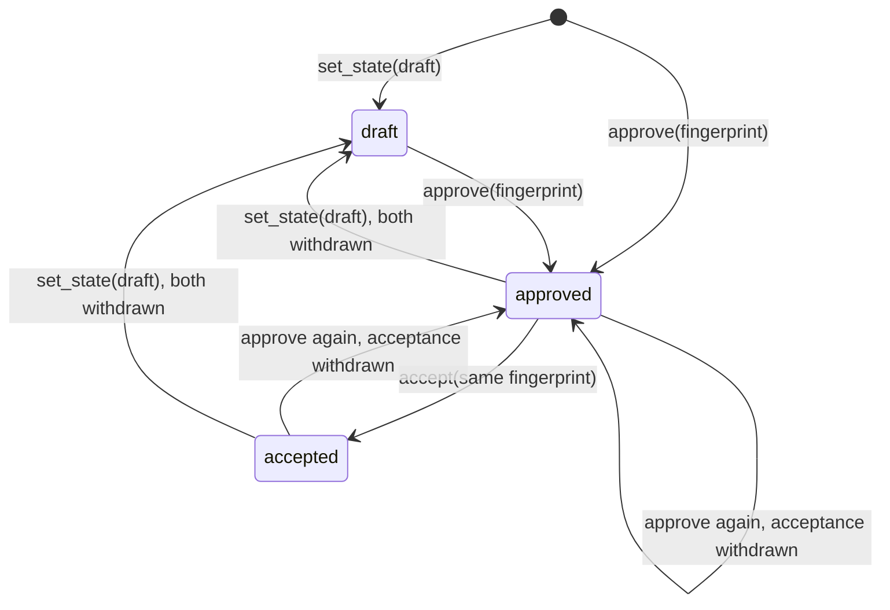

# ADR 0044: A devbook subject's workflow state lives in Backlog's own store, outside git, and replicates through its own container

```meta
date: 2026-10-30
status: proposed
related: [".devbook/arc42/adr/0004-knowledge-index-is-a-generated-local-database.md", ".devbook/arc42/adr/0008-knowledge-reads-from-a-branch-snapshot-when-there-is-no-clone.md", ".devbook/arc42/adr/0010-backup-is-the-database-committed-to-a-repository.md", ".devbook/arc42/adr/0011-devbook-annotations-are-a-third-replica-container.md", ".devbook/arc42/adr/0012-backlog-is-an-mcp-server-inside-the-desktop-app.md", ".devbook/arc42/adr/0015-devbook-database-lives-in-app-storage-and-the-app-builds-it.md", ".devbook/arc42/adr/0029-an-archived-repository-stays-in-the-registry.md", ".devbook/arc42/adr/0039-notifications-are-an-owned-document-kind-and-push-only-nudges.md", ".devbook/arc42/05-building-block-view.md#cloud-service", ".devbook/arc42/07-deployment-view.md#local-deployment-desktop", ".devbook/arc42/08-crosscutting-concepts.md#storage-and-sync", ".devbook/domain/devbook/domain.md#remark", ".devbook/domain/devbook/context.md#devbook-status", ".devbook/domain/devbook/features.md#rendered-devbook-documents", ".devbook/domain/devbook/requirements.md#requirement-decision-state-is-shown-beside-the-status", ".devbook/domain/devbook/requirements.md#requirement-leaving-a-decision-step-takes-its-record-with-it", ".devbook/domain/repository-management/requirements.md#requirement-remarks-are-not-written-into-an-archived-devbook", ".devbook/domain/sync/context.md"]
```

Backlog keeps the workflow state of a devbook **subject** in a store of the Devbook
context's own. A subject is a change proposal, a decision record or a debt record.
The store is keyed by repository and subject. A proposal's approval and acceptance
are keyed by the proposal's fingerprint. Nothing writes the state into a chapter,
into git or into the generated devbook database. It replicates between a person's
desktops through a Cosmos container of its own, `devbookSubjects`.

## Status

```meta
```

Proposed, 2026-10-30, by the flow-spec run `run-mvucwoq4-rgtkx3` that drafts it.
Built, proposed: the flow-code run `run-mvu766j9-rq1nik` built it first, in commit
`7445934f7`, as entry 5 (`backlog-subject-store`) of the `branch-true-devbook`
plan. The record awaits acceptance at the Personal Validation gate of this run's
pull request.

A **local** decision, numbered in the local sequence. Every bare ADR number below
means the local one. It records Backlog's consequences of a decision devbook took,
`JSdotNet/devbook:.devbook/arc42/adr/chapter-schema.md#branch-true-devbook`, and
answers two of devbook's contracts: `devbook.decision@1`
(`plugins/devbook/resources/decision.md`) and `devbook.chapter.fingerprint@1`
(`plugins/devbook/resources/chapter-fingerprint.md`).

It follows ADR 0011's arrangement for remarks and amends four records, each by a
dated note in the section that changes:

- ADR 0004: the status writer it names is retired (§4).
- ADR 0008: a subject's state is set on a branch snapshot too (§5).
- ADR 0012: a new tool group, behind the devbook group's flag (§6).
- ADR 0029: a subject's state is read-only on an archived repository (§5).

ADR 0011 is amended as well. Its sync loop now has five copies.

## Context

```meta
```

Code paths below are as they stand at commit `7445934f7`.

**devbook moved workflow state out of the chapter.** Its branch-true decision says a
branch's devbook is true of that branch's code. A review rung changes on another
schedule from the content, so committing it put a branch ahead of or behind its own
decisions. Workflow state now exists for three subjects only, and the tool that runs
the workflow keeps it:

| Subject | States (`devbook.decision@1`) | Keyed by |
| --- | --- | --- |
| Change proposal | `draft`, `approved`, `accepted`, with who, when and the fingerprint | the change's folder name |
| Decision record | `proposed`, `decided`, `declined` | the record's path and its pull request |
| Debt record | `identified`, `planned`, `in-progress`, `resolved` | the record's path |

spec-manager and Backlog each keep their own copy, and the two may differ. No
binding picks one.

**Backlog had no store for it.** The panels wrote `status` straight into the
working copy through `DevbookMarkdownStatusWriter`. A write was a file change
nobody had committed, and it was impossible on a branch snapshot, which ADR 0008
makes read-only.

**ADR 0011 had already answered "where does Devbook's own data live".** A remark is
the person's data, kept in `devbook-annotations/` under the storage folder and
replicated through the `annotations` container. The same three homes were on the
table here, for the same reasons: the generated devbook database, a table in
`backlog.db`, or a file of the Devbook context's own.

## Decision

```meta
```



The diagram is a proposal's life. A decision or debt record has no approval, so
`set_state` moves it to any state in its row.

### 1. The record, the rules and the port

```meta
```

`DevbookSubject`, in `Backlog.Modules.Devbook.Abstractions`, names a subject by its
kind and key. A proposal's key is its change folder name. A decision or debt
record's key is its repository path, with forward slashes. A decision record also
carries its pull request number. `DevbookSubjects.Classify` decides whether a
chapter path is a decision record under `adr/` or a debt record under `tdr/`, so the
panel and the MCP tools agree.

`DevbookSubjectState` holds the state, who set it and when, and for a proposal its
`Approval` and `Acceptance`. Each decision is a `DevbookSubjectDecision` of who,
when and fingerprint.

`DevbookSubjectRules` holds the contract's rules in one pure class that every store
applies:

- Approve and accept take a proposal alone. Any other kind is refused `bad-state`.
- `set_state` to `approved` or `accepted`, or to a state outside the kind's row, is
  refused `bad-state`. So is a fingerprint that is not `sha256:` and eight hex
  characters.
- Accept stands on an approval at the same fingerprint. With none it is refused
  `not-approved`, and with one at another fingerprint `fingerprint-mismatch`.
- `set_state(draft)` withdraws both decisions, and approving again withdraws an
  acceptance.
- A refusal writes nothing.

`IDevbookSubjectStateStore` is the port, beside `IDevbookAnnotationStore`. Its
writes stamp who and when from the host: `DevbookLocalAuthor.Name`, the machine's
name, and the store's clock. A caller never passes either. `Apply` takes a
replicated state only when `DevbookSubjectRules.Supersedes` says it is later than
the one held.

### 2. The store, outside git and outside the devbook database

```meta
```

`DevbookSubjectStateStore`, in `Backlog.Infrastructure.FileSystem`, keeps one JSON
file per repository in `devbook-subjects/` under the storage folder.
`WorkspaceSettingsStore.OwnedRootFolders` lists the folder, so a move takes the
states along. The panels fall back to `SessionDevbookSubjectStateStore`, in memory,
when a host composes none.

The state is never written into a chapter, and never into the devbook database.
ADRs 0004 and 0015 make that database a build output rebuilt whole from the
Markdown, so state kept there would be lost on the next build. Nothing under
`Backlog.Infrastructure.Devbook/Building/` or the database schema changed.

### 3. A proposal's decisions are keyed by its fingerprint

```meta
```

`DevbookFingerprint`, in `Backlog.Infrastructure.Devbook/Fingerprints`, computes
`devbook.chapter.fingerprint@1` for a block and for a change. `ReadChange` reads a
change from `openspec/changes/<name>/`. `ChapterFingerprintVectorTests` holds it to
every case of devbook's shared vector, copied byte for byte to
`tests/Fixtures/devbook-fingerprint/chapter-fingerprint.vector.json`. An approval
whose fingerprint differs from the change's current one has lapsed, and the caller
asks the person again.

### 4. No arc42, domain or design status is written into a file

```meta
```

`DevbookMarkdownStatusWriter` is retired. Its heading helpers moved unchanged to
`DevbookHeadingDocument`. `DevbookMarkdownRatingWriter` writes a `tech/` or `ai/`
rating and refuses every other folder. The rating keeps the field name `status`
until devbook's contract 38 renames it `rating`.

An authored `status` in `arc42/`, `domain/` or `design/` still renders, as a
read-only badge.

### 5. The arc42 panel shows a record's state, and sets a debt record's

```meta
```

With the `devbook-status` flag on, the arc42 panel draws a decision or debt record's
state from the store, with who set it and when, through `MetadataStateLine`.

- **A debt record's state is picked in the panel.** The pick goes through
  `Arc42DevbookStore.SetSubjectState` and changes no file. It is offered on a branch
  snapshot too, amending ADR 0008.
- **A decision record's state is read-only in the panel.** The panel shows the
  state most recently set for that path, under any pull request. It is set over MCP
  only.
- **An archived repository offers no pick.** `SetSubjectState` answers
  `DevbookSubjectOutcome.Archived` there, amending ADR 0029 §4.

With the flag off, nothing about a subject's state is drawn.

### 6. Four tools answer the state half of `devbook.decision@1`

```meta
```

`DecisionTools`, in `Backlog.Infrastructure.Mcp`, answers `devbook_get_state`,
`devbook_set_state`, `devbook_approve` and `devbook_accept`. They take `repository`
as `owner/name` and a `subject` of `kind`, `name`, `path` and `pullRequest`. They
answer `{ state, approval, acceptance }`, or `{ refused, message }` with the
contract's codes.

- The group sits behind `DevbookFeatures.RepositoryDevbook`, the key the devbook
  group already uses (ADR 0012 §7).
- The Brain is refused with `brain.no_workflow_state`.
- On an archived repository, `get_state` reads and the three writes refuse with
  `repository.archived`.

**The group binds only when the three note tools land.** devbook's contract binds a
server that lists all seven `devbook_*` operations, and one listing some binds
nothing. `devbook_list_notes`, `devbook_post_note` and `devbook_resolve_note` wait
for the remark to carry a note `kind`, which a sibling entry of the plan adds. Until
then a devbook skill finds no host and writes nothing.

### 7. The state replicates through its own container

```meta
```

The exchange copies ADR 0011's pipeline for remarks, with three differences:

| | Remarks (ADR 0011) | Subject state |
| --- | --- | --- |
| Id | a fresh id per remark | `DevbookSubject.IdFor`: a digest of the repository alias and the subject key, the same on every device |
| Precedence | later `updated_at`, a tombstone winning a tie | strictly later `updatedAt` wins whole, and a tie is refused (`DevbookSubjectChangePrecedence`) |
| Deletion | a tombstone, expired after 180 days | none: a state is set and never deleted, so the container has no TTL |

- **Wire.** `POST` and `GET /api/sync/devbook-subjects`, served by
  `DevbookSubjectSyncEndpoints`. `DevbookSubjectRecordLimits.WhyRefused` is the one
  rule the endpoint and the desktop push both run. A push takes at most 500 states.
- **Store.** The `devbookSubjects` container, partitioned on `/ownerId`, declared in
  the AppHost and in `infra/sync/main.bicep`. `CosmosDevbookSubjectReplica` writes
  against the etag.
- **Desktop.** `DevbookSubjectSyncWorker` runs the exchange as a fifth loop, behind
  the `sync` flag and a paired device. Its first cycle starts 16 seconds after the
  app does, behind the other four loops.
- **An older service.** A bare 404 from a service that predates the route is
  `NotYetServed`. The loop shows no error and keeps asking.

## Consequences

```meta
```

Positive:

- **A branch's devbook stays true of its code.** Setting a state is no file change,
  so it commits nothing and puts no branch ahead of its own decisions.
- **State is editable on a branch snapshot.** A debt record's state no longer needs a
  clone.
- **One rule set.** The panel, the MCP tools and both stores apply
  `DevbookSubjectRules`, so every caller gets the same refusals.
- **Two devices converge.** The deterministic id gives one document per subject,
  whichever device created it first.

Negative, and accepted:

- **A fifth copy of the sync loop.** ADR 0011 deferred the extraction at three
  copies. `NotificationSyncWorker` (ADR 0039) and `DevbookSubjectSyncWorker` make
  five. The copy keeps each exchange failing on its own.
- **Backlog's state and spec-manager's may differ.** devbook's contract allows it.
  A skill names the host that answered.
- **Not in the backup.** ADR 0010 backs up the database alone. The
  `devbook-subjects/` files travel by a move and by replication.
- **The deployed service lags.** Until the service with the route is deployed,
  states stay on the device that set them, and the loop reads the 404 as not yet.

Not decided here, and left to later entries of the plan:

- **No import.** The state an existing chapter holds in its `status` is not read
  into the store. The store starts empty.
- **The `sync` direction is still written into the Markdown.**
  `DevbookMarkdownSyncWriter` stays until Backlog keeps a direction map per
  repository.
- **No `open-question` refusal yet.** `DevbookSubjectRefusal.OpenQuestion` maps to
  its wire code, and nothing produces it until a note carries a kind.

## Rejected

```meta
```

- **Keep writing `status` into the chapter.** devbook's branch-true decision removes
  the field. A write is also impossible on a snapshot.
- **The generated devbook database.** It is rebuilt from the Markdown (ADRs 0004 and
  0015), so the state would be lost on the next build and could never leave the
  machine.
- **A table in `backlog.db`.** The file is Tasks', Roadmap's and the Inbox's, and a
  subject's state is Devbook's. ADR 0011 rejected it for remarks for the same reason.
- **A document kind in the `annotations` container.** A remark is deleted by a
  tombstone that expires, and a state never is. The two shapes and retentions differ,
  as they did between tasks and remarks.
- **A fresh id per state.** Two devices that each set the first state of one subject
  would keep two documents, and neither would win.
- **Selecting a decision record's state in the panel.** Its key needs the pull
  request the record is discussed in, and the panel holds only the path.
- **An `Archived` member on `DevbookSubjectRefusal`.** That enum is the contract's
  closed refusal set, and `repository.archived` is not one of its codes. The outcome
  carries archived as a result of its own instead.
- **Stub note tools listed now.** Listing all seven would bind the group, and every
  note call would then refuse. A caller with no host bound reports and writes
  nothing, which is the honest answer until the notes exist.

## Verification

```meta
```

Built, and held by these tests:

1. **The rules.** `DevbookSubjectRulesTests` covers each refusal, the withdrawals and
   that a refusal writes nothing.
2. **The key and the id.** `DevbookSubjectTests` covers the keys, the deterministic
   id and the alias folded to one spelling.
3. **The store.** `DevbookSubjectStateStoreTests` and
   `SessionDevbookSubjectStateStoreTests` cover a restart, `Apply`'s precedence and a
   damaged file.
4. **The fingerprint.** `ChapterFingerprintVectorTests` reproduces every case of the
   vector.
5. **Replication.** `DevbookSubjectRecordLimitsTests`,
   `InMemoryDevbookSubjectReplicaTests`, `DevbookSubjectSyncEndpointTests`,
   `DevbookSubjectDocumentTests`, `DevbookSubjectReplicaMergeTests`,
   `DevbookSubjectSyncSessionTests` and `DevbookSubjectSyncWorkerTests`.
6. **No status write.** `DevbookRatingWriteRulesTests` and
   `DevbookStatusRetirementTests`.
7. **Branch and archived.** `DevbookReadOnlyBranchTests` and
   `DevbookPanelsReadOnlyBranchTests`.
8. **The display.** `MetadataSubjectStateTests` and `Arc42DevbookPanelTests`.
9. **The tools.** `DecisionToolsTests`, `BacklogMcpToolsTests` and
   `McpToolCreationTests`.

## History

```meta
```

| Date | Change | Why |
| --- | --- | --- |
| 2026-10-30 | Proposed: a subject's workflow state lives in a Devbook store outside git, keyed by repository and subject and by fingerprint for a proposal's decisions, replicated through `devbookSubjects`, answered over MCP; the status writer is retired. | devbook's branch-true decision took workflow state out of the chapter, and Backlog had no store to keep it. |
