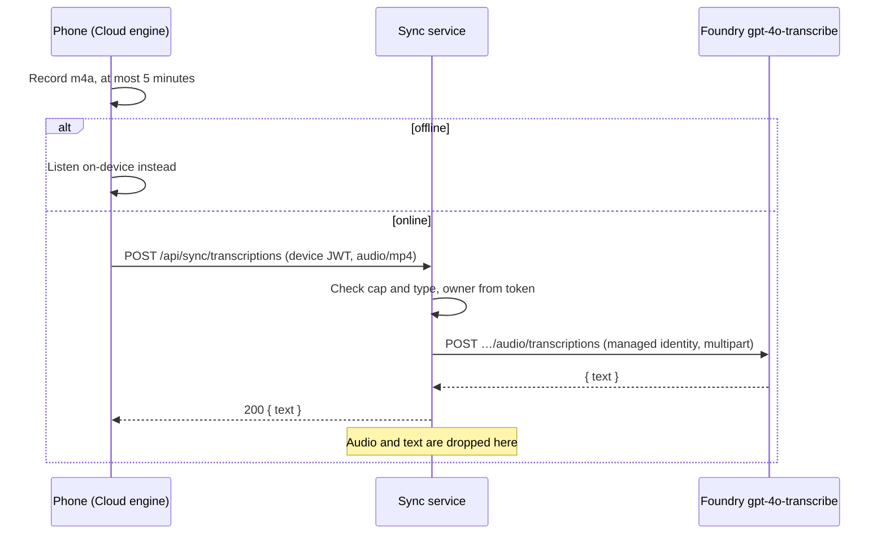

# ADR 0045: The sync service relays a phone dictation to Foundry for transcription and keeps none of it

```meta
date: 2026-11-05
related: [".devbook/arc42/adr/0005-azure-hosted-task-replica-for-multi-device-sync.md", ".devbook/arc42/adr/0014-attachments-travel-through-a-blob-store-beside-the-replica.md", ".devbook/arc42/adr/0023-inbox-items-may-be-read-by-the-foundry-model.md", ".devbook/arc42/adr/0030-stored-credentials-go-through-the-os-protected-envelope.md", ".devbook/arc42/adr/0033-the-dashboard-sends-its-figures-to-foundry-whichever-part-was-pressed.md", ".devbook/arc42/02-constraints.md#technical-constraints", ".devbook/arc42/12-glossary.md#terms", ".devbook/arc42/05-building-block-view.md#cloud-service", ".devbook/arc42/05-building-block-view.md#mobile-app", ".devbook/arc42/07-deployment-view.md#cloud-deployment-azure", ".devbook/arc42/adr/guidelines/0003-aspire-for-web-services.md", ".devbook/arc42/adr/guidelines/0005-modular-monolith-structure.md", ".devbook/arc42/adr/guidelines/0010-opentelemetry-observability.md", ".devbook/arc42/adr/guidelines/0013-authorization-zero-trust.md", ".devbook/arc42/adr/guidelines/0014-persistence-and-repository-boundaries.md", ".devbook/arc42/adr/guidelines/0015-resilience-for-outbound-dependencies.md", ".devbook/domain/capture/features.md#speech-to-text-capture", ".devbook/tech/cloud.md#azure-ai-foundry"]
```

The phone may send one dictation's recorded audio to the sync service, which hands
it to the Azure Foundry `gpt-4o-transcribe` deployment and returns the text. The
service keeps neither the audio nor the transcript: no store, no log, and no
telemetry payload. The person picks **Engine: On-device / Cloud** in the phone's
Settings, beside the Dictation language. On-device is the default, and the phone
falls back to it whenever the cloud cannot answer.

## Status

```meta
```

Accepted, 2026-11-05, at the Personal Validation gate of the flow-spec run `run-mw3bbhti-kv1pz8` that drafted it.
Built in the flow-code change that follows it, in the same pull request, as the
History records.

A **local** decision, numbered in the local sequence. Every bare ADR number below
means the local one; an inherited one is named "guideline".

It amends the *Cloud is a thin sync/coordination layer* and *All capture runs
locally* constraints in `.devbook/arc42/02-constraints.md#technical-constraints`,
and the *Thin cloud* term in `.devbook/arc42/12-glossary.md#terms`. It leaves ADR
0023 as it stands and says below how the two relate.

## Context

```meta
```

**The phone has one engine.** Dictation on the phone runs through
`ISpeechTranscriber`. On Android that is `AndroidSpeechTranscriber`, which wraps
the platform `SpeechRecognizer`. PR #1652 added a Dictation language setting
(`DictationLanguage`, kept by `ISpeechSettingsStore`). On a phone older than
Android 14, Dutch and English falls back to Dutch alone. The request asks for a
second engine, `gpt-4o-transcribe`, which transcribes a whole recording at once.
No measured quality gap is recorded here: the person wants the choice.

**The speech deployment already exists, and nothing calls it.**
`infra/foundry/main.bicep` declares `gpt-4o-transcribe` on the `backlog-foundry`
account behind `includeSpeechModel`, and `backlog-ai.bicepparam` turns it on. The
deployment is `GlobalStandard`.

**The cloud is meant to stay thin.** `02-constraints.md` says the cloud holds only
sync state and coordination, and does no inbox fetching, domain CRUD or full-text
search. Guideline 0014 says the cloud tier persists only sync-oriented state. ADR
0005 calls the replica "replication substrate" against which no domain logic runs.
A transcription is neither sync state nor domain logic. It is a device capability
the phone lacks, run on a model the phone cannot hold a key for.

**What Microsoft documents.** The facts below decide the limits and the shape of
the call. They come from
[Transcription models from OpenAI](https://learn.microsoft.com/en-us/azure/ai-services/speech-service/transcribe-overview),
read on 2026-11-05:

| Fact | What it decides here |
| --- | --- |
| The Azure OpenAI transcription model takes files up to 25 MB. | The service's request cap. |
| It accepts mp3, mp4, mpeg, mpga, m4a, wav and webm, with an ASCII file name only. | The content-type allowlist, and the file name the service sends. |
| Its deployment-style example calls `…/openai/deployments/{deployment}/audio/transcriptions?api-version=2025-03-01-preview`. The page names no minimum version. | The api-version is a setting, defaulted to that value. |
| The page names `whisper` and `gpt-transcribe` as the current model ids, and no longer `gpt-4o-transcribe`. | The deployment is a setting, so moving to a newer model is a deployment and a setting, not a decision. |
| A `language` hint "can improve stability for short or noisy audio". | The phone passes one when the person dictates in one language. |
| The page's comparison table marks "real-time text entry and document generation through voice dictation" as *not available* for the OpenAI model, and *recommended* for Azure Speech models. | Cloud dictation is record-then-send, never live. Azure Speech real-time is weighed under **Rejected**. |

**Microsoft may keep what it is sent.** Per
[Data, privacy, and security for Foundry Models sold by Azure](https://learn.microsoft.com/en-us/azure/foundry/responsible-ai/openai/data-privacy),
read on 2026-11-05, the models are stateless and inputs are not used for training.
Abuse monitoring may still store prompts and outputs that it flags, for human
review, in the geography of the Foundry resource. That stops only for a customer
approved for modified abuse monitoring, which Backlog is not. A `GlobalStandard`
deployment may process the request in any geography where the model is deployed.

## Decision

```meta
```



### 1. The route

```meta
```

The sync service answers `POST /api/sync/transcriptions` under the `/api/sync`
group. It sits behind the same bearer authentication, the `PairedDevice` policy's
fallback-deny and the owner-scope filter as every other sync route. The owner comes
from the token, as in ADR 0014.

- **The request** is the raw audio as the body, with its `Content-Type`. An
  optional `language` query value, `nl` or `en`, passes the hint on.
- **The answer** is `200` with `{ "text": "…" }`.
- **The route is a pure function.** It takes no client id and no digest, so a retry
  is simply a second call.

### 2. The limits

```meta
```

The cap and the allowlist are `Modules:Sync:Transcription` settings, enforced once,
in the service, as ADR 0014 enforces its own:

| Setting | Default |
| --- | --- |
| `MaxBytes` | 26214400 (25 MB, Foundry's own file limit) |
| `ContentTypes` | `audio/mp4`, `audio/x-m4a`, `audio/webm`, `audio/wav`, `audio/mpeg` |

A `Content-Length` over the cap is refused before a byte is read, and a body that
lies about its length is cut off at the cap. The allowlist is audio only and is a
setting of its own, apart from the attachment list of ADR 0014.

The phone stops a cloud recording at 5 minutes. An AAC recording of that length
weighs a few megabytes, far under the cap, so the cap guards the service rather
than shaping the phone.

### 3. The upstream call

```meta
```

The service calls
`POST {Endpoint}/openai/deployments/{Deployment}/audio/transcriptions?api-version={ApiVersion}`.
The body is multipart: `file`, with an ASCII file name such as `dictation.m4a`
derived from the content type, `response_format=json`, and `language` only when the
phone sent one.

| Setting | Default |
| --- | --- |
| `Endpoint` | none: the route answers `503` until it is set |
| `Deployment` | `gpt-4o-transcribe` |
| `ApiVersion` | `2025-03-01-preview` |

- **Where it lives.** A port in `Backlog.Modules.Sync`, `IDictationTranscriber`,
  declares the transcriber, beside `IAttachmentStore`. The Foundry call lives in
  `Backlog.Infrastructure.AzureFoundry` as a client of its own,
  `AzureFoundryTranscriptionClient`, configured from these settings and never
  from the desktop's `AzureFoundrySettingsStore`. The sync host joins the two with
  a small bridge, so the adapter project needs no reference to the Sync module and
  the desktop, which also references the adapter, never loads the server module.
  With no endpoint set, the module composes a stand-in that answers "unavailable",
  as `NoNotificationPushChannel` does for push. This keeps guideline 0005's rule
  that an adapter project alone references its provider.
- **Resilience.** Per guideline 0015, the call has a timeout and one retry on a
  `429` or a `5xx`. The whole call, retry included, is bounded at 50 seconds, so
  the service answers before the phone's 60-second upload timeout.

### 4. What is never kept

```meta
```

The service streams the audio to Foundry and drops it. It writes neither the audio
nor the transcript to Cosmos, Blob, disk or a log.

- **Telemetry** carries the request's size, content type, duration and outcome, and
  nothing else. The HTTP client and server instrumentation of guideline 0010 records
  no body, and no enricher may add one.
- **A failure** is logged by its status code and Foundry's error code. Foundry's
  error message is not logged, because it may quote the input.
- **"Keeps none of it" is Backlog's promise, not Microsoft's.** Foundry's abuse
  monitoring may keep a flagged request for review (see **Context**).

Guideline 0014 holds: the cloud tier persists nothing for this route at all.

### 5. The credential

```meta
```

The sync container app's user-assigned managed identity, `id-sync-…`, carries
**Cognitive Services OpenAI User** on the `backlog-foundry` account, scoped to that
account. `infra/sync/main.bicep` grants it. If the two templates sit in different
resource groups, the grant is a module scoped to Foundry's group. The adapter asks
Entra for a token for `https://cognitiveservices.azure.com/.default`.

- **No key in the sync service.** This follows guideline 0013 and the managed
  identity posture of ADR 0005.
- **No Foundry credential on the phone.** The phone sends its device token only.
  ADR 0030 therefore gains nothing to protect on the phone.
- **Local runs** point `Endpoint` at a transcription stand-in in
  `Backlog.AzureFoundry.TestService`, which the AppHost already starts, and send no
  credential. Guideline 0003 asks for the same path locally, and this gives it.

### 6. The status codes

```meta
```

| Answer | When | What the phone does |
| --- | --- | --- |
| No answer, offline | The phone has no network | Listens on-device at once, with no notice. |
| `404` | An older service without the route | Falls back: see below. |
| `503 sync.transcription_unavailable` | The service has no `Endpoint` | Falls back: see below. |
| Unreachable or timed out | No answer within 60 seconds | Falls back: see below. |
| `502 sync.transcription_failed` | Foundry failed or timed out | A failed turn: "Transcription failed, try again." No fallback. |
| `413 sync.transcription_too_large` | Over the cap | A failed turn. The phone's 5-minute stop should make it unreachable. |
| `415 sync.transcription_type_not_allowed` | A type off the list, named in the answer | A failed turn. The phone records only listed types. |

**A fallback** says "Cloud dictation is unavailable here; using on-device." on that
turn. The phone's transcriber then listens on-device for the rest of the app run,
and tries the cloud again after the next start.

A Foundry failure is not a fallback, because the recording is already made and the
person can simply try again. A route the service lacks or cannot serve will not
answer on the next turn either, so the phone stops asking.

### 7. The setting

```meta
```

**Engine: On-device / Cloud** sits in the phone's Settings sheet beside the
Dictation language. On-device is the default. `ISpeechSettingsStore` keeps it next
to `Language`. Like the language, it belongs to this phone and does not sync.

- **Choosing Cloud is the consent.** The phone sends audio only on a dictation turn
  the person starts with Cloud selected, never in the background. This mirrors ADR
  0023's argument that configuring Foundry is the person's acceptance.
- **The language hint.** When the Dictation language names one language, Dutch or
  English, the phone sends `nl` or `en`. For Dutch and English, and for the phone's
  own language, it sends none and the model detects the language.
- **The turn changes shape.** On-device dictation shows words as they are heard.
  Cloud dictation records first, and the text arrives after the person stops.

## Consequences

```meta
```

**How it meets the other records:**

- **The thin cloud is amended, not broken.** The relay persists nothing and runs no
  domain logic, so the service still holds only sync state (ADR 0005, guideline
  0014). Transcription is the one compute it does beyond coordination, and the
  constraint and the glossary now say so.
- **Local-first holds.** On-device is the default and the fallback, so dictation
  works with no cloud at all (`02-constraints.md`, *Local-first, offline-capable*).
- **ADR 0014's transport rules carry over, without its store.** Upload goes through
  the service, the device holds no Azure credential, and the limits are settings.
  There is no blob, no lifecycle rule, no tombstone release and no idempotency key.
- **ADR 0023 is untouched.** Its rule of one endpoint, one key and one deployment
  governs the Inbox on the desktop. Foundry now has a second caller, the sync
  service, configured separately: its own deployment, and a managed identity instead
  of the desktop's DPAPI-sealed key. Where 0023 hides an AI surface without
  Foundry, dictation falls back instead, because dictation must keep working and an
  AI card is optional.
- **The Dashboard's Foundry cost includes transcription.** It runs on the same
  `backlog-foundry` account that ADR 0023's consequences and ADR 0033 read.

Positive:

- A second engine for a person who opts in, which is not bound by the phone's
  recogniser or its Android version.
- No new Azure resource: the deployment is already provisioned.

Negative, and accepted:

- **Audio leaves the phone.** It reaches Microsoft in the Foundry resource's
  geography and may be processed elsewhere under `GlobalStandard`. A flagged
  request may be kept for abuse review.
- **A cold start costs latency.** The service scales to zero (ADR 0005), so the
  first turn after idle waits for it. The phone's 60-second timeout bounds the wait.
- **No live words in Cloud mode.** The person sees the text only after stopping.
- **Each turn costs money**, billed on the Foundry account.

**What the implementation has to build**, as a later flow-code change:

- the route handler, with the limits, the status codes and no payload logging;
- the transcription adapter in `Backlog.Infrastructure.AzureFoundry`, with Entra
  authentication, multipart and the deployment setting;
- an audio recorder port on the phone: Android's `SpeechRecognizer` yields text and
  never audio, so the MAUI head records m4a with `MediaRecorder`, and the web
  harness records webm beside `WebSpeechTranscriber`;
- a selecting `ISpeechTranscriber` with the fallback, and the engine on
  `ISpeechSettingsStore` and in `SettingsControl`;
- the role assignment and the `Modules:Sync:Transcription` settings in
  `infra/sync/main.bicep`;
- a transcription stand-in in `Backlog.AzureFoundry.TestService`, wired by the
  AppHost.

**Follow-ups outside `arc42/`:**

- `.devbook/domain/capture/features.md#speech-to-text-capture` says transcription
  is on-device. It needs the Cloud engine, through the domain flow.
- `.devbook/tech/cloud.md#azure-ai-foundry` lists chat completions as Foundry's
  use. It needs transcription from the sync service.

## Rejected

```meta
```

- **The phone calls Foundry directly.** The phone would hold a Foundry key. ADR 0014
  keeps every Azure credential off devices, ADR 0030 would have a new secret to
  guard, and guideline 0013 asks for identity over keys.
- **Azure Speech real-time recognition.** Microsoft recommends it for live dictation.
  It needs another resource and its own setup, and does not bring the
  `gpt-4o-transcribe` quality this change is for. Record-then-send is enough for a
  dictation turn.
- **Foundry through the desktop.** The desktop may be off or asleep while the person
  dictates on the phone, and the phone reaches the desktop only through the sync
  service.
- **Store the audio as an attachment first, then transcribe.** The cloud would keep
  data the thin-cloud constraint forbids, for a step that needs none of it.
- **Cloud as the default engine.** Audio would leave the phone without the person
  choosing it, and dictation would depend on the cloud by default.
- **Fall back on a Foundry failure too.** The person would dictate a second time,
  on a weaker engine, for what is usually a passing fault.

## History

```meta
```

| Date | Change | Why |
| --- | --- | --- |
| 2026-11-05 | Built: the route, the Foundry transcription client and the host bridge, the stand-in route, the AppHost wiring, the role grant in `infra/sync` (off until `SYNC_FOUNDRY_ACCOUNT_NAME` names the account), and on the phone the Engine setting, the recorders, and the cloud and selecting transcribers. §3 now names the host bridge. | The decision was accepted with no code behind it. |
| 2026-11-05 | Accepted at the flow-spec gate. Proposed: the sync service relays a phone dictation to `gpt-4o-transcribe` through `POST /api/sync/transcriptions` and keeps none of it, behind an opt-in Cloud engine with on-device as default and fallback. | The phone had one dictation engine, and the speech deployment was provisioned with no caller. |
