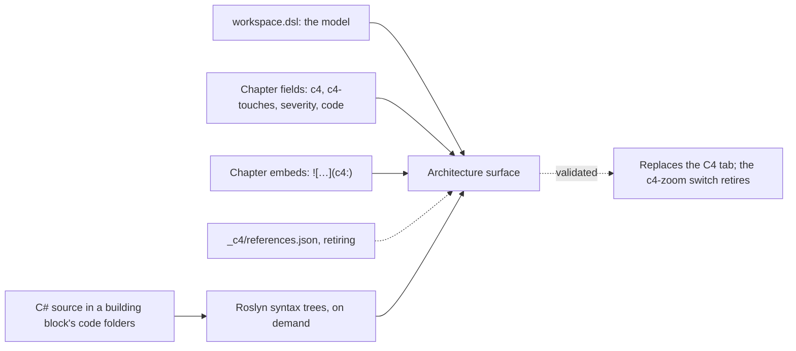

# ADR 0046: C4 zoom navigation is one architecture surface behind its own switch, its links are read from devbook metadata, and its code from syntax trees

```meta
date: 2026-11-09
related: [".devbook/domain/devbook/features.md#c4-zoom-navigation", ".devbook/domain/devbook/requirements.md#c4-zoom-navigation", ".devbook/domain/devbook/context.md#c4-zoom", ".devbook/arc42/adr/0004-knowledge-index-is-a-generated-local-database.md", ".devbook/arc42/adr/0015-devbook-database-lives-in-app-storage-and-the-app-builds-it.md", ".devbook/arc42/adr/0016-knowledge-folders-adopt-the-devbook-convention.md", ".devbook/arc42/08-crosscutting-concepts.md#devbook-database", ".devbook/arc42/adr/0044-devbook-subject-state-lives-in-backlogs-own-store.md", ".devbook/arc42/building-blocks/devbook.md"]
c4: [backlog.desktop.devbook]
```

While the `c4-zoom` switch is on, the architecture panel is one **architecture
surface** that walks the C4 model from context to code. With the switch off, the
panel keeps its **Chapters** and **C4** tabs as they were. The surface replaces the
**C4** tab for good only after it has been validated. Which element a record names,
a TDR's severity, which ADR supersedes which, and which code a component maps to
are read from the chapter files' devbook metadata, never from a file this
repository keeps beside the model. A record's workflow state is the exception: ADR
0044 keeps it in Backlog's subject store, which wins over the record's file. The
Code level is read from C# syntax trees with `Microsoft.CodeAnalysis.CSharp`,
without compiling anything.

## Status

```meta
```

Proposed, 2026-10-21. Built: the plan `+c4-zoom-navigation` reached `main` in PR
#1451, behind the `c4-zoom` switch, which ships off. Accepting the record is the
owner's call at a Personal Validation gate, so it stays proposed until then.

A **local** decision, numbered in the local sequence. Every bare ADR number below
means the local one.

The design is the canvas "C4 Zoom Navigation": nine screens and a page on how to
move between levels.

## Context

```meta
```

**The C4 tab lists views; it does not navigate them.** With `c4-diagrams` on, the
**C4** tab shows the model, kept as Structurizr DSL in
`workspace.dsl` under `.devbook/arc42/`, one view at a time, and links a view to the
chapters that document it. Before devbook's contract 33 the model sat under
`.devbook/arc42/_c4/`. A reader who wants the containers of a system, then the
components of one container, picks each view by name. Nothing says that the second
is inside the first, and no decision or debt record is shown against the element it
is about.

**The links that would make the model navigable were authored nowhere.**

- Which chapter documents which view was in `_c4/references.json`, a file this
  repository authors beside the model.
- Which element an ADR or a TDR is about was in prose only.
- A TDR's severity and its lifecycle (identified, planned, in progress, resolved)
  were a `## Status` paragraph, not fields.
- Which ADR supersedes which was a sentence in each record and a note in the
  `adr/` index.
- No component named the code it is built from.

**The Code level has no authored source and should not get one.** C4 treats level 4
as optional and best generated, because a hand-drawn class diagram is stale the day
after it is drawn.

## Decision

```meta
```



### 1. One surface behind its own switch

```meta
```

While `c4-zoom` and `c4-diagrams` are both on, the architecture panel is one
surface in place of its tabs. With `c4-zoom` off, the panel shows the **Chapters**
and **C4** tabs exactly as before. With `c4-diagrams` off there is no model, and the
panel shows the **Chapters** tab alone, whatever `c4-zoom` says.

The surface has four parts:

- **Zoom bar:** always across the top, with Landscape, Dynamic and Deployment under
  "Also".
- **Left navigation:** headed by a find field for elements, chapters, ADRs and TDRs.
  Below it sit the C4 views as a tree, one line per level, then the chapters that
  document the open view and the decision and debt records with their counts.
- **Main area:** the open view, or a chapter, an ADR or a TDR opened in its place. A
  press on the zoom bar returns to the view.
- **Right panel:** the selected element's inspector, or the panel that goes with
  the open document.

The pane's own architecture menu stands down while the surface is on, because the
surface brings its own left navigation. Chapters and records open inside the
surface. An ADR opens beside the decision log and a TDR beside the debt list, each
with a panel showing where it lands on the container view. A chapter opens with its
embedded views and a panel of the views it documents, the decisions citing it and
the debt on its elements.

Once the surface has been validated against the requirements of
[C4 zoom navigation](../../domain/devbook/requirements.md#c4-zoom-navigation), it
replaces the **C4** tab, and the `c4-zoom` switch is retired in the same change. A
decision record amends this one at that point.

### 2. Links to the model are devbook metadata in the chapters

```meta
```

Four facts are read from the chapters' own Markdown, in fields and sections the
devbook plugin defines and checks:

| Fact | Where it is written |
| --- | --- |
| The C4 elements an arc42 or domain chapter, an ADR or a TDR is about | `c4` and `c4-touches` in its own block |
| A TDR's severity | `severity` in the TDR's own block |
| The ADR a record supersedes, or the one superseding it | the record's `## History` rows that open by naming another ADR |
| The code folders a C4 component is built from | `code` in the component's `building-blocks/<slug>.md` |

`C4RecordLinks` reads them from the chapter files, not from the devbook database.
The database keeps the `c4` and `c4-touches` edges but not `severity` or `code`,
and a branch snapshot has no database at all. The overlays, the inspector and the
decision chain are views over this one read. This repository adds no file beside
the model for any of them.

Which chapter documents which view has two sources, one of them retiring:

- **An embed:** a chapter's `` documents the section it sits
  under, and the view is drawn there.
- **`_c4/references.json`:** the map authored before a chapter could embed a view.
  `C4DevbookStore` reads it after the embeds and keeps only an entry naming a file
  no embed of that view names.

The merged map feeds "documented by" under the open view, the inspector's arc42
chapters, the left navigation's "documents this view" list and a chapter's panel of
views. A view the map gives a chapter that does not embed it is drawn under the
section the entry names, and compared with that section's C4 mermaid fence. An
embedded view is compared with nothing, because the chapter draws no fence of its
own for it.

*Amended 2026-11-02.* A record's workflow state is not one of these fields. ADR
0044 moved it out of the chapter into Backlog's subject store. With the
`devbook-status` switch on, the surface reads it from there, as the file header
does (ADR 0044 §5): a TDR's lifecycle and an ADR's `proposed` mark, in the left
navigation, on the record panel, in the inspector, in the Debt overlay's counts and
in the cross-cutting tray. A decision record's state is the one most recently set
for its path, under any pull request. The record's own `status` is the fallback
where the store holds no state, and the only source with the switch off. Since
devbook's contract 38 this repository's records state none, so its fallback is the
resting read: a decision carries no `proposed` mark and a debt record rests at
`identified`. The fallback stays for a repository still on an older contract.
`C4RecordStates` lays the store over the records, and the panel reads the store
again when it changes, so a state picked in the header shows across the surface
without a reload.

### 3. The Code level is syntax trees only

```meta
```

Level 4 is drawn on demand when a reader opens it. The app parses the C# files
under the folders the component's building block names in `code`, with
`Microsoft.CodeAnalysis.CSharp` syntax trees, and lists their types and members. It
never creates a compilation, never resolves symbols, and never loads a project file
or restores packages. What syntax alone cannot answer is left out of the view, such
as a member's resolved type or a call between types.

Nothing at this level is authored or committed. A component no building block
names code for stops at level 3. A repository read from a branch snapshot has the
devbook folders on disk but no source, so its Code view finds no types.

## Consequences

```meta
```

- **Two readings of one model, picked by the switch.** With `c4-zoom` on the reader
  gets the surface; with it off, the tabs. The switch keeps the surface away from
  everyone who has not turned it on.
- **The fields come from the devbook plugin.** devbook 1.28.0 made `c4`,
  `c4-touches` and `code` the only statement of which element a record is about and
  where a block's code sits. The C# builder follows the reference builder, as
  `DevbookBuilderParityTests` requires, in the same pull request that adopts each
  field.
- **`_c4/references.json` is removed.** The embeds carry every arc42 entry it
  listed, and the domain context map reaches the container view through its plain
  link to chapter 05. The reader still treats a missing file as no references, so
  removing it needed no code change.
- **The Code view is fast and approximate.** Parsing one component's syntax trees
  takes no build and no restore, so opening level 4 needs nothing but the source.
  In exchange it shows declarations, not a semantic model: a partial type is
  merged by name, and a member's type is shown as written.
- **A new package.** `Microsoft.CodeAnalysis.CSharp` joins the desktop's
  dependencies, recorded in `.devbook/tech/desktop.md`.

## Considered options

```meta
```

### Keep the zoom navigation a second tab

```meta
```

Built first, then replaced in PR #1610. The design draws one surface with one left
navigation. As a tab beside **Chapters** and **C4**, the zoom navigation opened
every record in the **Chapters** tab, away from the model it names.

### Replace the C4 tab in place

```meta
```

Rejected. The **C4** tab is how the model is read today. A rework behind no switch
would take that away before the new navigation has been validated, and there would
be nothing to fall back to.

### Keep the links in a file beside the model

```meta
```

Rejected. A file such as `_c4/references.json`, extended with record and code
links, is a second place where a record states what it is about. It would be
checked by nothing the devbook plugin runs. Every other repository that adopts C4
zoom would need its own copy. A field on the record is written once, beside the
decision, and the devbook check reports it when it stops resolving.

### Read the links from the devbook database

```meta
```

Rejected in PR #1456. The database keeps the element edges but not a TDR's
`severity` or a block's `code`, and a branch snapshot has no database to read.

### Infer the links from prose

```meta
```

Rejected. Matching element names in a record's text would put an ADR on every
element its context paragraph mentions. The design separates "decides" from
"touches", and only an explicit field can say which one applies.

### Compile the source for the Code level

```meta
```

Rejected. A Roslyn compilation needs the project's references restored and would
tie the view to a buildable checkout of the right SDK. A repository the app does
not build could not show level 4 at all. Syntax trees need only the files.

### Author the Code level in the DSL

```meta
```

Rejected. A code diagram written by hand goes stale with the next refactor, and C4
itself recommends generating level 4.

## Open questions

```meta
```

None.

## History

```meta
```

| Date | Change | Why |
| --- | --- | --- |
| 2026-11-12 | `_c4/references.json` removed; its open question closed by the context map's existing plain link to chapter 05. | The owner retired the file; every entry it held was carried elsewhere. |
| 2026-11-09 | §1: one architecture surface in place of the tabs while `c4-zoom` is on. §2: the links are read from the chapter files, and a chapter's views come from its embeds and the retiring `references.json`. §3: code folders come from a building block. Status brought up to date. | PR #1610 and PR #1456 changed what this record described, and it still read as the earlier shape. |
| 2026-11-06 | Status: built, still proposed. | The plan has built what this record decides, and this section still read "not yet built". |
| 2026-11-05 | Renumbered from 0045 to 0046. | `main` took 0045 for the dictation relay while this record was still on its plan branch. |
| 2026-11-05 | §2: the file fallback is the resting read in this repository; this record's own `status` and `roadmap` fields are removed. | `main` moved to devbook contract 38, which takes workflow state out of the chapter. |
| 2026-11-02 | §2: a TDR's lifecycle and an ADR's `proposed` mark are read from Backlog's subject store, with the record's `status` as the fallback. The record was renumbered from 0044 to 0046 in the same merge. | `main` took local ADR 0044 for the subject store while this record was in flight on `plan/c4-zoom-navigation`. That record moves a record's workflow state out of the chapter, so the zoom tab and the file header disagreed. |
| 2026-10-21 | Proposed: the C4 zoom tab, its links read from devbook metadata, and its Code level read from syntax trees. | The C4 tab lists views but does not navigate them, and nothing links a record to the element it is about. |
