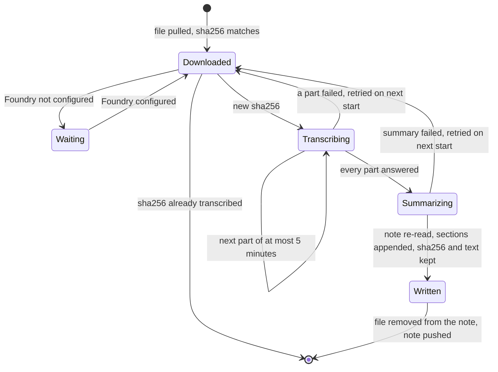

# ADR 0049: The desktop transcribes a meeting recording through Foundry, appends the transcript to the note, then removes the audio

```meta
date: 2026-11-10
related: [".devbook/arc42/adr/0048-meeting-audio-is-recorded-as-aac-in-an-adts-stream.md", ".devbook/arc42/adr/0014-attachments-travel-through-a-blob-store-beside-the-replica.md", ".devbook/arc42/adr/0023-inbox-items-may-be-read-by-the-foundry-model.md", ".devbook/arc42/adr/0025-notes-ride-the-task-feed.md", ".devbook/arc42/adr/0030-stored-credentials-go-through-the-os-protected-envelope.md", ".devbook/arc42/adr/0045-the-sync-service-relays-dictation-audio-to-foundry-and-keeps-none-of-it.md", ".devbook/arc42/06-runtime-view.md#mobile-note-sync", ".devbook/arc42/adr/guidelines/0015-resilience-for-outbound-dependencies.md", ".devbook/tech/cloud.md#azure-ai-foundry", ".devbook/tech/cloud.md#gpt-4o-transcribe"]
```

When a note's meeting recording has downloaded to the desktop, the desktop sends
it to the `gpt-4o-transcribe` deployment on the existing Foundry account, once per
file, keyed by the file's sha256. It appends `## Transcript` and `## Summary` to
the note body, and then removes the audio file from the note, which removes it
from the blob store and the phone. Nobody presses a button: the download is the
trigger.

## Status

```meta
```

Proposed, 2026-11-10, by the flow-spec run `run-mw9zhfom-66t7cx`, unattended. It
waits at that run's Personal Validation gate on a draft pull request.

A **local** decision, numbered in the local sequence. Every bare ADR number below
means the local one; an inherited one is named "guideline". It amends ADR 0023 and
ADR 0014, as **Consequences** says.

## Context

```meta
```

**A meeting recording will be a file on a note.** The phone records a meeting and
adds it to a note as one more file, as AAC in ADTS (`audio/aac`, `.aac`), 16 kHz
mono at 32 kbps, in parts of 24 MB (ADR 0048, proposed, not yet built). ADR 0048
leaves the transcription service, and the remux it may need, to this record. The file travels the way a photo does: uploaded to the blob store before
the note that names it (ADR 0014), pulled by the desktop with the note (ADR 0025,
`06-runtime-view.md#mobile-note-sync`). The person wants a transcript and a
summary, not an hour of audio to listen back to.

**The desktop already talks to Foundry.** `Backlog.Infrastructure.AzureFoundry`
holds the desktop's Foundry endpoint, its chat deployment and its DPAPI-sealed key
(`AzureFoundrySettings`, ADR 0030). The same project holds
`AzureFoundryTranscriptionClient`, which the sync service uses for phone
dictation (ADR 0045), with a managed identity and a 50-second budget sized for a
dictation turn. The `backlog-foundry` account, in resource group `JS-AI` in the
Sponsorship subscription, already provisions `gpt-4o-transcribe` behind
`includeSpeechModel`. The phone cannot do this work: its recogniser handles a
dictation turn, not an hour of audio.

**Notes merge whole, by the later `UpdatedAt`.** A note's body travels whole, and
the copy with the later stamp replaces the other (ADR 0025). A transcript written
over the body the desktop read an hour ago would undo an edit the person made
since on the phone. A phone edit built on the body before the transcript would
undo the transcript.

**What Microsoft documents**, read on 2026-11-10:

| Fact | Source | What it decides here |
| --- | --- | --- |
| The transcription model accepts mp3, mp4, mpeg, mpga, m4a, wav and webm. "Other formats return an error." AAC in ADTS is not on the list. | [Quickstart: speech to text with Azure OpenAI transcription models](https://learn.microsoft.com/azure/foundry/openai/whisper-quickstart), *Troubleshooting* | The desktop remuxes ADTS to M4A before sending (**Decision §3**). |
| `gpt-4o-transcribe` takes at most 25 MB per request. | [Foundry Models sold by Azure](https://learn.microsoft.com/azure/foundry/foundry-models/concepts/models-sold-directly-by-azure#audio-models), *Audio models* | One recording file fits: the phone rolls over at 24 MB. |
| Synchronous transcription "is limited to less than 15 to 30 minutes of audio depending on audio compression". | [Transparency note for Azure OpenAI](https://learn.microsoft.com/azure/foundry/responsible-ai/openai/transparency-note#capabilities), *Audio / speech models* | Size is not the binding limit; length is. The desktop sends a recording in parts (**Decision §3**). |
| For `gpt-4o-transcribe` "the only supported format is `json`": no `verbose_json`, so no segment or word timestamps. | [REST API v1 preview reference](https://learn.microsoft.com/azure/foundry/openai/reference-preview-latest#components), `AudioResponseFormat` | The model returns no timestamps. The desktop stamps each part with its own offset (**Decision §4**). |
| `language` is optional. `prompt` may "continue a previous audio segment". | The same reference, *Create transcription* | No language is sent. Each part's prompt is the tail of the part before it. |
| `gpt-4o-transcribe-diarize` is a separate model that labels speakers. | [Foundry Models sold by Azure](https://learn.microsoft.com/azure/foundry/foundry-models/concepts/models-sold-directly-by-azure#audio-models) | Weighed under **Rejected**. |

ADR 0045's **Context** records what Microsoft may keep: the models are stateless
and inputs are not used for training, but abuse monitoring may store a flagged
request for human review, in the Foundry resource's geography.

## Decision

```meta
```

A recording on the desktop, from its download to its removal:



### 1. When it runs

```meta
```

- **On download.** The desktop transcribes a recording once its file has fully
  downloaded and its sha256 matches the one the note names. No setting turns it
  on and no button starts it.
- **Once per file.** The desktop keeps the sha256 of every file it has
  transcribed, with the sections it wrote, in its local store. A file whose sha256
  is there is never sent again, whether it comes back through a re-sync, a second
  note or a restored backup.
- **One file at a time**, in the background. A rolled-over recording's files are
  transcribed as separate files, each appending its own sections in order.
- **Only audio.** Only a file of a recording type ADR 0048 lets a note carry
  (`audio/aac`, `audio/mp4`, `audio/x-m4a`) is transcribed; an M4A file is sent
  as it is, with no remux. A photo or a document on the same note is not sent.
- **Only with Foundry configured**, meaning `AzureFoundrySettings.IsConfigured`:
  endpoint, chat deployment and key all set, since the summary needs the chat
  deployment. Otherwise nothing is sent and the recording stays on the note.

### 2. The client and the deployment

```meta
```

The desktop reuses `AzureFoundryTranscriptionClient`, against the existing Foundry
endpoint with the desktop's existing key:

- **A key credential.** The client gains an API-key credential beside
  `ManagedIdentity` and `None`, filled from the DPAPI-sealed key in
  `AzureFoundrySettings` (ADR 0030).
- **Options from the desktop's settings.** On the desktop the client's options
  are bound from `AzureFoundrySettings`. ADR 0045's rule that the sync service
  never reads `AzureFoundrySettingsStore` still holds: the sync host keeps binding
  from its own `Modules:Sync:Transcription` settings.
- **Its own budget.** Each part gets a budget of its own, minutes rather than
  ADR 0045's 50 seconds, because nobody is waiting on a phone. Per guideline
  0015, each call keeps one retry on a `429` or a `5xx`.

It names a deployment of its own, because the chat deployment cannot transcribe:

| Setting on `AzureFoundrySettings` | Default |
| --- | --- |
| `TranscriptionDeployment` | `gpt-4o-transcribe` |
| `TranscriptionApiVersion` | `2025-03-01-preview`, as ADR 0045 |

The deployment is the one `infra/foundry/main.bicep` already declares on the
`backlog-foundry` account. No Azure resource is added.

### 3. The format

```meta
```

The model does not accept AAC in ADTS (see **Context**), so the desktop sends M4A,
as `audio/mp4` with a `.m4a` file name.

- **Remux, never re-encode.** The desktop lifts the AAC frames out of the ADTS
  stream and writes them into an MP4 container as they are. The audio is the same
  bytes; only the framing changes. A cut-off recording still remuxes, up to its
  last whole frame.
- **In parts of at most 5 minutes.** The synchronous limit is a length, 15 to 30
  minutes depending on compression, not the 25 MB a 32 kbps recording never
  reaches. The desktop cuts the stream on an ADTS frame boundary at or before each
  5-minute mark and remuxes each part on its own. ADTS frames stand alone, so a
  cut needs no decoding.
- **Each part carries the last words of the one before** as its `prompt`, so a
  sentence cut at a boundary reads on.
- **The remuxed parts are temporary files** in the desktop's own storage, deleted
  when the call returns, whatever it answers.

### 4. The transcript

```meta
```

- **No language setting.** The desktop sends no `language`, and the model detects
  the language itself, per part.
- **Timestamps per part.** `gpt-4o-transcribe` answers `json` only, with no
  segments. Each part's text is headed by its start offset in its file,
  `[00:04:59]`, computed from the frames before the cut, so the transcript reads
  in steps of about five minutes. A rolled-over file's offsets start again at
  zero, under its own part heading (§5).
- **No speaker labels.** The transcript is the spoken text and nothing else.

### 5. The write-back

```meta
```

The desktop appends, and never replaces:

1. It **re-reads the note** from its store after the transcription returns, not
   the copy it read before sending.
2. It **appends** `## Transcript`, with the parts in order, and `## Summary` to the
   end of that body. A rolled-over recording's later files append under
   `## Transcript (part 2)` and `## Summary (part 2)`.
3. The **summary** comes from the desktop's existing chat deployment, given the
   transcript text alone. It lists the decisions and, as `- [ ]` lines, the action
   items, which the person can turn into tasks.
4. The edit is stamped after the copy it replaces, as every local note edit is
   (`06-runtime-view.md#mobile-note-sync`), and pushes as a note document.

An edit the person made on the phone while the transcription ran is in the
re-read body when it arrived first, and is kept.

### 6. Removing the audio

```meta
```

- **After the transcript is written.** In the same local change that appends the
  sections, the desktop removes the recording from the note's files. The pushed
  note no longer names it. The sync service releases its blob, and the phone drops
  its copy on its next pull.
- **Never on failure.** A failed or partial transcription leaves the body and the
  file as they were, and the sha256 is not marked done. The desktop tries again on
  its next start, and the person can still play the recording.
- **A phone edit that undoes it is repaired.** A phone edit made on the body before
  the transcript arrives later, replaces the whole note, and drops the sections
  and names the file again (ADR 0025). On every pulled note, the desktop checks
  each file it has a sha256 record for: when the note names that file, or lacks a
  section it wrote for it, the desktop appends the kept sections again and removes
  the file again. The audio is gone by then; the kept text is what makes the
  transcript survive.
- **The transcript is the record.** Once the audio is gone there is nothing to
  transcribe again or listen back to.

## Consequences

```meta
```

**Meeting audio leaves the device for Azure.** This is why the decision is an ADR.

- Every recording on a synced note is sent to Microsoft, in the `backlog-foundry`
  account's geography, and may be processed elsewhere under `GlobalStandard`. A
  flagged request may be kept for abuse review (ADR 0045, **Context**).
- **Nobody opts in per recording.** Configuring Foundry on the desktop is the
  only consent; the transcription starts without a click. The people in the
  meeting are not asked by Backlog; the phone's recording reminder is where that
  belongs.
- **The transcript is text in the note**, so it syncs, is backed up (ADR 0010) and
  may be read by the Foundry chat model (ADR 0023), as every note body is.

**How it meets the other records:**

- **ADR 0023 is amended in three places.** It sends only on the reader's press,
  sends no attachment, and sends nothing on intake or in the background. A
  recording is now an attachment sent on intake, in the background, with no
  press, and its transcript is sent to the chat deployment for the summary.
  Everything else 0023 says holds, for the Inbox's triage calls.
- **ADR 0014 is amended.** Today only a tombstone releases blobs. A note edit
  that drops a file must now release that file's blob too, read from the copy the
  service already holds, so a pushed note cannot release a blob it never named.
  The 30-day lifecycle rule stays the backstop.
- **ADR 0045 is beside it, not changed.** The sync service relays phone dictation
  with its managed identity. The desktop reuses the same client and deployment
  with its own key. Neither caller goes through the other.
- **Cost.** Each recording is billed by audio length on the Foundry account, so
  the Dashboard's Foundry cost, read from that account, includes it.

Positive:

- A meeting becomes searchable text with its action items, with no step for the
  person.
- The blob store and the phone stop holding meeting audio once it is transcribed.

Negative, and accepted:

- **The audio is gone after the transcript.** A transcription error cannot be
  checked against the recording.
- **Timestamps are coarse**, one per part of about five minutes, because the model
  returns none of its own.
- **A desktop that is off delays it.** Nothing transcribes until a desktop with
  Foundry configured pulls the note.
- **The repair is the desktop's.** Between a phone edit that drops the sections and
  the desktop's next pull, the phone shows the note without its transcript, and
  names a file whose blob is gone. A second desktop that never wrote the sections
  holds no record and cannot repair them.

**What the implementation has to build**, as later flow-code changes:

- on `AzureFoundryTranscriptionClient`, the API-key credential, options bound from
  `AzureFoundrySettings` with the two new settings, and the desktop's budget and
  part prompt;
- the ADTS-to-M4A remuxer and the 5-minute cutter, with no codec;
- the local record of transcribed sha256s with the sections written, and the
  background step that runs on a recording's download;
- the re-read-and-append write-back with the summary call, the removal of the file
  in the same change, and the repair on pull;
- in the sync service, releasing the blob of a file a note edit drops;
- on the phone, deleting the local copy of a file the pulled note no longer names;
- a transcription stand-in for the desktop harness in
  `Backlog.AzureFoundry.TestService`.

## Rejected

```meta
```

- **Send ADTS as it is.** Not on the documented format list, and "other formats
  return an error".
- **Re-encode to another codec.** Loses quality and needs a codec on the desktop,
  for what a remux does with the same bytes.
- **Send the whole recording in one request.** A 47-minute recording fits the
  25 MB cap but not the 15-to-30-minute synchronous limit.
- **`gpt-4o-transcribe-diarize`, for speaker labels.** Speaker labels are out of
  scope for the first version. It stays a later change of deployment.
- **Azure AI Speech batch transcription.** Built for long audio, with speaker
  labels and timestamps, but a new resource, a new SDK, and a file the service
  must read from a URL, so the blob store would hand Azure Speech a SAS URL that
  ADR 0014 rejects.
- **Transcribe in the sync service, as ADR 0045 does for dictation.** The service
  would hold the audio for as long as an hour of transcription takes and run the
  summary, beyond the thin cloud that 0045 allows for one short dictation turn.
- **Transcribe on the phone.** Its recogniser handles dictation, not an hour of
  audio, and the phone holds no Foundry key.
- **Keep the audio after the transcript.** The blob store and the phone would keep
  sensitive audio that nothing reads any more.
- **Keep the audio until the phone has the transcript.** The desktop cannot see
  what the phone holds; the kept text repairs the same race without the audio.
- **A language setting.** The model detects the language, and a meeting may mix
  Dutch and English.

## History

```meta
```

| Date | Change | Why |
| --- | --- | --- |
| 2026-11-10 | Proposed: the desktop transcribes a downloaded meeting recording through `gpt-4o-transcribe` once per sha256, in remuxed M4A parts of at most 5 minutes, appends `## Transcript` and `## Summary`, then removes the audio and repairs a phone edit that drops the sections. | Plan entry `spec-transcription` of plan `meeting-recording`. |
