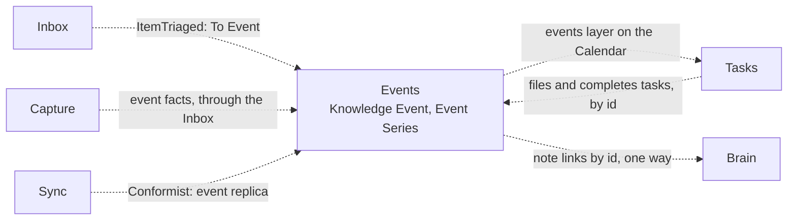

# ADR 0050: Events is its own bounded context

```meta
date: 2026-11-11
related: [".devbook/domain/events/context.md", ".devbook/domain/events/context.md#events-area", ".devbook/domain/events/domain.md#knowledge-event", ".devbook/domain/events/domain.md#event-series", ".devbook/domain/events/domain.md#harvest-task-policy", ".devbook/domain/events/features.md#harvest-task", ".devbook/domain/events/features.md#events-on-the-phone", ".devbook/domain/context-map.md", ".devbook/arc42/adr/0039-notifications-are-an-owned-document-kind-and-push-only-nudges.md", ".devbook/arc42/adr/0040-the-brain-is-its-own-bounded-context.md", ".devbook/arc42/adr/0026-the-brain-is-a-personal-devbook-outside-any-repository.md", ".devbook/arc42/adr/0027-the-brain-is-a-scope-beside-the-repositories.md", ".devbook/arc42/adr/0022-the-shell-shows-one-main-view-picked-by-a-view-switch.md", ".devbook/arc42/adr/guidelines/0005-modular-monolith-structure.md", ".devbook/arc42/adr/0055-calendar-is-a-surface-of-its-own-that-reads-layers.md"]
```

Events is a bounded context of its own. It holds the knowledge events a person
attends to learn something, and the series they belong to. It owns its documents
as a document kind on its own replica container, and it names Brain notes and
tasks by id, one way.

## Status

```meta
```

Proposed, 2026-11-10. A specification change only: the chapters are written in
`.devbook/domain/events/`, and no code exists yet. A later `flow-code` change
builds the module behind the `events` switch.

A **local** decision, numbered in the local sequence. Every bare ADR number below
means the local one. Numbers 0048 and 0049 were skipped, because open
meeting-recording branches claim them: `plan/meeting-recording` claims 0048 and
one of its `meeting-recording/` branches claims 0049. ADR 0047 skipped 0046 for
the same reason.

## Context

```meta
```

**A knowledge event is attended to learn something.** It is a conference, a
meetup, a webinar or a workshop. Its value lies in the decision before it and the
harvest after it. The person decides why they go and which talks to hear, and
afterwards what was worth it. A date on a calendar holds none of that.

**No context holds it today.** A task holds work to do, the Calendar shows due
dates, and a Brain note holds takeaways. Each holds one part of an event, and none
holds its dates, its place, its ticket and its decision together.

**The event is needed most at the venue.** There the person holds only the phone,
which does not see the Brain (ADR 0026). Talk notes are taken on the phone
([Talk note](../../domain/capture/features.md#talk-note)) and today belong to no
event.

**The plain word is taken.** "Event" already means a domain event in every
context, and Tasks has a [Usage Event](../../domain/tasks/domain.md#usage-event).
"Session" names the Sessions context, and "agenda" sits close to Tasks'
[Agenda Time](../../domain/tasks/domain.md#agenda-time). The new language has to
avoid all three.

**Notifications set the precedent.** ADR 0039 gave notifications a document kind
of their own, on their own replica container, which Sync carries without reading.

## Decision

```meta
```



Every edge is dashed because none is built. Each arrow runs from the upstream
context to the one that depends on it, as on the
[context map](../../domain/context-map.md).

### 1. Events is a bounded context, for knowledge events only

```meta
```

Events owns the [Knowledge Event](../../domain/events/domain.md#knowledge-event)
and its lifecycle, the [Event Series](../../domain/events/domain.md#event-series),
the [Harvest Task Policy](../../domain/events/domain.md#harvest-task-policy) and
the Events pane. Its chapters live in `.devbook/domain/events/`. It is a
Supporting subdomain: learning events support the person's work, and they are not
what sets the product apart.

Only knowledge events are inside. Meetings, holidays and other appointments stay
out, so the model stays small.

Its language avoids the words other contexts hold:

- **Knowledge Event**, never "Event" alone. The pane's label is "Events".
- **Event Series**, the organiser's recurring run of events.
- **[Talk](../../domain/events/domain.md#talk)**, never "session".
- **[Talk picks](../../domain/events/domain.md#talk-picks)**, never "agenda".

Talks are terms only and are not modelled in the first version.

### 2. Events owns its documents, on its own replica container

```meta
```

A knowledge event is a document kind of its own, on a replica container of its
own. Sync stores and carries the documents and never reads them, as it does for
notifications ([ADR 0039 §3](0039-notifications-are-an-owned-document-kind-and-push-only-nudges.md#3-notifications-get-their-own-replica-containers)).
The container's name stays open until the code.

Every desktop of the person may write a knowledge event, and the latest write
wins, as for tasks (ADR 0005). ADR 0039's rule of one owner desktop is not
adopted, because an event is the person's and not one desktop's.

The phone writes no event document. To attach a Talk note it sends an attachment
request naming the event and the note, and a desktop applies it to the event. A
reply reaches a notification's owner the same way
([ADR 0039 §2](0039-notifications-are-an-owned-document-kind-and-push-only-nudges.md#2-a-viewer-replies-by-writing-a-reply-document-and-the-owner-decides)).
The Inbox model does not change.

### 3. Links to notes and tasks run one way, by id

```meta
```

The event holds the ids of its tasks and the links to its notes. Tasks and the
Brain know no event: a task never shows the event it serves, and a note never
lists one. This mirrors [Progress](../../domain/progress/context.md), which names
tasks by id while Tasks knows nothing of it.

- **A Brain note** is named by its path from the Brain's root, as `ItemTriaged`
  names it. A moved note leaves a broken link, which the pane shows as missing.
- **A Talk note** is named by its Inbox note id.
- **A prep task** is filed under the Brain scope
  ([ADR 0027 §2](0027-the-brain-is-a-scope-beside-the-repositories.md#2-brain-is-the-scope-of-everything-filed-against-no-repository)).

The phone shows a Brain note link by its title only and cannot open it.

### 4. Events are discovered through the Inbox

```meta
```

An event page reaches the person as an Inbox item from a capture source, and the
Inbox's **To Event** route turns it into a knowledge event. Capture owns the pages
it watches. An Event Series keeps only the link to its organiser's page and
watches nothing itself.

### 5. The harvest task closes the loop

```meta
```

On the first local day after a Going event's end date, Events files a task
`Harvest <event title>` under the Brain scope and links it by id. Marking the
event Harvested completes that task if it is still open. Completing the task in
Tasks does not harvest the event, because Tasks knows no event.

Events files the harvest task at most once per event, even when several desktops
see the event end. It raises no notification. The
[Harvest task](../../domain/events/features.md#harvest-task) feature holds the
promises.

### 6. The `events` switch withdraws the whole area

```meta
```

The switch is the [Events area](../../domain/events/context.md#events-area), key
`events`, off by default. It gates five surfaces:

- the Events pane;
- the Inbox's To Event route;
- the event page capture source;
- the events layer on the Calendar;
- the Events screen on the phone.

### 7. The code is one module trio

```meta
```

The module is `Backlog.Modules.Events`, with `Backlog.Modules.Events.Abstractions`
for its published contracts and `Backlog.Modules.Events.UI` for its screens
(inherited ADR 0005). It reaches another context only through that context's
`.Abstractions`.

Superseded in part by [ADR 0055](0055-calendar-is-a-surface-of-its-own-that-reads-layers.md)
(proposed): the Calendar becomes a surface of its own, and the events layer's port
moves from Tasks to the Calendar. Events' read contract is unchanged. The text below
is the decision as first taken.

The Calendar is Tasks' view, so Tasks draws the events layer. Events publishes a
read contract in its `.Abstractions`. Tasks reads it through a port of its own,
which an Infrastructure adapter answers, as the Calendar's **Show plans** layer
reads the roadmap. So neither module references the other's implementation.

## Consequences

```meta
```

Positive:

- **The decision and the harvest have one home.** Why the person goes, what they
  picked and what it was worth sit on the event, beside its dates.
- **The phone has the event at the venue.** It reads the replica and attaches
  Talk notes without seeing the Brain.
- **Tasks and the Brain keep their models.** The links run one way, so neither
  learns a new word.

Negative:

- **There is more to build and run.** A module trio, a document kind and a
  replica container join the system.
- **An offline edit can be lost.** Two desktops that edit one event apart keep
  only the latest write, as tasks do.
- **A Brain note link breaks when the note moves.**
- **The sibling chapters lag.** They are left as follow-ups, and until each lands
  the Events chapters describe a contract its neighbour does not yet state:
  - Inbox: the To Event route beside
    [Route to Brain](../../domain/inbox/features.md#route-to-brain), an Events
    value on the routing target, and the route on `ItemTriaged`;
  - Capture: an event page source beside
    [Automation capture](../../domain/capture/features.md#automation-capture),
    event facts on the capture, and a Talk note attached to an event;
  - Tasks: a **Show events** choice on the
    [Calendar view](../../domain/calendar/features.md#calendar-view), and its
    dependency tables;
  - Sync: the feeds list, the container and the inbound table in
    [Sync](../../domain/sync/context.md);
  - arc42: the module and the phone tab in
    [chapter 5](../05-building-block-view.md), the runtime in chapter 6,
    [Storage and Sync](../08-crosscutting-concepts.md#storage-and-sync),
    [Feature Enablement](../08-crosscutting-concepts.md#feature-enablement), and
    the C4 element in the workspace once the module exists;
  - design: the Events pane and the phone screen.

Neutral:

- **No behaviour changes yet.** Nothing is built, and no existing chapter's rule
  changes.

## Rejected

```meta
```

- **Part of the Brain.** Knowledge belongs there, and a note already carries
  planning fields, so it came closest. But the phone does not see the Brain
  (ADR 0026, ADR 0027), and the event is needed most at the venue. The Brain also
  holds no note until a folder is chosen, and a state change would become a file
  edit synced by OneDrive. The Brain keeps the takeaways, linked by id.
- **Part of the Calendar.** The Calendar is a layout of the Tasks pane
  ([ADR 0022 §1](0022-the-shell-shows-one-main-view-picked-by-a-view-switch.md#1-one-main-view-always)).
  A view owns nothing, so it has nowhere to keep why the person goes or whether it
  was worth it. Events shows on it as a layer instead.
- **A task type.** [Task Type](../../domain/tasks/domain.md#task-type) classifies
  work to do. An event is not work: it has dates, a place, a ticket and a
  lifecycle of its own, which would sit beside every task's status. Its prep and
  harvest are tasks, linked by id.
- **A roadmap item.** The roadmap plans work across projects, and its windows are
  drawn from effort and pace (ADR 0018, ADR 0019). An event's dates are its
  organiser's, it carries no effort, and no pace places it.

## Verification

```meta
```

Look for these in the specification and, once built, in the code:

1. **Knowledge events only.** No Events chapter or type models a meeting or an
   appointment.
2. **Links run one way.** No Tasks or Brain chapter or type holds an event id.
3. **The phone writes no event.** It sends attachment requests and nothing else.
4. **One harvest task per event.** Two desktops that both see a Going event end
   file one task between them.
5. **Switch off.** With `events` off, none of the five surfaces shows.
6. **One trio, no cross references.** `Backlog.Modules.Events` references only
   other modules' `.Abstractions`, and no other module references it.

## History

```meta
```

| Date | Change | Why |
| --- | --- | --- |
| 2026-11-11 | §7 superseded in part by ADR 0055: the Calendar is a surface of its own, and the events layer's port moves from Tasks to the Calendar. The read contract stays. | The Calendar reads more sources than tasks, so a Tasks-owned port per source stopped making sense. |
| 2026-11-10 | Proposed: Events is a bounded context for knowledge events, its documents on their own replica container, linking notes and tasks by id, one way. | No context held an event's dates and decision together, and the phone needs it where the Brain is out of reach. |
