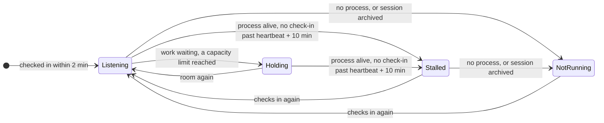

# ADR 0051: Scheduled runs and loop sessions report to Backlog over MCP

```meta
date: 2026-11-11
related: [".devbook/arc42/adr/0012-backlog-is-an-mcp-server-inside-the-desktop-app.md", ".devbook/arc42/adr/0038-backlog-queues-session-requests-and-a-manager-session-dispatches-them.md", ".devbook/arc42/adr/0039-notifications-are-an-owned-document-kind-and-push-only-nudges.md", ".devbook/arc42/adr/0041-agent-questions-reach-backlog-by-presence-and-come-back-through-the-hook-or-the-manager.md", ".devbook/domain/sessions/context.md#sessions-area", ".devbook/domain/sessions/domain.md#schedule-register", ".devbook/domain/sessions/domain.md#loop-register", ".devbook/domain/sessions/domain.md#session-title-reading", ".devbook/domain/sessions/features.md#schedules-and-their-runs", ".devbook/domain/sessions/features.md#loop-sessions", ".devbook/domain/sessions/requirements.md#schedules-and-their-runs", ".devbook/domain/sessions/requirements.md#loop-sessions", ".devbook/domain/notifications/features.md#asking-from-the-contexts", ".devbook/domain/notifications/requirements.md#asking-from-the-contexts"]
```

Each scheduled run tells Backlog that it started and how it finished, through MCP, from a
hook pair the `backlog-tools` plugin ships. Each loop session (the Manager of ADR 0038 and the
Brain tender) checks in with Backlog through a new MCP tool, `check_in`, on every tick. Backlog
decides a state for every schedule and every loop session from those reports, alerts the person
through the notification centre when one needs them, and shows both in the Sessions takeover.
All of it sits behind the existing `sessions` flag.

## Status

```meta
```

Proposed, 2026-11-11. Drafted by an unattended `execute-plan` run of the
`+schedules-and-loops` plan, its `record-decision` item, from the plan's settled decisions and
its design canvas *Schedules Monitor*. It waits for the repository owner's Personal Validation on
the draft pull request. Not yet built: the plan's later items build the report tools and the
hook pair, `check_in`, the states, the alerts and the screens.

A **local** decision, numbered in the local sequence. Every bare ADR number below means the
local one. It adds tools to the listener ADR 0012 built and changes none of its decisions. It
amends ADR 0038's Manager capacity rule, as [Amends](#amends) says. The rest of ADRs 0038 and
0041 stands.

## Context

```meta
```

**Unattended work stops without anyone noticing.** A schedule fires a `schedule-*` skill on a
cadence, as a local routine on this machine. A run that needs the person, fails, or holds the
next runs back says so only in its own Claude Desktop session. A schedule that never fired says
nothing at all. The person finds out when they next open the sidebar and read each run.

**A loop session can stop without anyone noticing.** The Manager session of ADR 0038 and the
Brain tender run under `/loop` in a pinned session. When one stops or hangs, session requests
and answer deliveries wait in Backlog, and nothing tells the person why.

**Claude Desktop's schedule and run files are its own.** They are private, undocumented and
change between releases. A reader built on them breaks when they do.

**Schedule prompts belong to `delivery-schedule`.** Its `update` skill rewrites every prompt it
manages, so a reporting step written into a prompt would be lost on the next update.

**The Manager measures its own capacity today.** It reads plan usage, CPU and memory itself
before each start, so the app cannot show why the queue is not moving.

## Decision

```meta
```

```mermaid
sequenceDiagram
  participant Run as Scheduled run
  participant Hook as backlog-tools hooks
  participant B as Backlog
  participant Loop as Loop session
  participant P as Person
  Hook->>Run: SessionStart: report your start
  Run->>B: run started (schedule id, title, repository, cron)
  Hook->>B: Stop: run finished (verdict, Needs-you lines)
  Loop->>B: check_in(state, heartbeat, limits)
  B-->>Loop: pause, resume or stop, and the work waiting
  B->>P: an Alert, in the centre and on Windows
```

### 1. Scheduled runs report to Backlog over MCP, from a `backlog-tools` hook pair

```meta
```

The app never reads Claude Desktop's private schedule or run files. Each run reports itself:

- **SessionStart** spots a session that a scheduled task started. Its hook has the session
  report its start, with the schedule's id, title, repository and cron, taken from the session's
  own scheduler tool.
- **Stop** reports the run's finish: its verdict and any Needs-you lines from its summary.

A schedule appears in Backlog after its first report. Until then Backlog does not know it
exists, so a schedule that has never run is not shown.

The hooks live in `backlog-tools` only. No schedule prompt carries a reporting step, so
`delivery-schedule:update` rewriting the prompts changes nothing. This differs from ADR 0041 §4
on purpose. The question relay must reach every session, so its hook ships with the app. A
schedule report concerns only scheduled `schedule-*` runs, which run where the person keeps
the stack's plugins.

### 2. Seven run states, read from the reports

```meta
```

| State | When | Alerts |
| --- | --- | --- |
| Needs you | The run reported Needs-you lines and its session is not archived. | Yes |
| Held | The run reported that it skipped itself because an earlier run is unarchived. | Yes |
| Failed | The run reported a failure. | Yes |
| Missed | Enabled, 30 minutes past its cron's due time, and no start report. | Yes |
| Review ready | The run reported work ready for review, and its session is not archived. | Row only |
| Handled | The run's session is archived. | Closes the alert |
| No summary yet | A start report and no finish report yet. | No |

**Handled is read from the desktop record the Sessions reader already reads.** Archiving a run's
session in Claude Desktop is how the person marks it done. Backlog never archives a session.

A schedule's state is its latest run's. Held stays on the schedule while its later runs keep
skipping, so the person sees one Held schedule, not one alert per skipped run.

### 3. Loop sessions check in over MCP, and the answer carries what the app wants

```meta
```

A **loop session** is a session titled by `standing-session.md`: `📡 SESSION DISPATCHER` or
`🧠 BRAIN TENDER`. Its Session Purpose is the new **Agent** purpose.

A loop checks in two ways:

- **`check_in`**, a new MCP tool. The loop (`dispatch-sessions`, `tend-brain`) sends its state,
  its own heartbeat and its limits on every tick.
- **The dispatch wait.** A Manager's call to `GET /session-requests/wait` counts as a check-in
  too, because it reaches Backlog far more often than a tick.

The answer to `check_in` carries what the app wants from the loop: `pause`, `resume` or `stop`,
set by the person on the loop's row, and the work waiting for it. The loop obeys the answer.
Backlog still never stops a session itself.



- **Listening.** It checked in within 2 minutes.
- **Holding.** It is checking in, work is waiting, and a capacity limit is reached. The Brain
  tender has no queue, so it never holds.
- **Stalled.** Its process is alive, but nothing checked in past its own heartbeat plus 10
  minutes.
- **Not running.** It has no process, or its session is archived.

Between 2 minutes and its heartbeat plus 10 minutes, a loop keeps the state it last had. Whether
its process is alive is read by the [Liveness Assessment](../../domain/sessions/domain.md#liveness-assessment)
the Sessions context already runs.

### 4. The app measures capacity itself

```meta
```

Backlog measures four figures, and the loop's limits decide whether there is room:

- dispatched sessions working, with Waiting sessions not counted, as ADR 0041 has it;
- plan usage, read from the Claude usage cache;
- CPU;
- free memory.

The check-in answer says whether there is room, and the loop's row shows the four figures beside
its limits. The person sees why the queue is not moving without opening the Manager's session.

### 5. Alerts go through the existing notification centre

```meta
```

Backlog raises an **Alert** in the notification centre of ADR 0039, with its Windows
notification, for six causes: Needs you, Held, Failed, Missed, Stalled, and Not running while
work waits. Each cause alerts once, and Backlog closes the alert when the cause clears: the run's
session is archived, a missed schedule's run starts, or the loop checks in again. Review ready shows on the
row only. No alert source of its own is built.

### 6. The screens sit in the Sessions takeover, behind the `sessions` flag

```meta
```

- **Schedules** is a page inside the Sessions takeover, like Delivery economics. A header button
  reaches it and carries a badge counting the schedules that need the person.
- **An Agents section always leads the Sessions list**, above every grouping's sections.
- **A waiting row shows its question**, as "Asks", with an Answer link to the notification.

All of it sits behind the existing `sessions` flag, with no flag of its own. With `sessions` off,
the page, the section, the report tools and `check_in` are gone, and no alert is raised.

## Amends

```meta
```

This record amends ADR 0038 §4 without rewriting it. Its Manager no longer measures how much
room the machine has. It reads the room from the `check_in` answer, against its own limits. How
many sessions it runs at once stays the skill's own setting.

## Consequences

```meta
```

Positive:

- **Unattended work that needs the person reaches them.** A run that needs them, fails, holds
  the next runs back or never fires raises one alert.
- **A stopped Manager is seen.** Waiting requests no longer wait silently.
- **Nothing breaks when Claude Desktop changes its files.** The app reads only what runs report
  and the session record it already reads.
- **The schedule prompts stay `delivery-schedule`'s.** Its `update` can rewrite them freely.

Negative, and accepted:

- **A schedule that never ran is invisible.** It appears only after its first report.
- **A run with no `backlog-tools` reports nothing.** A machine without the plugin shows no
  schedules.
- **A schedule disabled after its last report reads Missed once.** No report says it was
  disabled, so its next due time passes without a start. Archiving the last run does not
  clear it.
- **The Manager depends on the app for capacity.** With Backlog closed it has no answer, so it
  starts nothing, which it could not do anyway without the wait route.

Neutral:

- **The Sessions context gains two registers.** Run reports and check-ins are evidence the
  sessions send about themselves, beside the records the agents leave.

## Rejected

```meta
```

- **Reading Claude Desktop's schedule and run files.** They are private and change between
  releases, so the reader would break silently.
- **A reporting step in each schedule prompt.** `delivery-schedule:update` rewrites the prompts,
  and the step would go with the next update.
- **The hook shipped by the app, as ADR 0041 does.** The report only concerns `schedule-*` runs,
  and the plugin that sits beside them updates with the stack they belong to.
- **Watching the loop's process alone.** A hung loop keeps its process, so only a check-in tells
  Listening from Stalled.
- **The Manager measuring capacity itself.** The app could not show why the queue is not moving.
- **An alert per skipped run.** A held weekly sweep would alert every week for the same cause.
- **A flag of its own.** The screens belong to the Sessions area, and a second switch would only
  add a combination nobody wants.

## History

```meta
```

| Date | Change | Why |
| --- | --- | --- |
| 2026-11-11 | Proposed: scheduled runs report through a `backlog-tools` hook pair, loop sessions check in through `check_in`, Backlog decides their states, measures capacity, alerts through the notification centre, and shows them in the Sessions takeover. Amends ADR 0038 §4's capacity. | Unattended runs and loop sessions stop without the person noticing, and Claude Desktop's own files are no contract. |
