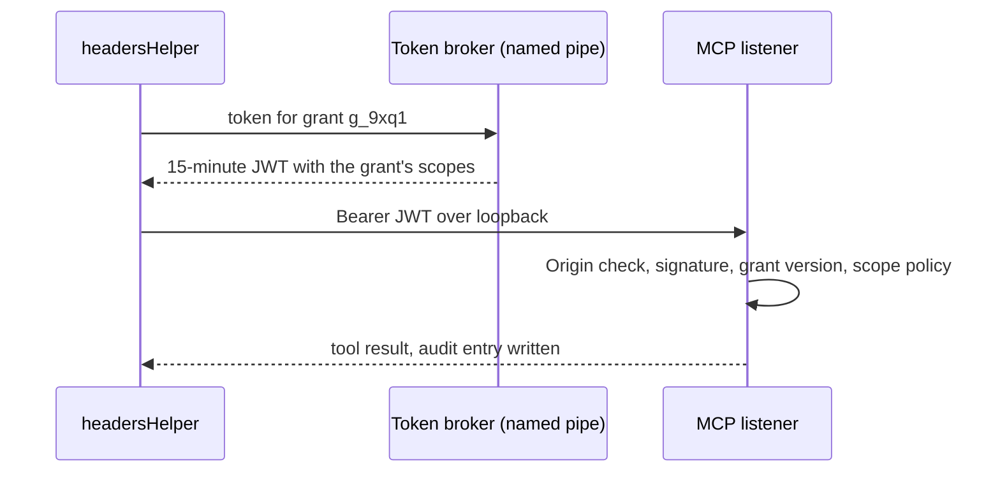
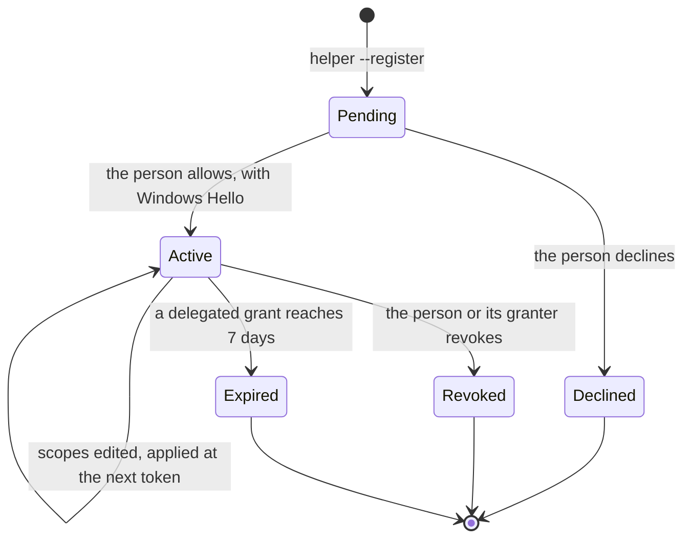

# ADR 0052: Agents and devices authenticate by grant and key, the owner by GitHub sign-in

```meta
date: 2026-11-12
related: [".devbook/arc42/08-crosscutting-concepts.md#authentication-and-authorization", ".devbook/arc42/adr/guidelines/0012-authentication-external-identity-providers.md", ".devbook/arc42/adr/guidelines/0013-authorization-zero-trust.md", ".devbook/arc42/adr/0005-azure-hosted-task-replica-for-multi-device-sync.md", ".devbook/arc42/adr/0009-captures-are-a-document-kind-on-the-replica.md", ".devbook/arc42/adr/0012-backlog-is-an-mcp-server-inside-the-desktop-app.md", ".devbook/arc42/adr/0024-claude-code-telemetry-arrives-on-the-mcp-listener.md", ".devbook/arc42/adr/0030-stored-credentials-go-through-the-os-protected-envelope.md", ".devbook/arc42/adr/0038-backlog-queues-session-requests-and-a-manager-session-dispatches-them.md", ".devbook/arc42/adr/0039-notifications-are-an-owned-document-kind-and-push-only-nudges.md", ".devbook/arc42/adr/0041-agent-questions-reach-backlog-by-presence-and-come-back-through-the-hook-or-the-manager.md", ".devbook/arc42/adr/0043-a-surface-can-open-in-its-own-window.md", ".devbook/arc42/adr/0044-devbook-subject-state-lives-in-backlogs-own-store.md", ".devbook/design/settings-pages.md"]
c4: [backlog.desktop, backlog.cloud]
c4-touches: [backlog.mobile, github, claude]
```

Backlog has one owner, and the owner never signs in to the local app: the Windows
session is the person's identity there. The owner signs in with GitHub only to enrol
the first device and to recover. Each device proves itself with a key that cannot
leave its hardware. Each agent gets a grant of its own, from which a token broker
mints 15-minute tokens with scopes. Windows Hello confirms the few actions that are
hard to undo, and approving or accepting a devbook decision stays a human action.

## Status

```meta
```

Proposed, 2026-11-11, by the flow-spec run `run-mwbv7gaz-4uj5ip` that drafted it,
as entry 1 (`write-auth-adr`) of the `zero-trust-auth` plan. **Not yet built.** It
awaits acceptance at the Personal Validation gate of this run's pull request; each
delivery phase below then goes through flow-code as its own pull request.

A **local** decision, numbered in the local sequence. Every bare ADR number below
means the local one; an inherited one is named "guideline".

It records the target shape of the zero-trust authorization proposal (revised
2026-11-09) and the answers the owner gave to its three open questions. It applies
guideline ADR 0013 to the MCP surface, and amends four records, each by a dated
note in the section that changes:

- ADR 0012 §1: the one bearer token becomes a grant's short-lived token (§3).
- ADR 0030 §6: the MCP token exception is retired (§3).
- ADR 0043 §7: a link token is minted under the `ui:open` scope (§4).
- ADR 0044 §6: who may decide a devbook subject (§7).

## Context

```meta
```

**The sync service is already close to zero trust.** Every request is bearer-only.
The service validates a 30-minute device JWT's issuer, audience, lifetime and
algorithm. A fallback-deny policy and an owner-scope filter guard every endpoint.
Two gaps remain. Registering an owner is anonymous, so anyone can create one on
the owner's Azure bill. A device proves itself with a stored secret, so a copied
`%LOCALAPPDATA%\Backlog` folder passes as the device.

**Behind the loopback edge, every MCP caller looks the same.** ADR 0012 §1 guards
the listener with an `Origin` check and one bearer token. That token sits in
plaintext in `settings.json`, the one exception ADR 0030 §6 allows. It never
expires and opens every tool. The telemetry exporter (ADR 0024) and the
`ask-backlog` question hook (ADR 0041) hold the same token, so each can also call a
write tool.

**Four changes since then made that token worth more:**

- The listener is always on: ADR 0012 §7 removed its feature flag, so switching it
  off is no longer a mitigation.
- Agents can approve and accept a devbook change (ADR 0044 §6). The host stamps
  each decision with the person's local author name, so an agent can sign off its
  own proposal and the record says the person did.
- Any token holder can mint a pop-out link (ADR 0043 §7). A browser trades it for
  a cookie with full UI access for as long as the app runs.
- An answer from the phone now reaches a waiting agent as the person's reply
  (ADR 0041). Whoever can answer can steer an agent, so device identity matters more.

Backlog has four principals, and this record proves each one differently:

| Principal | Who | Proven by |
| --- | --- | --- |
| The owner | The one human | GitHub sign-in, at enrolment and recovery only |
| A device | Desktop, phone | A hardware-bound key |
| A local agent | Claude Code, Copilot, the hooks | A grant, through the token broker |
| A remote agent | The Claude mobile app, claude.ai | OAuth 2.1 through the sync service |

The OS session already authenticates the person on the desktop. So the app adds a
check only where an attacker running as the person's Windows user would gain
something new.

## Decision

```meta
```

**Every request to Backlog names a principal, carries the least privilege it needs,
and leaves an audit entry.** The nine decisions below are one record, because each
is a part of the same answer to guideline ADR 0013.

### 1. The owner is one GitHub account, matched by its numeric user id

```meta
```

The sync service accepts one owner: the `JSdotNet` GitHub account. It matches the
account by the numeric `id` GitHub's user API answers, never by the login name,
because a login can be renamed and then taken by someone else. The id is service
configuration, not a value a client sends.

The owner signs in through GitHub OAuth in two moments only:

- **Enrolling the first device.** Registering an owner requires a GitHub sign-in
  whose user id matches the configured one. Anonymous owner creation stops.
- **Recovery.** When every device is lost, a GitHub sign-in enrols a new device
  and revokes the rest.

Every other moment rests on a device key (§2) or the Windows session. The desktop
app has no sign-in screen.

### 2. A device proves itself with a non-exportable key

```meta
```

Each device generates a key pair whose private half cannot be exported. On Windows
it lives in the CNG Platform Crypto Provider, which keeps it in the TPM. On Android
it lives in the Android Keystore. The device signs a `private_key_jwt` assertion
(RFC 7523) with that key and exchanges it for its 30-minute device token. The
stored registration credential is retired, so a copied app folder on another
machine cannot sync.

A second device still pairs by a single-use code a paired device mints; minting it
asks for Windows Hello (§6). An answer to an agent's question carries the answering
device's identity, and the hook delivers only an answer from a paired device.

### 3. A local agent holds a grant, and a broker mints its tokens

```meta
```

A **grant** is one registration: Claude Code at user scope, this repository's
`.mcp.json`, Copilot, the telemetry exporter or the question hook. The desktop app
keeps the grants. A registration carries only the grant's id, never a secret, so a
registration Dev PC copies between machines grants nothing.



- **The broker is a named pipe whose ACL admits only the person's Windows SID.**
  The OS has authenticated the caller, so the person sees no prompt. The existing
  `headersHelper` asks it at connect and again after any 401.
- **A token is a JWT** with audience `backlog-mcp-local`, the grant id as subject,
  the grant's scopes and a 15-minute expiry. The app signs it with a key it holds
  in memory only.
- **The listener keeps its `Origin` check** (ADR 0012 §1). Each tool group then
  requires a scope, enforced by named policies under fallback-deny, as the sync
  service does.
- **Revoking a grant takes effect at once.** Each grant carries a version the
  listener checks, so a token minted before the revoke is refused.
- **Every call is audited:** grant, tool, target id, outcome and correlation id.
  Settings shows the log, with a Revoke button beside each grant.
- **No long-lived MCP secret stays in a file.** `mcpServer.token` leaves
  `settings.json`. `BACKLOG_MCP_TOKEN` stays only as a development and CI escape
  hatch, off by default. This retires the exception in ADR 0030 §6.

*Broker and grants built 2026-11-11 by entry 7 (`token-broker`), beside the shared
token.* ADR 0012 §1 records how. A process of another user that takes the pipe name
first keeps the broker down, and it then learns only the grant ids clients send it.

Grants are created, listed and revoked on the MCP server's own Settings page. The
**Agents** card replaces the **Bearer token** card there, by the rules of
`.devbook/design/settings-pages.md`. Nothing in the Dev PC catalog or the Tools
pane reads or writes a grant.

*Agents card built 2026-11-12 by entry 10 (`agents-card`).* A grant stores scopes,
not a role: the roles are presets that fill the switches. A scope switch raises the
grant's version as well as storing the scope, so a token minted under the old scopes
is refused and the headers helper fetches one under the new. The switches are §4's
scopes as `McpScopes` lists them, and a change of scopes is refused like a new grant
for any scope no grant may hold. `devbook:decide` is drawn locked, and so is
`agents:grant` until switching it on asks for Windows Hello (§5, §6). The card's
registration names the repository's `tools/mcp/backlog-mcp-headers.mjs`. The page no
longer shows or rotates the shared token.

*Shared token retired 2026-11-12 by step `remove-settings-token`.* ADR 0012 §1 records
how. `settings.json` holds no MCP token, and the listener accepts none of the three
static ones. On each start the app creates its **Backlog delivery**, **Question hook**
and **Telemetry** grants once, records their ids in `settings.json`, and rewrites a
registration that still carries a retired token to the headers helper. The escape
hatch is the hand-edited debug setting `"mcpServer": { "acceptEnvironmentToken": true }`,
which the app never writes. Two `backlog-tools` scripts and the `delivery-surface-backlog`
plugin's client still read `mcpServer.token` and are refused until they move to a grant.

### 4. Scopes decide who may call a tool that is switched on

```meta
```

A tool group's feature flag still removes its tools entirely (ADR 0012 §7). A scope
decides which grant may call a tool that is listed. The names are a starting cut.

| Scope | Tools | Default grant |
| --- | --- | --- |
| `tasks:read` | `find_item`, `read_item`, `list_entries`, `get_plan_items`, `get_roadmap`, `list_goals` | every agent |
| `tasks:write` | `create_item`, `comment`, `transition`, `set_blocked`, goal attach and detach, `capture_note` | coding agents |
| `tasks:admin` | `delete_goal`, any bulk change | none |
| `devbook:read` | `read_knowledge_chapter`, `list_annotations`, `devbook_get_state`, `devbook_list_notes`, `list_sync_directions` | every agent |
| `devbook:write` | `resolve_annotation`, `devbook_post_note`, `devbook_resolve_note`, `devbook_set_state` to `draft` | coding agents |
| `devbook:decide` | approve, accept, a decided or declined state | never an agent (§7) |
| `runs:write` | the delivery surface tools, `link_*`, `list_run_usage` | delivery flows |
| `notify:ask` | `notify`, `ask`, `get_answer`, `close` | coding agents, the question hook |
| `ui:open` | `open_window` and its link tokens | coding agents |
| `sessions:dispatch` | the session-request and answer-delivery tools, the wait route (ADR 0038, 0041) | the Manager session |
| `telemetry:write` | the OTLP logs route (ADR 0024) | the telemetry exporter |
| `inbox:capture` | a capture into the Inbox | personal assistants, the remote connector (§8) |
| `agents:grant` | `list_agent_requests`, `grant_agent`, `edit_agent_scopes`, `revoke_agent` | none (§5) |

*Built 2026-11-12 by entry 8 (`scope-policies`).* ADR 0012 §1 records how. The table is
per tool, not per group, because a flag's group can hold reads and writes. Tools the table
leaves out are placed so: `list_devbook_references` is `tasks:read`, and
`set_devbook_references`, `create_goal`, `update_goal` and the impediment tools are
`tasks:write`. `list_knowledge_contexts` is `devbook:read` and `list_sessions` is
`runs:write`. Reading the Inbox is `tasks:read` and archiving a capture `tasks:write`,
because `inbox:capture` is write-only and no local tool captures yet. `inbox:capture` and
`agents:grant` are policies with no tool until §8 and entry 12. A grant that asks for a scope
outside the table is refused when it is created.

**A pop-out link is minted under `ui:open`.** This amends ADR 0043 §7. The cookie a
link buys now expires after 8 idle hours, and the app logs every link
`open_window` mints.

### 5. An agent registers itself, and only the person allows it

```meta
```

The person approves an agent, not a session. Every session, sub-agent and restart
that uses a registration gets its tokens without asking again.



- **Registering.** `headersHelper --register "<name>"` creates a pending grant over
  the pipe and saves its id in the agent's own MCP configuration. A pending grant
  gets no token. Each name has one pending request at most, and five may be open at
  once. A declined name cannot ask again for a day.
- **The request window.** `--request`, or the `request_access` tool for an agent
  that wants more scopes, brings Backlog's request window forward. Opening it
  changes nothing. It shows the agent's name, executable, folder and the scopes it
  asked for. `agents:grant` always starts switched off there.
- **Never itself.** No pipe command and no MCP tool changes the caller's own grant.
  **Allow** sits only in the desktop window and asks for Windows Hello, which a
  script or UI automation cannot pass. A request for more scopes is a new request.

*Built 2026-11-12 by entry 11 (`agent-self-registration`).* Requests live in
`mcp-access-requests.json` beside the grants. A registration's grant holds no scope,
and the broker refuses it a token as `pending` while its request is open. The
request window is the `agent-request` surface, outside the header. Opening it again
for the same request brings that window forward. A waiting request also shows as a
card on the MCP server page, as "1 waiting" on its menu badge, and as an ADR 0039
alert, which the phone shows and cannot answer. `request_access` passes the `/mcp`
caller policy, not a scope policy, because an agent that lacks a scope is the one
that must ask. Allow asks `IUserConsent`: the desktop head answers it with
`UserConsentVerifier`, and the web harness answers "not available", which refuses
every Allow.

**An agent the person gives `agents:grant` may answer other agents' requests.**
Switching it on asks for Windows Hello. The broker holds such a granter to five
rules:

- **A subset of its own scopes.** `grant_agent` refuses a scope the granter lacks.
  Each token mint cuts a delegated grant's scopes to what its granter holds then.
- **Never the powerful scopes.** `devbook:decide`, `agents:grant` and `tasks:admin`
  are never delegated, so delegation is one level deep.
- **Never itself.** The target is another grant, not its own granter. Grants the
  person or another granter made are read-only to it.
- **Bounded in time.** A delegated grant expires after 7 days unless its granter
  renews it. Revoking the granter revokes every grant it made in the same moment.
- **Visible.** A delegated grant shows under its granter on the MCP server page,
  with a quiet notification and an audit entry naming both.

A grant id is a label, not a password. A process running as the person could ask
for any grant. A grant buys scoping, revocation and an audit trail, and no grant
can carry `devbook:decide`.

### 6. Windows Hello confirms what is hard to undo

```meta
```

The desktop app asks for Windows Hello through `UserConsentVerifier` before it:

- runs a `tasks:admin` tool, such as deleting a goal or a bulk change, asked
  through MCP elicitation;
- revokes a device;
- mints a pairing code;
- allows an agent's grant;
- switches `agents:grant` on for an agent.

**A transition to Done asks for no step-up.** A delivery flow makes it routinely,
and it can be undone.

### 7. Devbook decisions are the person's

```meta
```

Approving and accepting a devbook change, and marking a subject decided or
declined, are human actions. This amends ADR 0044 §6:

- `devbook_approve` and `devbook_accept` are not served over MCP. The devbook view
  gains **Approve** and **Accept** buttons in their place.
- `devbook_set_state` over MCP accepts `draft` only and refuses every other state.
- Every other decision-group write over MCP, such as a note, is stamped
  **agent via MCP**, never with the person's author name.

Answering an agent's question stays a person's action too: only the person answers,
in the app (ADR 0041).

*Built 2026-11-11 by entry 2 (`human-only-decisions`).* ADR 0044 §6 records how.

### 8. A remote agent reaches Backlog through OAuth 2.1 on the sync service

```meta
```

The Claude mobile app reaches Backlog through a claude.ai custom connector. The sync
service gets a small **OAuth 2.1 authorization server** and a **`/mcp` resource
server** for it.

- **The authorization server signs the owner in through GitHub** (§1) and issues
  tokens only for that one subject. It uses PKCE.
- **One client is registered statically:** the claude.ai connector. The server
  offers no dynamic client registration, so no other client can appear.
- **The resource server follows the MCP authorization spec.** It publishes
  protected-resource metadata (RFC 9728), accepts only tokens bound to its own
  audience (RFC 8707), and never passes a token through.
- **It starts with `inbox:capture`.** Read scopes from §4 may follow; `tasks:admin`
  and `devbook:decide` never do.
- **It writes the replica, never the desktop.** A capture lands as a document on the
  replica (ADR 0009), and the desktop picks it up at its next sync.

The desktop listener stays bound to loopback. The person can revoke the connector's
access from Settings.

### 9. The Aspire web harness keeps no auth

```meta
```

The web harness under Aspire maps the same `/mcp` endpoint (ADR 0012 §2) and keeps
no grant, broker or step-up. It is not the installed app: it runs a development
workspace, and QA drives it. It keeps the loopback `Origin` check. Retiring the
shared token on 2026-11-12 left it unchanged: it never held one.

## Consequences

```meta
```

**It lands in four phases, each worth shipping alone:**

| Phase | Delivers | Done when |
| --- | --- | --- |
| 0, hygiene | §7; separate telemetry and hook tokens; §4's cookie expiry and link log; a Rotate button; the audit log; a rate limit on failed bearer attempts | an agent cannot approve its own change, and every tool call shows in the log |
| 1, grants | §3, §4 and §5 | no long-lived MCP secret sits in a file, and revoking a grant cuts off that client only |
| 2, device keys | §1, §2 and §6 | a copied app folder cannot sync, and nobody creates an owner without the owner's GitHub sign-in |
| 3, remote MCP | §8 | the Claude mobile app captures into the Inbox, and no other account can connect |

Phase 1 retired Phase 0's telemetry and hook tokens and its Rotate button on
2026-11-12, with the shared token they split from. Phase 3 needs only Phase 2's owner identity. Phase 2 also moves the sync service's
signing key into Key Vault under a managed identity, with a planned rotation.

- **Guideline ADR 0013 applies to the MCP surface**, besides the sync service: named
  policies over scopes, fallback-deny, short-lived tokens, and an audit of every call.
- **Malware running as the person can still ask the pipe for a token.** Windows
  cannot reliably tell which process calls. What it gains is a 15-minute, scoped,
  audited token, and no secret on disk for a backup, a sync folder or a stray
  `git add`.
- **A prompt-injected agent can still make a bad write** within its scopes. Scopes
  and Windows Hello keep the damage small and reversible, the audit log names the
  grant, and no agent can approve its own change.
- **There is still one user.** This keeps ADR 0005's single-owner model, with no
  roles and no sharing.
- **The phone cannot allow a grant.** A grant is a desktop decision, so a request
  notification on the phone only tells the person.

## Rejected

```meta
```

- **Microsoft Entra ID with a passkey as the owner's identity provider.** The
  proposal recommended it. The owner chose GitHub, the account every repository and
  the GitHub integration already use, so Backlog runs no second identity provider
  for one person. The cost is that a small authorization server must front GitHub
  for §8.
- **Matching the owner by GitHub login name.** A login can be renamed and then
  registered by someone else. The numeric id never changes.
- **Dynamic client registration for the connector.** It would let any client
  register itself against a service with one owner. One static client is all the
  connector needs.
- **Opening the desktop listener to the network for remote agents.** It would put
  every local tool one misconfiguration away from the internet. The replica is
  already the door between devices.
- **A sign-in to the local app.** The Windows session already authenticates the
  person, and a second prompt would protect nothing an attacker running as that
  user could not reach.
- **Agent approval of a devbook decision behind Windows Hello.** It may return once
  grants exist. Until then no MCP path can approve or accept at all.
- **Windows Hello on a transition to Done.** A delivery flow does it routinely, and
  the change can be undone.
- **Keeping one shared token and rotating it.** Rotation shortens a leak's life but
  still gives every caller every tool, and names no caller in the log.

## History

```meta
```

| Date | Change | Why |
| --- | --- | --- |
| 2026-11-12 | Built §5's self-registration: `--register` makes a pending grant that mints no token, `--request` and `request_access` open or focus the request window, and the waiting request shows on the MCP server page, its badge and an alert. The limits are one per name, five open and a day after a decline. Allow asks for Windows Hello, and no pipe command or tool answers a request. | Plan `zero-trust-auth` entry 11, Phase 1. |
| 2026-11-12 | Retired the shared, question-hook and telemetry tokens: the app creates its three grants on start, rewrites the registrations that carry a retired token to the headers helper, and drops the tokens. `BACKLOG_MCP_TOKEN` is accepted only under a hand-edited debug setting. | Plan `zero-trust-auth` step `remove-settings-token`, Phase 1. |
| 2026-11-12 | Built §3's Agents card on the MCP server page in the Bearer token card's place: rows with role, source, last use and scopes, switches that store on change and raise the grant's version, Revoke confirmed in place, and Add agent with its registration. | Plan `zero-trust-auth` entry 10, Phase 1. |
| 2026-11-12 | Built §4's scopes: one named policy per scope under fallback-deny, per tool and per route, a principal on every admitted request, and an audit record naming the grant. `devbook:decide` is in no grant, token or policy. | Plan `zero-trust-auth` entry 8, Phase 1. |
| 2026-11-11 | Built §3's token broker and grants beside the shared token: a named pipe for the person's SID alone mints 15-minute JWTs, and the listener refuses one older than its grant's version. Scopes are not enforced yet. | Plan `zero-trust-auth` entry 7, Phase 1. |
| 2026-11-11 | Proposed: the owner is one GitHub account matched by numeric id, devices hold hardware-bound keys, agents hold grants with 15-minute scoped tokens, Windows Hello confirms what is hard to undo, devbook decisions are human-only, and remote MCP goes through OAuth 2.1 on the sync service. Amends ADR 0012 §1, 0043 §7 and 0044 §6, and retires ADR 0030 §6's exception. | The always-on listener's one plaintext token opened every tool, including approving an agent's own devbook change. |
