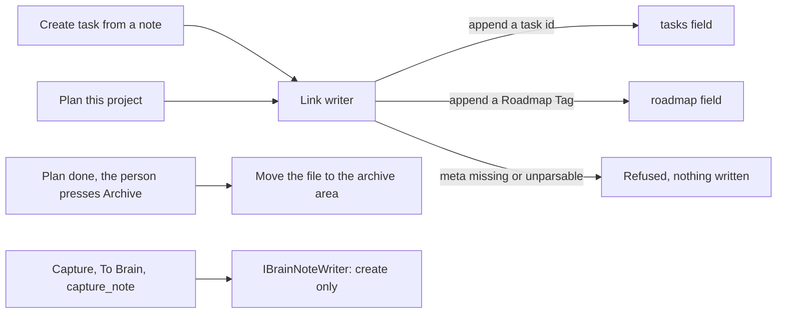

# ADR 0052: The app may write links into a Brain note and move a finished project note to the archive

```meta
date: 2026-11-11
related: [".devbook/arc42/adr/0026-the-brain-is-a-personal-devbook-outside-any-repository.md", ".devbook/arc42/adr/0040-the-brain-is-its-own-bounded-context.md", ".devbook/arc42/adr/0027-the-brain-is-a-scope-beside-the-repositories.md", ".devbook/domain/brain/features.md#bi-directional-linking", ".devbook/domain/brain/features.md#capture-into-the-brain", ".devbook/domain/brain/domain.md#cross-linking", ".devbook/domain/brain/domain.md#task-link", ".devbook/domain/brain/domain.invariants.md#cross-linking", ".devbook/domain/tasks/domain.md#roadmap-tag"]
```

The app may add a link to an existing Brain note. It appends a task id to the
note's `tasks` field, or a Roadmap Tag to its `roadmap` field, and changes
nothing else in the file. On the person's press, it may also move a finished
project note into the Brain's archive area, without changing the file.

## Status

```meta
```

Proposed, 2026-11-11. Not yet built. The repository owner decided the link
writer on 2026-10-29, as design question Q1 and change C15 of the GTD and PARA
exploration, choosing option (b) of three. The owner decided the archive move
on 2026-11-09.

A **local** decision, numbered in the local sequence. Every bare ADR number below
means the local one. Numbered 0052 because the open branches already claim
0048 to 0051.

It **amends** three sections of two records:

- **ADR 0026 §3.** The app may now write the `tasks` field of an existing note,
  which only the person and their agent wrote before.
- **ADR 0040 §3.** The `roadmap` list stays Devbook's field, and the Brain's link
  writer may append a Roadmap Tag to it.
- **ADR 0040 §4.** The `repo:` link stays one way. The app now writes a note's
  task and plan links into the note when it makes the task or plan.

It leaves ADR 0027 §6 as it is: no repository devbook links into a Brain, and the
backlinks a repository chapter shows are still never written.

## Context

```meta
```

**Picking up a note needs a link in the note.** A person turns a Brain note
into work in two ways. They create a task from the note, or they plan the
project the note describes. The note should then name that work, through its
`tasks` and `roadmap` fields, so its Tasks chips show it.

**Today the app writes no link into a note.** Apart from saving the person's own
edits in the pane, the app only creates notes. Capture writes a new note through
`IBrainNoteWriter`, and a taken name gets a numbered suffix
([Capture into the Brain](../../domain/brain/features.md#capture-into-the-brain)).
The person or their agent must add each link by hand.

**The Brain is the person's.** The person and their agent curate its folders,
fields and text (ADR 0040). An app that edits a note must leave the person's
writing alone, or the note stops being theirs.

**The folder is synced.** OneDrive or another product carries the folder between
machines. A write on one machine can meet a change on another and leave a
conflict copy, `<name>-<MACHINE>.md`, which the app shows and never merges (ADR
0026 §5).

**A finished project leaves a note behind.** When a plan's last task is done,
its project note still sits in the projects area. PARA moves it to the archive.
Doing that by hand means leaving the app.

## Decision

```meta
```



### 1. The app appends to two lists in the top `meta` block

```meta
```

The app may append a task id to a note's `tasks` field. It may append a
[Roadmap Tag](../../domain/tasks/domain.md#roadmap-tag) to the note's `roadmap`
field. Both fields sit in the note's top `meta` block.

The app only appends. It never removes, reorders or rewrites a value already in
either list. When a field is missing, the app adds it as the last line of the
block.

### 2. Everything else stays byte for byte

```meta
```

An append changes only the list it adds to. These stay byte for byte:

- the note's body, and every `meta` block below the top one;
- every other field in the top block, and the order of its keys;
- comments and blank lines in the block;
- the list's own style, flow (`[a, b]`) or block (`- a`).

### 3. A value already present is not added again

```meta
```

When the list already holds the value, the app writes nothing. A repeated link
leaves the file unchanged, so the append is idempotent.

### 4. A note without a readable `meta` block is refused

```meta
```

When the note's top `meta` block is missing or does not parse, the app writes
nothing. It tells the caller why. The person repairs the block, then links
again.

### 5. A finished project note moves to the archive on the person's press

```meta
```

When the plan a project note names in its `roadmap` field is done, the app
offers to archive the note. On the person's press, it moves the note's file into
the Brain's archive area. The move changes no byte inside the file. A Brain
without an archive area gets no offer.

### 6. Capture stays create-only, and the link writer is a second port

```meta
```

Capture through `IBrainNoteWriter` still only creates new notes. It never
changes a note already in the Brain. The link writer is a second port beside
it, in the Brain context, and the
[Cross-Linking](../../domain/brain/domain.md#cross-linking) service writes
through it. It appends to an existing note's two lists and moves
a project note's file, and it does nothing else.

## Consequences

```meta
```

Positive:

- **The note names its work.** A task or plan made from a note appears on the
  note's Tasks chips without the person editing the file.
- **The person's writing is safe.** The body and every other field stay as the
  person or their agent wrote them.
- **A repeated link is harmless.** A retry, or a second press, leaves the file
  as it was.
- **A finished project leaves the projects area.** The archive move keeps the
  projects area to the work that is still open.

Negative:

- **The Brain has a second writer.** Capture and the link writer both write into
  the folder, and each has its own rules to keep.
- **A synced folder can meet a conflict copy.** An append or a move on one
  machine can cross a change on another. The app shows the conflict copy and
  never merges it (ADR 0026 §5). The write is append-only and idempotent, so the
  person keeps either copy and links again.
- **A note with a broken `meta` block cannot be linked.** The person repairs the
  block first.

Neutral:

- **Links from a repository stay out.** ADR 0027 §6 still holds: no repository
  devbook links into a Brain, and a repository chapter's backlinks are never
  written.

## Rejected

```meta
```

- **(a) The app stays create-only, and links live only on the task or plan
  side.** The note's Tasks chips stay empty for every task made from it, until
  the person adds each id by hand.
- **(c) The app may edit note bodies, including an outcome line on archive.** A
  body is the person's writing. An app that rewrites it can lose text on a sync
  conflict, and the person can no longer tell which words are theirs.

## Verification

```meta
```

Look for tests that show these behaviours:

1. **Only the two lists change.** After an append, the file differs from before
   only in the `tasks` or `roadmap` list it added to.
2. **A missing field lands last.** Appending to a note without the field adds it
   as the last line of the top `meta` block.
3. **List style survives.** A flow list stays a flow list, and a block list stays
   a block list.
4. **A present value is not added again.** Appending a value the list holds
   leaves the file byte for byte unchanged.
5. **An unparsable block is refused.** A note whose top `meta` block is missing
   or does not parse is not written, and the caller gets the reason.
6. **The archive move keeps the bytes.** After the move, the file in the archive
   area is byte for byte the file that left the projects area.
7. **Capture still never overwrites.** `IBrainNoteWriter` still writes only new
   files.

## History

```meta
```

| Date | Change | Why |
| --- | --- | --- |
| 2026-11-11 | Proposed: the app appends to a note's `tasks` and `roadmap` lists, and moves a finished project note to the archive. | Picking up a note into a task or plan needs the link at the note's end too (Q1, C15, 2026-10-29; archive move, 2026-11-09). |
