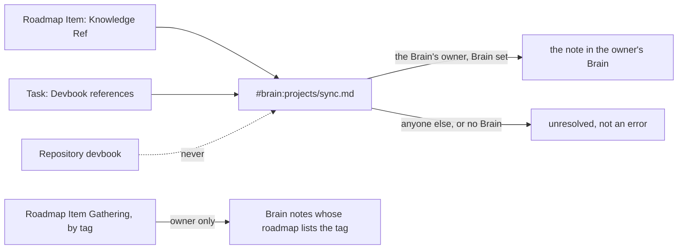

# ADR 0053: A plan or a task may reference a Brain note

```meta
date: 2026-11-11
related: [".devbook/arc42/adr/0027-the-brain-is-a-scope-beside-the-repositories.md", ".devbook/arc42/adr/0026-the-brain-is-a-personal-devbook-outside-any-repository.md", ".devbook/arc42/adr/0040-the-brain-is-its-own-bounded-context.md", ".devbook/arc42/adr/0052-the-app-may-write-links-into-a-brain-note-and-move-a-finished-project-note-to-the-archive.md", ".devbook/domain/roadmap/domain.md#knowledge-ref", ".devbook/domain/roadmap/domain.md#roadmap-item-gathering", ".devbook/domain/tasks/features.md#acceptance-from-scenario-parts", ".devbook/domain/brain/features.md#mcp-brain-scope"]
```

A Roadmap Item's Knowledge Ref and a task's Devbook references may name a Brain
note as `#brain:<path from the Brain's root>`. The address resolves only for the
Brain's owner, from their own Brain. For anyone else, and where no Brain is set,
it reads as unresolved, never as an error. Roadmap Item Gathering by tag also
gathers the owner's Brain notes whose `roadmap` list names the item's Roadmap
Tag.

## Status

```meta
```

Proposed, 2026-11-11. The plan side is built: a Roadmap Item's Knowledge Ref,
Import's `devbook:` token on a `plan` entry, gathering by tag, and the item's
Brain chips. The task side is built too: a task's Devbook references hold a Brain
address from the task's picker, Import's `devbook:` token and `set_devbook_references`;
`list_devbook_references` marks one with `scope: "#brain"`; the task shows a Brain
chip; and `run-plan-item` reads an entry's Brain notes before it works. `import-plan`
writes a plan from a Brain project note and names the note on the `plan` entry and its
steps. The repository owner settled it as changes C8 and C11 of the GTD and PARA exploration of 2026-10-29, the "pick up from the
Brain" slice.

A **local** decision, numbered in the local sequence. Every bare ADR number below
means the local one.

It **amends** ADR 0027 §6. A repository devbook still never links into a Brain,
and a repository chapter's backlinks are still never written. What changes: the
owner's own plans and tasks may now reference a Brain note.

It **builds on** ADR 0052, which lets the app write the other end of the link, a
task id or a Roadmap Tag, into the note.

## Context

```meta
```

**Picking up a note leaves the work without the note.** A person turns a Brain
note into a task or a plan (ADR 0052). The note then names the work through its
`tasks` and `roadmap` fields. The work cannot name the note back: a
[Knowledge Ref](../../domain/roadmap/domain.md#knowledge-ref) and a task's
Devbook references name a chapter in a repository's devbook folders, and a
Brain note is in none of them.

**A session needs the note as context.** A session started on a task or a plan
item reads what the task's and the item's references name. The note that
explains the work is the context it misses.

**ADR 0027 §6 runs links one way.** A Brain note links into a repository devbook,
and a repository devbook never links back. The reason is that a repository is
shared history and the Brain is personal: a link back points every other reader
at a note they cannot read.

**Plans and tasks are not repository history.** They are the person's own
records. They travel on the replica to the person's other devices (ADRs 0005 and
0018), not into a repository's git history.

**The MCP tools already spell the Brain.** They take `#brain` in place of a
repository's `owner/name`. A GitHub owner or name cannot hold a `#`, so `#brain`
matches no repository ([MCP Brain scope](../../domain/brain/features.md#mcp-brain-scope)).

## Decision

```meta
```



### 1. A Brain note is addressed as `#brain:<path>`

```meta
```

A Brain note is addressed as `#brain:<path from the Brain's root>`, as in
`#brain:projects/sync.md`, with an optional `#slug` for a chapter in the note.
The prefix is the `#brain` spelling the MCP tools take. A repository chapter's
address starts with a path, never with a `#`, so a Brain address can never match
a repository.

### 2. A Knowledge Ref and a task's Devbook references may hold it

```meta
```

A Roadmap Item's Knowledge Ref may hold a Brain address. So may a task's Devbook
references. Each behaves as its repository counterpart does. It is a reference
by value, never validated or repaired, and the plan never reads through it.

### 3. It resolves for the Brain's owner only

```meta
```

A Brain address resolves only for the Brain's owner, from their own Brain. For
anyone else it reads as unresolved, never as an error. It reads the same way
where no Brain is set. A note moved or deleted in the Brain also leaves the
address unresolved, as a moved chapter does.

### 4. The address travels, the note's content never does

```meta
```

The address travels on the replica with the plan or the task. So a note's path
reaches the person's other devices, and that is accepted. A note's content never
travels: each device resolves the address from the Brain folder it has.

### 5. Gathering by tag reaches the owner's Brain notes too

```meta
```

[Roadmap Item Gathering](../../domain/roadmap/domain.md#roadmap-item-gathering)
by tag also gathers the Brain notes whose `roadmap` list names the item's Roadmap
Tag. It does so for the Brain's owner only. A Brain note registers no progress,
as a devbook chapter does not, so it is never read as finished.

### 6. Repositories still never link into a Brain

```meta
```

ADR 0027 §6 stands for repositories. No repository devbook links into a Brain,
and the backlinks a repository chapter shows are never written. The Brain is now
referenced only from the owner's own plans and tasks.

## Consequences

```meta
```

Positive:

- **The work names the note.** A task or a plan made from a note points back at
  it, so the link runs both ways between the Brain and the backlog.
- **A session gets the note as context.** Listing a task's Devbook references
  over MCP answers the Brain notes too, and an assistant reads them through the
  `#brain` tools.
- **A plan reaches its project note without naming it.** Tagging the note with
  the plan's Roadmap Tag is enough.
- **No one else sees a note.** Another reader of a shared plan sees an
  unresolved reference, not the note.

Negative:

- **A note's path leaves the Brain folder.** It travels on the replica to the
  person's other devices, and a path can say something about its note.
- **The reference reads differently per reader.** The owner sees the note, and
  everyone else sees it unresolved.
- **A Brain set up on one device only resolves on that device.** The others read
  the address as unresolved until they have the folder.
- **An older device drops a task's Brain references.** A build from before the
  task side reads a `#brain:` address as no reference at all: its replica merge
  and its store leave it out without a word. If that device then edits the task
  and pushes it, the references are gone for every device. Update every device
  before using Brain references on tasks.

Neutral:

- **Repository devbooks are unchanged.** They hold no Brain address, as before.

## Rejected

```meta
```

- **Copying the note's text onto the plan or task.** Two copies drift, and the
  content would travel on the replica.
- **A bare `brain:` prefix.** A repository alias may be `brain`, so the address
  could collide with one.
- **Refusing a Brain address for anyone but the owner.** The plan holds the
  reference for the owner, and refusing it would lose the owner's intent.
- **Keeping the address on one device.** A plan or task read on another device
  would lose its reference.

## Verification

```meta
```

Look for tests that show these behaviours:

1. **A Brain address is accepted.** A Knowledge Ref and a task's Devbook
   references each hold `#brain:projects/sync.md`.
2. **It never matches a repository.** A `#brain:` address is never resolved
   against a repository's devbook.
3. **The owner resolves it.** With a Brain set, the address opens the note in
   the owner's Brain.
4. **Anyone else reads it unresolved.** For another reader, and with no Brain
   set, the address reads as unresolved and nothing fails.
5. **Only the path travels.** The replicated plan or task carries the address,
   and no note content.
6. **Gathering reaches tagged notes.** For the owner, gathering by tag returns
   the Brain notes whose `roadmap` list names the tag, never as finished.
7. **Repositories stay clean.** No repository devbook file holds a Brain
   address.

## History

```meta
```

| Date | Change | Why |
| --- | --- | --- |
| 2026-11-11 | Proposed: a Knowledge Ref and a task's Devbook references may name a Brain note as `#brain:<path>`, resolved for the owner only. | Picking up a note into a task or plan needs the link from the work to the note too (C8, C11, 2026-10-29). |
| 2026-11-11 | The plan side built: Knowledge Ref, Import's `plan` entry `devbook:` token (ADR 0013 amended), gathering by tag, Brain chips. | Plan entry gtd-para:14. |
| 2026-11-11 | The task side built: a task's Devbook references hold a Brain address, answered from the owner's Brain with `scope: "#brain"` over MCP, shown as a Brain chip, and read by `run-plan-item` before a session works. | Plan entry gtd-para:15. |
| 2026-11-11 | `import-plan` takes a Brain note as its source: the `plan` entry and its steps carry `devbook:#brain:` and name the note in `Read first:`; the import grammar documents the address. | Plan entry gtd-para:18. |
| 2026-11-11 | Consequences record that a device on a build before the task side drops a task's Brain references, and that a push from it loses them everywhere. | Left open by the review of PR #1763; found by plan entry gtd-para:23. |
