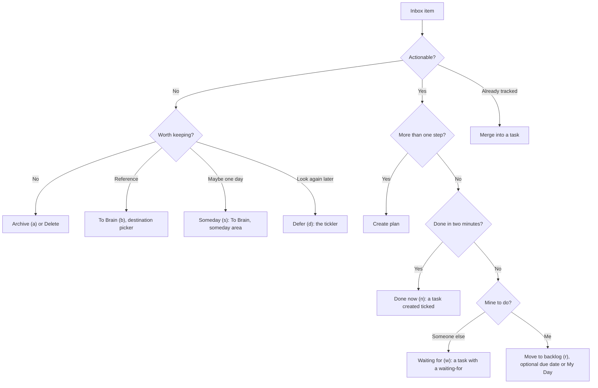

# ADR 0053: Clarify outcomes follow GTD, and each item has one home

```meta
date: 2026-11-11
related: [".devbook/arc42/adr/0026-the-brain-is-a-personal-devbook-outside-any-repository.md", ".devbook/arc42/adr/0040-the-brain-is-its-own-bounded-context.md", ".devbook/arc42/adr/0052-the-app-may-write-links-into-a-brain-note-and-move-a-finished-project-note-to-the-archive.md", ".devbook/arc42/adr/0012-backlog-is-an-mcp-server-inside-the-desktop-app.md", ".devbook/arc42/adr/0002-backlog-module-owns-the-entry-text-language.md", ".devbook/domain/inbox/features.md#per-item-triage-actions", ".devbook/domain/inbox/features.md#quick-triage-shortcuts", ".devbook/domain/inbox/features.md#route-to-brain", ".devbook/domain/inbox/features.md#work-the-queue-over-mcp", ".devbook/domain/brain/domain.md#para-category", ".devbook/domain/tasks/domain.md#waiting-for", ".devbook/design/content-editing.md#scheduling-and-dependency-tokens"]
```

Every Inbox decision is one outcome of the GTD clarify step, and every item ends
in one home. The Inbox clarifies and holds nothing for long. The Brain holds what
is not actionable. The backlog holds every commitment. Links join the three,
never copies.

## Status

```meta
```

Proposed, 2026-11-11. Not yet built. The repository owner settled every point
below on 2026-11-09, from the GTD and PARA exploration of 2026-10-29.

A **local** decision, numbered in the local sequence. Every bare ADR number below
means the local one. Numbered 0053 because 0052 is taken twice on the open
branches.

It **amends** two sections of ADR 0026:

- **§2.** The PARA default set gains `someday`, after `projects`.
- **§3.** A note may carry a fourth field, `review`, which the app reads and
  never writes.

It adds a tool to ADR 0012's Inbox tool group, and two named tokens to the entry
grammar ADR 0002 gives the Tasks module. Neither changes a rule of those records.

## Context

```meta
```

**GTD needs one trusted place per item.** Getting Things Done clarifies each
capture once: is it actionable, and if not, is it worth keeping? The answer
decides where the item lives. Backlog already has three places, the Inbox, the
Brain and the backlog, but nothing says which one an item belongs in.

**Today's decisions cover part of the tree.** Triage offers Move to backlog,
Create plan, To Brain, Defer, Archive, Delete and Merge. It has no outcome for
work done on the spot, for work someone else owes, or for a maybe.

**To Brain files twice.** Every note routed To Brain lands in the Brain's inbox
area, so a capture already judged worth keeping is sorted again in the Brain.

**An assistant skips clarify.** `capture_note` writes straight into the Brain's
inbox area. An assistant asked to "remind me to call Anna" makes a note, not
something the person decides on.

**Waiting is not an impediment.** An [Impediment](../../domain/progress/domain.md#impediment)
holds back a goal and has its own lifecycle in Progress. A task waiting on a
reply from one person needs only a name and a date to chase it.

## Decision

```meta
```



### 1. Each item has one home, and links join them

```meta
```

| Home | Answers | Holds |
| --- | --- | --- |
| Inbox | What is this? | Captures until they are clarified, and deferred items until their date |
| Brain | What do I know? | Reference, project support, ongoing standards, possibilities |
| Backlog | What will I do? | Every commitment: tasks, plans, goals, waiting-for |

An item lives in one home. The Inbox clarifies it and lets it go. A Brain note
holds no commitment: a checkbox in a note points at a task, it is not the task.
A task holds no reference material: it links to the note that explains it.
The homes are joined by links, a note's `tasks` and `roadmap` fields (ADR 0052)
and a task's links, never by copying text from one to another.

### 2. The Inbox decisions and their keys

```meta
```

| Decision | Key | GTD outcome | Ends in |
| --- | --- | --- | --- |
| Archive | **a** | Trash, kept findable | The Inbox archive |
| Delete | — | Trash | Nothing |
| To Brain | **b** | Reference | A note in the area or project the picker names |
| Defer | **d** | Tickler | The Inbox, back on its review date |
| Someday | **s** | Someday or maybe | A note in the Brain's `someday` area |
| Done now | **n** | Do it now | A task created already ticked |
| Waiting for | **w** | Delegate | A task with a waiting-for value |
| Move to backlog | **r** | Next action | A task, optionally with a due date or in My Day |
| Create plan | — | Project | A plan in the backlog |
| Merge | — | Already tracked | A comment on the task |

**To Brain** opens a destination picker. It lists the Brain's areas and the
active notes in its `projects` area, and starts on the inbox area. A note filed
into a project goes into that project's folder beside its note.

**Someday** is To Brain with the `someday` area chosen, in one press.

**Done now** and **Waiting for** route the item to a task, as Move to backlog
does: the item is routed once, and a failure on the Tasks side leaves it open.

### 3. The PARA default set gains `someday`

```meta
```

When `CONVENTIONS.md` declares no areas, the default set is `_inbox`,
`projects`, `someday`, `areas`, `resources`, `people`, `journal` and `archive`.
`someday` holds possibilities not committed to. A Brain whose `CONVENTIONS.md`
declares its own areas is unchanged: it gets no `someday` area unless it
declares one.

### 4. A task may wait for someone

```meta
```

A task's **waiting-for** is who it waits on, as free text, and an optional
follow-up date. Entry text writes them as two named tokens on the metadata line:
`waiting:<who>` and `followup:<YYYY-MM-DD>`. A follow-up date that has passed
reads overdue, as a reminder does. Clearing the waiting-for returns the task to
the person's next actions. A waiting-for is not an Impediment and creates none.

### 5. Contexts are tags starting with `@`

```meta
```

A context is a tag whose name starts with `@`, written `#@pc` or `#@calls`. It
is a convention on tags, not a new field.

### 6. A Brain note may name a review date

```meta
```

A note may carry `review: <YYYY-MM-DD>` in its top `meta` block. The weekly
review reads it. The app never writes it, not even through the link writer of
ADR 0052.

### 7. An assistant captures an action into the Inbox

```meta
```

A new MCP tool beside `capture_note` captures into the Inbox, so an action an
assistant hears reaches clarify. `capture_note` stays the way to file a note the
person has already judged worth keeping.

### 8. The weekly review walks all three homes

```meta
```

- **Get clear.** The Inbox and the Brain's inbox area to zero, and the deferred
  items due this week.
- **Get current.** Every active plan has a ready next action, every project note
  has a plan, waiting-for past its follow-up date, overdue due dates.
- **Get creative.** The `someday` notes to promote or drop, and the notes whose
  `review` date has come.

This record decides what the review reads, not where it is shown.

## Consequences

```meta
```

Positive:

- **One decision files an item.** A capture is clarified and organized in one
  press, and the Brain's inbox area holds only what the person chose to sort
  later.
- **Every GTD outcome has a key.** Done now, Waiting for and Someday join the
  decisions triage already had.
- **Waiting is cheap.** A name and a date chase a reply without the weight of an
  Impediment.
- **Contexts cost nobody a field.** A person who does not use them sees nothing
  new.

Negative:

- **A task gains two stored values.** The waiting-for and its follow-up date
  ride the task feed, so the replica, the phone and the entry grammar all learn
  them.
- **`#@pc` is not a tag today.** The tag grammar takes a letter after `#`, and
  the canonical rewrite treats `#@` as a corrupt person tag. The parser and the
  rewrite must admit an `@` context before contexts work.
- **`review` is a retired devbook field.** The devbook check reports a `review`
  field since its contract 21. The repository check never reads a Brain, but a
  person who runs the devbook check over their Brain sees it reported.
- **A Brain without a `someday` area cannot take Someday.** The key is offered
  disabled there, with its reason.

Neutral:

- **The two inboxes keep different jobs.** The app's Inbox clarifies; the
  Brain's inbox area is a tray of notes already kept.

## Rejected

```meta
```

- **Someday as an `idea` task in the backlog.** A possibility not committed to is
  not a commitment, and the backlog holds only commitments.
- **Done now as an archived item.** It leaves no record of the work. A ticked
  task is counted with the rest.
- **Waiting-for as a tag, or as an Impediment.** A tag cannot carry the date; an
  Impediment holds back a goal and has its own lifecycle.
- **Contexts as a field.** Many people drop contexts, and a field would be dead
  weight for them.

## Verification

```meta
```

Look for tests that show these behaviours:

1. **The keys decide.** **s**, **n** and **w** take Someday, Done now and
   Waiting for, as their buttons do.
2. **To Brain files where the picker points.** A note routed to an area or a
   project lands in that folder, and the picker starts on the inbox area.
3. **Done now ticks.** The task the item becomes carries today's `completed:`.
4. **Waiting-for round-trips.** `waiting:` and `followup:` parse, save and
   rewrite unchanged, and a passed follow-up date reads overdue.
5. **The default set has eight areas.** A Brain declaring none shows `someday`
   after `projects`; a Brain declaring its own shows only those.
6. **`#@pc` is a tag.** It parses as the tag `@pc` and survives the canonical
   rewrite.
7. **The app never writes `review`.** No writer of the Brain adds or changes it.
8. **An assistant's capture lands in the Inbox.** The new tool makes an Inbox
   item, not a Brain note.

## History

```meta
```

| Date | Change | Why |
| --- | --- | --- |
| 2026-11-11 | Proposed: Inbox decisions follow the GTD clarify tree, each item has one home, and the Brain gains a `someday` area. | The owner settled the outcomes, keys and fields on 2026-11-09. |
