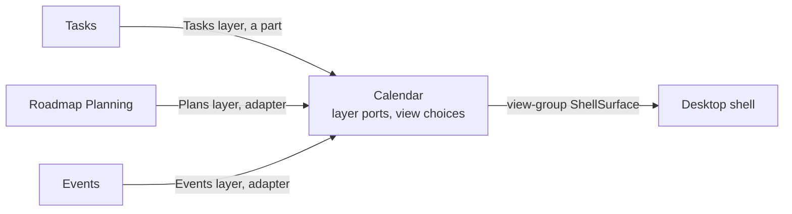

# ADR 0055: Calendar is a surface of its own that reads layers

```meta
date: 2026-11-12
related: [".devbook/domain/calendar/context.md", ".devbook/domain/calendar/features.md#calendar-view", ".devbook/domain/calendar/features.md#planned-hours", ".devbook/domain/tasks/features.md#tasks-on-the-calendar", ".devbook/domain/events/features.md#events-on-the-calendar", ".devbook/domain/roadmap/features.md#laying-out-a-plan-whose-tasks-arrived-first", ".devbook/domain/context-map.md", ".devbook/arc42/adr/0022-the-shell-shows-one-main-view-picked-by-a-view-switch.md#1-one-main-view-always", ".devbook/arc42/adr/0042-repository-management-owns-pull-request-state.md", ".devbook/arc42/adr/0043-a-surface-can-open-in-its-own-window.md", ".devbook/arc42/adr/0050-events-is-its-own-bounded-context.md#7-the-code-is-one-module-trio", ".devbook/arc42/adr/guidelines/0005-modular-monolith-structure.md"]
c4-touches: [backlog.desktop.shell]
```

The Calendar is a surface of its own, and the Calendar context owns it. It owns no
data and stores nothing but its own view choices. Each source draws on it as a
**layer**: Tasks, Plans and Events. Plans and Events come through layer ports the
Calendar owns, and Tasks offers its layer as a part the Calendar hosts. The
Calendar keeps its slot in the header, and every stored name stays as it is.

## Status

```meta
```

Proposed, 2026-11-11, by the flow-spec run of step 11 of the `knowledge-events` plan,
run unattended. The decisions were settled with the repository owner before the plan
was imported, and this record writes them down. The chapters live in
`.devbook/domain/calendar/`. The `flow-code` run of step 12 built the module trio and
the Tasks and Plans layers. The Events layer and the Show events choice still reach
the Calendar through Tasks' `ICalendarEvents`, drawn by the Tasks part, until step 13
of the plan builds them.

A **local** decision, numbered in the local sequence. Every bare ADR number below
means the local one. Numbers 0051 to 0054 were skipped, because open branches claim
them: `plan/schedules-and-loops` claims 0051, `plan/zero-trust-auth` and a `gtd-para/`
branch claim 0052, and that `gtd-para/` branch also claims 0053 and 0054.

It supersedes ADR 0022 §1's rule that Tasks, Board and Calendar are one pane, the
Tasks pane, in three layouts. Tasks and Board stay one pane. The rest of ADR 0022
stands, its header order and `calendarPlansShown` included. It also supersedes ADR
0050 §7's sentence that Tasks draws the events layer. Events' read contract stays as
ADR 0050 decided it.

## Context

```meta
```

**The Calendar reads more than tasks.** It began as the filtered tasks laid out by
due date (ADR 0022). Then it drew the roadmap's plans, through a Tasks-owned port
`ICalendarPlans`, and the decided knowledge events, through a second Tasks-owned port
`ICalendarEvents` (ADR 0050 §7). The working week behind the planned hours comes in
through a third, `ICalendarCapacity`. Each new source is one more port in
`Backlog.Modules.Tasks.Abstractions`.

**Tasks learns what it does not own.** Each port puts another context's language in
Tasks' published surface: a plan's window and points, an event's state and key dates.
Tasks only passes them through to the screen.

**More sources are coming.** Goals and an external calendar feed are the likely next
ones. A Tasks-owned port per source stops making sense once a source has nothing to do
with tasks.

**To the person it is a section already.** The header reads `Tasks | Board | Calendar
| Roadmap`. Only its implementation is a layout of the Tasks pane. Moving it out moves
ownership more than it moves pixels.

**ADR 0043 lets a module register a surface.** A `ShellSurface` registered from a
module's `.UI` project appears in the header and can pop out, with no shell edit.

**ADR 0042 forbids a cycle between contexts.** A context reads another through a port
it owns, answered by an adapter under `src/Infrastructure/`. Progress reads each owner
that way and stores nothing of theirs.

## Decision

```meta
```



Each arrow runs from the source to the context that depends on it, as on the
[context map](../../domain/context-map.md). The Calendar references no source, and no
source references the Calendar.

### 1. Calendar is a surface of its own, and owns no data

```meta
```

The [Calendar](../../domain/calendar/context.md) is a Supporting context. It owns the
Calendar surface, the layer ports and its view choices. It owns no task, plan or event,
and keeps no copy of one. Each layer is read fresh from its source.

What it stores is its own view choices, on this device:

- the range, **Month | Week**;
- the **Show plans** choice;
- the **Show events** choice.

The date shown is never stored, as today.

### 2. Each source answers a layer port the Calendar owns

```meta
```

The layer ports live in `Backlog.Modules.Calendar.Abstractions`. An adapter under
`src/Infrastructure/` answers each one over its source's published contract. The Tasks
layer is the exception: Tasks offers it as a part, registered through a host contract
in `Backlog.UI.Components`, and the Calendar surface renders it. It is a part because
the filter bar and the open task come with it (§3). So the Calendar references no
source module, and no source references the Calendar: there is no cycle (ADR 0042).

| Layer | Reaches the Calendar through | As built |
| --- | --- | --- |
| Tasks | A part Tasks offers | `TasksCalendarPart`, registered as `CalendarTasksLayer` |
| Tasks, the hours worked each day | A port, over Roadmap's working week and days off | `ICalendarCapacity`, answered by `RoadmapCalendarCapacity` |
| Plans | A port, over Roadmap's plans | `ICalendarPlans`, answered by `RoadmapCalendarPlans` |
| Events | A port, over Events' `IKnowledgeEventReader` | Not built: `ICalendarEvents` in Tasks, answered by `EventsCalendarEvents` |

Both Roadmap adapters sit in `Backlog.Infrastructure.FileSystem/Calendar/`. Two of the
three Tasks-owned ports have moved to the Calendar, and `ICalendarEvents` moves at
step 13. Tasks' `.Abstractions` then names no plan window, no working week and no
event.

A layer writes only back through its source, and the source decides whether a write
is taken. The Tasks part calls Tasks' own commands, and a port carries its source's
command:

- **Tasks:** a due date set by a drag, and planned hours set, changed or removed.
- **Plans:** a shelf plan's window started on a day. The roadmap works out its end.
- **Events:** nothing. An event bar takes no drag.

### 3. The layers are Tasks, Plans and Events

```meta
```

The **Tasks layer** is always drawn. It is the Tasks view's reading of the same tasks,
so it carries what the Tasks pane carries:

- the Tasks filter bar, which narrows the Tasks layer only;
- the open task beside the calendar;
- the tray of open tasks with no due date;
- the [planned hours](../../domain/calendar/features.md#planned-hours) against the
  hours the person works that day;
- the drag that sets a due date.

The filter, the open task and the selection are the window's, so switching between
Tasks, Board and Calendar keeps them (ADR 0043 §5). The tasks' own behaviour is
described under Tasks, in
[Tasks on the Calendar](../../domain/tasks/features.md#tasks-on-the-calendar).

The **Plans layer** and the **Events layer** are each switched by their layer choice,
**Show plans** and **Show events**, off by default. Show events is offered only while
the [Events area](../../domain/events/context.md#events-area) is on.

A new source joins as a fourth layer: a port in the Calendar, an adapter, and a layer
choice. Nothing in Tasks changes.

### 4. The header and the stored names do not change

```meta
```

The Calendar keeps its slot in the view switch, `Tasks | Board | Calendar | Roadmap`
(ADR 0022 §2). It is a view-group `ShellSurface`, id `calendar`, registered from the
Calendar's `.UI` project in place of Tasks' (ADR 0043 §1).

Every stored name stays, so nothing migrates:

| Stored in `shell-navigation.json` | Holds |
| --- | --- |
| `lastView: calendar` | The Calendar as the view last shown |
| `calendarRange` | The range, `Month` or `Week` |
| `calendarPlansShown` | The Show plans choice |
| `calendarEventsShown` | The Show events choice |

### 5. The chapters move to the Calendar context

```meta
```

The Calendar's chapters live in `.devbook/domain/calendar/`. The
[Calendar view](../../domain/calendar/features.md#calendar-view) and
[Planned hours](../../domain/calendar/features.md#planned-hours) chapters move there
from Tasks and keep their anchors. Tasks keeps
[Tasks on the Calendar](../../domain/tasks/features.md#tasks-on-the-calendar), which
describes the Tasks layer. The [Planned Hours](../../domain/tasks/domain.md#planned-hours)
a task holds stay Tasks' value object.

### 6. The code is one module trio

```meta
```

The module is `Backlog.Modules.Calendar`, with `Backlog.Modules.Calendar.Abstractions`
for the layer ports and `Backlog.Modules.Calendar.UI` for the surface (inherited ADR
0005). Its core project holds no aggregate, because the context owns no data. The
calendar components move from `Backlog.UI.Components/Tasks/` with the surface, or stay
shared where another screen uses them.

## Consequences

```meta
```

Positive:

- **A new source is one layer.** It costs a port, an adapter and a choice, and no edit
  in Tasks or the shell.
- **Tasks stops passing through other contexts' language.** Its published surface names
  no plan window and no event.
- **Events lands where it is drawn.** The Events edge reaches the Calendar, not Tasks.
- **Nothing changes for the person.** The header, the choices and the stored names stay.

Negative:

- **The filter bar and the open task must reach another module.** The Tasks layer
  draws Tasks' filter bar and open task inside the Calendar's surface, so Tasks has to
  offer them as a part the Calendar hosts. This is the one thing a rebuild could lose
  by accident.
- **Each layer needs a write path.** The drag and the hours go through Tasks' commands,
  and a shelf plan's start through the roadmap's.
- **There is more to build.** A module trio, three adapters and the Tasks part join
  the system.
- **The chapters run ahead of the code for the Events layer.** Until step 13 lands,
  [the Calendar's chapters](../../domain/calendar/context.md) describe an Events layer
  the code still reads through Tasks' `ICalendarEvents` and draws in the Tasks part.

Neutral:

- **The phone is unchanged.** It has no Calendar.
- **The Board stays a layout of the Tasks pane.** It reads only tasks.

## Rejected

```meta
```

- **A Tasks-owned port per source.** It works for two sources, and it is how plans and
  events landed. Every further source would put another context's language into Tasks'
  published surface, for a screen Tasks does not need to own.
- **A Calendar that keeps copies of what it shows.** A store of its own would be a
  second truth for every due date and window, and would need its own sync. A layer is
  read from its source each time.
- **One filter bar over every layer.** Plans and events carry no task type, status or
  priority, so the Tasks filters mean nothing to them. The filter bar narrows the Tasks
  layer, and the other layers have their choice.
- **A Tasks layer that can be switched off.** Without it the Calendar would lose its
  tray, its hours and its drags, and read as an empty month. It stays always drawn.
- **Renaming or migrating the stored keys.** `calendarPlansShown` and the others are
  persisted values. Renaming them costs a migration and risks resetting a person's
  choices, for no change they would see.
- **Calendar as part of Events, Roadmap or Progress.** Each would own a screen that
  reads the others, which is the same problem moved.

## Verification

```meta
```

Look for these in the specification and, once built, in the code:

1. **No data.** No Calendar chapter or type holds a task, plan or event, and its only
   writes are the three view choices.
2. **Ports are the Calendar's.** `Backlog.Modules.Calendar.Abstractions` holds the
   layer ports, and `Backlog.Modules.Tasks.Abstractions` holds no `ICalendarPlans`,
   `ICalendarEvents` or `ICalendarCapacity`.
3. **No cycle.** `ModuleBoundaryTests` find no reference from the Calendar to a source
   module, nor back.
4. **Writes go back through the source.** A drag and an hours edit change the task
   through Tasks, and a shelf drop starts the plan through the roadmap.
5. **The Tasks layer keeps the filters.** A filter pressed on Tasks narrows the
   Calendar's tasks, and the open task stays open on switching views.
6. **Stored names.** An existing `shell-navigation.json` reopens on the Calendar with
   its range and both choices, unchanged.

## History

```meta
```

| Date | Change | Why |
| --- | --- | --- |
| 2026-11-12 | Tasks and Plans layers built: the `Backlog.Modules.Calendar` trio and its view-group surface; `ICalendarPlans` and `ICalendarCapacity` moved to the Calendar, answered by `RoadmapCalendarPlans` and `RoadmapCalendarCapacity`; the range and Show plans as the Calendar's own view choices. §2 amended: the Tasks layer is a part Tasks offers, `TasksCalendarPart` through `CalendarTasksLayer` in `Backlog.UI.Components`, not a port. The Events layer stays with Tasks until step 13. | The filter bar and the open task must come with the Tasks layer, as the Negative consequences foresaw, and a port carries neither. Step 12 of the `knowledge-events` plan. |
| 2026-11-11 | Proposed: the Calendar is a surface of its own that reads the Tasks, Plans and Events layers through ports it owns, storing only its view choices. Supersedes ADR 0022 §1's one-pane rule for the Calendar. | Each new source was one more Tasks-owned port, and the next sources have nothing to do with tasks. |
