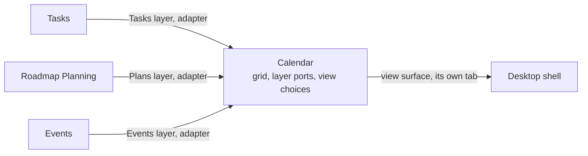

# ADR 0056: The Calendar owns its grid, and Tasks is one layer

```meta
date: 2026-11-18
related: [".devbook/arc42/adr/0055-calendar-is-a-surface-of-its-own-that-reads-layers.md", ".devbook/domain/calendar/context.md", ".devbook/domain/calendar/features.md#calendar-view", ".devbook/domain/calendar/features.md#planned-hours", ".devbook/domain/tasks/features.md#tasks-on-the-calendar", ".devbook/domain/events/features.md#events-on-the-calendar", ".devbook/domain/roadmap/features.md#laying-out-a-plan-whose-tasks-arrived-first", ".devbook/domain/context-map.md", ".devbook/arc42/adr/0022-the-shell-shows-one-main-view-picked-by-a-view-switch.md#2-the-view-switch-holds-the-task-views-in-progress-sits-with-the-work-in-progress", ".devbook/arc42/adr/0042-repository-management-owns-pull-request-state.md", ".devbook/arc42/adr/0043-a-surface-can-open-in-its-own-window.md", ".devbook/arc42/adr/0050-events-is-its-own-bounded-context.md#7-the-code-is-one-module-trio", ".devbook/arc42/adr/guidelines/0005-modular-monolith-structure.md", ".devbook/design/interaction-guidelines.md#shell-header"]
c4: [backlog.desktop.calendar]
c4-touches: [backlog.desktop.shell, backlog.desktop.tasks, backlog.desktop.roadmap, backlog.desktop.events]
```

The Calendar draws its own grid. Tasks reaches it the way Plans and Events do: through
a layer port the Calendar owns, `ICalendarTasks`, answered by an adapter over Tasks'
published contract. The Tasks filter bar, the open task and the tray of undated tasks
leave the Calendar. A **Show tasks** choice switches the Tasks layer, and the Calendar
gets a header tab of its own, outside the view switch.

## Status

```meta
```

Proposed, 2026-11-18, by a flow-spec run, from the repository owner's answers of the
same day. Specification only: no code has changed. A later `flow-code` run builds it.

A **local** decision, numbered in the local sequence. Every bare ADR number below
means the local one.

It supersedes, in [ADR 0055](0055-calendar-is-a-surface-of-its-own-that-reads-layers.md):

- §2's exception that Tasks offers its layer as a part. Every layer is now a port.
- §3's Tasks layer: always drawn, under the Tasks filter bar, beside the open task,
  with the tray of undated tasks.
- §6's last sentence, that the calendar components may stay shared. §1 below says
  which move and which stay.
- The Rejected bullet "A Tasks layer that can be switched off".

It amends ADR 0055 §4 with one stored key, `calendarTasksShown`, and its header half
(§4 below). The rest of 0055 stands: §1's Calendar that owns no data, §4's other
stored names, §5's chapters, the three adapters it built, and no cycle.

It amends [ADR 0022 §2](0022-the-shell-shows-one-main-view-picked-by-a-view-switch.md#2-the-view-switch-holds-the-task-views-in-progress-sits-with-the-work-in-progress):
the view switch becomes `Tasks | Board | Roadmap`, and the Calendar is a tab of its
own.

## Context

```meta
```

**With no Tasks module, the Calendar draws nothing.** `CalendarSurface.razor` renders
whatever `CalendarTasksLayer` names, through a `DynamicComponent`. Tasks registers
`TasksCalendarPart`, whose `TasksCalendarBody.razor` renders `TaskCalendar` with the
tasks, and with the plans, events and hours the Calendar hands down. The grid is
Tasks' component, so a host without Tasks has a Calendar surface and no calendar.

**The part was there for the filter bar and the open task.** ADR 0055's History says
so: a port carries neither. Both are the Tasks pane's state, so the part brought
Tasks' window state into the Calendar's surface. The Calendar read as a third layout
of the Tasks pane, which ADR 0055 set out to end.

**The person sees the Calendar as its own place.** The repository owner expected the
Calendar to stand free of the Tasks features once events landed. The filter bar and
the open task tie it to Tasks on screen, and the view switch places it among the
Tasks pane's layouts.

**Plans and Events already show the shape.** Each answers a Calendar port through an
adapter in `Backlog.Infrastructure.FileSystem/Calendar/`, carries `Available`, and
answers Off in a host without its source (`NoCalendarEvents`).

## Decision

```meta
```



Each arrow runs from the source to the context that depends on it, as on the
[context map](../../domain/context-map.md). The Calendar references no source module,
and no source references the Calendar.

### 1. The Calendar owns the grid

```meta
```

`TaskCalendar.razor` moves from `Backlog.UI.Components/Tasks/` into
`Backlog.Modules.Calendar.UI`, and takes a Calendar name there. The records it draws
move with it:

| Today in `Backlog.UI.Components/Tasks/` | Moves to |
| --- | --- |
| `CalendarTask`, `CalendarTaskState`, `CalendarDueChange`, `CalendarMonth` | `Calendar.UI` |
| `CalendarPlan`, `CalendarMilestone`, `CalendarShelfPlan`, `CalendarPlanStart`, `CalendarPlanSegment`, `CalendarPlanLanes` | `Calendar.UI` |
| `CalendarEvent`, `CalendarKeyDate`, `CalendarEventSegment`, `CalendarEventLanes` | `Calendar.UI` |
| `CalendarLanes` | `Calendar.UI` |
| `CalendarHoursBlock`, `CalendarHoursChange`, `CalendarDayHours` | `Calendar.UI` |
| `CalendarRange` | `Calendar.UI`, beside `ICalendarViewPreferences` |

`CalendarRange` needs no `.Abstractions` home. The shell's
`ShellCalendarViewPreferences` already references `Calendar.UI`, and
`ShellNavigationStore` stores the range as a name, not as the enum. No infrastructure
type needs a moved record.

Two pieces stay shared in `Backlog.UI.Components/Tasks/`, because the Tasks detail
panel uses them:

- `PlannedHoursEditor.razor`, the detail panel's Planned hours editor;
- the `CalendarHours` helpers it uses (presets, parse, the hours limit), with
  `PlannedHoursDay` and `PlannedHoursDayChange`. The code run may rename them, since
  no calendar uses them any more.

The storybook page `TaskCalendarPage.razor` moves with the component, and its
`StorybookIndex` entry follows.

### 2. Tasks answers a layer port, `ICalendarTasks`

```meta
```

`ICalendarTasks` sits in `Backlog.Modules.Calendar.Abstractions/Services/`, beside
`ICalendarPlans` and `ICalendarEvents`. It:

- reads the tasks for a window: each task with a due date in it, with its title, its
  state, whether it repeats, its repository, and its planned-hours blocks;
- raises `Changed` when a task changed, from Tasks' `ITaskChangeSignal`;
- sets a task's due date;
- sets, changes or removes a task's planned hours on a day.

Each read carries `Available`, as `CalendarPlansDto` and `CalendarEventsDto` do.

| Host | Answered by |
| --- | --- |
| With Tasks | `TasksCalendarTasks`, in `Backlog.Infrastructure.FileSystem/Calendar/`, over `ITaskItems`, `ITaskLookup`, `ITaskStore` and `ITaskChangeSignal` |
| Without Tasks | `NoCalendarTasks`, which answers Off and refuses every write |

A write still goes back through the source, which decides whether it is taken (0055
§2). Planned hours go through `ITaskItems.SetPlannedHoursAsync`. Tasks' published
contract has no due-date command today: the Tasks pane writes it from its own state.
The code run adds one to `ITaskItems`, writing the due date the way the detail
panel's Due row does.

`ICalendarCapacity` stays as built. The hours a person works each day are a Calendar
concern, answered over Roadmap's working week.

The repository scope and the repository colours are the window's, not Tasks'. The
Calendar asks for them through a port of its own that the host answers from the
window's view state, the way the Devbook asks `IDevbookWindowScope`. The scope
narrows the Tasks layer, Brain included. The colours mark a task chip and a plan bar
while they are showing. The code run names the port.

### 3. The shared part contract goes

```meta
```

These are retired:

- `CalendarTasksLayer` and `CalendarLayerInputs`, in `Backlog.UI.Components/Calendar/`,
  with `CalendarPlansInputs`, `CalendarEventsInputs` and `CalendarPlanWindow`;
- `TasksCalendarPart` and `TasksCalendarBody.razor`, in `Backlog.Modules.Tasks.UI`;
- the registration at `TasksSurfaceRegistration.cs` that offers the part.

`CalendarSurface` renders the grid itself, and reads all three layers through its
ports. `Backlog.Modules.Tasks.UI` registers nothing for the Calendar.

### 4. The Tasks layer: what it keeps, what it drops

```meta
```

The Tasks layer draws, through `ICalendarTasks`:

- each task with a due date in the window, within the repository scope;
- a finished task struck through and never overdue, as today. An archived task is
  left out, as the Tasks view's default leaves it out;
- the drag that moves a task to another day, which sets its due date;
- the [planned hours](../../domain/calendar/features.md#planned-hours): the chips,
  **Add hours…**, the Shift-drag, and each day's total against the hours worked that
  day.

It drops:

| Dropped | Why |
| --- | --- |
| The Tasks filter bar | It is the Tasks pane's. The scope chips narrow the layer, and Show tasks switches it |
| The open task beside the grid | Pressing a task opens it in Tasks (§5) |
| The tray of open tasks with no due date | It reads the backlog, not the calendar. A due date is set in Tasks |
| The My Day count | It is Tasks' measure of the day, not the Calendar's |
| The shared selection | The Calendar keeps none. Opening a task sets the Tasks selection |

The **Show tasks** choice switches the layer, tasks and hours together. It is on by
default. It is offered only while `ICalendarTasks` answers `Available`. It is the
Calendar's own view choice, stored as `calendarTasksShown` in `shell-navigation.json`.
That amends 0055 §4's "every stored name stays": this key is new, and nothing else
changes. An absent key reads as on, so every existing file shows the tasks as before.

### 5. Opening a task goes to Tasks

```meta
```

Pressing a task on the Calendar asks the window's `ISurfaceNavigator` (ADR 0043 §3)
to show the `tasks` surface with the `entry` query key set to the task. The Tasks
view replaces the Calendar, with that task selected and open. The Calendar names the
surface by its published id and key, and references no Tasks project.

### 6. A host with no Tasks module still draws plans and events

```meta
```

With `NoCalendarTasks` answering, the Calendar draws the grid with the Plans and
Events layers, under their own choices. Show tasks is not offered. Nothing in the
surface waits for a part.

### 7. The Calendar gets a header tab of its own

```meta
```

The Calendar leaves the view switch. The header's navigation region reads, left to
right: **Inbox**, the view switch `Tasks | Board | Roadmap`, the **Calendar** tab,
**Devbook**, and the rest as ADR 0022 and the
[shell header](../../design/interaction-guidelines.md#shell-header) place them. The
Calendar tab stands alone, outside the fused group. It still acts as a view option:
it is a view-group `ShellSurface`, id `calendar`, so it is pressed while the Calendar
is the main view and never closes. It leads with its glyph, as before. Its
`aria-controls` names the Calendar's own region instead of the Tasks pane.

While the Calendar shows, the shell no longer counts a task list on screen. So the
GitHub check is not offered there, and Ask AI has no Tasks area there.

`lastView: calendar` is read as before: the id is unchanged, so a stored file reopens
on the Calendar, now under its own tab. Nothing migrates.

## Consequences

```meta
```

Positive:

- **The Calendar stands on its own.** A host with no Tasks module draws plans and
  events.
- **Every layer is built the same way.** Port, adapter, Off answer and choice. The
  one exception in 0055 §2 is gone.
- **Tasks registers nothing for the Calendar.** `Backlog.UI.Components` holds no
  calendar.

Negative:

- **The person loses the Tasks filters on the Calendar.** A filter set on Tasks no
  longer narrows the Calendar. The scope chips and Show tasks are what is left.
- **The tray goes.** An undated task cannot be dragged onto a day. A due date is set
  in Tasks.
- **Opening a task leaves the Calendar.** The person switches back with the Calendar
  tab, or opens the Calendar in its own window (ADR 0043).
- **One stored key and one new contract command.** `calendarTasksShown`, and a
  due-date write on `ITaskItems`.
- **There is more to build.** The grid and its records move, a port, an adapter, a
  scope port and the Off answer join, and the part retires. The tests that cite
  `TaskCalendar*Tests` move with the component, and the chapters' `tests:` fields
  follow in that run.

Neutral:

- **The phone is unchanged.** It has no Calendar.
- **The Board stays a layout of the Tasks pane**, with the filter bar, the open task
  and the selection.

## Rejected

```meta
```

- **Keeping the part and drawing an empty grid without it.** It would draw plans and
  events with no Tasks, but Tasks would still draw the grid whenever it is present,
  with its filter bar inside the Calendar. The coupling the person objected to stays.
- **A small filter of the Calendar's own, by task type.** It repeats a slice of the
  Tasks filter bar with different rules. Show tasks and the scope chips are enough
  for a calendar.
- **Keeping the tray through the port.** It shows tasks with no date on a
  calendar, which is the backlog's question. The owner dropped it.
- **Opening a task in a peek on the Calendar, or in a pop-out window.** A peek is a
  second task panel to keep in step with Tasks. A pop-out opens a window for every
  press. Switching to Tasks reuses the one task panel there is.
- **Keeping the Calendar in the view switch.** The fused switch says its options are
  one set, readings of the same tasks. The Calendar is no longer one of them.
- **Amending 0055 in place.** 0055 records why the Calendar became a surface, and
  its History shows the part being chosen. A separate record keeps that reasoning
  readable beside the reversal.

## Verification

```meta
```

Look for these in the specification and, once built, in the code:

1. **The grid is the Calendar's.** `Backlog.UI.Components` holds no `TaskCalendar`
   and none of the records §1 moves. `PlannedHoursEditor` and its helpers stay there.
2. **No part.** No `CalendarTasksLayer`, `CalendarLayerInputs`, `TasksCalendarPart`
   or `TasksCalendarBody` remains, and `Backlog.Modules.Tasks.UI` registers nothing
   for the Calendar.
3. **The port.** `Backlog.Modules.Calendar.Abstractions` holds `ICalendarTasks`.
   `TasksCalendarTasks` and `NoCalendarTasks` sit in
   `Backlog.Infrastructure.FileSystem/Calendar/`.
4. **No Tasks, still a calendar.** With no `ICalendarTasks` adapter over Tasks, the
   surface draws plans and events, and offers no Show tasks.
5. **No cycle.** `ModuleBoundaryTests` find no reference from the Calendar to Tasks or
   back. Its comment cites this record, not 0055 §6.
6. **Writes go through the port.** A drag sets the due date, and an hours edit
   changes the task, each through `ICalendarTasks` into Tasks' contract.
7. **No Tasks filter on the Calendar.** A filter set on Tasks leaves the Calendar's
   tasks unchanged. No filter bar, open task, tray or My Day count draws there.
8. **Opening a task.** Pressing a task shows the Tasks view with that task selected
   and open.
9. **The header.** The view switch reads `Tasks | Board | Roadmap`, the Calendar tab
   stands alone after it, and neither the GitHub check nor Ask AI's Tasks area is
   offered while the Calendar shows.
10. **Stored names.** An existing `shell-navigation.json` with `lastView: calendar`
    reopens on the Calendar with its range and choices. A file with no
    `calendarTasksShown` shows the tasks. That key is the only new one.

## History

```meta
```

| Date | Change | Why |
| --- | --- | --- |
| 2026-11-18 | Proposed: the Calendar owns its grid; Tasks answers `ICalendarTasks` like the other layers; the filter bar, the open task, the tray and the My Day count leave the Calendar; Show tasks stored as `calendarTasksShown`; the Calendar gets its own header tab. Supersedes ADR 0055 §2, §3, §6 and one Rejected bullet; amends 0055 §4 and ADR 0022 §2. | With no Tasks module the Calendar drew nothing, and the person expected it to stand free of Tasks. |
