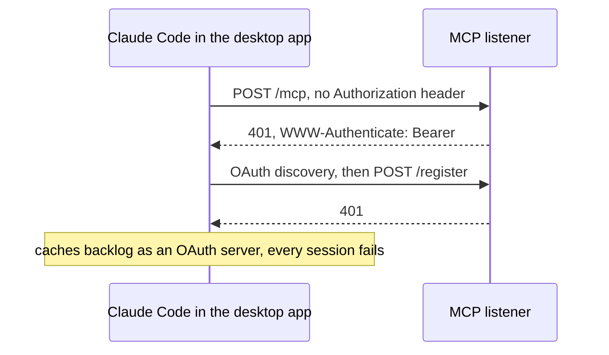
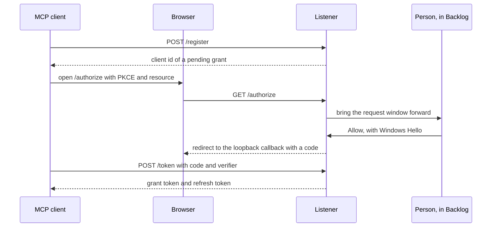

# ADR 0059: The loopback MCP listener can offer OAuth behind a switch

```meta
date: 2026-11-24
related: [".devbook/arc42/adr/0058-agents-and-devices-authenticate-by-grant-and-key-the-owner-by-github-sign-in.md", ".devbook/arc42/adr/0012-backlog-is-an-mcp-server-inside-the-desktop-app.md", ".devbook/arc42/adr/0030-stored-credentials-go-through-the-os-protected-envelope.md", ".devbook/arc42/adr/guidelines/0013-authorization-zero-trust.md", ".devbook/design/settings-pages.md"]
c4: [backlog.desktop]
c4-touches: [claude]
```

A switch on the MCP server's Settings page, off by default, lets an MCP client sign
in to the loopback listener through OAuth 2.1. Registering creates only a pending
grant, the person allows it in Backlog's request window with Windows Hello, and the
client then holds the same 15-minute grant tokens the broker mints. Switched off,
the listener behaves exactly as ADR 0058 §3 describes.

## Status

```meta
```

Proposed, 2026-11-24, by a flow-spec run. **Not yet built.** It awaits acceptance at
the Personal Validation gate of that run's pull request; the build then goes through
flow-code as one entry.

A **local** decision, numbered in the local sequence. Every bare ADR number below
means the local one; an inherited one is named "guideline".

It amends ADR 0058 in three places:

- §3: a local agent may hold its grant through OAuth, not only through the broker (§2, §4).
- §8: OAuth is no longer only on the sync service. The sync service's one static
  client is unchanged (§2).
- Its Rejected entry "Dynamic client registration for the connector": the rejection
  stands for the sync service. On loopback registration is allowed, because it
  creates only a pending grant the person must allow (§2, §3).

## Context

```meta
```

**No session in the Claude desktop app can reach Backlog under ADR 0058 §3.** On
2026-11-23, Claude Code 2.1.293 inside the Claude desktop app (its Code tab) connected
the `backlog` server from `.mcp.json` without running its `headersHelper`. The sequence
observed:



The client reported `Dynamic Client Registration rejected (HTTP 401)`. The same
configuration through the Claude CLI runs the helper, gets a broker grant token, and
connects. The helper is the only way a token reaches the listener today, so a client
that skips it gets nothing.

**The MCP authorization specification expects an OAuth server.** Authorization is
optional in MCP, but an HTTP server that requires it should conform to the 2025-06-18
revision (<https://modelcontextprotocol.io/specification/2025-06-18/basic/authorization>).
That revision requires:

| Requirement | Level | Standard |
| --- | --- | --- |
| Protected-resource metadata, named in the 401's `WWW-Authenticate` | MUST | RFC 9728 |
| Authorization server metadata | MUST | RFC 8414 |
| Dynamic client registration | SHOULD | RFC 7591 |
| PKCE on the authorization code | MUST, on the client | OAuth 2.1 draft 13 §7.5.2 |
| A `resource` parameter, and tokens checked for their audience | MUST | RFC 8707 |
| Refresh tokens rotated for a public client | MUST | OAuth 2.1 draft 13 §4.3.1 |
| Every authorization server endpoint over HTTPS | MUST | OAuth 2.1 draft 13 §1.5 |

Later revisions add client metadata documents as an alternative to registration. This
record has not checked that Claude Code 2.1.293 supports them, so it relies on RFC 7591.

## Decision

```meta
```

**The listener offers OAuth only while the person has switched it on, and OAuth adds a
way to get a grant, not a new kind of credential.** Six decisions follow.

### 1. A switch on the MCP server page, off by default

```meta
```

The MCP server's Settings page gains a card titled **OAuth sign-in**, with one switch,
**Let MCP clients sign in**. The card follows `.devbook/design/settings-pages.md`.

- **Off**, the listener is what it is today. It accepts the broker's grant tokens only,
  answers a tokenless request with a bare `401`, publishes no metadata and refuses
  registration.
- **Switching it on asks for Windows Hello**, because it opens a new way in.
  Switching it off asks nothing.

### 2. Switched on, the listener is also a loopback authorization server

```meta
```

The listener serves the authorization server on its own `127.0.0.1` origin. It stays
bound to loopback, and the `Origin` check of ADR 0012 §1 still guards every route.

| Route | Standard | What it does |
| --- | --- | --- |
| `/.well-known/oauth-protected-resource` | RFC 9728 | Names this origin as the authorization server; the 401's `resource_metadata` points here |
| `/.well-known/oauth-authorization-server` | RFC 8414 | Lists the routes below, code flow and S256 only |
| `/register` | RFC 7591 | Creates a pending grant and returns its client id |
| `/authorize` | OAuth 2.1 | Opens the request window (§3) and redirects with a code after Allow |
| `/token` | OAuth 2.1 | Trades a code or a refresh token for a grant token (§4) |

- **Only loopback redirect URIs register:** `http://localhost:<port>/…` or
  `http://127.0.0.1:<port>/…`, any port. Any other redirect URI is refused.
- **Only the authorization code grant with PKCE S256.** No implicit, password or
  client-credentials grant, and no `plain` challenge.
- **The `resource` must be this listener's own `/mcp` URI** (RFC 8707). Any other
  resource is refused, and no token passes through to anything else.
- **Registering grants nothing.** It creates a pending grant exactly as
  `headersHelper --register` does (ADR 0058 §5), under the same limits: one pending
  request per name, five open at once, and a day's wait after a decline.

The authorization server runs over plain HTTP on loopback, which departs from OAuth
2.1 §1.5's HTTPS requirement. The listener has never had a certificate, and nothing
leaves the machine. Whether Claude Code accepts an `http://127.0.0.1` authorization
server is **unverified**; the build must prove it before this record is accepted.

### 3. The person authorizes, in the desktop app

```meta
```



The authorize page in the browser only waits. The decision happens in Backlog's
request window, the one `--request` focuses. It shows the client's name, its redirect
host and the scopes it asked for.

- **The preselected scopes are the Backlog delivery grant's:** `tasks:read`,
  `tasks:write`, `runs:write`, `devbook:read`, `devbook:write`, `notify:ask` and
  `ui:open`. The person can untick any of them.
- **Never offered:** `tasks:admin`, `agents:grant`, `sessions:dispatch` and
  `devbook:decide`. A request for one of them is cut to what may be offered.
- **Allow asks for Windows Hello,** as allowing a pending grant does (ADR 0058 §5).
  Decline answers the browser with `access_denied`, and the decline limit applies.

### 4. The tokens are the grant's tokens

```meta
```

**The access token is the broker's 15-minute JWT for that grant,** with audience
`backlog-mcp-local`. Scopes, the grant version check, the audit and Revoke therefore
work unchanged. The listener names its `/mcp` URI as the resource in its metadata and
maps it to that audience.

**The token endpoint also issues a refresh token,** because an OAuth client has no
broker to ask again. The refresh token:

- is opaque, single-use and rotated on every use;
- is stored by Backlog only as a hash;
- expires after 7 days without use, the window of a delegated grant (ADR 0058 §5);
- dies with the grant's Revoke or with any scope edit, because both raise the grant's version.

This puts a long-lived secret in the client's own store. Claude Code keeps it in
`~/.claude/.credentials.json`. That is the cost ADR 0058 Phase 1 removed ("no
long-lived MCP secret stays in a file"), and it is why the switch is off by default.

### 5. Switching off closes the door at once

```meta
```

Switching off refuses registration, authorization and refresh in the same moment.
Grants made through OAuth stay on the Agents card, marked as signed in through OAuth,
until the person revokes them. Their access tokens lapse within 15 minutes, and none
can be refreshed.

### 6. The web harness keeps no auth

```meta
```

The Aspire web harness keeps no grant, broker or step-up (ADR 0058 §9), whatever the
switch says. It offers no OAuth routes.

## Consequences

```meta
```

- **A new door, guarded by the person.** Any local process can register while the
  switch is on. It gets a pending grant and nothing more until the person allows it
  with Windows Hello, which a script cannot pass.
- **Refresh tokens sit on disk** in each signed-in client's store, for up to 7 days
  idle. Revoking the grant kills them, and the audit names the grant.
- **The request window becomes the consent page** for OAuth clients. It must show the
  redirect host, and the browser tab must say where the decision is made.
- **Desktop-app sessions reach Backlog again** once the person switches it on and
  allows the client once per registration.
- **Tests are needed** for the off state, registration limits, redirect and resource
  checks, PKCE, refresh rotation and reuse, and Revoke cutting a refresh token.
- **It lands as one flow-code entry** after this record is accepted.

## Rejected

```meta
```

- **Asking the Claude desktop app to run `headersHelper`.** It is not ours to change.
  It is to be reported to Anthropic. If it is fixed, the person can leave the switch off.
- **Static clients only, no dynamic registration.** Claude Code registers itself
  dynamically. A static client id would have to be copied into each client's
  configuration, which is what grants already avoid.
- **OAuth always on.** It would put a refresh token on disk for every client, against
  ADR 0058 Phase 1, for people who use only the CLI.
- **No refresh token, re-authorizing every 15 minutes.** That is a Windows Hello
  prompt every 15 minutes in every session.
- **A static bearer token for the desktop app.** It is the retired shared token
  again (ADR 0058 §3).

## History

```meta
```

| Date | Change | Why |
| --- | --- | --- |
| 2026-11-24 | Proposed: a switch, off by default, makes the loopback listener an OAuth 2.1 authorization server whose registration creates a pending grant the person allows with Windows Hello, issuing the grant's tokens and a rotated refresh token. Amends ADR 0058 §3, §8 and its Rejected entry on dynamic client registration. | Claude Code in the Claude desktop app skips the `headersHelper` and tries OAuth, so no desktop-app session could reach Backlog. |
