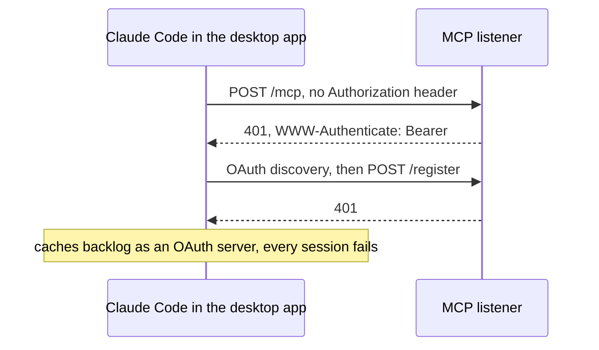

# ADR 0059: Tokenless MCP calls get the scopes the person opens to them

```meta
date: 2026-11-24
related: [".devbook/arc42/adr/0058-agents-and-devices-authenticate-by-grant-and-key-the-owner-by-github-sign-in.md", ".devbook/arc42/adr/0012-backlog-is-an-mcp-server-inside-the-desktop-app.md", ".devbook/arc42/adr/guidelines/0013-authorization-zero-trust.md", ".devbook/design/settings-pages.md"]
c4: [backlog.desktop]
c4-touches: [claude]
```

The Agents card gains a built-in **Unauthenticated** row. Its scopes are what a call
to the loopback listener with no token gets. It starts with none, so a fresh install
behaves exactly as ADR 0058 §3 describes, and widening it asks for Windows Hello. A
call that carries a grant token is judged by that grant alone, as before.

## Status

```meta
```

Proposed, 2026-11-24, by a flow-spec run. **Not yet built.** It awaits acceptance at
the Personal Validation gate of that run's pull request; the build then goes through
flow-code as one entry.

A **local** decision, numbered in the local sequence. Every bare ADR number below
means the local one; an inherited one is named "guideline".

It amends ADR 0058 in three places:

- §3: a local call with no grant token can be admitted, under the Unauthenticated
  row's scopes (§1, §3).
- §4: the fallback-deny scope policies gain the `unauthenticated` principal (§2, §3).
- §6: widening the Unauthenticated row joins the acts that ask for Windows Hello (§4).

## Context

```meta
```

**No session in the Claude desktop app can reach Backlog under ADR 0058 §3.** On
2026-11-23, Claude Code 2.1.293 inside the Claude desktop app (its Code tab) connected
the `backlog` server from `.mcp.json` without running its `headersHelper`. The sequence
observed:



The client reported `Dynamic Client Registration rejected (HTTP 401)`. The same
configuration through the Claude CLI runs the helper, gets a broker grant token, and
connects. The helper is the only way a token reaches the listener today, so a client
that skips it gets nothing.

A `401` is what sends the client into OAuth. The MCP authorization specification
(<https://modelcontextprotocol.io/specification/2025-06-18/basic/authorization>) tells
a client to discover an authorization server when a server answers `401`. A tokenless
call that the listener admits never starts that discovery.

## Decision

```meta
```

**The person chooses which scopes a call with no token may use, and a call with a
token keeps exactly its grant's scopes.** Five decisions follow.

### 1. A built-in Unauthenticated row on the Agents card

```meta
```

The Agents card on the MCP server's Settings page gains a row named
**Unauthenticated**, beside Backlog delivery, Question hook, Telemetry and Manager. Its
role line reads that it is what a call with no token gets. The card follows
`.devbook/design/settings-pages.md`.

- **Edit scopes** opens the same scope switches as every grant's.
- **No Revoke.** The row holds no token, so there is nothing to revoke. Switching
  every scope off closes it.
- **It starts with no scopes.** A fresh install, and an upgraded one, answers a
  tokenless call with a bare `401`, as ADR 0058 §3 does.

The unit is the scope, because the named policies of ADR 0058 §4 enforce scopes.

### 2. Six scopes are never offered to it

```meta
```

The row offers the rest of ADR 0058 §4's table, except `inbox:capture`, which no tool
on the desktop listener uses and the row therefore leaves out. These six are drawn
locked:

| Scope | Why never offered |
| --- | --- |
| `tasks:admin` | Deletes and bulk changes need a caller that answers for them. |
| `agents:grant` | A tokenless caller could grant itself, or anything, a real grant. |
| `sessions:dispatch` | It starts sessions that run code; the Manager grant alone holds it. |
| `devbook:decide` | No agent ever decides (ADR 0058 §7). |
| `telemetry:write` | The telemetry exporter keeps its own grant; others must not write its logs. |
| `ui:open` | Each pop-out link it mints buys a cookie that lives up to 8 idle hours (ADR 0043 §7); a tokenless caller must not hold one. |

The listener refuses these six to the `unauthenticated` principal even if a hand
edit of the grants file put them there.

### 3. How the listener decides, per request

```meta
```

The `Origin` check of ADR 0012 §1 runs first, as now. Then:

| The request carries | The Unauthenticated row | The listener |
| --- | --- | --- |
| No `Authorization` header | holds scopes | Admits it as `unauthenticated` with those scopes |
| No `Authorization` header | holds none | Answers a bare `401`, as today |
| A token that is invalid, expired or below its grant's version | either | Answers `401`, as today, so `headersHelper` mints again |
| A valid grant token | either | Applies that grant's scopes only |

- **An admitted tokenless call sees only what its scopes reach.** `tools/list` leaves
  out every other tool. A call to one of them answers `403 insufficient_scope`, never
  a `401`, so the client does not fall back to OAuth.
- **A bad token is never downgraded** to the unauthenticated scopes. It stays a `401`.
- **A valid grant gets nothing added.** The unauthenticated scopes are not merged into
  any grant's.

### 4. Widening asks for Windows Hello

```meta
```

Switching any scope on in the Unauthenticated row asks for Windows Hello first,
through the same `IUserConsent` as ADR 0058 §6. A cancelled or unavailable prompt
leaves the row as it was. Switching a scope off asks nothing.

### 5. Every other guard holds

```meta
```

- **The listener stays bound to loopback,** and the `Origin` check still refuses a web
  page's call (ADR 0012 §1).
- **The audit names every tokenless call** as `unauthenticated`, with tool, target id,
  outcome and correlation id, as for a grant (ADR 0058 §3).
- **The rate limit on failed bearer attempts stays** (ADR 0058, Phase 0).
- **The web harness keeps no auth** (ADR 0058 §9). It shows no Unauthenticated row.

## Consequences

```meta
```

- **Any process on this machine can call the opened scopes without a token.** That
  includes another Windows user's processes. The broker pipe admits only the
  person's SID, but loopback TCP admits every local user. This is why the row starts
  empty and widening asks for Windows Hello.
- **The audit cannot name a tokenless caller** beyond `unauthenticated`.
- **Desktop-app sessions reach Backlog with exactly the opened scopes.** The Claude
  CLI, which runs the helper, keeps its grant and its grant's scopes.
- **Tests are needed** for the four request cases of §3, `tools/list` filtering, the
  six never-offered scopes, and Windows Hello on widening.
- **It lands as one flow-code entry** after this record is accepted.

## Rejected

```meta
```

- **An OAuth switch on the listener.** This record's first draft, replaced on
  2026-11-24 at Personal Validation. It made the listener a loopback OAuth server with
  dynamic registration. It put refresh tokens on disk, departed from OAuth 2.1 by
  running over plain HTTP, and added far more surface than the problem needs.
- **Choosing per tool instead of per scope.** The policies enforce scopes. A per-tool
  list would be a second authorization model.
- **Downgrading a bad token to the unauthenticated scopes.** `headersHelper` would no
  longer see a `401` to mint again on, and an expired grant would pass unnoticed.
- **Opening every tool to tokenless calls.** That is the retired shared token without
  even the token (ADR 0058 §3).
- **Asking the Claude desktop app to run `headersHelper`.** It is not ours to change.
  It is to be reported to Anthropic. If it is fixed, the person can switch the row's
  scopes off.

## History

```meta
```

| Date | Change | Why |
| --- | --- | --- |
| 2026-11-24 | Proposed: a built-in Unauthenticated row on the Agents card, empty by default and widened only with Windows Hello, gives tokenless loopback calls the scopes the person opens; a bad token stays a `401` and a grant token keeps its own scopes. Amends ADR 0058 §3, §4 and §6. It replaced this record's OAuth draft at Personal Validation. | Claude Code in the Claude desktop app skips the `headersHelper` and falls back to OAuth after a `401`, so no desktop-app session could reach Backlog. |
