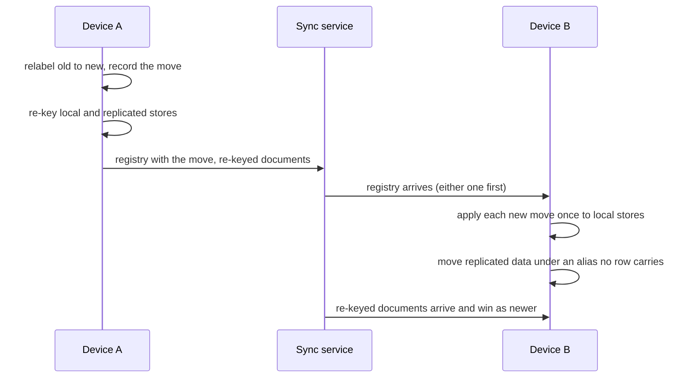

# ADR 0060: A renamed repository takes its new name as its alias, and what is keyed by the alias follows it

```meta
date: 2026-11-24
related: [".devbook/domain/repository-management/features.md#following-a-repository-rename", ".devbook/domain/repository-management/domain.md#repository-alias", ".devbook/domain/repository-management/domain.md#rename-record", ".devbook/arc42/adr/0021-github-accounts-and-repository-registry-ride-the-task-feed.md", ".devbook/arc42/adr/0018-roadmap-plan-and-pace-ride-the-task-feed.md", ".devbook/arc42/adr/0044-devbook-subject-state-lives-in-backlogs-own-store.md", ".devbook/arc42/adr/0011-devbook-annotations-are-a-third-replica-container.md", ".devbook/arc42/adr/0039-notifications-are-an-owned-document-kind-and-push-only-nudges.md"]
c4: [backlog.desktop.persistence]
c4-touches: [backlog.desktop.roadmap, backlog.desktop.devbook, backlog.desktop.sessions, backlog.desktop.notifications, backlog.desktop.shell, backlog.mobile, backlog.cloud]
```

A rename relabels the repository when its alias is still its old name, and every
relabel leaves an **alias move** in the registry. The device that makes the edit
re-keys the replicated stores. Every device re-keys its own local stores from the
moves, and an old alias still written anywhere resolves through them.

## Status

```meta
```

Proposed, 2026-11-24. Not yet built.

A **local** decision, numbered in the local sequence. Every bare ADR number below
means the local one.

It reverses the line in `GitHubSettingsStore.RenameRepository` that discards the alias
a new name derives, and the line in `GitHubSettings.UniqueAlias` that an existing alias
is never renamed. A repository's own rename is not "making room" for another one, so
`UniqueAlias` still never takes an alias from a different repository.

## Context

```meta
```

**A rename keeps the alias, so a renamed repository answers to its old name.** On
2026-11-24 the person renamed `JSdotNet/Project-Guidelines-MCP` to
`JSdotNet/app-defaults`. The list still shows `project-guidelines-mcp =
JSdotNet/app-defaults`, and the repository still answers to `@project-guidelines-mcp`.
The person wants a rename to move everything to the new name.

Entries and inbox items already follow a rename, because they store the repository's
id. A `RepositoryRename` record in the registry resolves an old id on a device that
has not caught up, and a reconcile pass at start re-points what is left
([Following a repository rename](../../domain/repository-management/features.md#following-a-repository-rename)).
Nothing like that exists for the alias. A relabel today leaves every alias-keyed
store behind under a label no row carries.

The registry is one whole document on the task feed (ADR 0021). The alias-keyed
stores travel as other documents, or not at all. A second device therefore receives
the relabelled registry and the re-keyed stores in no fixed order.

### What an alias keys today

```meta
```

| Store | What holds the alias | Travels | How it follows |
| --- | --- | --- | --- |
| Roadmap plan (`RoadmapPlanDocument`) | `BandColours` keys; item and milestone Repository Scope lists | Replicated, whole document (ADR 0018) | Re-keyed by the editing device |
| Planning pace (`PlanningVelocitySettingsStore`) | `repositories` keys | Replicated, whole document (ADR 0018) | Re-keyed by the editing device |
| Devbook subject state (`DevbookSubjectStateStore`) | File per alias; document id `DevbookSubject.IdFor(alias, subject)` | Replicated (ADR 0044) | Re-keyed by the editing device: a new document under the new id, the old one tombstoned |
| Devbook annotations (`DevbookAnnotationStore`) | File per alias | Replicated (ADR 0011) | Re-keyed by the editing device |
| Session records (`SessionDocument`) | `RepositoryAlias` | Replicated | Resolved at read: a record of what happened |
| Notifications | `PublishedRepository(alias)`; remark links `backlog://devbook/<alias>/<path>` | Replicated (ADR 0039) | Resolved at read: a record of what happened |
| Shell navigation (`ShellNavigationStore`) | Header scope; `LastSurface` `repo:`/`ghost:<alias>` | Local | Re-keyed on each device |
| Devbook import ledger (`DevbookImportLedger`) | `imported.json` keys | Local | Re-keyed on each device |
| Workspace settings (`WorkspaceSettingsStore`) | `RootRepository` alias copy | Local | Re-keyed on each device |
| Phone notification filter | `notifications.filter.repository` preference | Local, phone | Re-keyed on the phone |
| Brain links, plan `Repositories` lists | `repo:<alias>/<path>`, the aliases as typed | Person-authored text | Never rewritten; resolved at read |

Entries, inbox items, inbox routing rules and impediments store the id, and need
nothing new.

## Decision

```meta
```

**The registry records each alias move, as it already records each id move.** Five
decisions follow.

### 1. When a rename relabels

```meta
```

A rename that is not a merge relabels the repository when its alias equals
`GitHubRepositoryRef.NormalizeAlias` of the old name. That is the alias a repository
registered without one of its own was given. The new alias is
`UniqueAlias(NormalizeAlias(new name), repository)`, so it falls back to the
`owner-name` form, then a counter, only when a different repository holds the new name.

- **A custom alias stays.** Anything else the person chose is theirs.
- **A change of owner alone, or of case alone, relabels nothing,** because the
  normalized name does not change.
- **A merge always moves the alias.** The renamed row goes, so its alias moves to the
  kept row's alias, custom or not. Where both carry data under one key, the kept
  row's wins, as its settings do.

### 2. The alias move

```meta
```

The registry gains `AliasMoves` beside `Renames`: the old alias, the new alias, the
repository's id, and when. One edit writes its moves with one time, and a device
applies them together. That is what keeps an alias swap, two moves at once, from
running into itself.

`GitHubSettings.Find` resolves an alias no row carries through the moves, the latest
first, bounded by their count as `RenamedTo` is. A configured row always wins over a
move, as it does over a Rename Record.

### 3. How the stores follow

```meta
```



- **Replicated stores are re-keyed once, by the device that made the edit,** and
  pushed. The newer document wins on every other device by the store's existing
  merge rule. The devbook subject merge accepts the moved state, because its new id
  is `IdFor` of its new alias.
- **Local stores are re-keyed on each device,** because no other device can reach
  them. Each device keeps the time of the last move it applied, and applies every
  later one once, in order.
- **A backstop runs at start and when a registry arrives.** Replicated data under an
  alias no row carries, which a move resolves to a row, moves to that row's alias.
  It only ever acts on an orphaned alias, so running it twice changes nothing. It
  catches a write a device made under the old alias before it saw the move.
- **Person-authored text and records of what happened are never rewritten.** A Brain
  link, a plan's `Repositories` list, a session record and a notification keep the
  alias as written, and resolve it through the moves.

### 4. A manual relabel takes the same path

```meta
```

Changing the alias in the list records a move and follows it, exactly as a rename's
relabel does. An alias swap records two moves in one edit.

### 5. The rename already made is relabelled once

```meta
```

At start, a row is relabelled when a Rename Record leads to it, its alias still
equals the normalized old name, and no alias move names that alias. The move it
records is what keeps it from running twice. It is how
`project-guidelines-mcp` becomes `app-defaults`.

## Consequences

```meta
```

- **A relabel no longer orphans anything.** The roadmap bands, the pace, devbook
  states, remarks and the shell's last place follow the repository.
- **Until the registry arrives, a device may show re-keyed data under no repository,**
  or after a swap under the other one. It corrects itself when the registry lands.
- **A swap is not fully covered.** A write a lagging device makes under a swapped alias
  lands on the repository that holds the alias now, because the backstop leaves an
  alias a row carries alone.
- **A person who kept the old name as the alias on purpose loses it** to §5, once. The
  pass cannot tell that choice from the default. They relabel back, and nothing fires
  again.
- **The moves are kept indefinitely,** as Rename Records are. Pruning is open.
- **Each alias-keyed store gains one re-key operation,** and the registry one list and
  one cursor per device. Tests are needed for the trigger rule of §1, both arrival
  orders, a swap, a merge, and §5 firing once.

## Rejected

```meta
```

- **(a) Rewrite every store at rename time, and nothing more.** It reaches only this
  device's local stores. Another device's shell, import ledger, root repository and
  phone filter stay on the old alias for good. A write a lagging device makes under
  the old alias after the rewrite is orphaned.
- **(c) Key every store by the repository's id, so the alias is only a label.** It
  would end the problem, but it migrates every store and every device. Every devbook
  subject id changes, because `IdFor` hashes the alias. Roadmap Repository Scope is
  defined as alias strings. Person-authored text still names aliases, so a resolver
  for old aliases is needed anyway.
- **Relabel every alias on a rename, custom ones too.** The person decided a custom
  alias stays.
- **Leave a manual relabel as it is.** It would orphan the same data a rename's
  relabel now carries.

## History

```meta
```

| Date | Change | Why |
| --- | --- | --- |
| 2026-11-24 | Proposed: a rename relabels an alias that is still the old name; the registry records alias moves; the editing device re-keys replicated stores, each device its local ones, and an old alias resolves at read. | A renamed repository kept answering to its old name, and a relabel orphaned everything keyed by the alias. |
